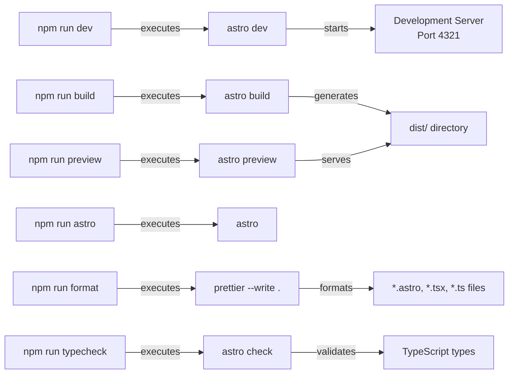
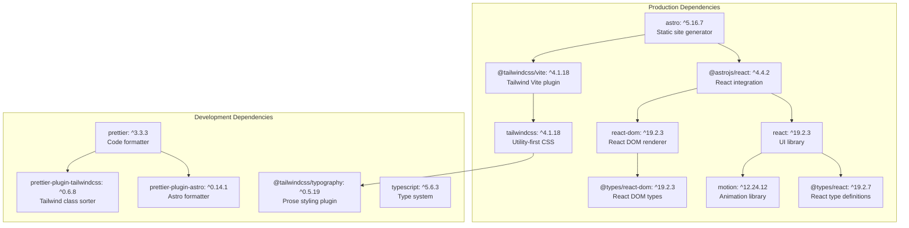
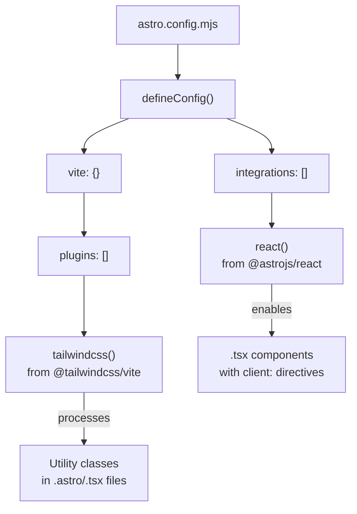
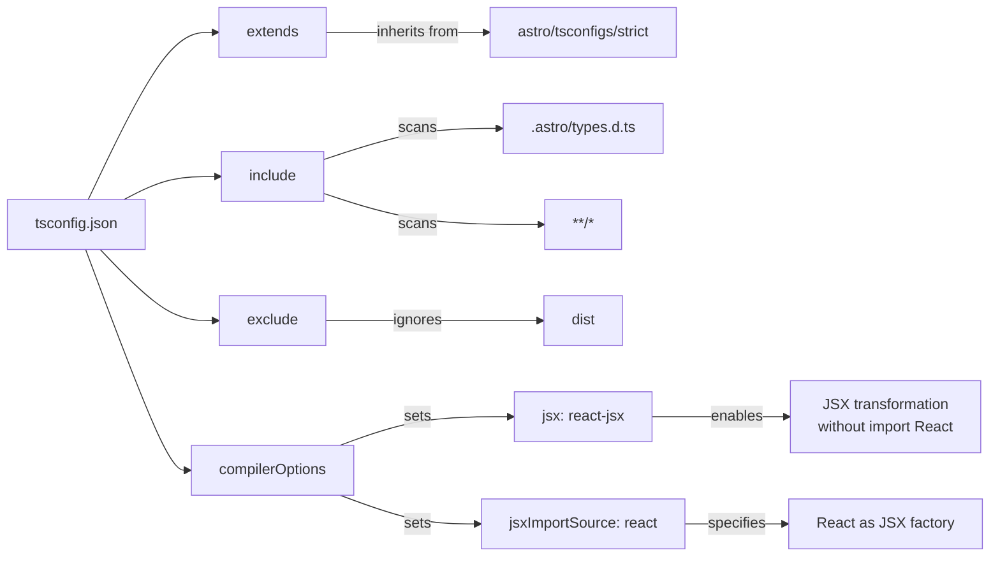
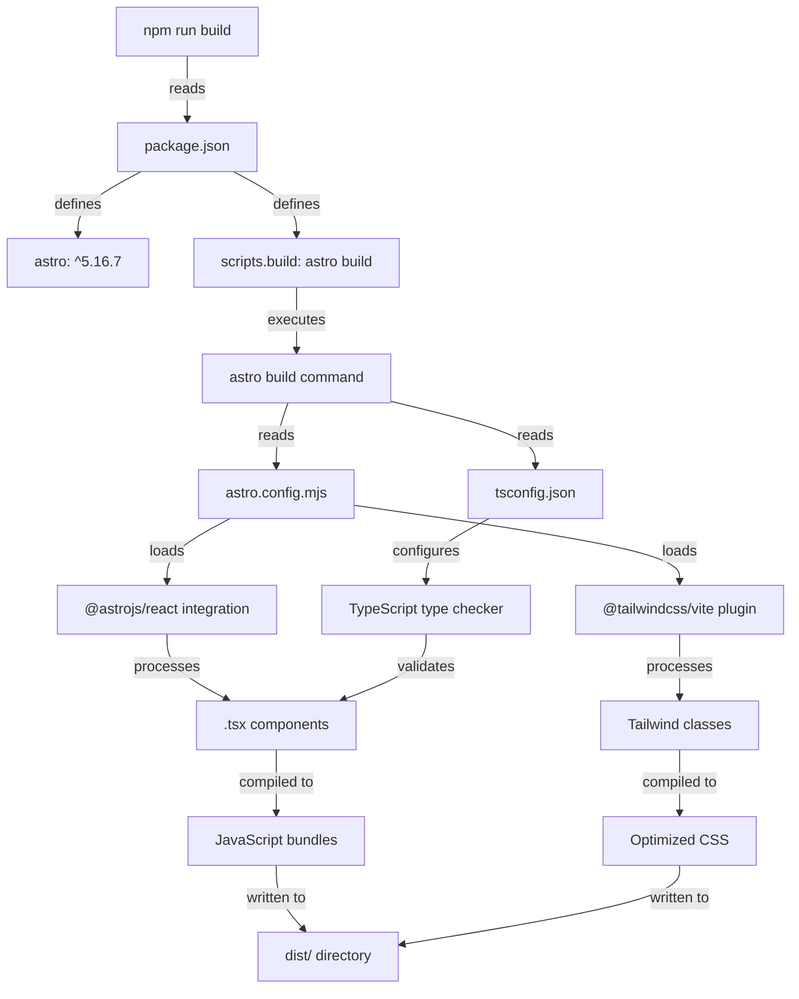

<!-- source: DeepWiki mcp.deepwiki.com · repo ibelick/ui-skills · page 6.1 Project Configuration · fetched 2026-10-26 -->

# Project Configuration

Relevant source files

The following files were used as context for generating this wiki page:

- [astro.config.mjs](astro.config.mjs)
- [package.json](package.json)
- [tsconfig.json](tsconfig.json)

This document details the core configuration files that define the ui-skills project structure, dependencies, build scripts, and tooling setup. It covers the package manifest, Astro framework configuration, and TypeScript compiler settings that establish the development and build environment.

For deployment-specific configuration including Cloudflare Workers setup, see [Deployment Configuration](#6.2). For development tooling like Prettier and VS Code settings, see [Development Tools](#6.3).

## Purpose and Scope

The project configuration encompasses three primary files:
- `package.json`: Defines dependencies, version constraints, and npm scripts
- `astro.config.mjs`: Configures the Astro framework, integrations, and Vite plugins
- `tsconfig.json`: Sets TypeScript compiler options and file inclusion rules

These files establish the foundational build toolchain that transforms source code into deployable static assets.

## Package Manifest

The [package.json:1-32]() file defines the project metadata, dependency graph, and executable scripts for the ui-skills project.

### Project Metadata

| Field | Value | Purpose |
|-------|-------|---------|
| `name` | `"ui-skills"` | Package identifier |
| `type` | `"module"` | Enables ES module syntax |
| `version` | `"0.0.1"` | Semantic version |
| `license` | `"MIT"` | Open source license |

The `"type": "module"` declaration [package.json:3]() ensures all `.js` files are treated as ES modules, enabling `import`/`export` syntax throughout the codebase.

### npm Scripts

The project defines six npm scripts for development and maintenance workflows:

**Script Definitions**: [package.json:6-12]()

| Script | Command | Purpose |
|--------|---------|---------|
| `dev` | `astro dev` | Starts development server with hot module reloading |
| `build` | `astro build` | Produces optimized static assets in `dist/` |
| `preview` | `astro preview` | Serves the built `dist/` directory locally |
| `astro` | `astro` | Direct access to Astro CLI for advanced commands |
| `format` | `prettier --write .` | Auto-formats all files using Prettier |
| `typecheck` | `astro check` | Runs TypeScript type checking without building |

Sources: [package.json:6-12]()

### Dependency Graph

The project uses a two-tier dependency structure: production dependencies for runtime functionality and development dependencies for build-time tooling.

**Production Dependencies**: [package.json:14-23]()

- **`astro`**: Framework orchestrating the build process, SSG capabilities, and island architecture
- **`@astrojs/react`**: Integration enabling React components within Astro pages
- **`react` / `react-dom`**: Core React library and DOM rendering engine
- **`@types/react` / `@types/react-dom`**: TypeScript type definitions for React APIs
- **`@tailwindcss/vite` / `tailwindcss`**: CSS framework integrated via Vite plugin
- **`motion`**: Animation library (formerly Framer Motion) for declarative animations

**Development Dependencies**: [package.json:25-31]()

- **`@tailwindcss/typography`**: Provides prose class utilities for rich text formatting
- **`prettier`**: Opinionated code formatter ensuring consistent style
- **`prettier-plugin-astro`**: Prettier integration for `.astro` file formatting
- **`prettier-plugin-tailwindcss`**: Automatically sorts Tailwind class names
- **`typescript`**: Type system compiler for static type checking

Sources: [package.json:14-31]()

## Astro Framework Configuration

The [astro.config.mjs:1-11]() file configures Astro's build behavior and integrations using ES module syntax.

### Configuration Structure

### Integration Configuration

**React Integration**: [astro.config.mjs:7]()

The `react()` integration imported from `@astrojs/react` [astro.config.mjs:2]() enables React component usage within Astro pages. This integration:
- Allows `.tsx` files to be imported into `.astro` files
- Enables `client:*` directives for selective hydration (e.g., `client:load`)
- Provides React 19 compatibility with Astro's build system

**Vite Plugin Configuration**: [astro.config.mjs:8-10]()

The `vite.plugins` array contains the `tailwindcss()` plugin from `@tailwindcss/vite` [astro.config.mjs:3](). This plugin:
- Processes Tailwind utility classes during the Vite build
- Scans `.astro` and `.tsx` files for class names
- Generates optimized CSS containing only used utilities
- Integrates with Tailwind CSS 4's new Vite-native architecture

Sources: [astro.config.mjs:1-11]()

## TypeScript Configuration

The [tsconfig.json:1-14]() file configures the TypeScript compiler and type checking behavior for the project.

### Compiler Options Mapping

### Configuration Details

**Base Configuration**: [tsconfig.json:2]()

The `"extends": "astro/tsconfigs/strict"` declaration inherits Astro's strict TypeScript configuration, which includes:
- Strict type checking enabled
- No implicit any types
- Strict null checks
- Unused variable warnings

**File Inclusion**: [tsconfig.json:3-6]()

The `include` array specifies which files TypeScript should analyze:
- `".astro/types.d.ts"`: Auto-generated Astro type definitions
- `"**/*"`: All files in the project directory

**File Exclusion**: [tsconfig.json:7-9]()

The `exclude` array prevents TypeScript from analyzing the `"dist"` directory, which contains compiled output that doesn't require type checking.

**Compiler Options**: [tsconfig.json:10-13]()

| Option | Value | Purpose |
|--------|-------|---------|
| `jsx` | `"react-jsx"` | Uses React 17+ automatic JSX transform |
| `jsxImportSource` | `"react"` | Specifies React as the JSX factory library |

The `"jsx": "react-jsx"` setting [tsconfig.json:11]() enables the modern JSX transform that doesn't require `import React from 'react'` at the top of every file containing JSX. The `"jsxImportSource": "react"` option [tsconfig.json:12]() explicitly declares React as the JSX runtime.

Sources: [tsconfig.json:1-14]()

## Configuration Integration Flow

The following diagram shows how the three configuration files interact during the build process:

During the build process:
1. `npm run build` reads the `build` script from [package.json:8]()
2. The script executes `astro build`, which reads [astro.config.mjs]() and [tsconfig.json]()
3. Astro loads the React integration and Tailwind Vite plugin from [astro.config.mjs:7,9]()
4. TypeScript validates types according to [tsconfig.json:10-13]()
5. React components are compiled and selectively hydrated
6. Tailwind utilities are processed and optimized
7. All output is written to the `dist/` directory

Sources: [package.json:1-32](), [astro.config.mjs:1-11](), [tsconfig.json:1-14]()

---

