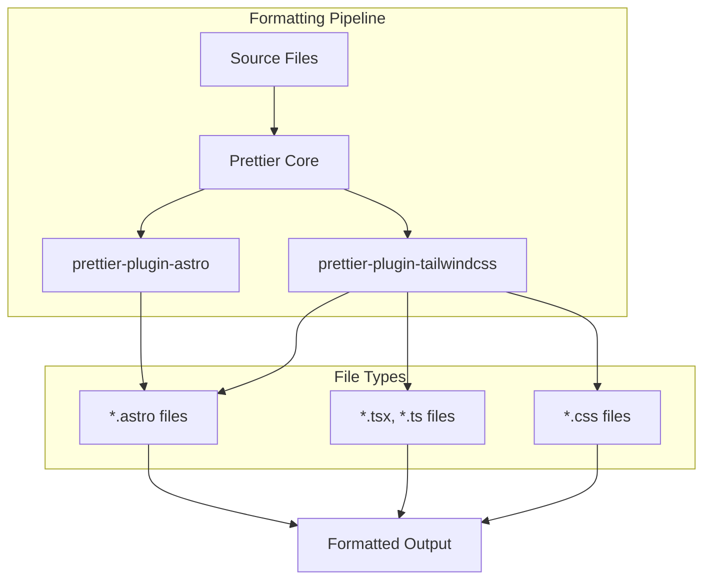
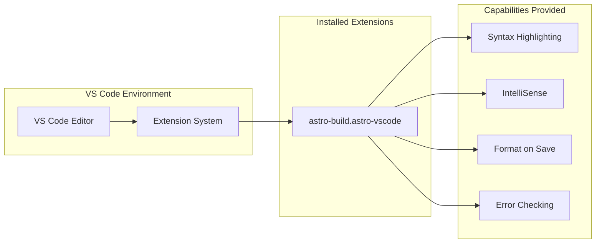
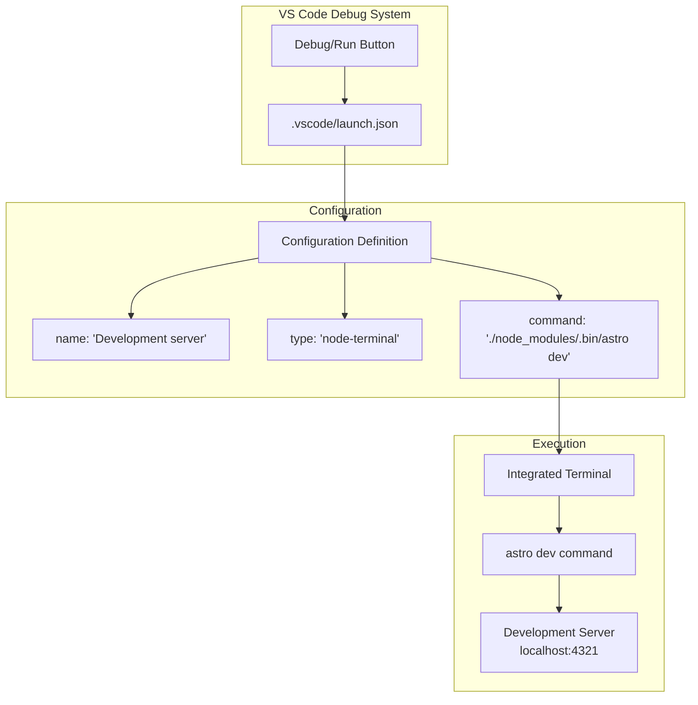
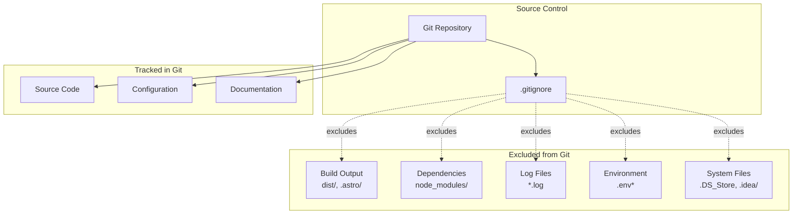
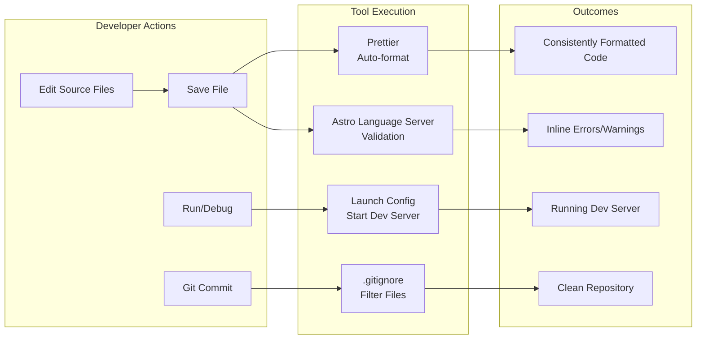

<!-- source: DeepWiki mcp.deepwiki.com · repo ibelick/ui-skills · page 6.3 Development Tools · fetched 2026-10-26 -->

# Development Tools

<details>
<summary>Relevant source files</summary>

The following files were used as context for generating this wiki page:

- [.gitignore](.gitignore)
- [.prettierrc.json](.prettierrc.json)
- [.vscode/extensions.json](.vscode/extensions.json)
- [.vscode/launch.json](.vscode/launch.json)

</details>


This document describes the development environment setup for the ui-skills repository, including code formatting with Prettier, VS Code integration, and version control configuration. For project dependencies and build configuration, see [Project Configuration](#6.1). For deployment tooling, see [Deployment Configuration](#6.2).

## Code Formatting with Prettier

The repository uses Prettier for automated code formatting with two specialized plugins to handle Astro and Tailwind CSS syntax.

### Configuration

The Prettier configuration is defined in [.prettierrc.json:1-11](). The setup includes:

| Configuration Item | Value | Purpose |
|-------------------|-------|---------|
| `prettier-plugin-astro` | Plugin | Formats `.astro` files with proper syntax awareness |
| `prettier-plugin-tailwindcss` | Plugin | Automatically sorts Tailwind CSS class names |
| Parser override | `astro` | Applied to all `*.astro` files |

### Plugin Integration



**Diagram: Prettier plugin architecture and file processing flow**

The Prettier configuration uses a plugin-based architecture where specialized plugins extend Prettier's formatting capabilities. The `prettier-plugin-astro` plugin handles the unique syntax of Astro component files, while `prettier-plugin-tailwindcss` ensures consistent ordering of Tailwind utility classes across all file types that contain them.

**Sources:** [.prettierrc.json:1-11]()

### Parser Override Mechanism

The configuration includes an explicit parser override at [.prettierrc.json:3-9]():

```json
"overrides": [
  {
    "files": "*.astro",
    "options": {
      "parser": "astro"
    }
  }
]
```

This override ensures that any file with the `.astro` extension is processed using the Astro-specific parser provided by `prettier-plugin-astro`, enabling proper formatting of the mixed HTML, JavaScript, and component syntax used in Astro files.

**Sources:** [.prettierrc.json:3-9]()

## VS Code Integration

The repository includes VS Code-specific configuration to standardize the development environment across team members.

### Recommended Extensions



**Diagram: VS Code extension integration and provided capabilities**

The extensions configuration at [.vscode/extensions.json:1-4]() specifies:

| Field | Value | Purpose |
|-------|-------|---------|
| `recommendations` | `["astro-build.astro-vscode"]` | Prompts developers to install official Astro extension |
| `unwantedRecommendations` | `[]` | No extensions are explicitly excluded |

When a developer opens this repository in VS Code, the editor will prompt them to install the `astro-build.astro-vscode` extension if it's not already installed. This extension provides language support for `.astro` files including syntax highlighting, IntelliSense, and integration with the Astro language server.

**Sources:** [.vscode/extensions.json:1-4]()

### Debug and Launch Configuration

The launch configuration at [.vscode/launch.json:1-11]() defines a single debug target for running the development server:



**Diagram: VS Code launch configuration execution flow**

The configuration parameters are:

| Parameter | Value | Purpose |
|-----------|-------|---------|
| `name` | `"Development server"` | Display name in VS Code's debug dropdown |
| `request` | `"launch"` | Launches a new process rather than attaching to existing |
| `type` | `"node-terminal"` | Runs command in VS Code's integrated terminal |
| `command` | `"./node_modules/.bin/astro dev"` | Executes local Astro CLI to start dev server |

This allows developers to start the development server directly from VS Code's Run and Debug panel (F5) or by clicking the "Development server" configuration in the debug dropdown. The `node-terminal` type ensures the command runs in an integrated terminal, providing full console output and the ability to interact with the process.

**Sources:** [.vscode/launch.json:1-11]()

## Version Control Configuration

The `.gitignore` file defines patterns for files and directories that should not be tracked by Git.

### Ignored Categories



**Diagram: Git repository structure with ignored paths**

The ignored patterns at [.gitignore:1-24]() are organized into categories:

| Category | Patterns | Rationale |
|----------|----------|-----------|
| Build Output | `dist/`, `.astro/` | Generated during build; reproducible from source |
| Dependencies | `node_modules/` | Installed via `package.json`; large and reproducible |
| Log Files | `*-debug.log*`, `pnpm-debug.log*` | Runtime artifacts; not part of source code |
| Environment Variables | `.env`, `.env.production` | May contain secrets; should not be committed |
| System Files | `.DS_Store`, `.idea/` | OS-specific or IDE-specific; not project files |

### Build Output Exclusions

The patterns at [.gitignore:1-5]() exclude:

- `dist/` - The compiled output directory created by Astro's build process
- `.astro/` - Generated TypeScript types and development cache files

These directories are created during development (`astro dev`) and production builds (`astro build`) and should be regenerated from source rather than committed to version control.

**Sources:** [.gitignore:1-5]()

### Dependency Exclusions

The `node_modules/` directory at [.gitignore:7-8]() contains all installed npm packages. This directory is:

- Typically very large (hundreds of MB)
- Fully reproducible via `npm install` using `package.json` and `package-lock.json`
- Platform-specific in some cases (native modules compiled for specific OS/architecture)

Excluding it from version control keeps the repository lightweight and ensures each developer installs dependencies appropriate for their platform.

**Sources:** [.gitignore:7-8]()

### Log File Exclusions

Debug and error logs at [.gitignore:10-14]() are excluded because:

- They are generated at runtime and development time
- They contain session-specific information not useful to other developers
- They can grow large over time
- They are not part of the application's source code

**Sources:** [.gitignore:10-14]()

### Environment and System Files

Sensitive and system-specific files at [.gitignore:16-24]() include:

- `.env`, `.env.production` - May contain API keys, secrets, or environment-specific configuration
- `.DS_Store` - macOS Finder metadata files
- `.idea/` - JetBrains IDE (WebStorm, IntelliJ) configuration directory

These files are either security-sensitive or specific to individual development environments and should not be shared via version control.

**Sources:** [.gitignore:16-24]()

## Development Workflow

The development tools integrate to provide a cohesive workflow:



**Diagram: Integrated development tool workflow**

The tools work together to provide:

1. **Automatic Formatting** - Prettier formats code on save (when configured in VS Code)
2. **Real-time Validation** - Astro extension provides immediate feedback on syntax errors
3. **One-Click Server Start** - Launch configuration starts development server without manual commands
4. **Clean Version Control** - `.gitignore` ensures only source files are committed

**Sources:** [.prettierrc.json:1-11](), [.vscode/extensions.json:1-4](), [.vscode/launch.json:1-11](), [.gitignore:1-24]()

---

