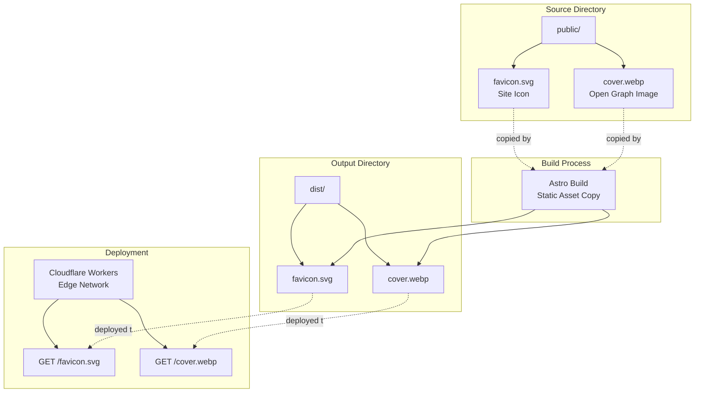
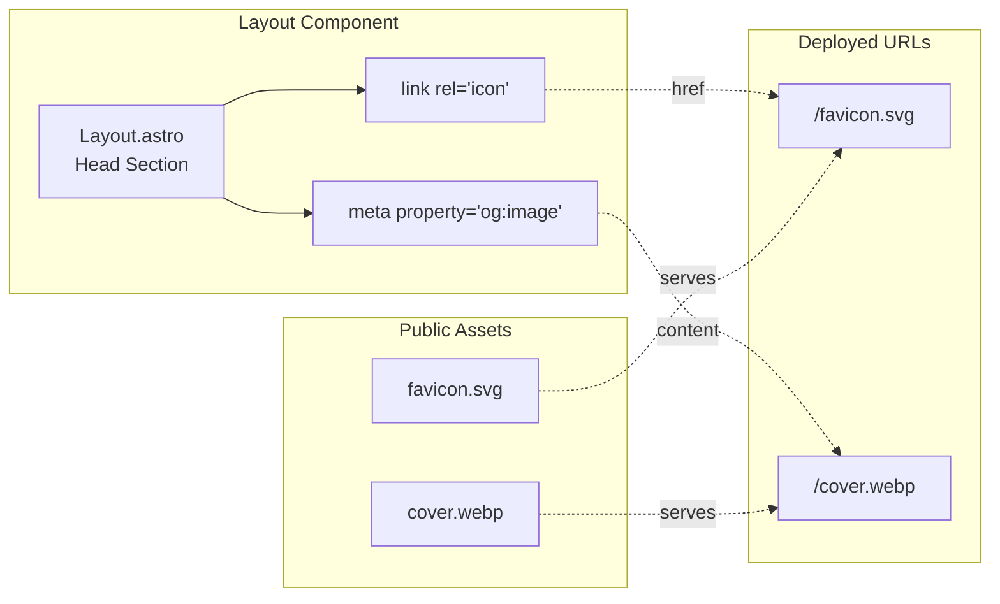
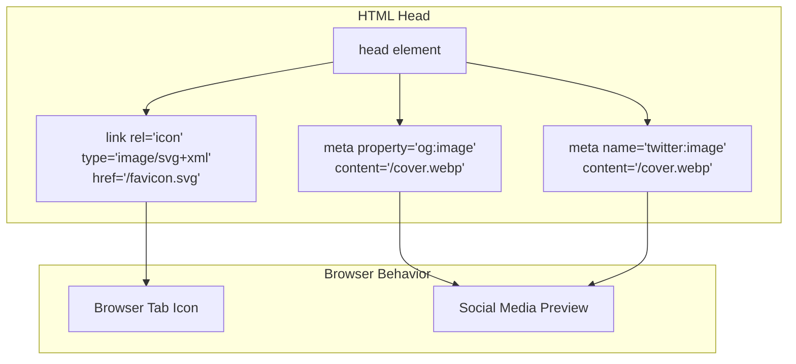
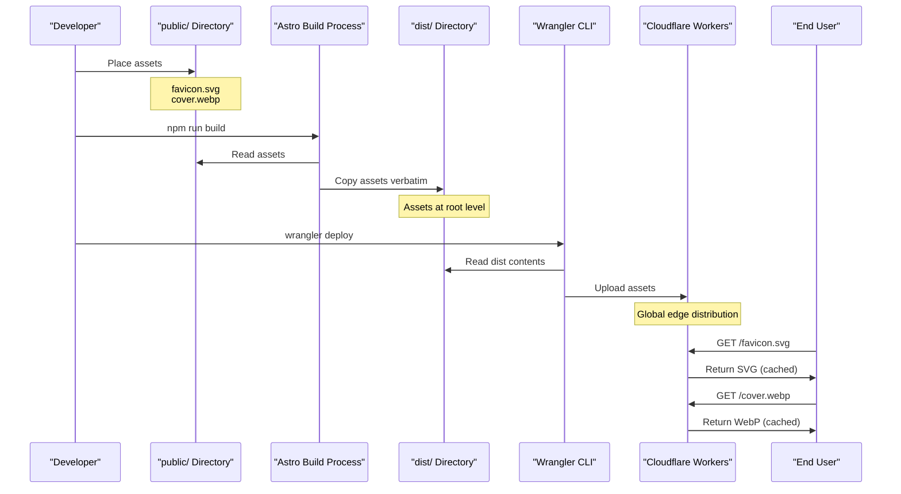

<!-- source: DeepWiki mcp.deepwiki.com · repo ibelick/ui-skills · page 7 Static Assets · fetched 2026-10-26 -->

# Static Assets

<details>
<summary>Relevant source files</summary>

The following files were used as context for generating this wiki page:

- [LICENSE](LICENSE)
- [public/cover.webp](public/cover.webp)
- [public/favicon.svg](public/favicon.svg)

</details>


This document describes the static assets in the ui-skills repository, including their locations, formats, purposes, and how they are processed during the build and deployment pipeline. Static assets are files that are served directly to clients without modification, such as images, icons, and license files.

For information about styling assets like CSS files, see [Styling System](#4.3). For build configuration details, see [Project Configuration](#6.1).

## Overview

The ui-skills project maintains a minimal set of static assets in the `/public` directory. These assets are automatically copied to the output directory during the build process and served directly by Cloudflare Workers at the edge. The project follows Astro's convention where files in the `public/` directory are served at the root path.

**Sources:** [public/favicon.svg:1-3](), [public/cover.webp:1]()

## Asset Directory Structure



**Asset Processing Pipeline**

**Sources:** Architecture diagrams, [public/favicon.svg:1-3](), [public/cover.webp:1]()

## Static Assets Catalog

### Favicon (favicon.svg)

The site icon is implemented as an SVG file, providing scalability and small file size.

**Specifications:**
- **File Path:** `public/favicon.svg`
- **Format:** SVG (Scalable Vector Graphics)
- **Dimensions:** 20×20 pixels viewBox
- **Design:** Simple rounded rectangle with light background
- **Color:** `#FAFAF6` (off-white/cream)
- **Border Radius:** 2px

**Technical Details:**

The favicon is a minimal SVG consisting of a single rounded rectangle element:

```svg
<svg width="20" height="20" viewBox="0 0 20 20" fill="none" xmlns="http://www.w3.org/2000/svg">
<rect width="20" height="20" rx="2" fill="#FAFAF6"/>
</svg>
```

This design choice provides:
- **Scalability:** Vector format ensures crisp rendering at any size
- **Minimal file size:** Only 124 bytes
- **Fast loading:** Instant rendering without HTTP request overhead when inlined
- **Accessibility:** Solid color provides clear visual distinction

**Sources:** [public/favicon.svg:1-3]()

### Cover Image (cover.webp)

The cover image serves as the Open Graph preview image when the site is shared on social media platforms.

**Specifications:**
- **File Path:** `public/cover.webp`
- **Format:** WebP (modern image format)
- **Purpose:** Social media preview/Open Graph image
- **File Size:** Approximately 11KB (compressed binary data)
- **Optimization:** WebP format chosen for superior compression

**Usage Context:**

The cover image is referenced in the Layout component's Open Graph meta tags, enabling rich previews when the site URL is shared on platforms like Twitter, LinkedIn, Discord, and Slack.

**Sources:** [public/cover.webp:1]()

## Asset References in Code



**Asset Reference Architecture**

**Sources:** [src/layouts/Layout.astro]() (referenced from architecture), [public/favicon.svg:1-3](), [public/cover.webp:1]()

## Asset Processing During Build

The static asset processing follows Astro's standard build pipeline:

| Build Phase | Action | Result |
|-------------|--------|--------|
| **Pre-build** | Assets exist in `public/` directory | Source files ready |
| **Build** | Astro copies files verbatim to `dist/` | No transformation |
| **Post-build** | `dist/` directory contains all assets | Ready for deployment |
| **Deploy** | Wrangler uploads to Cloudflare Workers | Assets served at edge |

**Key Characteristics:**
- **No processing:** Assets are copied as-is without minification or optimization
- **Root-level serving:** Files in `public/` are served from the root URL path
- **Cache-friendly:** Static assets benefit from Cloudflare's edge caching
- **Fast access:** Global CDN distribution ensures low-latency delivery

**Sources:** Architecture diagrams, [wrangler.jsonc]() (referenced)

## Asset Integration with Meta Tags

The favicon and cover image are integrated into the HTML document through the Layout component's `<head>` section:



**Meta Tag Integration Flow**

**Expected Meta Tag Implementation:**
- Favicon linked via `<link rel="icon" type="image/svg+xml" href="/favicon.svg">`
- Open Graph image via `<meta property="og:image" content="/cover.webp">`
- Twitter Card image via `<meta name="twitter:image" content="/cover.webp">`

**Sources:** Architecture diagrams describing Layout.astro

## License File

The repository includes a standard MIT License file at the root level.

**Specifications:**
- **File Path:** `LICENSE`
- **License Type:** MIT License
- **Copyright:** 2026 Julien Thibeaut
- **Purpose:** Defines usage rights and distribution terms

**Key Permissions:**
- Use, copy, modify, merge, publish, distribute
- Sublicense and sell copies
- Commercial use allowed
- Attribution required

The license applies to all source code and associated documentation files in the repository, but not necessarily to the content of `SKILL.md` which may be considered documentation under different terms.

**Sources:** [LICENSE:1-21]()

## Asset Deployment Flow



**Static Asset Deployment Sequence**

**Sources:** Architecture diagrams, [wrangler.jsonc]() (referenced), [package.json]() (referenced)

## Performance Characteristics

The static assets in this project are optimized for performance:

| Asset | Size | Format | Caching | Load Time |
|-------|------|--------|---------|-----------|
| `favicon.svg` | ~124 bytes | SVG (text) | Aggressive edge caching | <5ms |
| `cover.webp` | ~11KB | WebP (binary) | Aggressive edge caching | <50ms |

**Optimization Strategies:**
1. **Format Selection:** SVG for favicon (scalable, tiny), WebP for cover (superior compression)
2. **Edge Caching:** Cloudflare Workers cache assets globally
3. **No Build Processing:** Direct copy avoids build-time overhead
4. **CDN Distribution:** Assets served from nearest edge location

**Sources:** [public/favicon.svg:1-3](), [public/cover.webp:1](), Architecture diagrams

## Asset Conventions

The project follows these conventions for static assets:

**File Location:**
- All static assets reside in `public/` directory
- No nested subdirectories currently used
- Assets served from root URL path (e.g., `/favicon.svg`)

**Naming:**
- Lowercase filenames
- Descriptive names indicating purpose
- Standard file extensions

**Format Choices:**
- **SVG:** For scalable icons and graphics (favicon)
- **WebP:** For photographic/complex images (cover)
- Preference for modern, efficient formats

**Versioning:**
- No hash-based versioning currently implemented
- Assets updated through repository commits
- Cache invalidation via Cloudflare deployment

**Sources:** [public/favicon.svg:1-3](), [public/cover.webp:1]()