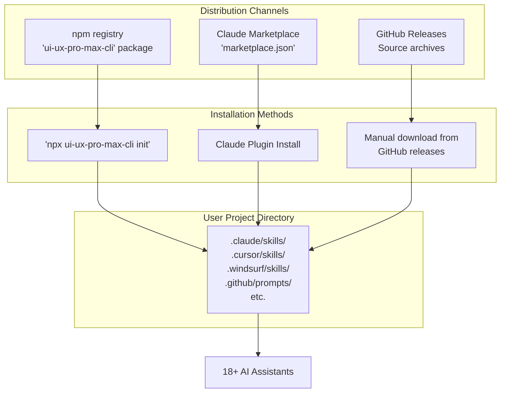
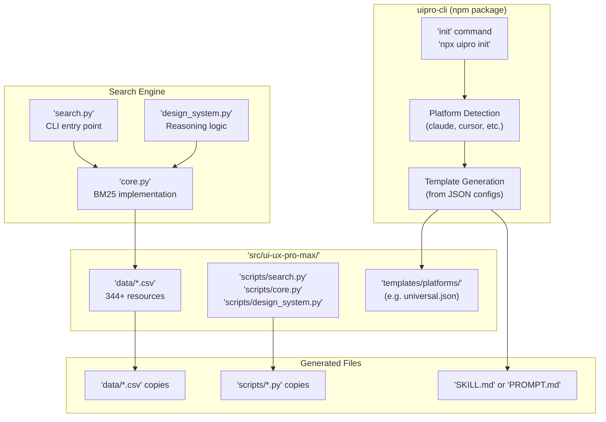
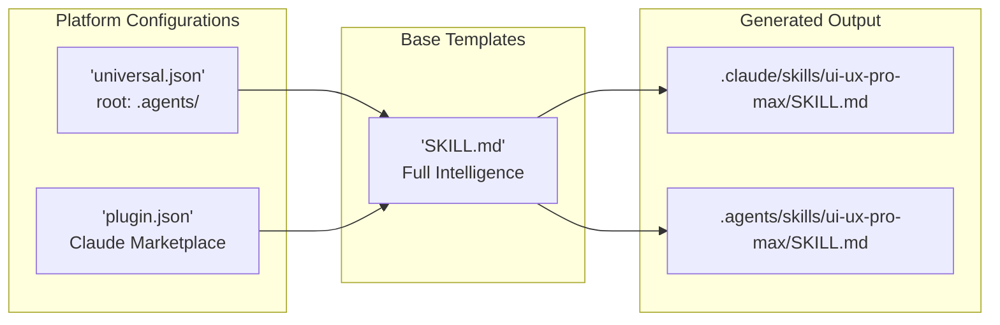

<!-- source: DeepWiki mcp.deepwiki.com · repo nextlevelbuilder/ui-ux-pro-max-skill · page 1 Overview · fetched 2026-10-26 -->

# Overview

<details>
<summary>Relevant source files</summary>

The following files were used as context for generating this wiki page:

- [.claude-plugin/marketplace.json](.claude-plugin/marketplace.json)
- [.claude-plugin/plugin.json](.claude-plugin/plugin.json)
- [LICENSE](LICENSE)
- [README.md](README.md)
- [README.vi.md](README.vi.md)
- [README.zh.md](README.zh.md)
- [cli/.gitignore](cli/.gitignore)
- [cli/assets/templates/platforms/universal.json](cli/assets/templates/platforms/universal.json)
- [cli/bun.lock](cli/bun.lock)
- [skill.json](skill.json)
- [src/ui-ux-pro-max/templates/platforms/universal.json](src/ui-ux-pro-max/templates/platforms/universal.json)

</details>


## Purpose and Scope

UI/UX Pro Max is an AI-powered design intelligence toolkit that provides searchable databases of UI/UX resources (styles, colors, typography, patterns) to AI coding assistants. This page introduces the system architecture, distribution methods, installation modes, and core capabilities. For specific installation instructions, see [Getting Started](#1.1). For detailed architecture diagrams, see [System Architecture](#1.2).

Sources: [README.md:24-24](), [skill.json:2-5]()

## What is UI/UX Pro Max

UI/UX Pro Max consists of three primary components:

1. **Knowledge Base** — 344+ design resources stored in CSV databases covering 10 domains (styles, colors, typography, landing patterns, charts, UX guidelines, icons, products, reasoning rules) and 16 technology stacks. [README.md:11-13](), [skill.json:4-4]()
2. **Search Engine** — BM25-based ranking system provided via `search.py` with domain auto-detection and stack-specific filtering. [cli/assets/templates/platforms/universal.json:10-10](), [src/ui-ux-pro-max/templates/platforms/universal.json:10-10]()
3. **Design System Generator** — AI-powered reasoning engine that analyzes project requirements to generate complete, tailored design systems including layout patterns, color palettes, and typography. [README.md:44-46](), [README.zh.md:44-46]()

The system integrates with 18+ AI coding assistants through a skill/workflow pattern, supporting platforms like Claude, Cursor, Windsurf, and GitHub Copilot. [skill.json:20-40]()

Sources: [README.md:42-98](), [skill.json:1-42]()

## Distribution Channels



**Distribution Methods**

| Method | Package | Target Audience |
|--------|---------|-----------------|
| npm | `ui-ux-pro-max-cli` | Users who prefer CLI installation via `npx`. [skill.json:41-41]() |
| GitHub Releases | Source archives (.zip) | Users installing manually or offline. [README.md:10-10]() |
| Claude Marketplace | Direct plugin installation | Claude Code users only via `.claude-plugin/`. [.claude-plugin/marketplace.json:1-35]() |

The CLI tool (`ui-ux-pro-max-cli`) is the recommended installation method, as it automates the deployment of the skill into the appropriate local environment. [skill.json:41-41]()

Sources: [README.md:10-22](), [skill.json:1-42](), [.claude-plugin/marketplace.json:1-35]()

## Core System Components



**Component Responsibilities**

| Component | Role | Responsibility |
|-----------|------|----------------|
| CLI Tool | Orchestrator | Handles installation, platform detection, and local file deployment. [skill.json:41-41]() |
| Platform Configs | Metadata | JSON files defining folder structures and frontmatter for each AI. [src/ui-ux-pro-max/templates/platforms/universal.json:1-21]() |
| Search Engine | Intelligence | BM25-based retrieval of design resources from CSV files. [cli/assets/templates/platforms/universal.json:13-13]() |
| Reasoning Engine | Generator | Synthesizes product requirements into design systems. [README.md:44-46]() |
| Knowledge Base | Data | CSV files containing 84 styles, 192 palettes, and 22 stack guidelines. [skill.json:4-4]() |

Sources: [README.md:42-98](), [skill.json:1-42](), [cli/assets/templates/platforms/universal.json:1-21]()

## Platform Integration Architecture

The system supports 18+ AI platforms through a template-based configuration system. Each platform has a JSON configuration file in `templates/platforms/` that defines how the skill should be presented to that specific AI assistant.

- `folderStructure` — Defines where the skill files are placed (e.g., `.agents/skills/`). [src/ui-ux-pro-max/templates/platforms/universal.json:5-9]()
- `installType` — Specifies whether a full skill or reference is installed. [src/ui-ux-pro-max/templates/platforms/universal.json:4-4]()
- `frontmatter` — Metadata describing the skill's capabilities to the AI. [src/ui-ux-pro-max/templates/platforms/universal.json:11-14]()
- `scriptPath` — The relative path the AI should use to execute search commands. [src/ui-ux-pro-max/templates/platforms/universal.json:10-10]()



**Supported Platforms (Partial List)**

| Platform | Key Configuration | Install Type |
|----------|-------------------|--------------|
| Claude | `.claude/skills/` | full |
| Cursor | `.cursor/` | full |
| Universal | `.agents/` | full [src/ui-ux-pro-max/templates/platforms/universal.json:4-9]() |
| GitHub Copilot | `.github/prompts/` | reference |

Sources: [skill.json:20-40](), [src/ui-ux-pro-max/templates/platforms/universal.json:1-21](), [.claude-plugin/plugin.json:1-21]()

## Search and Generation Workflow

```mermaid
sequenceDiagram
    participant User
    participant AI["AI Assistant<br/>(Claude/Cursor/etc)"]
    participant SearchPy["'search.py'"]
    participant CorePy["'core.py'"]
    participant CSV["'data/*.csv'"]
    
    User->>AI: "Design a luxury spa landing page"
    AI->>SearchPy: python3 search.py --design-system "luxury spa"
    
    SearchPy->>CorePy: Execute BM25 search across domains
    CorePy->>CSV: Query products.csv & ui-reasoning.csv
    CSV-->>CorePy: Return ranked design matches
    
    CorePy-->>SearchPy: Synthesize Design System
    SearchPy-->>AI: Return Markdown Design System
    
    AI->>User: Present complete UI/UX plan
```

The system uses a 4-step workflow: **Analyze Requirements** → **Generate Design System** → **Supplement Searches** → **Stack Guidelines**. This ensures that every UI component generated by the AI assistant adheres to professional standards and project-specific reasoning rules.

Sources: [README.md:42-98](), [README.zh.md:100-115]()

## Development Architecture

The project maintains a strict "Source of Truth" model where all core logic and data reside in `src/ui-ux-pro-max/`.

**Sync Rules**
1. **Source of Truth**: All changes to CSV data, Python scripts, and platform templates must happen in `src/ui-ux-pro-max/`.
2. **CLI Distribution**: The `cli/assets/` directory acts as a distribution cache. Files from the source of truth must be synced to the CLI assets before publishing the `ui-ux-pro-max-cli` package to npm. [cli/assets/templates/platforms/universal.json:1-21]()

Sources: [src/ui-ux-pro-max/templates/platforms/universal.json:1-21](), [cli/assets/templates/platforms/universal.json:1-21]()

---

**Next Steps:**
- [Getting Started](#1.1) — Quick-start installation and basic usage.
- [System Architecture](#1.2) — Detailed technical deep-dive.

---

