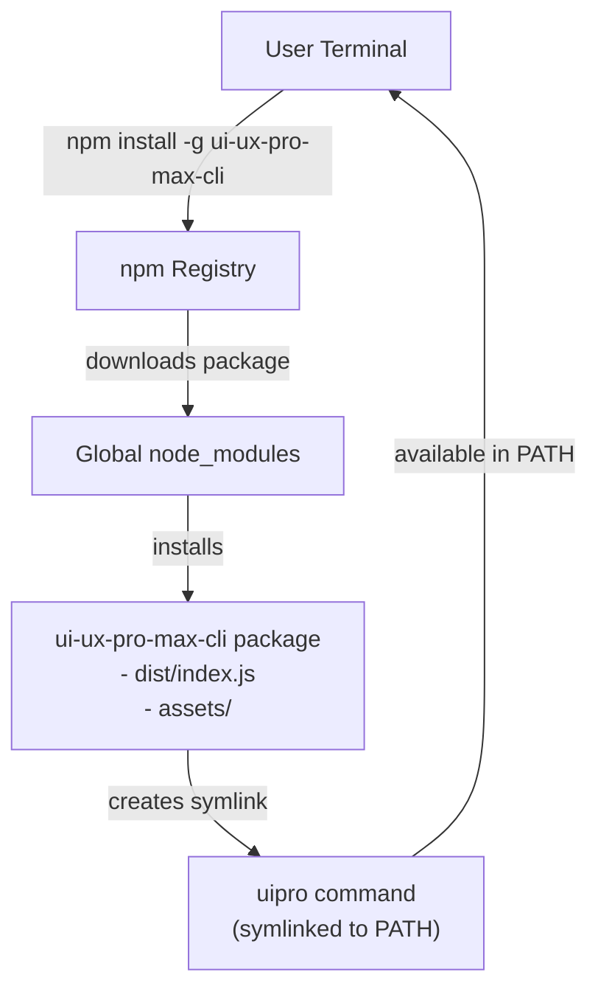
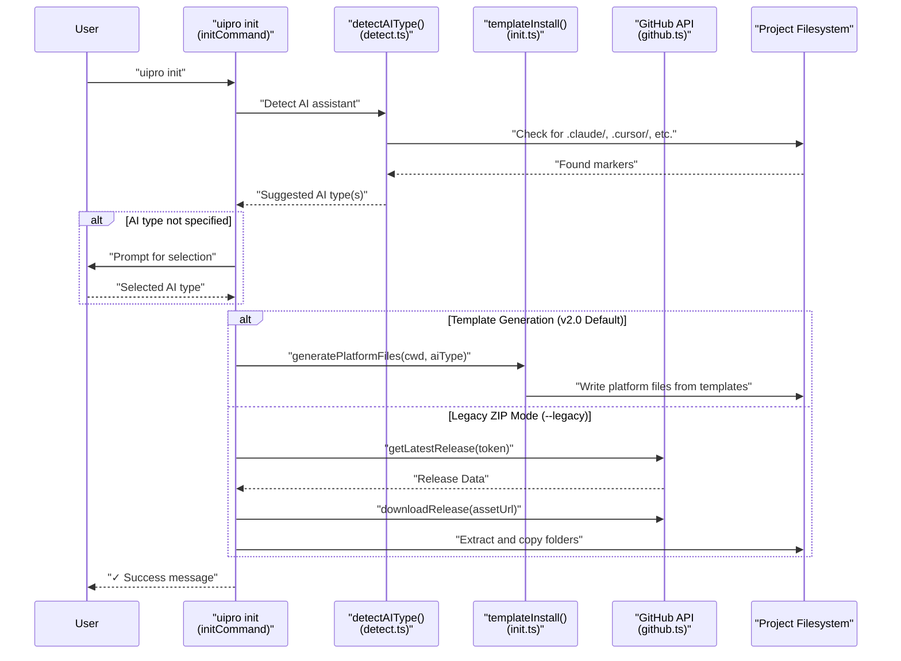
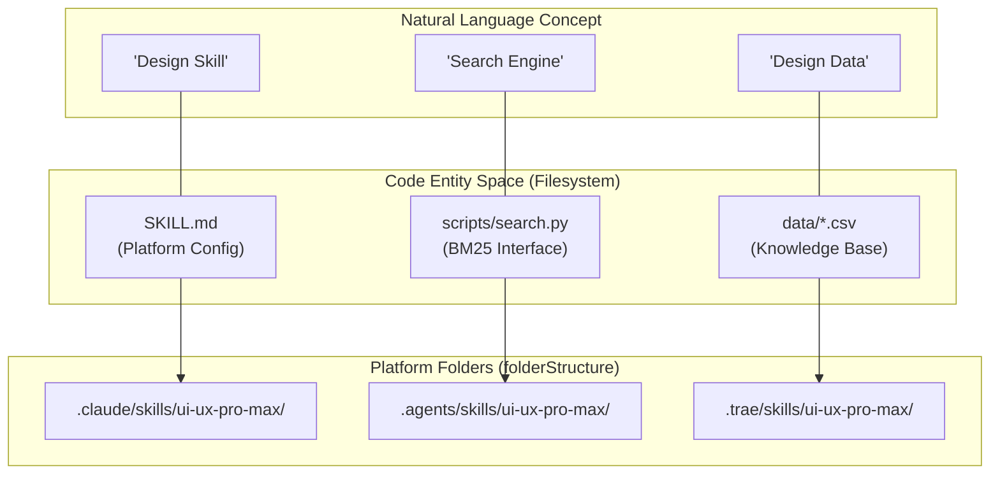
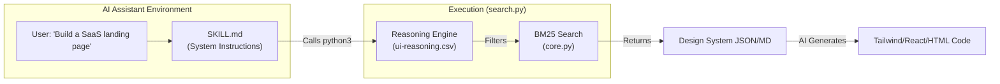

<!-- source: DeepWiki mcp.deepwiki.com · repo nextlevelbuilder/ui-ux-pro-max-skill · page 1.1 Getting Started · fetched 2026-10-26 -->

# Getting Started

<details>
<summary>Relevant source files</summary>

The following files were used as context for generating this wiki page:

- [README.md](README.md)
- [README.vi.md](README.vi.md)
- [README.zh.md](README.zh.md)
- [cli/README.md](cli/README.md)
- [cli/assets/templates/platforms/universal.json](cli/assets/templates/platforms/universal.json)
- [cli/src/commands/init.ts](cli/src/commands/init.ts)
- [cli/src/commands/update.ts](cli/src/commands/update.ts)
- [cli/src/commands/versions.ts](cli/src/commands/versions.ts)
- [cli/src/utils/github.ts](cli/src/utils/github.ts)
- [src/ui-ux-pro-max/templates/platforms/universal.json](src/ui-ux-pro-max/templates/platforms/universal.json)

</details>


This document guides you through the installation and first-time usage of the `uipro-cli` tool. It covers prerequisites, installation commands, initialization workflows, and basic verification steps for 18 supported AI platforms.

## Prerequisites

Before installing `uipro-cli`, ensure the following are available on your system:

| Requirement | Version | Purpose |
|------------|---------|---------|
| Python | 3.x or higher | Required by `search.py` script to perform BM25 searches [cli/assets/templates/platforms/universal.json:10]() |
| Node.js | 18.x or higher | Required for the CLI runtime [cli/README.md:81-87]() |
| npm / bun | Latest | Package manager for installing `uipro-cli` [cli/README.md:7-9]() |

### Verifying Prerequisites

```bash
# Check Python installation
python3 --version

# Check Node.js and npm
node --version
npm --version
```

Sources: [cli/README.md:7-9](), [cli/assets/templates/platforms/universal.json:1-21]()

---

## Installation

The `uipro-cli` package is distributed via npm and installed globally to make the `uipro` command available system-wide.

### Installing uipro-cli

```bash
npm install -g ui-ux-pro-max-cli
```

This installs the package defined in the `ui-ux-pro-max-cli` repository [cli/README.md:1-10]().

### Verifying Installation

```bash
# Check CLI version
uipro --version

# View available commands
uipro --help
```

The CLI entry point and command registration are handled in the main package index, supporting commands like `init`, `update`, and `versions` [cli/README.md:11-39]().

**Installation Flow Diagram:**



Sources: [cli/README.md:1-40]()

---

## First-Time Initialization

After installation, navigate to your project directory and run the `init` command to install the UI/UX Pro Max skill.

### Basic Initialization

```bash
# Navigate to your project
cd /path/to/your/project

# Initialize with auto-detection
uipro init
```

The `initCommand` at [cli/src/commands/init.ts:127]() accepts several options defined in `InitOptions` [cli/src/commands/init.ts:31-38]():

| Option | Flag | Description |
|--------|------|-------------|
| AI Type | `--ai <type>` | Target AI assistant (e.g., claude, cursor, trae) [cli/src/commands/init.ts:32]() |
| Force | `--force` | Overwrite existing files [cli/src/commands/init.ts:33]() |
| Offline | `--offline` | Use bundled templates instead of fetching [cli/src/commands/init.ts:34]() |
| Global | `--global` | Install to home directory (`~/`) instead of project [cli/src/commands/init.ts:36]() |
| Token | `--token` | GitHub PAT for higher API rate limits [cli/src/commands/init.ts:37]() |

### Supported AI Types

The CLI supports 18 AI assistant types, including new additions like `trae`, `gemini`, and `qoder` [cli/README.md:15-28]():

```bash
uipro init --ai claude      # Claude Code
uipro init --ai cursor      # Cursor
uipro init --ai trae        # Trae
uipro init --ai qoder       # Qoder
uipro init --ai gemini      # Gemini CLI
uipro init --ai universal   # Agent Standard (.agents/skills/)
uipro init --ai all         # Install for all detected assistants
```

### Initialization Workflow

The system defaults to `templateInstall` [cli/src/commands/init.ts:109-125]() which generates platform-specific files from local templates. It also supports a `--legacy` mode that attempts to download the latest release from GitHub via `tryGitHubInstall` [cli/src/commands/init.ts:44-104]().

**Initialization Process Diagram:**



Sources: [cli/src/commands/init.ts:127-226](), [cli/src/utils/github.ts:74-92](), [cli/src/utils/detect.ts:11-15]()

---

## Installation Results

The system uses a **template-based generation model** [cli/src/commands/init.ts:189-193](). Every skill installation includes the necessary platform configurations and local data references.

**Natural Language to Code Entity Mapping:**



| AI Type | Root Directory | Skill Filename |
|---------|----------------|----------------|
| Claude | `.claude` | `SKILL.md` |
| Universal | `.agents` | `SKILL.md` [cli/assets/templates/platforms/universal.json:5-9]() |
| Trae | `.trae` | `SKILL.md` |
| GitHub Copilot | `.github` | `ui-ux-pro-max.prompt.md` |

Sources: [cli/assets/templates/platforms/universal.json:1-21](), [cli/src/commands/init.ts:127-226]()

---

## Basic Usage Workflow

Once installed, the skill provides design intelligence through a reasoning-driven workflow [README.md:44-98]().

### Usage Workflow Diagram



### Example Prompts

1. **Intelligent Design System Generation**:
   `"Analyze my project requirements for a 'Meditation App' and generate a full design system."` [README.md:44-48]()
   
2. **Component Search**:
   `"Find the best accessible color palette for a financial dashboard using the ui-ux-pro-max skill."`

3. **Stack-Specific Implementation**:
   `"Build a hero section for a spa website using React and Tailwind, following the UI/UX Pro Max guidelines."` [README.md:53-61]()

Sources: [README.md:42-98](), [cli/assets/templates/platforms/universal.json:11-14]()

---

## Maintenance and Updates

### Updating the CLI
To get the latest templates and features, update the global CLI package:
```bash
uipro update
```
The `updateCommand` [cli/src/commands/update.ts:38]() checks for new versions via GitHub [cli/src/commands/update.ts:44]() and executes `npm install -g` if a new version is found [cli/src/commands/update.ts:71-75]().

### Refreshing Skill Files
After updating the CLI, refresh the files in your project:
```bash
uipro init --ai <platform> --force
```
This regenerates the skill files from the updated templates bundled in the new CLI version [cli/README.md:68-73]().

### Checking Available Versions
To see the release history and latest version:
```bash
uipro versions
```
This calls `fetchReleases` from the GitHub utility to list all published tags [cli/src/commands/versions.ts:10-46]().

Sources: [cli/src/commands/update.ts:38-106](), [cli/src/commands/versions.ts:10-46](), [cli/README.md:35-39]()

---

