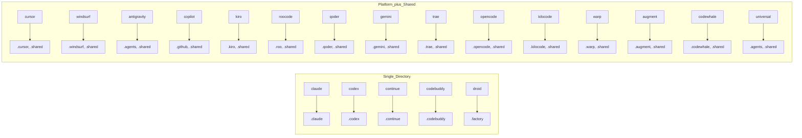

<!-- source: DeepWiki mcp.deepwiki.com · repo nextlevelbuilder/ui-ux-pro-max-skill · page 2.3 Platform Detection · fetched 2026-10-26 -->

# Platform Detection

<details>
<summary>Relevant source files</summary>

The following files were used as context for generating this wiki page:

- [cli/src/types/index.ts](cli/src/types/index.ts)
- [cli/src/utils/detect.ts](cli/src/utils/detect.ts)
- [cli/src/utils/template.ts](cli/src/utils/template.ts)

</details>


## Purpose and Scope

The Platform Detection system identifies which AI coding assistant platforms are present in a user's project directory by scanning for platform-specific folders. The `detectAIType()` function returns detected platforms and suggests an installation target for the UI/UX Pro Max skill.

This system enables automatic environment detection, validates user-provided platform identifiers, and maps platforms to their corresponding directory structures. The current version supports detection for 20 distinct AI platform types.

For information about how template generation uses the detected platform, see [2.4](). For the complete CLI tool architecture, see [1.2]().

---

## Detection Components

The platform detection system consists of three components:

| Component | Purpose | Location |
|-----------|---------|----------|
| Type Definitions | `AIType` union, `AI_TYPES` array, `AI_FOLDERS` mapping | [cli/src/types/index.ts:1-72]() |
| Detection Function | `detectAIType()` - scans filesystem and returns detection results | [cli/src/utils/detect.ts:10-91]() |
| CLI Validation | Validates `--ai` flag and invokes detection in init/update commands | [cli/src/index.ts:20-81]() |

The system supports 20 distinct platforms plus an `'all'` option for multi-platform installations. Detection runs automatically when users execute `uipro init` or `uipro update` without the `--ai` flag.

**Sources:** [cli/src/types/index.ts:1-72](), [cli/src/utils/detect.ts:10-91](), [cli/src/index.ts:20-81]()

---

## Platform Type Definitions

### AIType Union

The `AIType` union type defines all supported platforms:

```typescript
export type AIType = 'claude' | 'cursor' | 'windsurf' | 'antigravity' | 'copilot' | 'kiro' | 'roocode' | 'codex' | 'qoder' | 'gemini' | 'trae' | 'opencode' | 'continue' | 'codebuddy' | 'droid' | 'kilocode' | 'warp' | 'augment' | 'codewhale' | 'universal' | 'all';
```

The `AI_TYPES` array [cli/src/types/index.ts:46]() provides runtime validation for CLI arguments.

**Sources:** [cli/src/types/index.ts:1-2](), [cli/src/types/index.ts:46]()

### AI_FOLDERS Mapping

The `AI_FOLDERS` record maps each `ConcreteAIType` to its target installation directories. This mapping is used for backward compatibility with ZIP-based installs and for identifying folders to remove during uninstallation.

**Diagram: Platform to Directory Mapping (AI_FOLDERS)**



**Sources:** [cli/src/types/index.ts:51-72]()

### Platform Descriptions

The `getAITypeDescription()` function [cli/src/utils/detect.ts:93-138]() returns human-readable descriptions and the specific sub-paths used by each platform:

| Platform | Description | Directory Marker |
|----------|-------------|------------------|
| `claude` | Claude Code | `.claude/skills/` |
| `cursor` | Cursor | `.cursor/skills/` |
| `windsurf` | Windsurf | `.windsurf/skills/` |
| `antigravity`| Antigravity | `.agents/skills/` |
| `copilot` | GitHub Copilot | `.github/prompts/` |
| `kiro` | Kiro | `.kiro/steering/` |
| `codex` | Codex | `.agents/skills/` |
| `roocode` | RooCode | `.roo/skills/` |
| `qoder` | Qoder | `.qoder/skills/` |
| `gemini` | Gemini CLI | `.gemini/skills/` |
| `trae` | Trae | `.trae/skills/` |
| `opencode` | OpenCode | `.opencode/skills/` |
| `continue` | Continue | `.continue/skills/` |
| `codebuddy` | CodeBuddy | `.codebuddy/skills/` |
| `droid` | Droid (Factory) | `.factory/skills/` |
| `kilocode` | KiloCode | `.kilocode/skills/` |
| `warp` | Warp | `.warp/skills/` |
| `augment` | Augment | `.augment/skills/` |
| `codewhale` | CodeWhale | `.codewhale/skills/` |
| `universal` | Universal | `.agents/skills/` |

**Sources:** [cli/src/utils/detect.ts:93-138]()

---

## detectAIType() Function

### Detection Algorithm

The `detectAIType()` function [cli/src/utils/detect.ts:10-91]() implements filesystem-based platform detection using `existsSync()` from `node:fs`.

**Diagram: detectAIType() Execution Flow**

```mermaid
flowchart TD
    "Start"["detectAIType(cwd)"] --> "Init"["const detected: ConcreteAIType[] = []"]
    "Init" --> "CheckClaude"{"existsSync('.claude')"}
    "CheckClaude" -- "Yes" --> "AddClaude"["detected.push('claude')"]
    "CheckClaude" -- "No" --> "CheckCursor"{"existsSync('.cursor')"}
    "AddClaude" --> "CheckCursor"
    
    "CheckCursor" -- "Yes" --> "AddCursor"["detected.push('cursor')"]
    "CheckCursor" -- "No" --> "CheckWindsurf"{"existsSync('.windsurf')"}
    "AddCursor" --> "CheckWindsurf"
    
    "CheckWindsurf" -- "Yes" --> "AddWindsurf"["detected.push('windsurf')"]
    "CheckWindsurf" -- "No" --> "CheckAgents"{"existsSync('.agents')"}
    "AddWindsurf" --> "CheckAgents"
    
    "CheckAgents" -- "Yes" --> "AddMulti"["detected.push('antigravity', 'codex', 'universal')"]
    "CheckAgents" -- "No" --> "CheckOther"["... checks for .github, .kiro, .codex, .roo, .qoder, .gemini, .trae, .opencode, .continue, .codebuddy, .factory, .kilocode, .warp, .augment, .codewhale ..."]
    "AddMulti" --> "CheckOther"
    
    "CheckOther" --> "Suggest"{"detected.length"}
    "Suggest" -- "1" --> "Single"["suggested = detected[0]"]
    "Suggest" -- "2 or 3 (Agent conflict)" --> "AgentLogic"["suggested = 'codex'"]
    "Suggest" -- "> 1 (General)" --> "Multi"["suggested = 'all'"]
    "Suggest" -- "0" --> "None"["suggested = null"]
    
    "Single" --> "Return"["return { detected, suggested }"]
    "AgentLogic" --> "Return"
    "Multi" --> "Return"
    "None" --> "Return"
```

**Sources:** [cli/src/utils/detect.ts:10-91]()

### DetectionResult Interface

The `DetectionResult` interface structures the output:

```typescript
interface DetectionResult {
  detected: ConcreteAIType[]; // All platforms found in directory
  suggested: AIType | null;   // Recommended installation target
}
```

**Suggestion Logic:**
- Exactly 1 platform detected → `suggested = detected[0]` [cli/src/utils/detect.ts:77-78]().
- Overlapping agent platforms (Antigravity/Codex/Universal) sharing `.agents` directory → `suggested = 'codex'` to avoid redundant installs [cli/src/utils/detect.ts:79-85]().
- Multiple distinct platforms detected → `suggested = 'all'` [cli/src/utils/detect.ts:86-88]().

**Sources:** [cli/src/utils/detect.ts:5-8](), [cli/src/utils/detect.ts:76-90]()

### Directory Marker Strategy

The function checks for platform-specific directories using `join(cwd, marker)`:

**Diagram: Directory Markers to Platform Resolution**

```mermaid
graph TB
    subgraph "Filesystem"
        "cwd"["process.cwd()"]
    end
    
    subgraph "Directory_Markers"
        "d1"[".claude/"]
        "d2"[".cursor/"]
        "d3"[".windsurf/"]
        "d4"[".agents/"]
        "d5"[".github/"]
        "d6"[".kiro/"]
        "d7"[".codex/"]
        "d8"[".roo/"]
        "d9"[".qoder/"]
        "d10"[".gemini/"]
        "d11"[".trae/"]
        "d12"[".opencode/"]
        "d13"[".continue/"]
        "d14"[".codebuddy/"]
        "d15"[".factory/"]
        "d16"[".kilocode/"]
        "d17"[".warp/"]
        "d18"[".augment/"]
        "d19"[".codewhale/"]
    end
    
    subgraph "ConcreteAIType_Values"
        "t1"["'claude'"]
        "t2"["'cursor'"]
        "t3"["'windsurf'"]
        "t4"["'antigravity'"]
        "t5"["'copilot'"]
        "t6"["'kiro'"]
        "t7"["'codex'"]
        "t8"["'roocode'"]
        "t9"["'qoder'"]
        "t10"["'gemini'"]
        "t11"["'trae'"]
        "t12"["'opencode'"]
        "t13"["'continue'"]
        "t14"["'codebuddy'"]
        "t15"["'droid'"]
        "t16"["'kilocode'"]
        "t17"["'warp'"]
        "t18"["'augment'"]
        "t19"["'codewhale'"]
    end
    
    "cwd" --> "d1" & "d2" & "d3" & "d4" & "d5" & "d6" & "d7" & "d8" & "d9" & "d10" & "d11" & "d12" & "d13" & "d14" & "d15" & "d16" & "d17" & "d18" & "d19"
    
    "d1" --> "t1"
    "d2" --> "t2"
    "d3" --> "t3"
    "d4" --> "t4" & "t7"
    "d5" --> "t5"
    "d6" --> "t6"
    "d7" --> "t7"
    "d8" --> "t8"
    "d9" --> "t9"
    "d10" --> "t10"
    "d11" --> "t11"
    "d12" --> "t12"
    "d13" --> "t13"
    "d14" --> "t14"
    "d15" --> "t15"
    "d16" --> "t16"
    "d17" --> "t17"
    "d18" --> "t18"
    "d19" --> "t19"
```

**Sources:** [cli/src/utils/detect.ts:13-73]()

---

## CLI Integration

### Command-Line Usage

Platform detection integrates with `init`, `update`, and `uninstall` commands [cli/src/index.ts:26-81]():

**init command**:
```bash
uipro init                    # Auto-detect platform
uipro init --ai claude        # Specify platform explicitly
uipro init --ai all           # Install for all platforms
```

**update command**:
```bash
uipro update                  # Auto-detect platform
uipro update --ai windsurf    # Update specific platform
```

**Sources:** [cli/src/index.ts:26-81]()

### Validation Flow

The CLI validates `--ai` flag values before invoking detection. Validation at [cli/src/index.ts:33-37](), [cli/src/index.ts:56-60](), and [cli/src/index.ts:72-76]() ensures only values from `AI_TYPES` are accepted.

**Sources:** [cli/src/index.ts:33-37](), [cli/src/index.ts:56-60](), [cli/src/index.ts:72-76]()

---

## Detection Result Handling

### Integration with Template System

The detected `aiType` is used to load configuration from the `ASSETS_DIR` [cli/src/utils/template.ts:72-81]():

1.  **Map Type**: `AI_TO_PLATFORM` maps the detection string (e.g., `antigravity`) to a filename (e.g., `agent.json`) [cli/src/utils/template.ts:37-58]().
2.  **Load Config**: `loadPlatformConfig(aiType)` reads the corresponding JSON from `assets/templates/platforms/` [cli/src/utils/template.ts:78-80]().
3.  **Render**: `renderSkillFile()` uses the `folderStructure` from the config to generate the platform-specific markdown file [cli/src/utils/template.ts:132-164]().

**Sources:** [cli/src/utils/template.ts:37-58](), [cli/src/utils/template.ts:72-81](), [cli/src/utils/template.ts:132-164]()

---

## Limitations and Edge Cases

### Known Limitations

| Limitation | Impact | Mitigation |
|------------|--------|------------|
| Shared Directory Markers | `.agents/` is used by Antigravity, Codex, and Universal | Specific suggestion logic returns `'codex'` if these are detected [cli/src/utils/detect.ts:79-85]() |
| `.github/` false positives | Detects Copilot when directory exists for GitHub Actions | User can override via `--ai` flag [cli/src/index.ts:28]() |
| Multiple Platforms | Defaults to `'all'` | Users can specify a single platform via CLI flag if preferred |

**Sources:** [cli/src/utils/detect.ts:79-85](), [cli/src/index.ts:28]()

---

