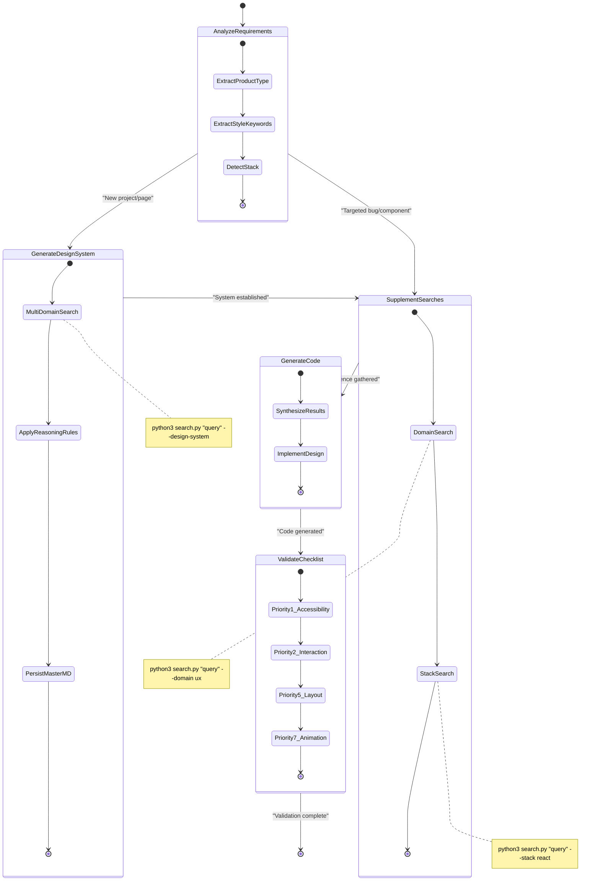
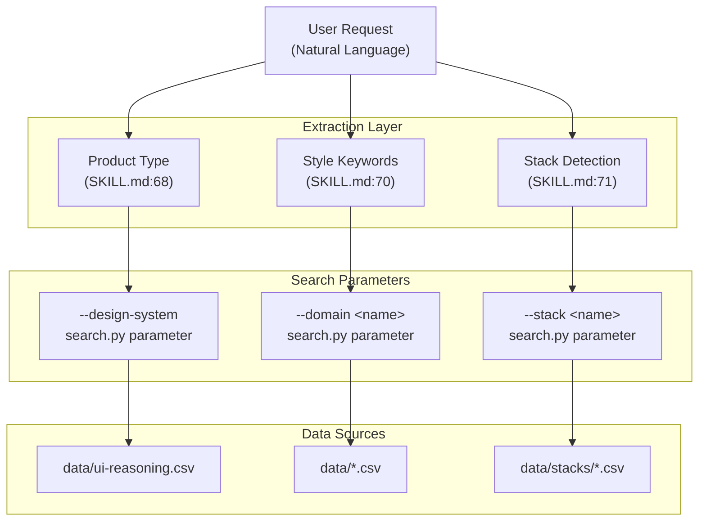
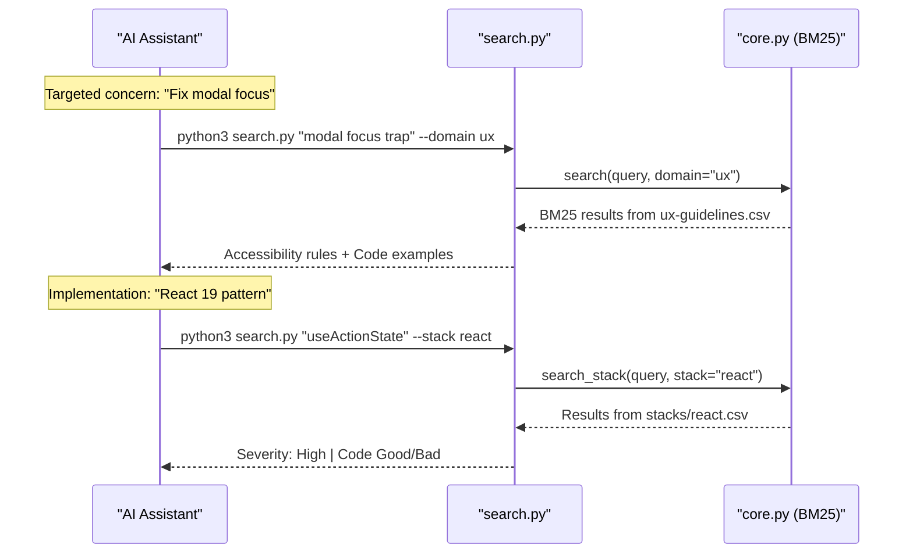

<!-- source: DeepWiki mcp.deepwiki.com · repo nextlevelbuilder/ui-ux-pro-max-skill · page 3.1 Skill Workflow · fetched 2026-10-26 -->

# Skill Workflow

<details>
<summary>Relevant source files</summary>

The following files were used as context for generating this wiki page:

- [.claude/skills/ui-ux-pro-max/SKILL.md](.claude/skills/ui-ux-pro-max/SKILL.md)
- [.claude/skills/ui-ux-pro-max/scripts/core.py](.claude/skills/ui-ux-pro-max/scripts/core.py)
- [.claude/skills/ui-ux-pro-max/scripts/search.py](.claude/skills/ui-ux-pro-max/scripts/search.py)
- [CLAUDE.md](CLAUDE.md)
- [cli/assets/templates/base/skill-content.md](cli/assets/templates/base/skill-content.md)
- [src/ui-ux-pro-max/templates/base/skill-content.md](src/ui-ux-pro-max/templates/base/skill-content.md)

</details>


This document describes the 4-step workflow defined in `SKILL.md` that AI coding assistants follow when handling UI/UX requests. The workflow orchestrates searches across design domains, applies stack-specific guidelines, and validates output quality before delivery.

## Overview

The skill workflow is a structured process that ensures AI assistants gather comprehensive design intelligence before generating UI/UX code. The workflow consists of four mandatory steps:

1.  **Analyze Requirements** - Extract product type, style keywords, target audience, and technology stack.
2.  **Generate Design System** - Create a coherent product-wide visual direction using reasoning rules.
3.  **Supplement Searches** - Perform targeted domain or stack queries for specific components or performance patterns.
4.  **Validate with Pre-Delivery Checklist** - Verify code meets quality standards across 10 prioritized categories.

The workflow is defined in [.claude/skills/ui-ux-pro-max/SKILL.md:65-214]() and synchronized across all AI platform integrations. Each step produces inputs for the next, creating a dependency chain that builds a complete design system before code generation begins.

Sources: [.claude/skills/ui-ux-pro-max/SKILL.md:65-214](), [CLAUDE.md:7-39]()

## Workflow Execution Flow

**Workflow State Machine**



This state machine represents the execution flow defined in [.claude/skills/ui-ux-pro-max/SKILL.md:65-214](). Sequential execution ensures comprehensive design intelligence gathering before code generation.

Sources: [.claude/skills/ui-ux-pro-max/SKILL.md:65-214]()

## Step 1: Analyze Requirements

The AI assistant parses the request to identify critical attributes defined in [.claude/skills/ui-ux-pro-max/SKILL.md:65-72]().

| Attribute | Purpose | Examples |
|-----------|---------|----------|
| **Product type** | Determines style recommendations and palettes | SaaS, e-commerce, portfolio, dashboard, tool |
| **Audience** | Influences accessibility and context | C-end consumer, commute, leisure, work |
| **Style keywords** | Identifies UI style and visual effects | playful, vibrant, minimal, dark mode, immersive |
| **Stack** | Selects technology-specific guidelines | React, Vue, Next.js, SwiftUI, Flutter, Laravel |

**Requirement to Search Parameter Mapping**



Stack detection involves checking `package.json` (React/Next), `pubspec.yaml` (Flutter), or `composer.json` (Laravel) [.claude/skills/ui-ux-pro-max/SKILL.md:71]().

Sources: [.claude/skills/ui-ux-pro-max/SKILL.md:65-72](), [CLAUDE.md:16-39]()

## Step 2: Generate Design System

For new projects or pages, the workflow requires generating a coherent visual direction using the `--design-system` flag [.claude/skills/ui-ux-pro-max/SKILL.md:73-81]().

**Generation Pipeline**
1.  **Aggregate**: Performs multi-domain searches (product, style, color, typography, landing).
2.  **Reason**: Applies rules from `ui-reasoning.csv` to map product categories to specific styles and palettes.
3.  **Synthesize**: Returns a complete system including design dials (variance, motion, density) and anti-patterns.
4.  **Persist**: Saves the result to `design-system/<project-slug>/MASTER.md` for hierarchical retrieval [.claude/skills/ui-ux-pro-max/SKILL.md:83-118]().

```bash
python3 scripts/search.py "fintech dashboard" --design-system --persist -p "NeoBank" --output-dir "."
```

Sources: [.claude/skills/ui-ux-pro-max/SKILL.md:73-118](), [.claude/skills/ui-ux-pro-max/scripts/search.py:106-117]()

## Step 3: Supplement Searches

Once a system is established, the assistant performs targeted searches for specific components or technical issues.

**Domain Search Orchestration**



**Query Contract**
-   **Targeted concern**: Use one explicit `--domain` (e.g., `ux`, `icons`, `gsap`).
-   **Known stack**: Use `--stack` (e.g., `react`, `tailwind-html`, `shadcn`).
-   **Semantic First**: For layout bugs, search the semantic UX outcome first, then the stack for implementation [.claude/skills/ui-ux-pro-max/SKILL.md:59-62]().

Sources: [.claude/skills/ui-ux-pro-max/SKILL.md:49-63](), [.claude/skills/ui-ux-pro-max/scripts/core.py:18-112]()

## Step 4: Validate with Pre-Delivery Checklist

Generated code is validated against a prioritized checklist [.claude/skills/ui-ux-pro-max/SKILL.md:20-33]().

| Priority | Category | Key Checks | Anti-Patterns |
|----------|----------|------------|---------------|
| 1 | **Accessibility** | Contrast 4.5:1, Aria-labels | Removing focus rings |
| 2 | **Interaction** | Min size 44×44px, Loading feedback | Reliance on hover only |
| 3 | **Performance** | WebP/AVIF, CLS < 0.1 | Layout thrashing |
| 4 | **Style Selection** | Match product type, SVG icons | Mixing flat & skeuomorphic |
| 7 | **Animation** | Motion conveys meaning | Animating width/height |

**Professional UI Rules**
The workflow enforces specific "Pro Rules" for common issues [.claude/skills/ui-ux-pro-max/SKILL.md:214]():
-   **Icons**: No emoji as icons; use Heroicons or Lucide [.claude/skills/ui-ux-pro-max/SKILL.md:214]().
-   **Interaction**: `cursor-pointer` on all clickable cards/items [.claude/skills/ui-ux-pro-max/SKILL.md:214]().
-   **Light/Dark**: Ensure borders are visible in both modes [.claude/skills/ui-ux-pro-max/SKILL.md:214]().

Sources: [.claude/skills/ui-ux-pro-max/SKILL.md:20-33](), [.claude/skills/ui-ux-pro-max/SKILL.md:214]()

---

