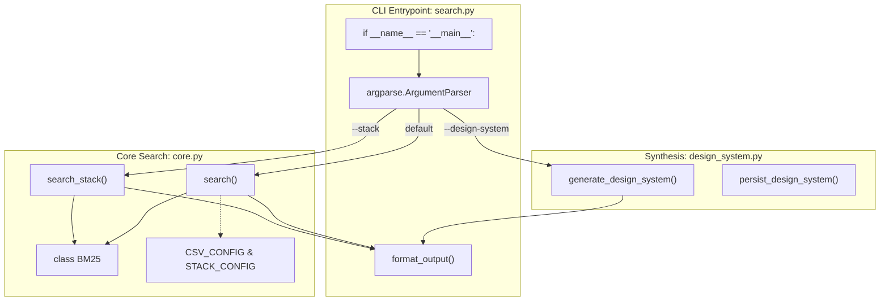
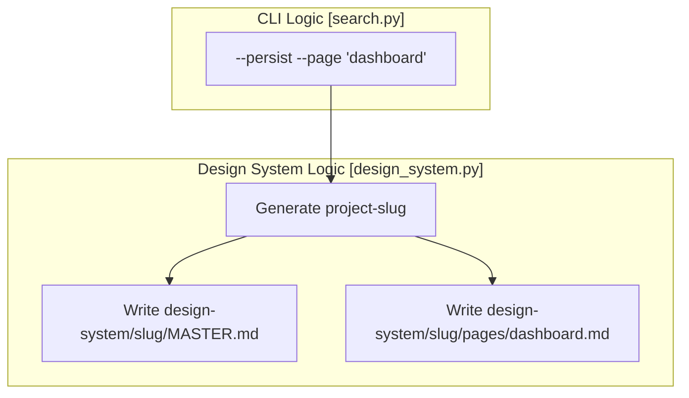

<!-- source: DeepWiki mcp.deepwiki.com · repo nextlevelbuilder/ui-ux-pro-max-skill · page 5.2 search.py CLI Interface · fetched 2026-10-26 -->

# search.py CLI Interface

<details>
<summary>Relevant source files</summary>

The following files were used as context for generating this wiki page:

- [CLAUDE.md](CLAUDE.md)
- [cli/assets/scripts/core.py](cli/assets/scripts/core.py)
- [cli/assets/scripts/search.py](cli/assets/scripts/search.py)
- [cli/assets/templates/base/skill-content.md](cli/assets/templates/base/skill-content.md)
- [src/ui-ux-pro-max/scripts/core.py](src/ui-ux-pro-max/scripts/core.py)
- [src/ui-ux-pro-max/scripts/search.py](src/ui-ux-pro-max/scripts/search.py)
- [src/ui-ux-pro-max/templates/base/skill-content.md](src/ui-ux-pro-max/templates/base/skill-content.md)

</details>


## Purpose and Scope

The `search.py` script is the primary command-line interface for the UI/UX Pro Max search engine. It orchestrates the flow between user queries, the BM25 ranking algorithm, and the design database [src/ui-ux-pro-max/scripts/search.py:4-26](). It provides two main modes of operation: **Standard Search** (Domain or Stack-specific) and **Design System Generation** (using the reasoning engine) [src/ui-ux-pro-max/scripts/search.py:121-150]().

This interface is designed to be called directly by AI agents (Claude, Cursor, etc.) or by developers via the terminal. It includes sophisticated output formatting to minimize token consumption while maximizing the relevance of design intelligence delivered to the LLM [src/ui-ux-pro-max/scripts/search.py:44-93]().

---

## Architecture and Data Flow

The `search.py` script acts as a controller that imports logic from `core.py` for search operations and `design_system.py` for complex synthesis.

**Diagram: CLI Logic and Code Entity Mapping**



**Sources:** [src/ui-ux-pro-max/scripts/search.py:32-33](), [src/ui-ux-pro-max/scripts/search.py:96-120]()

---

## Command-Line Arguments

The CLI supports a variety of flags to control search scope, output format, and persistence.

### Core Arguments

| Flag | Alias | Type | Description |
| :--- | :--- | :--- | :--- |
| `query` | N/A | Positional | The natural language search string (e.g., "minimalist fintech dashboard"). |
| `--domain` | `-d` | Choice | Filters search to a specific CSV (e.g., `style`, `color`, `ux`). |
| `--stack` | `-s` | Choice | Filters search to a specific technology stack (e.g., `react`, `shadcn`). |
| `--max-results`| `-n` | Int | Limits the number of returned rows (Default: 3). |
| `--json` | N/A | Flag | Returns raw JSON instead of formatted Markdown. |
| `--full` | N/A | Flag | Prevents truncation of long field values in text output. |

**Sources:** [src/ui-ux-pro-max/scripts/search.py:98-104]()

### Design System & Persistence Flags

| Flag | Alias | Type | Description |
| :--- | :--- | :--- | :--- |
| `--design-system`| `-ds`| Flag | Triggers the `generate_design_system` pipeline. |
| `--project-name` | `-p` | String | Sets the project name for design system output and slug generation. |
| `--persist` | N/A | Flag | Saves the output to `MASTER.md` in the project directory. |
| `--page` | N/A | String | Creates a page-specific override file in `design-system/pages/`. |
| `--output-dir` | `-o` | String | Directory where the `design-system/` folder is created. |
| `--force` | N/A | Flag | Overwrites an existing `MASTER.md` when persisting. |

**Sources:** [src/ui-ux-pro-max/scripts/search.py:106-113]()

### Design Dials (v2.5.0+)
These dials only apply when `--design-system` is active:
*   `--variance` (1-10): 1=centered/minimal, 10=bold/asymmetric.
*   `--motion` (1-10): 1=subtle, 10=complex; attaches a matching GSAP snippet.
*   `--density` (1-10): 1=spacious, 10=dense/dashboard; overrides spacing scale.

**Sources:** [src/ui-ux-pro-max/scripts/search.py:115-117]()

---

## Implementation Details

### Domain and Stack Validation
The CLI dynamically populates its allowed choices for `--domain` and `--stack` by inspecting the configuration dictionaries in `core.py`.
- **Domains:** Derived from `list(CSV_CONFIG.keys())` [src/ui-ux-pro-max/scripts/search.py:99]().
- **Stacks:** Derived from `AVAILABLE_STACKS` [src/ui-ux-pro-max/scripts/search.py:100]().

### Output Formatting
The `format_output` function [src/ui-ux-pro-max/scripts/search.py:44-93]() is critical for AI performance. It performs the following:
1. **Header Generation:** Identifies the domain or stack and the source file used [src/ui-ux-pro-max/scripts/search.py:50-62]().
2. **Auto-detection Notes:** If the domain was auto-detected, it lists the detected domain and any runner-up [src/ui-ux-pro-max/scripts/search.py:56-61]().
3. **Aggressive Truncation:** Any field value exceeding 300 characters is truncated with an ellipsis (`...`) unless the column is in `UNTRUNCATED_COLS` (like code snippets) or the `--full` flag is used [src/ui-ux-pro-max/scripts/search.py:88-89]().
4. **Encoding Safety:** Forces UTF-8 for `stdout` and `stderr` to prevent crashes on Windows environments when handling emojis in the design data [src/ui-ux-pro-max/scripts/search.py:35-39]().

**Sources:** [src/ui-ux-pro-max/scripts/search.py:35-93](), [src/ui-ux-pro-max/scripts/core.py:83-87]()

---

## Persistence: Master + Overrides Pattern

When the `--persist` flag is used, the CLI implements a hierarchical documentation strategy. This is handled by the `generate_design_system` function which manages the persistence logic.

**Diagram: File Persistence Flow**



The system creates a `design-system/` folder at the specified `--output-dir` (defaulting to current directory) [src/ui-ux-pro-max/scripts/search.py:110-112](). It creates a global `MASTER.md` and optional page-specific files in a `pages/` subdirectory to allow for hierarchical retrieval where page rules override master rules [src/ui-ux-pro-max/templates/base/skill-content.md:98-108]().

**Sources:** [src/ui-ux-pro-max/scripts/search.py:127-133](), [src/ui-ux-pro-max/templates/base/skill-content.md:90-110]()

---

## Usage Examples

### 1. Simple Domain Search
```bash
python3 src/ui-ux-pro-max/scripts/search.py "dark mode dashboard" --domain style --max-results 2
```

### 2. Stack-Specific Technical Search
```bash
python3 src/ui-ux-pro-max/scripts/search.py "form validation" --stack react --json
```

### 3. Full Design System Generation with Dials
```bash
python3 src/ui-ux-pro-max/scripts/search.py "fintech mobile app" --design-system --variance 8 --motion 9 --density 7
```

### 4. Persistence and Overrides
```bash
python3 src/ui-ux-pro-max/scripts/search.py "beauty spa" --design-system --persist -p "Serenity" --page "booking" --output-dir "./my-project"
```

**Sources:** [src/ui-ux-pro-max/scripts/search.py:5-26](), [CLAUDE.md:11-39]()

---

