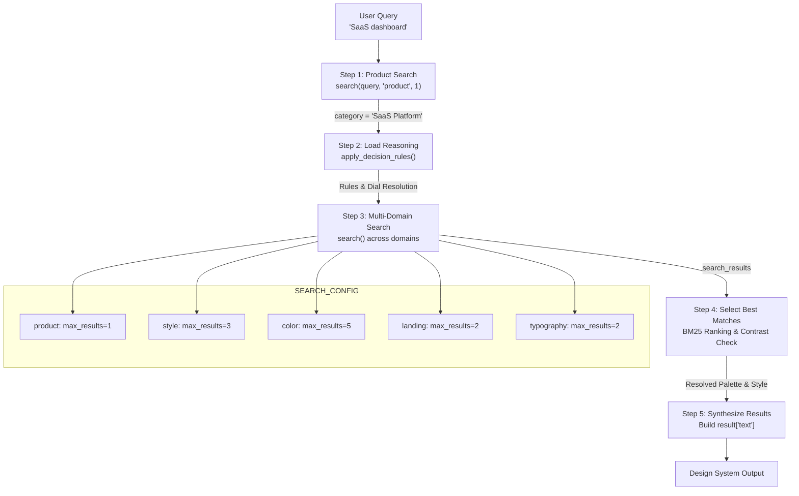
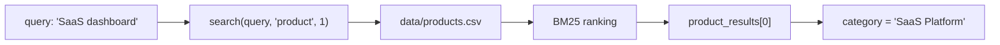
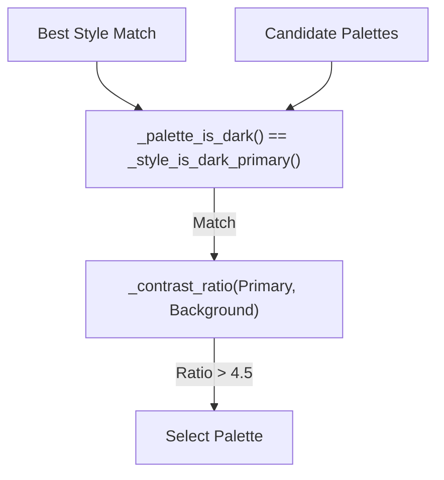

<!-- source: DeepWiki mcp.deepwiki.com · repo nextlevelbuilder/ui-ux-pro-max-skill · page 6.1 Generation Pipeline · fetched 2026-10-26 -->

# Generation Pipeline

<details>
<summary>Relevant source files</summary>

The following files were used as context for generating this wiki page:

- [.claude/skills/ui-ux-pro-max/scripts/design_system.py](.claude/skills/ui-ux-pro-max/scripts/design_system.py)
- [cli/assets/scripts/core.py](cli/assets/scripts/core.py)
- [cli/assets/scripts/design_system.py](cli/assets/scripts/design_system.py)
- [cli/assets/scripts/search.py](cli/assets/scripts/search.py)
- [src/ui-ux-pro-max/scripts/core.py](src/ui-ux-pro-max/scripts/core.py)
- [src/ui-ux-pro-max/scripts/design_system.py](src/ui-ux-pro-max/scripts/design_system.py)
- [src/ui-ux-pro-max/scripts/search.py](src/ui-ux-pro-max/scripts/search.py)

</details>


This document details the 5-step process executed by the `generate_design_system` function to produce comprehensive design system recommendations. The pipeline performs product categorization, loads reasoning rules, executes multi-domain searches, selects optimal matches, and synthesizes results into a structured design system.

For information about the persistence mechanism (Master + Overrides pattern), see [6.2](). For details on the search engine implementation, see [5]().

---

## Overview

The generation pipeline is implemented in the `design_system.py` module and orchestrated by the `generate_design_system` function. The process transforms a natural language query (e.g., "SaaS dashboard") into a comprehensive design system specification containing colors, typography, layout patterns, component specifications, and anti-patterns.

**Sources:** [src/ui-ux-pro-max/scripts/design_system.py:1-16](), [cli/assets/scripts/design_system.py:1-16]()

---

## Pipeline Architecture

### High-Level Flow



**Sources:** [src/ui-ux-pro-max/scripts/design_system.py:40-46](), [src/ui-ux-pro-max/scripts/design_system.py:177-240]()

---

## Step 1: Product Search

The pipeline begins by identifying the product category through a single search in the `product` domain. This categorization determines which reasoning rules apply.

### Implementation



The product search is executed at [src/ui-ux-pro-max/scripts/design_system.py:178]() with:
```python
product_results = search(query, "product", 1).get("results", [])
category = "General"
if product_results:
    category = product_results[0].get("Product Type", "General")
```

If no product match is found, the category defaults to `"General"`.

**Sources:** [src/ui-ux-pro-max/scripts/design_system.py:178-182](), [cli/assets/scripts/design_system.py:178-182]()

---

## Step 2: Load Reasoning & Dial Resolution

After obtaining the product category, the pipeline applies reasoning rules from `ui-reasoning.csv` and resolves "Design Dials" (Variance, Motion, Density).

### Design Dials (1-10)
Dials bias the search rather than replacing it. Each dial buckets into a low/mid/high tier defined in `DIAL_TIERS` [src/ui-ux-pro-max/scripts/design_system.py:71-87]().

- **Variance**: 1-3 (Minimal), 4-7 (Modern), 8-10 (Asymmetric).
- **Motion**: 1-3 (Subtle), 4-7 (Standard), 8-10 (Complex).
- **Density**: Adjusts spacing scales (e.g., `Spacious` vs `Dense`).

### Reasoning Contract
The `apply_decision_rules` function [src/ui-ux-pro-max/scripts/design_system.py:28]() processes the JSON-based rules in `ui-reasoning.csv` to extract:
- `style_priority`: List of preferred styles.
- `anti_patterns`: Specific design constraints to avoid.
- `color_mood`: Direction for palette selection.

**Sources:** [src/ui-ux-pro-max/scripts/design_system.py:71-98](), [src/ui-ux-pro-max/scripts/design_system.py:184-190]()

---

## Step 3: Multi-Domain Search

The pipeline executes parallel searches across design domains defined in `SEARCH_CONFIG`.

### Search Configuration
```python
SEARCH_CONFIG = {
    "product": {"max_results": 1},
    "style": {"max_results": 3},
    "color": {"max_results": 5},
    "landing": {"max_results": 2},
    "typography": {"max_results": 2}
}
```

### Style Search Enhancement
For the `style` domain, the pipeline augments the query with keywords from resolved dials and reasoning rules [src/ui-ux-pro-max/scripts/design_system.py:202-205]().

**Sources:** [src/ui-ux-pro-max/scripts/design_system.py:40-46](), [src/ui-ux-pro-max/scripts/design_system.py:196-214]()

---

## Step 4: Select Best Matches & Color Resolution

The system selects the optimal result from each domain, with a special focus on **Color Mode Resolution** to prevent contradictions (e.g., pairing a dark style with a light palette).

### Color Mode Logic
The system uses `_relative_luminance` [src/ui-ux-pro-max/scripts/design_system.py:129-144]() and `_palette_is_dark` [src/ui-ux-pro-max/scripts/design_system.py:147-150]() to determine if a palette is dark-mode based on a luminance threshold of `0.18`.



**Sources:** [src/ui-ux-pro-max/scripts/design_system.py:108-161](), [src/ui-ux-pro-max/scripts/design_system.py:220-238]()

---

## Step 5: Synthesize Results

The final step aggregates selected results into a structured output, applying the "Master + Overrides" pattern if persistence is enabled.

### Synthesis Components
1.  **Product Metadata**: Category and keywords.
2.  **Visual Style**: Core style definition and AI prompt keywords.
3.  **Semantic Colors**: Mapping hex codes to CSS variables (e.g., `--color-primary`) [src/ui-ux-pro-max/scripts/design_system.py:48-65]().
4.  **Typography**: Heading/Body font pairings and Google Fonts imports.
5.  **Layout & Motion**: Landing page patterns and GSAP animation snippets.
6.  **Accessibility & Anti-patterns**: Checklist derived from reasoning rules.

### Implementation Checklist
The synthesizer includes a specific `Implementation Checklist` from the `styles.csv` to ensure technical feasibility.

**Sources:** [src/ui-ux-pro-max/scripts/design_system.py:245-280](), [src/ui-ux-pro-max/scripts/core.py:22-23]()

---

## Entry Point: generate_design_system

The module exposes a single entry point function:

```python
def generate_design_system(
    query: str,
    project_name: str = None,
    output_format: str = "ascii",
    persist: bool = False,
    page: str = None,
    output_dir: str = None,
    variance: int = None,
    motion: int = None,
    density: int = None,
    force: bool = False
) -> dict
```

**Returns:** A dictionary containing:
- `text`: The formatted design system string.
- `data`: Raw dictionary of all selected components.
- `persistence`: Status of file creation (if `persist=True`).

**Sources:** [src/ui-ux-pro-max/scripts/design_system.py:177-180](), [src/ui-ux-pro-max/scripts/search.py:123-134]()

---

