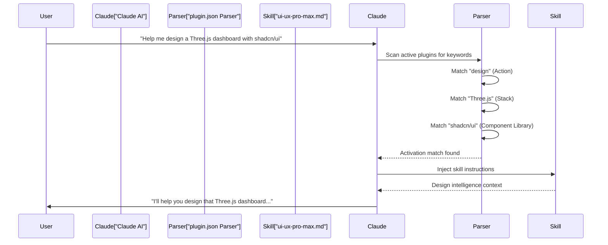

<!-- source: DeepWiki mcp.deepwiki.com · repo nextlevelbuilder/ui-ux-pro-max-skill · page 7.3 Claude Marketplace Integration · fetched 2026-10-26 -->

# Claude Marketplace Integration

<details>
<summary>Relevant source files</summary>

The following files were used as context for generating this wiki page:

- [.claude-plugin/marketplace.json](.claude-plugin/marketplace.json)
- [.claude-plugin/plugin.json](.claude-plugin/plugin.json)
- [skill.json](skill.json)

</details>


This document describes the Claude Marketplace plugin distribution system for UI/UX Pro Max, covering the `plugin.json` and `marketplace.json` configuration files that enable direct installation through Claude's plugin directory. For general platform integration patterns across all supported AI platforms, see [Platform Configuration System]().

## Purpose and Scope

The Claude Marketplace integration provides a native distribution channel for UI/UX Pro Max, enabling users to install the skill directly from Claude's plugin ecosystem. This integration is specific to the Claude platform and uses a two-file configuration system:

1.  **plugin.json**: Defines the plugin runtime metadata, activation keywords, and skill directory paths.
2.  **marketplace.json**: Provides marketplace-specific packaging, versioning, and listing metadata.

Both files reside in the `.claude-plugin/` directory at the repository root.

---

## Plugin Configuration Architecture

The marketplace integration uses a dual-file structure where `plugin.json` defines the runtime behavior and `marketplace.json` handles distribution metadata.

### System Relationship Diagram

```mermaid
graph TB
    subgraph "Distribution_Channels"
        [uipro-cli] -- "init --ai claude" --> [claude.json_Template]
        [Claude_Marketplace] -- "Direct Install" --> [Plugin_Files]
    end
    
    subgraph "Plugin_Files[.claude-plugin/]"
        [plugin.json]
        [marketplace.json]
    end
    
    subgraph "Claude_Skill_Directory[.claude/skills/]"
        [ui-ux-pro-max.md]
        [data_CSV_Files]
        [search.py_Script]
    end

    [plugin.json] -- "skills path" --> [ui-ux-pro-max.md]
    [claude.json_Template] -- "configures" --> [ui-ux-pro-max.md]
    [ui-ux-pro-max.md] -- "queries" --> [data_CSV_Files]
    [ui-ux-pro-max.md] -- "executes" --> [search.py_Script]
```

**Sources:** [.claude-plugin/plugin.json:1-21](), [.claude-plugin/marketplace.json:1-35](), [skill.json:20-41]()

---

## plugin.json Structure

The `plugin.json` file defines the core plugin metadata and activation rules used by the Claude environment.

### Field Specification

| Field | Type | Purpose | Example Value |
| :--- | :--- | :--- | :--- |
| `name` | string | Plugin identifier | `"ui-ux-pro-max"` |
| `description` | string | Keyword-rich activation text | `"UI/UX design intelligence..."` |
| `version` | string | Current semantic version | `"2.13.0"` |
| `author.name` | string | Plugin publisher | `"nextlevelbuilder"` |
| `keywords` | array | Searchable tags | `["ui", "ux", "design", ...]` |
| `skills` | string | Relative path to skill files | `"./.claude/skills/"` |

**Sources:** [.claude-plugin/plugin.json:1-21]()

### Activation Keyword System

The `description` field implements a keyword-rich activation system that enables Claude to auto-detect when the skill should be invoked. As of version 2.13.0, the description includes expanded support for 22 tech stacks.

#### Keyword Categories Table

| Category | Purpose | Examples |
| :--- | :--- | :--- |
| **Actions** | Trigger verbs | designing, building, reviewing |
| **UI Elements** | Component triggers | pages, components, layout, accessibility, animation |
| **Visual Design** | Style triggers | color schemes, typography, data visualization |
| **Frameworks** | Stack detection | React, Next.js, SwiftUI, Flutter, Tailwind, shadcn/ui, Three.js |
| **Desktop/Web** | Platform detection | WPF, WinUI, Avalonia, Uno Platform, UWP |

**Sources:** [.claude-plugin/plugin.json:3-3](), [.claude-plugin/plugin.json:9-19]()

### Activation Pattern Diagram



**Sources:** [.claude-plugin/plugin.json:3-3](), [.claude-plugin/plugin.json:20-20]()

---

## marketplace.json Structure

The `marketplace.json` file provides marketplace-specific metadata for plugin directory listings and publisher identification.

### Root Schema

| Field | Type | Purpose | Value |
| :--- | :--- | :--- | :--- |
| `name` | string | Marketplace listing name | `"ui-ux-pro-max-skill"` |
| `id` | string | Unique marketplace ID | `"ui-ux-pro-max-skill"` |
| `owner.name` | string | Publisher account | `"nextlevelbuilder"` |
| `metadata.version`| string | Listing version | `"2.13.0"` |

**Sources:** [.claude-plugin/marketplace.json:1-10]()

### Plugin Array Schema

The `plugins` array contains the specific distribution configuration for the Claude environment:

| Field | Type | Purpose | Value |
| :--- | :--- | :--- | :--- |
| `name` | string | Internal plugin name | `"ui-ux-pro-max"` |
| `source` | string | Source code path | `"./"` |
| `description` | string | Long-form feature list | Mentions 84 styles, 192 palettes, 22 stacks |
| `category` | string | Marketplace category | `"design"` |
| `strict` | boolean | Validation mode | `false` |

**Sources:** [.claude-plugin/marketplace.json:11-33]()

---

## Comparison with CLI Configuration

The marketplace integration differs from the CLI-based installation defined in the global `skill.json`.

### Configuration Comparison Table

| Aspect | CLI Installation (skill.json) | Marketplace Installation |
| :--- | :--- | :--- |
| **Trigger** | `npx ui-ux-pro-max-cli init` | Direct Marketplace Install |
| **Platforms** | claude, cursor, windsurf, etc. (19+) | Claude Only |
| **Version** | `2.13.0` | `2.13.0` |
| **Target Path** | `{{platform}}` variable | `.claude/skills/` |
| **Command** | `npx ui-ux-pro-max-cli init --ai {{platform}}` | Native plugin loading |

**Sources:** [skill.json:5-41](), [.claude-plugin/plugin.json:1-21]()

---

## Resource Count Verification

The marketplace description includes specific resource counts that reflect the internal database as of version 2.13.0:

| Resource Type | Marketplace Claim | Internal Source |
| :--- | :--- | :--- |
| **UI Styles** | 84 styles | `design.csv` |
| **Color Palettes** | 192 palettes | `color.csv` |
| **Font Pairings** | 74 pairings | `typography.csv` |
| **UX Guidelines** | 98 guidelines | `ux.csv` |
| **Tech Stacks** | 22 stacks | `stack/` directory & CSVs |

**Sources:** [.claude-plugin/plugin.json:3-3](), [.claude-plugin/marketplace.json:8-8](), [skill.json:4-4]()

---

