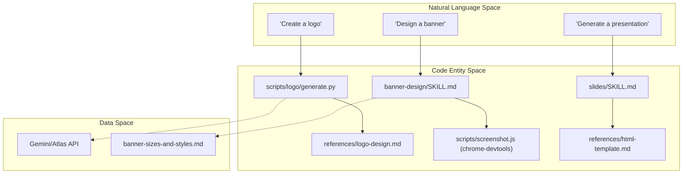
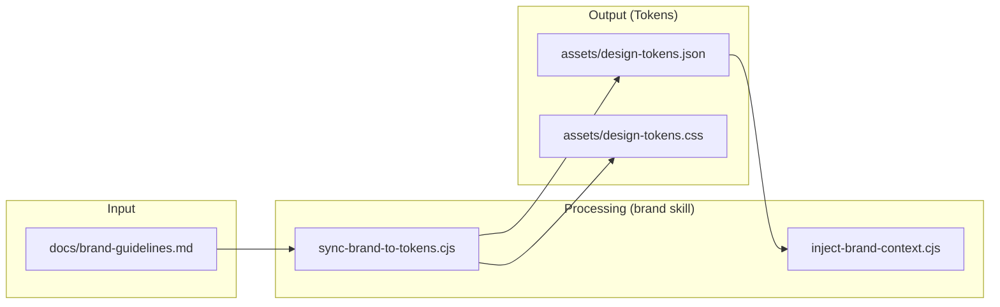

<!-- source: DeepWiki mcp.deepwiki.com · repo nextlevelbuilder/ui-ux-pro-max-skill · page 8 Companion Skills and Tools · fetched 2026-10-26 -->

# Companion Skills and Tools

Relevant source files

The following files were used as context for generating this wiki page:

- [.claude/skills/banner-design/SKILL.md](.claude/skills/banner-design/SKILL.md)
- [.claude/skills/banner-design/references/banner-sizes-and-styles.md](.claude/skills/banner-design/references/banner-sizes-and-styles.md)
- [.claude/skills/brand/SKILL.md](.claude/skills/brand/SKILL.md)
- [.claude/skills/design-system/SKILL.md](.claude/skills/design-system/SKILL.md)
- [.claude/skills/design/SKILL.md](.claude/skills/design/SKILL.md)
- [.claude/skills/design/references/logo-design.md](.claude/skills/design/references/logo-design.md)
- [.claude/skills/design/scripts/logo/generate.py](.claude/skills/design/scripts/logo/generate.py)
- [.claude/skills/design/scripts/logo/tests/test_generate.py](.claude/skills/design/scripts/logo/tests/test_generate.py)
- [.claude/skills/slides/SKILL.md](.claude/skills/slides/SKILL.md)
- [.claude/skills/ui-styling/SKILL.md](.claude/skills/ui-styling/SKILL.md)
- [cli/assets/skills/design/SKILL.md](cli/assets/skills/design/SKILL.md)
- [cli/assets/skills/design/references/logo-design.md](cli/assets/skills/design/references/logo-design.md)
- [cli/assets/skills/design/scripts/logo/generate.py](cli/assets/skills/design/scripts/logo/generate.py)
- [cli/assets/skills/design/scripts/logo/tests/test_generate.py](cli/assets/skills/design/scripts/logo/tests/test_generate.py)
- [gallery/.gitignore](gallery/.gitignore)
- [gallery/app/globals.css](gallery/app/globals.css)
- [gallery/app/layout.tsx](gallery/app/layout.tsx)
- [gallery/app/page.tsx](gallery/app/page.tsx)
- [gallery/app/providers.tsx](gallery/app/providers.tsx)
- [gallery/components/CodeSnippet.tsx](gallery/components/CodeSnippet.tsx)
- [gallery/components/ColorPalette.tsx](gallery/components/ColorPalette.tsx)
- [gallery/components/DarkModeToggle.tsx](gallery/components/DarkModeToggle.tsx)
- [gallery/components/ExpandableSection.tsx](gallery/components/ExpandableSection.tsx)
- [gallery/components/FilterBar.tsx](gallery/components/FilterBar.tsx)
- [gallery/components/GalleryGrid.tsx](gallery/components/GalleryGrid.tsx)

The UI/UX Pro Max ecosystem extends beyond the core design database and search engine. It includes a suite of specialized sub-skills for brand identity, asset generation, and presentation design, alongside standalone tools like the Style Gallery and the Claude Website Design Stack. These companions allow the system to transition from "design intelligence" to "asset production."

### Sub-Skill Ecosystem Architecture

The system uses a routing architecture defined in the primary `design` skill to delegate tasks to specialized sub-skills.

| Skill Name | Role | Key File |
|:---|:---|:---|
| `design` | Orchestrator for all visual sub-skills | [.claude/skills/design/SKILL.md:1-39]() |
| `brand` | Voice, identity, and token synchronization | [.claude/skills/brand/SKILL.md:1-56]() |
| `design-system` | Technical specs and CSS variables | [.claude/skills/design/SKILL.md:31-31]() |
| `ui-styling` | shadcn/ui and Tailwind implementation | [.claude/skills/ui-styling/SKILL.md:1-55]() |
| `slides` | Strategic HTML presentations | [.claude/skills/slides/SKILL.md:1-35]() |
| `banner-design` | Multi-format ad and social creative | [.claude/skills/banner-design/SKILL.md:1-13]() |

---

## 8.1 Design and Brand Sub-skills
The `brand` and `design` skills focus on establishing a "Source of Truth" for identity and generating core visual assets like logos and icons.

*   **Brand Skill:** Manages the `brand-guidelines.md` source of truth and provides scripts to sync these guidelines into `design-tokens.json` and `design-tokens.css` [.claude/skills/brand/SKILL.md:42-56]().
*   **Logo & Icon Generation:** The `design` skill includes built-in support for AI-driven logo generation (55+ styles) using Gemini (Nano Banana) or Atlas Cloud [.claude/skills/design/scripts/logo/generate.py:57-70](). It also handles SVG icon design across 15 styles [.claude/skills/design/SKILL.md:180-182]().
*   **CIP (Corporate Identity Program):** Automates the creation of 50+ deliverables, including business cards and letterheads, with a dedicated mockup generation pipeline [.claude/skills/design/SKILL.md:72-105]().

For details, see [Design and Brand Sub-skills](#8.1).

**Sources:**
- [.claude/skills/design/SKILL.md:1-115]()
- [.claude/skills/brand/SKILL.md:1-97]()
- [.claude/skills/design/scripts/logo/generate.py:1-140]()

---

## 8.2 Slides, Banner, and UI-Styling Sub-skills
These sub-skills handle high-fidelity output for web and marketing contexts.

*   **Slides Skill:** Generates strategic HTML-based presentations using Chart.js for data visualization and predefined layout patterns [.claude/skills/slides/SKILL.md:1-35]().
*   **Banner Design:** A specialized system for creating social media covers, ads, and website heroes across 22 art direction styles [.claude/skills/banner-design/SKILL.md:11-23](). It uses `chrome-devtools` to export HTML/CSS designs to PNG at exact dimensions [.claude/skills/banner-design/SKILL.md:102-122]().
*   **UI-Styling:** Focuses on the implementation of `shadcn/ui` and `Tailwind CSS`. It includes automation scripts like `shadcn_add.py` and `tailwind_config_gen.py` to rapidly scaffold accessible interfaces [.claude/skills/ui-styling/SKILL.md:211-226]().

For details, see [Slides, Banner, and UI-Styling Sub-skills](#8.2).

**Sources:**
- [.claude/skills/slides/SKILL.md:1-40]()
- [.claude/skills/banner-design/SKILL.md:1-172]()
- [.claude/skills/ui-styling/SKILL.md:1-235]()

---

## 8.3 Style Gallery
The `gallery/` directory contains a standalone Next.js application that serves as a visual browser for the 84+ UI styles defined in the design database.

*   **Component Architecture:** Uses a `GalleryGrid` and `FilterBar` to allow users to explore styles by category or technology stack.
*   **Visual Extraction:** The gallery visualizes color palettes and typography choices directly from the CSV data, providing a "live" look at the design intelligence.
*   **Integration:** The `design` skill workflow suggests invoking the gallery via `/ui-ux-pro-max` after logo or CIP generation to provide the user with a visual preview [.claude/skills/design/SKILL.md:70-71]().

For details, see [Style Gallery](#8.3).

**Sources:**
- [.claude/skills/design/SKILL.md:70-71]()
- [gallery/app/page.tsx]()
- [gallery/components/GalleryGrid.tsx]()

---

## 8.4 Claude Website Design Stack
The `stack/` directory provides a "ready-to-clone" project configuration designed specifically for use with **Claude Code**.

*   **Workflow Integration:** It wires together `ui-ux-pro-max` for design intelligence, `frontend-design` for implementation, and the `shadcn` MCP for component management.
*   **Design Review Subagent:** Includes a configuration for a design-review subagent that uses the `pre-delivery checklist` to audit generated code for accessibility and brand compliance.
*   **Playwright Integration:** Uses Playwright MCP for automated visual regression testing and design validation.

For details, see [Claude Website Design Stack](#8.4).

**Sources:**
- [.claude/skills/banner-design/SKILL.md:3-3]() (Mentions of skill inter-dependencies)
- [.claude/skills/ui-styling/SKILL.md:33-55]()

---

### System Entity Mapping

This diagram maps the high-level sub-skills to their specific implementation scripts and reference files.

**Diagram: Sub-Skill Code Mapping**

**Sources:**
- [.claude/skills/design/SKILL.md:33-38]()
- [.claude/skills/banner-design/SKILL.md:109-114]()
- [.claude/skills/slides/SKILL.md:27-35]()

**Diagram: Brand-to-Token Synchronization Flow**

**Sources:**
- [.claude/skills/brand/SKILL.md:42-56]()
- [.claude/skills/brand/SKILL.md:78-86]()

---

