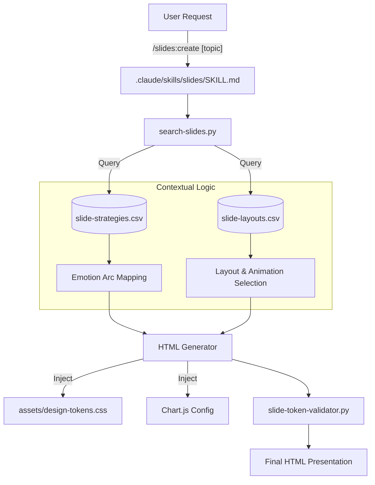
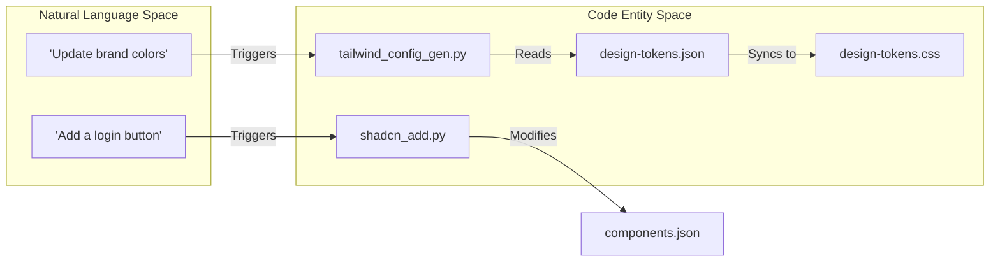

<!-- source: DeepWiki mcp.deepwiki.com · repo nextlevelbuilder/ui-ux-pro-max-skill · page 8.2 Slides, Banner, and UI-Styling Sub-skills · fetched 2026-10-26 -->

# Slides, Banner, and UI-Styling Sub-skills

Relevant source files

The following files were used as context for generating this wiki page:

- [.claude/skills/banner-design/SKILL.md](.claude/skills/banner-design/SKILL.md)
- [.claude/skills/banner-design/references/banner-sizes-and-styles.md](.claude/skills/banner-design/references/banner-sizes-and-styles.md)
- [.claude/skills/brand/SKILL.md](.claude/skills/brand/SKILL.md)
- [.claude/skills/design-system/SKILL.md](.claude/skills/design-system/SKILL.md)
- [.claude/skills/slides/SKILL.md](.claude/skills/slides/SKILL.md)
- [.claude/skills/ui-styling/LICENSE.txt](.claude/skills/ui-styling/LICENSE.txt)
- [.claude/skills/ui-styling/SKILL.md](.claude/skills/ui-styling/SKILL.md)
- [.claude/skills/ui-styling/canvas-fonts/ArsenalSC-OFL.txt](.claude/skills/ui-styling/canvas-fonts/ArsenalSC-OFL.txt)
- [.claude/skills/ui-styling/canvas-fonts/ArsenalSC-Regular.ttf](.claude/skills/ui-styling/canvas-fonts/ArsenalSC-Regular.ttf)
- [.claude/skills/ui-styling/canvas-fonts/BigShoulders-Bold.ttf](.claude/skills/ui-styling/canvas-fonts/BigShoulders-Bold.ttf)
- [.claude/skills/ui-styling/canvas-fonts/BigShoulders-OFL.txt](.claude/skills/ui-styling/canvas-fonts/BigShoulders-OFL.txt)
- [.claude/skills/ui-styling/canvas-fonts/BigShoulders-Regular.ttf](.claude/skills/ui-styling/canvas-fonts/BigShoulders-Regular.ttf)
- [.claude/skills/ui-styling/canvas-fonts/Boldonse-OFL.txt](.claude/skills/ui-styling/canvas-fonts/Boldonse-OFL.txt)
- [.claude/skills/ui-styling/canvas-fonts/Boldonse-Regular.ttf](.claude/skills/ui-styling/canvas-fonts/Boldonse-Regular.ttf)
- [.claude/skills/ui-styling/canvas-fonts/BricolageGrotesque-Bold.ttf](.claude/skills/ui-styling/canvas-fonts/BricolageGrotesque-Bold.ttf)
- [.claude/skills/ui-styling/canvas-fonts/BricolageGrotesque-OFL.txt](.claude/skills/ui-styling/canvas-fonts/BricolageGrotesque-OFL.txt)
- [.claude/skills/ui-styling/scripts/shadcn_add.py](.claude/skills/ui-styling/scripts/shadcn_add.py)

This section documents the specialized design capabilities bundled within the UI/UX Pro Max system. These sub-skills extend the core design intelligence by providing executable workflows for high-fidelity presentations, multi-format advertising banners, and programmatic UI component styling.

## 1. Slides Skill (Strategic Presentations)

The `slides` skill facilitates the creation of strategic HTML-based presentations. It integrates **Chart.js** for data visualization and utilizes a **BM25-based search engine** to retrieve slide strategies, copywriting formulas, and layout patterns.

### Implementation Details
The system follows a token-compliant architecture, where every generated slide must import `assets/design-tokens.css` as its single source of truth for styling [ .claude/skills/design-system/SKILL.md:112-120]().

**Key Components:**
*   **Decision System:** Uses a series of CSV files (e.g., `slide-strategies.csv`, `slide-layouts.csv`) to map user goals to specific emotional arcs and layout structures [ .claude/skills/design-system/SKILL.md:136-147]().
*   **Duarte Sparkline Logic:** A pattern-breaking mechanism that alternates between "What Is" (frustration) and "What Could Be" (hope) states at specific slide positions (1/3 and 2/3) [ .claude/skills/design-system/SKILL.md:168-175]().
*   **Search Interface:** The `search-slides.py` script provides contextual recommendations based on slide position and previous emotional beats [ .claude/skills/design-system/SKILL.md:121-134]().

### Presentation Data Flow
The following diagram illustrates how a user request is transformed into a token-validated HTML presentation.

**Presentation Generation Pipeline**

**Sources:** [ .claude/skills/slides/SKILL.md:36-41](), [ .claude/skills/design-system/SKILL.md:121-166]()

---

## 2. Banner-Design Skill (Multi-Format Creative)

The `banner-design` skill is a multi-format creative system capable of generating banners for social media, display ads, and website hero sections. It leverages 22 distinct art direction styles and utilizes a dual-model AI approach for asset generation.

### Art Direction and Styles
The system supports a wide range of styles including **Minimalist**, **Glassmorphism**, **Neon/Cyberpunk**, and **Bold Typography** [ .claude/skills/banner-design/references/banner-sizes-and-styles.md:49-72]().

### Technical Workflow
1.  **Research:** Uses Pinterest search queries to gather inspiration [ .claude/skills/banner-design/SKILL.md:40-50]().
2.  **Generation:** Employs `gemini-2.5-flash-image` for backgrounds and `gemini-3-pro-image-preview` for detailed hero illustrations [ .claude/skills/banner-design/SKILL.md:68-91]().
3.  **Composition:** Overlays text and CTAs using HTML/CSS via the `frontend-design` skill [ .claude/skills/banner-design/SKILL.md:100]().
4.  **Export:** Uses `screenshot.js` (via `chrome-devtools`) to capture the HTML at exact platform dimensions (e.g., 1500x500 for Twitter) [ .claude/skills/banner-design/SKILL.md:102-122]().

### Banner Specification Table
| Platform | Type | Size (px) | Aspect Ratio |
| :--- | :--- | :--- | :--- |
| Facebook | Cover | 820 × 312 | ~2.6:1 |
| Twitter/X | Header | 1500 × 500 | 3:1 |
| LinkedIn | Personal | 1584 × 396 | 4:1 |
| YouTube | Channel art | 2560 × 1440 | 16:9 |

**Sources:** [ .claude/skills/banner-design/SKILL.md:1-13](), [ .claude/skills/banner-design/references/banner-sizes-and-styles.md:6-16]()

---

## 3. UI-Styling Skill (shadcn/ui & Tailwind)

The `ui-styling` skill focuses on implementing accessible, modern user interfaces using **shadcn/ui** (Radix UI primitives) and **Tailwind CSS**.

### Implementation Tools
The skill provides two primary Python scripts for project automation:
*   `shadcn_add.py`: Wraps the shadcn CLI to install components with automatic dependency handling and version detection from `package.json` [ .claude/skills/ui-styling/scripts/shadcn_add.py:17-80]().
*   `tailwind_config_gen.py`: Programmatically generates `tailwind.config.js` files with custom theme extensions for colors and fonts [ .claude/skills/ui-styling/SKILL.md:221-226]().

### Canvas Fonts
The skill includes a library of high-quality, open-source fonts (OFL licensed) located in `.claude/skills/ui-styling/canvas-fonts/` for use in visual designs and canvas-based compositions [ .claude/skills/ui-styling/SKILL.md:49-55]().

**Supported Fonts:**
*   **Arsenal SC**: A semi-serif typeface [ .claude/skills/ui-styling/canvas-fonts/ArsenalSC-OFL.txt:1]().
*   **Bricolage Grotesque**: A modern grotesque [ .claude/skills/ui-styling/canvas-fonts/BricolageGrotesque-OFL.txt:1]().
*   **Big Shoulders**: A condensed sans-serif [ .claude/skills/ui-styling/canvas-fonts/BigShoulders-OFL.txt:1]().
*   **Boldonse**: A high-impact display font [ .claude/skills/ui-styling/canvas-fonts/Boldonse-OFL.txt:18]().

### UI Styling Architecture
The following diagram bridges the Natural Language request to the specific code entities used for UI generation.

**UI Styling Entity Mapping**

**Sources:** [ .claude/skills/ui-styling/scripts/shadcn_add.py:9-31](), [ .claude/skills/ui-styling/SKILL.md:213-226](), [ .claude/skills/brand/SKILL.md:42-56]()

### Summary of Scripts
| Script | Purpose | Path |
| :--- | :--- | :--- |
| `shadcn_add.py` | Programmatic component installation | `.claude/skills/ui-styling/scripts/shadcn_add.py` |
| `tailwind_config_gen.py` | Theme configuration generation | `.claude/skills/ui-styling/scripts/tailwind_config_gen.py` |
| `search-slides.py` | BM25 retrieval for slide assets | `.claude/skills/design-system/SKILL.md:90` |
| `slide-token-validator.py` | HTML compliance checking | `.claude/skills/design-system/SKILL.md:91` |

**Sources:** [ .claude/skills/ui-styling/SKILL.md:213-226](), [ .claude/skills/design-system/SKILL.md:85-93]()

---

