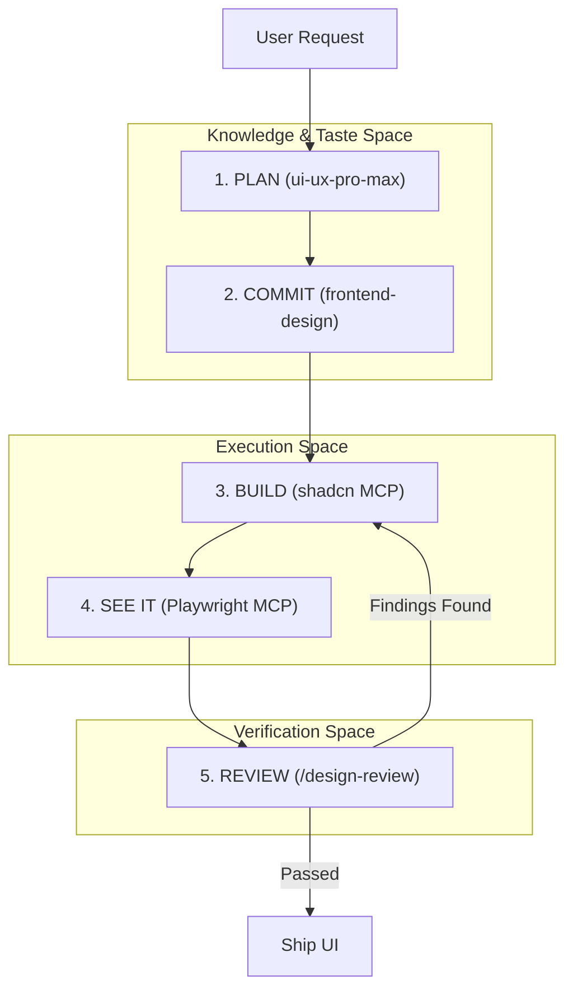

<!-- source: DeepWiki mcp.deepwiki.com · repo nextlevelbuilder/ui-ux-pro-max-skill · page 8.4 Claude Website Design Stack · fetched 2026-10-26 -->

# Claude Website Design Stack

Relevant source files

The following files were used as context for generating this wiki page:

- [projects/healthcare-dashboard/index.html](projects/healthcare-dashboard/index.html)
- [projects/portfolio-dark/index.html](projects/portfolio-dark/index.html)
- [projects/saas-landing/index.html](projects/saas-landing/index.html)
- [stack/.claude/agents/design-review.md](stack/.claude/agents/design-review.md)
- [stack/.claude/commands/design-plan.md](stack/.claude/commands/design-plan.md)
- [stack/.claude/commands/design-review.md](stack/.claude/commands/design-review.md)
- [stack/.claude/settings.json](stack/.claude/settings.json)
- [stack/.github/workflows/design-review.yml](stack/.github/workflows/design-review.yml)
- [stack/.gitignore](stack/.gitignore)
- [stack/.mcp.json](stack/.mcp.json)
- [stack/CLAUDE.md](stack/CLAUDE.md)
- [stack/README.md](stack/README.md)
- [stack/docs/SETUP.md](stack/docs/SETUP.md)
- [stack/docs/STACK.md](stack/docs/STACK.md)

The `stack/` directory provides a ready-to-clone **Claude Code project** designed to elevate AI-assisted web design from generic outputs to production-grade, accessible, and distinctive user interfaces. It addresses the common "AI slop" failure mode by integrating a knowledge layer for data-driven decisions, a taste layer for aesthetic commitment, and a visual feedback loop using real browser instrumentation [stack/README.md:1-11]().

## System Purpose and Components

The stack wires together multiple tools to create a closed-loop design workflow where the AI agent can "see" its work and self-correct against professional standards [stack/README.md:14-20]().

### Core Integration Layers

| Layer | Component | Functionality |
| :--- | :--- | :--- |
| **Knowledge** | `ui-ux-pro-max` | Provides 84 UI styles, 192 palettes, and 99 UX rules via a searchable Python CLI [stack/docs/STACK.md:13-18](). |
| **Taste** | `frontend-design` | An Anthropic plugin that forces decisions on tone and differentiation to avoid generic defaults [stack/docs/STACK.md:24-33](). |
| **Components** | `shadcn` MCP | Enables natural language discovery and installation of production-ready UI components [stack/docs/STACK.md:35-40](). |
| **Feedback** | Playwright & DevTools MCP | Allows Claude to open a real Chromium instance, take screenshots, and read console errors [stack/docs/STACK.md:42-50](). |
| **Review** | `design-review` Subagent | A specialized agent profile that performs a 7-phase audit across 5-7 viewport tiers [stack/docs/STACK.md:52-57](). |

**Sources:** [stack/README.md:14-20](), [stack/docs/STACK.md:1-57]()

## The Design Loop Workflow

The stack enforces a strict sequence of operations, defined in `CLAUDE.md`, to ensure design integrity from planning to delivery [stack/CLAUDE.md:9-42]().

### Workflow Execution Diagram

**Sources:** [stack/CLAUDE.md:9-42](), [stack/README.md:36-38]()

## Implementation Details

### Configuration and Environment
The stack uses `.mcp.json` to define the Model Context Protocol servers for Playwright, Chrome DevTools, and shadcn [stack/README.md:50](). Permissions are managed via `.claude/settings.json`, which enables project-specific MCP servers and grants necessary bash execution rights for auditing scripts [stack/.claude/settings.json:1-15]().

### The `design-review` Subagent
Located at `.claude/agents/design-review.md`, this subagent acts as a senior product design reviewer. It is instructed to "assess the live experience first" by interacting with the UI before reading source code [stack/.claude/agents/design-review.md:12-21]().

**The 7-Phase Audit Process:**
1.  **Phase 0 (Setup):** Baseline rendering and console error check [stack/.claude/agents/design-review.md:34-36]().
2.  **Phase 1 (Interaction):** Testing hover, active, and disabled states [stack/.claude/agents/design-review.md:38-41]().
3.  **Phase 2 (Responsiveness):** Screenshotting at 375, 768, 1024, 1440, and 1920px [stack/.claude/agents/design-review.md:43-46]().
4.  **Phase 3 (Visual Polish):** Checking spacing rhythm and token discipline [stack/.claude/agents/design-review.md:48-50]().
5.  **Phase 4 (Accessibility):** WCAG 2.1 AA check including focus order and contrast [stack/.claude/agents/design-review.md:52-56]().
6.  **Phase 5 (Robustness):** Testing edge cases like long strings or slow networks [stack/.claude/agents/design-review.md:58-60]().
7.  **Phase 6 (Health):** Final performance and layout-shift (CLS) check [stack/.claude/agents/design-review.md:62-64]().

### Custom Slash Commands
The stack provides two primary custom commands for Claude Code:
*   `/design-plan`: Triggers `scripts/search.py` with the `--design-system` flag to generate tokens before building [stack/.claude/commands/design-plan.md:6-12]().
*   `/design-review`: Invokes the `design-review` subagent to audit a specific URL or file [stack/.claude/commands/design-review.md:6-10]().

**Sources:** [stack/.claude/settings.json:1-15](), [stack/.claude/agents/design-review.md:29-65](), [stack/.claude/commands/design-plan.md:1-26](), [stack/.claude/commands/design-review.md:1-15]()

## Data Flow: Natural Language to Code Entity

This diagram illustrates how a natural language design prompt is transformed into code entities through the stack's integrated tools.

```mermaid
flowchart LR
    Prompt["'Modern Fintech Dashboard'"] -- "1. /design-plan" --> SearchPy["search.py --design-system"]
    SearchPy -- "Retrieves" --> Tokens["MASTER.md (Design Tokens)"]
    
    Tokens -- "2. commit" --> FrontendPlugin["frontend-design plugin"]
    FrontendPlugin -- "Defines" --> StyleCommit["Aesthetic Rationale"]
    
    StyleCommit -- "3. build" --> ShadcnMCP["mcp__shadcn"]
    ShadcnMCP -- "Installs" --> Components["/components/ui/*.tsx"]
    
    Components -- "4. audit" --> AuditScript["design-audit.mjs"]
    AuditScript -- "Executes" --> Playwright["mcp__playwright"]
    Playwright -- "Generates" --> Report["audit-output/report.md"]
```

**Sources:** [stack/CLAUDE.md:9-42](), [stack/.claude/commands/design-plan.md:1-26](), [stack/README.md:48-68](), [stack/docs/SETUP.md:42-51]()

## Standalone Audit Script
For environments without Claude Code (e.g., CI/CD), the stack includes `scripts/design-audit.mjs`. This script performs multi-viewport screenshots and heuristic checks for horizontal overflow, missing focus styles, and tap-target sizes [stack/README.md:70-82](). It returns a non-zero exit code if high-severity findings are detected, making it suitable for GitHub Actions integration [stack/docs/SETUP.md:49-50]().

**Sources:** [stack/README.md:70-82](), [stack/docs/SETUP.md:42-51](), [stack/.github/workflows/design-review.yml]()

---

