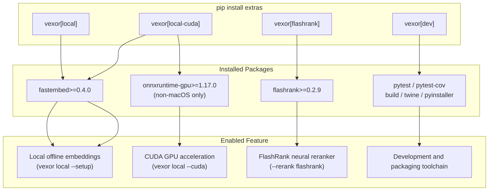
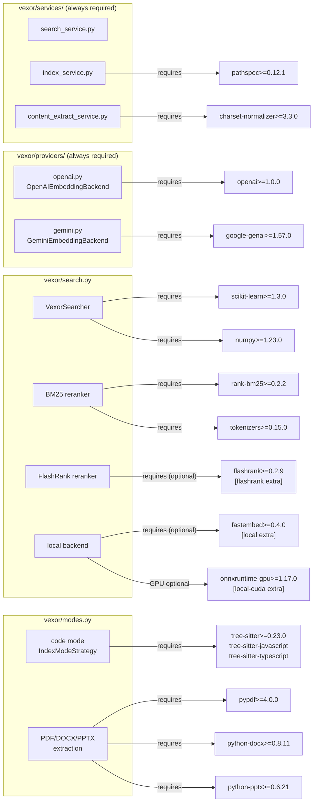

<!-- source: DeepWiki mcp.deepwiki.com · repo scarletkc/vexor · page 1.4 System Requirements · fetched 2026-10-26 -->

# System Requirements

Relevant source files

The following files were used as context for generating this wiki page:

- [README.md](README.md)

This page lists the Python version requirements, required and optional package dependencies, and OS compatibility notes for running Vexor. For installation steps, see [Installation](#2.1). For configuring optional features like local models and reranking, see [Provider Configuration](#8.2) and [Reranking Strategies](#3.4).

---

## Python Version

Vexor requires **Python 3.9 or later**.

[pyproject.toml:12-12]()

If you are using the standalone binary from the GitHub releases page, no Python installation is needed.

---

## Required Dependencies

These packages are installed automatically when you run `pip install vexor`. They cover the core search pipeline, embedding provider clients, content extraction, and the CLI interface.

| Package | Minimum Version | Role |
|---|---|---|
| `openai` | 1.0.0 | OpenAI embedding provider client |
| `google-genai` | 1.57.0 | Gemini embedding provider client |
| `scikit-learn` | 1.3.0 | Cosine similarity scoring |
| `numpy` | 1.23.0 | Vector math and embedding storage |
| `rank-bm25` | 0.2.2 | BM25 reranking (`BM25Okapi`) |
| `tokenizers` | 0.15.0 | Multilingual tokenizer for BM25 (BERT pre-tokenizer) |
| `typer` | 0.9.0 | CLI framework (`vexor/cli.py`) |
| `rich` | 13.0.0 | Terminal output formatting (`vexor/text.py`) |
| `pathspec` | 0.12.1 | `.gitignore`-style file filtering (`vexor/utils.py`) |
| `python-dotenv` | 1.0.0 | `.env` file loading for API keys |
| `charset-normalizer` | 3.3.0 | File encoding detection during content extraction |
| `pypdf` | 4.0.0 | PDF content extraction |
| `python-docx` | 0.8.11 | `.docx` content extraction |
| `python-pptx` | 0.6.21 | `.pptx` content extraction |
| `tree-sitter` | 0.23.0 | AST parsing for code indexing (`code` mode) |
| `tree-sitter-javascript` | 0.23.0 | JavaScript AST grammar |
| `tree-sitter-typescript` | 0.23.0 | TypeScript AST grammar |

Sources: [pyproject.toml:29-47]()

---

## Optional Dependencies (Extras)

Optional extras enable specific features. Install them with the bracket syntax shown below.

### Dependency map

**Diagram: Optional extras and their enabled features**

Sources: [pyproject.toml:51-68]()

### Summary table

| Extra | Install Command | Key Package | Feature Unlocked |
|---|---|---|---|
| `local` | `pip install "vexor[local]"` | `fastembed>=0.4.0` | Offline local embedding models via `fastembed` |
| `local-cuda` | `pip install "vexor[local-cuda]"` | `fastembed`, `onnxruntime-gpu>=1.17.0` | GPU-accelerated local embeddings (requires CUDA drivers) |
| `flashrank` | `pip install "vexor[flashrank]"` | `flashrank>=0.2.9` | Neural reranking via `FlashRank` |
| `dev` | `pip install "vexor[dev]"` | `pytest`, `pyinstaller`, etc. | Test suite, packaging, publishing |

Sources: [pyproject.toml:51-68]()

> **Note:** `onnxruntime-gpu` is excluded on macOS (`platform_system != "Darwin"`). On macOS, GPU acceleration via ONNX Runtime is not supported; use `vexor[local]` (CPU only) instead.

---

## Feature-to-Package Dependency Map

This diagram maps Vexor code-level features to the concrete Python packages they require.

**Diagram: Code entity to dependency mapping**

Sources: [pyproject.toml:29-68](), [README.md:198-219]()

---

## Operating System Compatibility

Vexor's `pyproject.toml` classifies it as `Operating System :: OS Independent`. In practice:

| OS | Support Level | Notes |
|---|---|---|
| **Linux** | Full | All extras supported including `local-cuda` |
| **macOS** | Full | `onnxruntime-gpu` excluded; CPU-only local models via `[local]` |
| **Windows** | Full | All extras supported including `local-cuda` |

Sources: [pyproject.toml:14-28](), [pyproject.toml:56-57]()

---

## Storage Requirements

Vexor writes persistent data to `~/.vexor/` at runtime. No specific disk quota is enforced, but storage usage scales with indexed corpus size:

| Item | Default Location | Notes |
|---|---|---|
| Config file (`config.json`) | `~/.vexor/config.json` | Small; JSON text |
| SQLite index database (`index.db`) | `~/.vexor/` | Grows with number of indexed chunks and embeddings |
| Local embedding models | `~/.vexor/models/` | Model-dependent; typically hundreds of MB |
| FlashRank model cache | `~/.vexor/flashrank/` | Model-dependent; `ms-marco-TinyBERT-L-2-v2` is the default |

These paths are managed by `vexor/config.py` (`load_config`, `save_config`) and `vexor/cache.py`. Use `vexor local --clean-up` and `vexor config --clear-flashrank` to reclaim disk space.

Sources: [README.md:148-148](), [README.md:217-218]()

---

