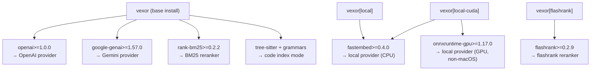

<!-- source: DeepWiki mcp.deepwiki.com · repo scarletkc/vexor · page 2.1 Installation · fetched 2026-10-26 -->

# Installation

<details>
<summary>Relevant source files</summary>

The following files were used as context for generating this wiki page:

- [README.md](README.md)

</details>


This page covers all supported methods for installing Vexor and its optional dependency extras. It applies to the Python package distributed via PyPI as well as the standalone binary distribution. For first-run configuration after installation, see [First-Run Setup](#2.5). For system requirements (Python version, OS compatibility), see [System Requirements](#1.4).

---

## Installation Methods

Vexor can be installed in three ways. All three produce the same `vexor` CLI entry point and the same importable `vexor` Python package.

| Method | Command | Notes |
|---|---|---|
| `pip` | `pip install vexor` | Standard; installs into the active environment |
| `pipx` | `pipx install vexor` | Isolated environment; recommended for CLI-only use |
| `uv` | `uv pip install vexor` or `uv tool install vexor` | Fast resolver alternative |
| Standalone binary | Download from GitHub releases | No Python required |

The CLI entry point is declared in [pyproject.toml:73-74]() as `vexor = "vexor.cli:run"`, mapping the `vexor` shell command to the `run` function in `vexor/cli.py`.

Sources: [README.md:38-43](), [pyproject.toml:73-74]()

---

## Optional Extras

The base `vexor` package installs only remote-provider dependencies (OpenAI, Gemini, VoyageAI). Additional capabilities require optional extras declared in [pyproject.toml:51-68]().

| Extra | Install Command | What It Adds |
|---|---|---|
| `local` | `pip install "vexor[local]"` | `fastembed>=0.4.0` — enables the `local` embedding provider (CPU) |
| `local-cuda` | `pip install "vexor[local-cuda]"` | `fastembed>=0.4.0` + `onnxruntime-gpu>=1.17.0` — enables the `local` provider with GPU acceleration (not available on macOS) |
| `flashrank` | `pip install "vexor[flashrank]"` | `flashrank>=0.2.9` — enables the `flashrank` reranking strategy |
| `dev` | `pip install "vexor[dev]"` | `pytest`, `pytest-cov`, `build`, `twine`, `pyinstaller` — development tooling only |

> **Note:** `local-cuda` excludes `onnxruntime-gpu` on Darwin (`platform_system != "Darwin"`), as declared in [pyproject.toml:56-58]().

Sources: [pyproject.toml:51-68](), [README.md:200-219]()

---

## Core Dependencies

The base install pulls in these required packages ([pyproject.toml:29-47]()):

| Package | Purpose |
|---|---|
| `openai>=1.0.0` | OpenAI embedding provider |
| `google-genai>=1.57.0` | Gemini embedding provider |
| `rank-bm25>=0.2.2` | BM25 reranking (always available; no extra needed) |
| `scikit-learn>=1.3.0` | Cosine similarity scoring |
| `numpy>=1.23.0` | Vector math |
| `tokenizers>=0.15.0` | Multilingual tokenizer (used by BM25) |
| `typer>=0.9.0` | CLI framework |
| `rich>=13.0.0` | Terminal output formatting |
| `tree-sitter>=0.23.0` | AST-based code chunking |
| `tree-sitter-javascript>=0.23.0` | JS grammar for code mode |
| `tree-sitter-typescript>=0.23.0` | TS grammar for code mode |
| `pypdf>=4.0.0` | PDF content extraction |
| `python-docx>=0.8.11` | DOCX content extraction |
| `python-pptx>=0.6.21` | PPTX content extraction |
| `pathspec>=0.12.1` | `.gitignore`-style path filtering |
| `python-dotenv>=1.0.0` | `.env` file loading for API keys |
| `charset-normalizer>=3.3.0` | File encoding detection |

Sources: [pyproject.toml:29-47]()

---

## Dependency and Extra Relationships

**Diagram: Install extras mapped to providers and strategies**



Sources: [pyproject.toml:29-68](), [README.md:163-168]()

---

## Standalone Binary

A pre-built binary is available on the GitHub releases page. It bundles a Python interpreter and all core dependencies via PyInstaller (see [pyproject.toml:64]() for the `pyinstaller` dev dependency). No Python installation is required.

The binary exposes the same `vexor` CLI as the pip-installed package. Optional extras (e.g., `local`, `flashrank`) are not available in the standalone binary.

Sources: [README.md:40-41](), [README.md:87](), [pyproject.toml:64]()

---

## Entry Point Resolution

**Diagram: How the `vexor` shell command maps to source code**

```mermaid
flowchart LR
    shell["\"vexor\" shell command"]
    entry["pyproject.toml\nscripts.vexor = \"vexor.cli:run\""]
    cli["vexor/cli.py\nrun()"]
    typer_app["typer app\n(commands: search, index, config, init, ...)"]

    shell --> entry
    entry --> cli
    cli --> typer_app
```

Sources: [pyproject.toml:73-74]()

---

## Python Version Requirement

Vexor requires **Python 3.9 or later**, as declared in [pyproject.toml:12]():

```
requires-python = ">=3.9"
```

Sources: [pyproject.toml:12](), [README.md:7]()

---

## Post-Installation

After installation, run the guided setup wizard:

```
vexor init
```

This configures the embedding provider, API key, and optional reranking. The wizard also runs automatically on first use when no config file exists at `~/.vexor/config.json`. See [First-Run Setup](#2.5) for full details.

To verify the installation:

```
vexor doctor
```

`vexor doctor` checks the command path, config file, cache directory, API key presence, and API connectivity. See [vexor doctor and update](#4.5) for what each check covers.

Sources: [README.md:47-51](), [README.md:266]()

---

