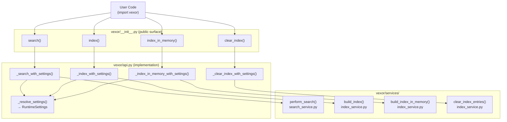
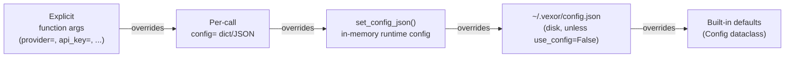
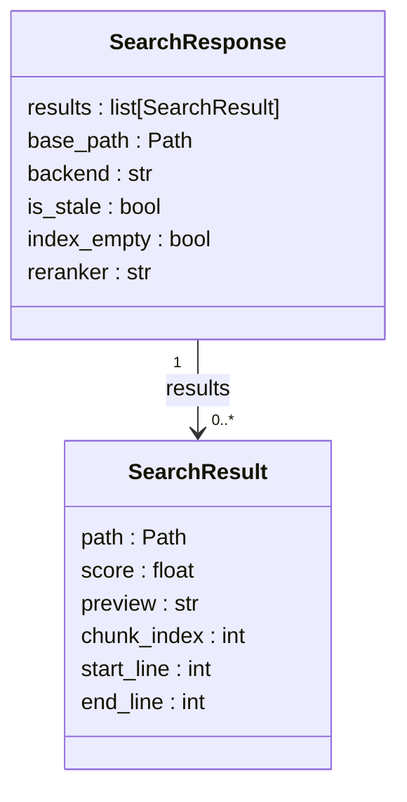

<!-- source: DeepWiki mcp.deepwiki.com · repo scarletkc/vexor · page 2.3 Quick Start - Python API · fetched 2026-10-26 -->

# Quick Start - Python API

<details>
<summary>Relevant source files</summary>

The following files were used as context for generating this wiki page:

- [README.md](README.md)
- [docs/api/python.md](docs/api/python.md)
- [plugins/vexor/.claude-plugin/plugin.json](plugins/vexor/.claude-plugin/plugin.json)
- [tests/unit/test_api.py](tests/unit/test_api.py)
- [vexor/__init__.py](vexor/__init__.py)
- [vexor/api.py](vexor/api.py)

</details>


This page covers the minimal steps to import Vexor as a Python library and perform your first index and search operations. It uses the top-level convenience functions exported from `vexor/__init__.py`.

For a complete parameter reference, see the [Python API Reference](#5). For CLI-based usage, see [Quick Start - CLI](#2.2). For session-scoped or library-style usage patterns (e.g., `VexorClient`, `config_context`), see [VexorClient Class](#5.4) and [Configuration Management](#5.5).

---

## Public API Surface

All user-facing symbols are re-exported from [vexor/\_\_init\_\_.py:1-38](). The `__all__` list defines the complete public contract:

| Symbol | Kind | Purpose |
|---|---|---|
| `search` | function | Run a semantic search against an indexed directory |
| `index` | function | Build or refresh the persistent disk index |
| `index_in_memory` | function | Build a temporary index without writing to disk |
| `clear_index` | function | Remove cached index entries for a directory |
| `VexorClient` | class | Session wrapper that holds shared config/dir state |
| `config_context` | context manager | Scoped config override, yields a `VexorClient` |
| `set_config_json` | function | Set a global in-memory config override |
| `set_data_dir` | function | Redirect config and cache to a custom directory |
| `InMemoryIndex` | class | Return type of `index_in_memory`; supports `.search()` |
| `VexorError` | exception | Raised for invalid API inputs |

Sources: [vexor/\_\_init\_\_.py:1-38]()

---

## Basic Workflow

The most common pattern is: index a directory once, then search repeatedly.

**Step 1 — Index**

Call `index()` to build the embedding cache for a directory. On subsequent calls, only changed files are re-embedded.

```
from vexor import index
index(path=".", mode="head")
```

See [vexor/api.py:574-624]() for the function signature.

**Step 2 — Search**

Call `search()` with a natural-language query. By default, `auto_index=True` so an index is built automatically if none exists.

```
from vexor import search

response = search("config loader", path=".", mode="name")
for hit in response.results:
    print(hit.path, hit.score)
```

See [vexor/api.py:511-571]() for the function signature.

Sources: [docs/api/python.md:8-16](), [README.md:93-101]()

---

## Call Flow Diagram

**Diagram: How `search()` and `index()` route through the API layer**



Sources: [vexor/api.py:511-707](), [vexor/\_\_init\_\_.py:1-38]()

---

## Configuration

By default, all functions read `~/.vexor/config.json`. You can override settings at three levels.

### Option 1: Explicit function arguments

Pass provider and key directly on each call:

```
response = search(
    "config loader",
    path=".",
    provider="openai",
    api_key="YOUR_KEY",
    mode="name",
    top=5,
)
```

### Option 2: Per-call `config` dict

Pass a `config` mapping to override a subset of settings without affecting global state:

```
response = search(
    "config loader",
    path=".",
    config={"provider": "gemini", "api_key": "YOUR_KEY", "rerank": "bm25"},
)
```

### Option 3: `set_config_json` (global in-memory override)

Set once, applies to all subsequent module-level calls. Does not write to disk.

```
from vexor import set_config_json, search

set_config_json({"provider": "openai", "api_key": "YOUR_KEY"})
response = search("config loader", path=".")
set_config_json(None)  # clear override
```

### Configuration Precedence

Settings are resolved from highest to lowest priority:



Sources: [docs/api/python.md:42-48](), [vexor/api.py:1029-1105]()

---

## Reading Results

`search()` returns a `SearchResponse`. Each hit is a `SearchResult`.

**Diagram: Return type structure**



```
response = search("database connection", path=".")

print(response.backend)     # e.g. "openai / text-embedding-3-small"
print(response.is_stale)    # True if index may be out of date

for hit in response.results:
    print(f"{hit.score:.3f}  {hit.path}")
    if hit.preview:
        print(f"  {hit.preview}")
```

Sources: [docs/api/python.md:81-85](), [vexor/api.py:36-50]()

---

## In-Memory Index

`index_in_memory()` builds embeddings without writing to disk. Useful for ephemeral use cases such as test fixtures or scanning a temporary directory. Returns an `InMemoryIndex` object with its own `.search()` method.

```
from vexor import index_in_memory

mem_index = index_in_memory(path="./src", mode="code", use_config=False,
                             provider="openai", api_key="YOUR_KEY")
response = mem_index.search("database connection", top=3)
```

`InMemoryIndex.search()` accepts `top`, `rerank`, `flashrank_model`, and `remote_rerank`. It always operates with `no_cache=True`.

See [vexor/api.py:74-162]() for the `InMemoryIndex` dataclass and its `.search()` method.

Sources: [docs/api/python.md:94-96](), [vexor/api.py:627-679]()

---

## Session-Style Usage with `VexorClient`

`VexorClient` holds shared `data_dir`, `config_dir`, `cache_dir`, and runtime config across multiple calls. Prefer it when making many calls with consistent settings.

```
from vexor import VexorClient

client = VexorClient(data_dir="/tmp/vexor_test", use_config=False)
client.set_config_json({"provider": "openai", "api_key": "YOUR_KEY"})

client.index(path="./src", mode="code")
response = client.search("parse config", path="./src", top=5)
```

`config_context` is a convenience alternative that yields a pre-configured `VexorClient` for a scoped block:

```
from vexor import config_context

with config_context({"provider": "openai", "api_key": "YOUR_KEY"}) as client:
    response = client.search("parse config", path="./src")
```

See [vexor/api.py:209-508]() for `VexorClient` and [vexor/api.py:487-508]() for `config_context`.

Sources: [docs/api/python.md:19-37](), [tests/unit/test_api.py:360-386]()

---

## Common Parameters

The following parameters are shared by `search()`, `index()`, and `index_in_memory()`:

| Parameter | Type | Default | Description |
|---|---|---|---|
| `path` | `Path \| str` | `Path.cwd()` | Root directory to index/search |
| `mode` | `str` | `"auto"` | Indexing mode: `auto`, `name`, `head`, `brief`, `code`, `outline`, `full` |
| `provider` | `str \| None` | from config | Embedding provider: `openai`, `gemini`, `voyageai`, `custom`, `local` |
| `model` | `str \| None` | from config | Embedding model name |
| `api_key` | `str \| None` | from config / env | API key for the provider |
| `extensions` | `Sequence[str] \| str \| None` | `None` | Filter files by extension, e.g. `".py,.md"` |
| `exclude_patterns` | `Sequence[str] \| str \| None` | `None` | Gitignore-style exclusion patterns |
| `include_hidden` | `bool` | `False` | Include hidden files |
| `recursive` | `bool` | `True` | Recurse into subdirectories |
| `use_config` | `bool` | `True` | Whether to read `~/.vexor/config.json` |
| `config` | `dict \| str \| None` | `None` | Per-call config override |
| `data_dir` | `Path \| str \| None` | `None` | Override config + cache directory for this call |

`search()` also accepts:

| Parameter | Type | Default | Description |
|---|---|---|---|
| `top` | `int` | `5` | Number of results to return |
| `auto_index` | `bool \| None` | from config | Auto-build index if missing |
| `no_cache` | `bool` | `False` | Disable all disk caches for this call |
| `temporary_index` | `bool` | `False` | Build index in memory; skip cache read/write |

Sources: [vexor/api.py:511-571](), [vexor/api.py:574-624](), [docs/api/python.md:57-78]()

---

## Error Handling

All validation errors raise `VexorError` (a subclass of `ValueError`). Common causes:

- Empty query string passed to `search()`
- Unrecognized `mode` value
- Negative or zero `top`
- `embedding_dimensions` value not supported by the selected model
- `config=` payload that is not a `dict` or valid JSON object

```
from vexor import search, VexorError

try:
    response = search("", path=".")
except VexorError as e:
    print(f"Invalid input: {e}")
```

Sources: [vexor/api.py:52-54](), [vexor/api.py:741-748](), [tests/unit/test_api.py:270-283]()

---

