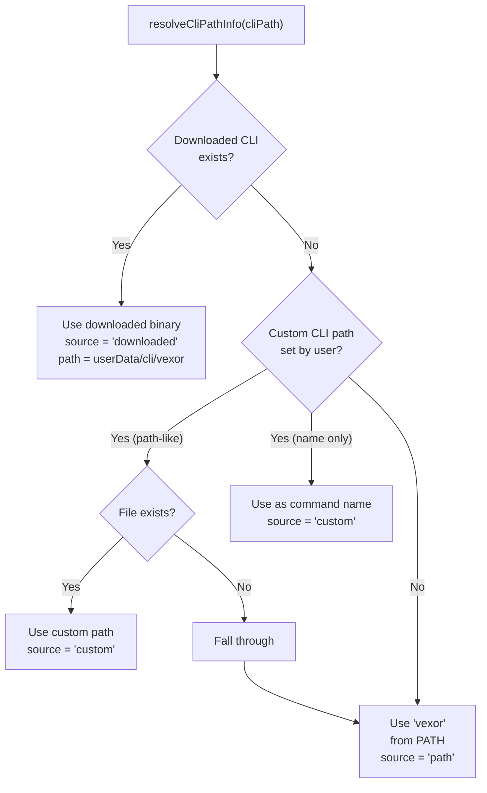
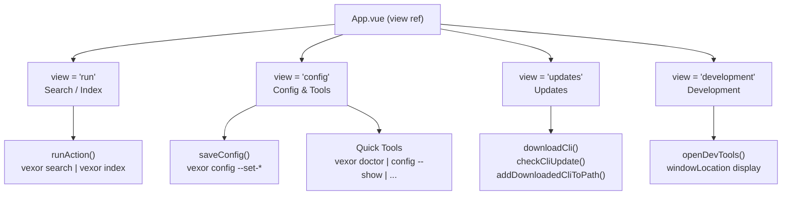
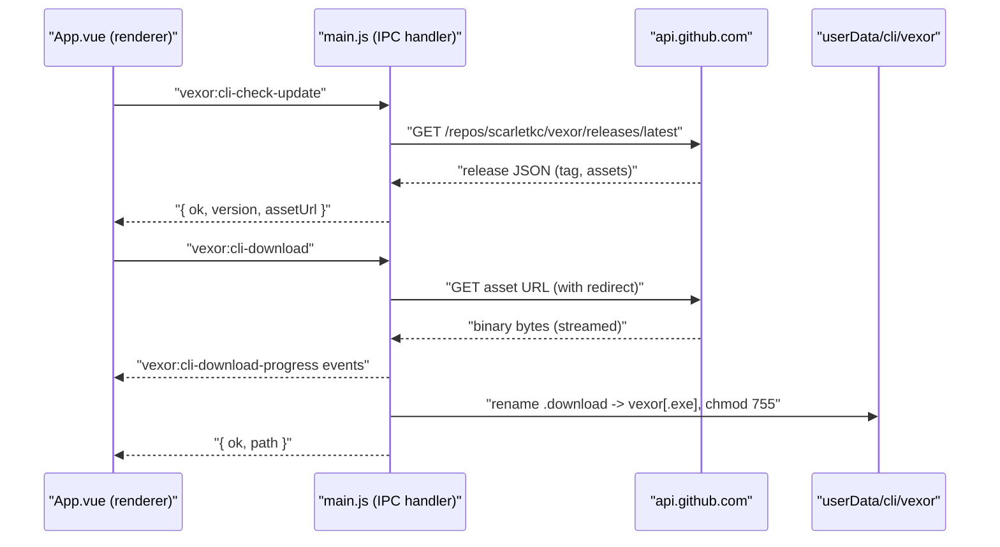
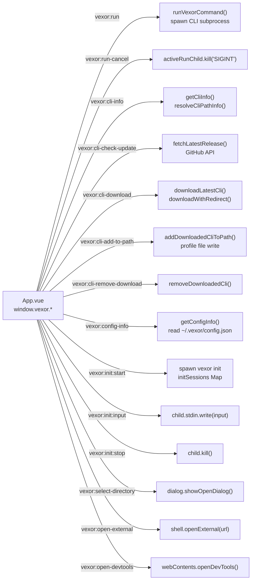

<!-- source: DeepWiki mcp.deepwiki.com · repo scarletkc/vexor · page 2.4 Quick Start - Desktop App · fetched 2026-10-26 -->

# Quick Start - Desktop App

<details>
<summary>Relevant source files</summary>

The following files were used as context for generating this wiki page:

- [README.md](README.md)
- [gui/src/App.vue](gui/src/App.vue)

</details>


> **Experimental.** The desktop app is explicitly marked as experimental and wraps the Vexor CLI binary via Electron IPC. All search and indexing operations are delegated to the CLI; the GUI provides a visual interface around those calls. For the full CLI reference see [CLI Reference](#4). For the Python API see [Quick Start - Python API](#2.3).

---

## Prerequisites

| Requirement | Details |
|---|---|
| Node.js | Required to build and run the Electron/Vue app |
| Vexor CLI | Must be available (downloaded via the Updates tab, on `PATH`, or set manually) |
| Vexor config | `~/.vexor/config.json` with a provider and API key configured |

The GUI itself does **not** embed the Python runtime. It locates and spawns a `vexor` CLI binary as a subprocess. If no CLI is found, search and index operations will not work until one is provided.

---

## Launching the App

### Development mode

```
cd gui
npm install
npm run dev
```

This runs [gui/package.json:8-9]() — Vite starts on port 5173, then `electron/dev-runner.cjs` starts Electron pointed at the dev server URL.

### Production build

```
cd gui
npm run make
```

This runs `vite build` then `electron-forge make`, producing a distributable in `gui/out/`.

### Starting a packaged build

```
npm run start
```

This runs `electron .` directly, loading `gui/dist/index.html`.

Sources: [gui/package.json:1-30](), [gui/electron/main.js:44-53]()

---

## CLI Binary Resolution

Before running any command, the app resolves which `vexor` binary to use. The resolution order is fixed and handled by `resolveCliPathInfo` in the main process.

**CLI Resolution Order**



Sources: [gui/electron/main.js:56-106]()

The resolved CLI path and source are shown in the app header as a status pill (`CLI: downloaded | custom | path`). If the CLI is unavailable, a warning banner appears in the **Search / Index** tab and operations are blocked.

---

## App Layout

The app opens to a four-tab shell. Navigation is a simple button row; no routing library is used.

**Tab Structure**



Sources: [gui/src/App.vue:22-35](), [gui/src/App.vue:519-530]()

---

## Running a Search

1. Open the **Search / Index** tab (default on launch).
2. Select **Search** in the segmented control.
3. Enter a query in the **Query** field.
4. Optionally set **Path**, **Index Mode**, **Top K**, **Extensions**, **Exclude Patterns**, and file toggles.
5. Click **Run Search**.

The `runAction()` function in [gui/src/App.vue:894-940]() assembles the following CLI invocation:

```
vexor search <query> --format porcelain --top <K> [--path ...] [--mode ...] [--ext ...] ...
```

Results are parsed from TSV porcelain output by `parsePorcelain()` [gui/src/App.vue:858-878]() and displayed in the results table. Each row shows rank, score, file path, line range, and a content preview.

### Search form fields

| GUI field | CLI flag | Default |
|---|---|---|
| Query | positional argument | — |
| Path | `--path` | current directory |
| Index Mode | `--mode` | `auto` |
| Top K | `--top` | `5` |
| Extensions | `--ext` | all |
| Exclude Patterns | `--exclude-pattern` | none |
| Include hidden files | `--include-hidden` | off |
| Ignore gitignore | `--no-respect-gitignore` | off |
| No recursion | `--no-recursive` | off |

Sources: [gui/src/App.vue:64-107](), [gui/src/App.vue:832-856]()

---

## Building an Index

1. In **Search / Index**, select **Index** in the segmented control.
2. Set **Path** and **Index Mode** as needed.
3. Optionally check **Clear index cache** or **Show index details**.
4. Click **Build Index**.

`runAction()` builds:

```
vexor index [--clear] [--show] [--path ...] [--mode ...] ...
```

The **Clear index cache** and **Show index details** toggles are mutually exclusive; the app enforces this with a validation check [gui/src/App.vue:906-909]().

Index output appears in the **Command Log** panel below the form. If optional dependencies like `vexor[local]` or `vexor[flashrank]` are missing, `detectMissingDeps()` [gui/src/App.vue:732-761]() parses the log output and displays inline installation hints.

Sources: [gui/src/App.vue:916-928](), [gui/src/App.vue:124-133]()

---

## Configuring Providers

Open the **Config & Tools** tab. Configuration is split into two cards.

### Core Config card

| GUI field | `vexor config` flag | Notes |
|---|---|---|
| Provider | `--set-provider` | `openai`, `gemini`, `custom`, `local` |
| Model | `--set-model` | e.g. `text-embedding-3-small` |
| API Key | `--set-api-key` | Sent only when non-empty |
| Base URL | `--set-base-url` | Custom or self-hosted endpoints |
| Batch Size | `--set-batch-size` | Integer |
| Embed Concurrency | `--set-embed-concurrency` | Integer |
| Auto index | `--set-auto-index` | Boolean toggle |
| Local CUDA | applied via `vexor local --cuda` | Toggle |

Clicking **Save Config** calls `saveConfig()` [gui/src/App.vue:956-1002]() which constructs a `vexor config` command with all non-empty fields appended as flags, then reloads the config from disk.

Clicking **Load Current** re-reads `~/.vexor/config.json` via `getConfigInfo()` and populates the form with `applyConfigSnapshot()` [gui/src/App.vue:774-793]().

### Rerank & Local card

| GUI field | CLI mapping |
|---|---|
| Rerank Mode | `--rerank off|bm25|flashrank|remote` |
| FlashRank Model | `--set-flashrank-model` (visible when rerank = flashrank) |
| Remote Rerank URL | `--set-remote-rerank-url` (visible when rerank = remote) |
| Remote Rerank Model | `--set-remote-rerank-model` |
| Remote Rerank API Key | `--set-remote-rerank-api-key` |
| Local Model | `--model` passed to `vexor local --setup` |

### Quick Tools

The right card also exposes one-click buttons that invoke CLI commands directly via `runConfigAction()` [gui/src/App.vue:1004-1018]():

| Button | CLI command |
|---|---|
| Run doctor | `vexor doctor` |
| Show config | `vexor config --show` |
| Show index list | `vexor config --show-index-all` |
| Clear all indexes | `vexor config --clear-index-all` |
| Clear FlashRank cache | `vexor config --clear-flashrank` |
| Clear Base URL | `vexor config --clear-base-url` |
| Clear remote rerank | `vexor config --clear-remote-rerank` |
| Clear API key | `vexor config --clear-api-key` |
| Init wizard | opens interactive `vexor init` modal |
| Show alias (vx) | `vexor alias` |
| Install skills | `vexor install --skills <target>` |

Sources: [gui/src/App.vue:295-464](), [gui/src/App.vue:956-1074]()

---

## Downloading and Managing the CLI Binary

The **Updates** tab handles CLI binary lifecycle. It does not use `pip` — it fetches a standalone executable from GitHub Releases.

**CLI Download Flow**



Sources: [gui/electron/main.js:274-387](), [gui/src/App.vue:1076-1118]()

### Available actions

| Button | Function | Effect |
|---|---|---|
| Download CLI | `downloadCli()` | Downloads latest release binary for the current platform |
| Remove Downloaded CLI | `removeDownloadedCli()` | Deletes binary; removes PATH entry from shell profile |
| Check CLI Update | `checkCliUpdate()` | Queries GitHub API and compares versions |
| Add Downloaded CLI to PATH | `addDownloadedCliToPath()` | Appends export line to `~/.zprofile`, `~/.bashrc`, or `config.fish` |
| Open GitHub Releases | `openReleases()` | Opens browser via `shell.openExternal` |

Platform support for the downloadable binary is limited: Windows (`.exe`) and Linux are supported; macOS is not [gui/electron/main.js:264-272]().

Sources: [gui/electron/main.js:389-538](), [gui/src/App.vue:185-262]()

---

## First-Run Behavior

On mount, `App.vue` calls `loadConfig(true)` and `refreshCliInfo()` [gui/src/App.vue:1235-1258](). If `~/.vexor/config.json` does not exist, a notice banner appears at the top of the **Search / Index** tab prompting the user to configure a provider or run the init wizard.

The **Init Wizard** button opens an in-app modal that spawns `vexor init` as an interactive subprocess. Output streams to the modal's log area; user input is forwarded via `vexor:init:input` IPC to the child's stdin [gui/electron/main.js:683-743](). The wizard completes by writing `~/.vexor/config.json`, which is then automatically reloaded into the config form.

For a detailed walkthrough of what the init wizard configures, see [First-Run Setup](#2.5).

Sources: [gui/src/App.vue:1206-1233](), [gui/electron/main.js:683-724]()

---

## IPC Bridge Summary

All renderer-to-main communication goes through `window.vexor`, which is exposed by `gui/electron/preload.js`. The main process registers handlers with `ipcMain.handle`.



Sources: [gui/electron/main.js:592-744]()

---

