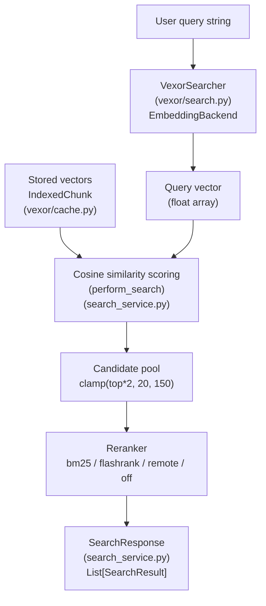
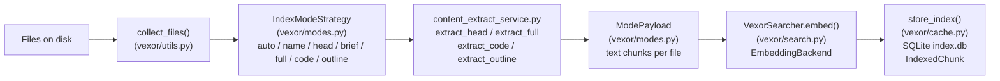
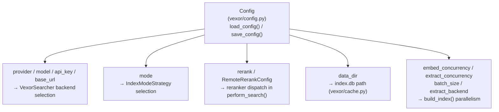

<!-- source: DeepWiki mcp.deepwiki.com · repo scarletkc/vexor · page 3 Core Concepts · fetched 2026-10-26 -->

# Core Concepts

Relevant source files

The following files were used as context for generating this wiki page:

- [README.md](README.md)
- [tests/unit/test_search_service.py](tests/unit/test_search_service.py)
- [vexor/services/search_service.py](vexor/services/search_service.py)

This page introduces the foundational concepts that underpin how Vexor works. It is a section landing page; for configuration details, CLI flags, or API method signatures, refer to the relevant reference sections. For an architectural walkthrough of the internal modules, see the Architecture Deep Dive ([7](#7)).

---

## What This Section Covers

Vexor operates through five interlocking subsystems. Understanding each one independently is important before combining them in advanced workflows.

| Concept | What it explains | Detail page |
|---|---|---|
| Semantic Search | How files are turned into vectors and ranked by meaning | [3.1](#3.1) |
| Indexing Modes | Which content is extracted per file type | [3.2](#3.2) |
| Embedding Providers | Which model/service produces the vectors | [3.3](#3.3) |
| Reranking Strategies | How the initial vector results are re-ordered | [3.4](#3.4) |
| Cache System | How indexes are persisted and reused | [3.5](#3.5) |

---

## How the Concepts Fit Together

The diagram below shows the conceptual pipeline from a user query to a set of ranked results, naming the concrete code entities involved at each step.

**Diagram: End-to-End Concept Pipeline**

Sources: [vexor/services/search_service.py](), [vexor/search.py](), [vexor/cache.py]()

---

**Diagram: Indexing Pipeline — Files to Stored Vectors**

Sources: [vexor/modes.py](), [vexor/services/content_extract_service.py](), [vexor/search.py](), [vexor/cache.py](), [vexor/utils.py]()

---

## Concept Summary

### Semantic Search

Vexor converts both documents and queries into high-dimensional vectors using an embedding model. Results are ranked by cosine similarity between the query vector and each stored chunk vector. This differs from keyword search: a query for "database connection handler" will match a file called `db_pool.py` even if none of those exact words appear in it.

The core class is `VexorSearcher` in [vexor/search.py](), which holds an `EmbeddingBackend` instance and exposes `embed()`. Search is coordinated by `perform_search()` in [vexor/services/search_service.py](), which returns a `SearchResponse` containing a ranked list of `SearchResult` objects.

See [3.1](#3.1) for the full explanation.

---

### Indexing Modes

Indexing mode controls what text is extracted from each file before embedding. The `IndexModeStrategy` class in [vexor/modes.py]() selects the strategy per file and returns a `ModePayload` containing the text chunks to embed.

| Mode | Extraction Strategy | Target Files |
|---|---|---|
| `auto` | Smart routing to best mode | Any |
| `name` | Filename only | Any |
| `head` | First snippet | Any |
| `brief` | High-frequency keywords | PRDs, requirements |
| `full` | Entire file, chunked | Small/medium files |
| `code` | AST boundaries (class/function) | Python, JS, TS |
| `outline` | Markdown heading hierarchy | `.md` files |

The `auto` mode routes Python/JS/TS files to `code`, Markdown to `outline`, small files to `full`, and large files to `head`.

See [3.2](#3.2) for per-mode behavior and tradeoffs.

---

### Embedding Providers

The `EmbeddingBackend` protocol in [vexor/search.py]() defines the interface that all providers implement. `VexorSearcher` selects and instantiates the correct backend based on the `provider` field in the `Config` dataclass ([vexor/config.py]()).

| Provider | Backend | Credential |
|---|---|---|
| `openai` | `OpenAIEmbeddingBackend` ([vexor/providers/openai.py]()) | `OPENAI_API_KEY` or `VEXOR_API_KEY` |
| `gemini` | `GeminiEmbeddingBackend` ([vexor/providers/gemini.py]()) | `GOOGLE_GENAI_API_KEY` |
| `voyageai` | OpenAI-compatible client | `VOYAGE_API_KEY` |
| `custom` | OpenAI-compatible client | User-supplied `base_url` + key |
| `local` | `fastembed` / `onnxruntime` | None (offline) |

See [3.3](#3.3) for model defaults, API key resolution order, and dimension configuration.

---

### Reranking Strategies

After vector scoring produces a candidate pool, an optional reranker reorders results. The candidate pool is sized with `clamp(int(top * 2), 20, 150)`. Reranking is dispatched inside `perform_search()` in [vexor/services/search_service.py]().

| Strategy | Mechanism | Requirement |
|---|---|---|
| `off` | No reranking | None |
| `bm25` | Lexical BM25 with BERT tokenizer | `rank_bm25` |
| `flashrank` | Local neural cross-encoder | `vexor[flashrank]` |
| `remote` | HTTP endpoint `{model, query, documents}` | `RemoteRerankConfig` in [vexor/config.py]() |

See [3.4](#3.4) for configuration and when each strategy is appropriate.

---

### Cache System

Vexor stores indexes in SQLite (`~/.vexor/index.db`), managed through [vexor/cache.py](). The `IndexedChunk` dataclass represents a single stored chunk with its embedding vector. `store_index()` writes chunks; `load_index_vectors()` reads them back for search.

Cache keys are derived from: `--path`, `--mode`, `--include-hidden`, `--no-recursive`, `--no-respect-gitignore`, `--ext`, and `--exclude-pattern`. Changing any of these flags creates a separate cache entry rather than invalidating the existing one.

Incremental updates re-embed only changed files. If more than 50% of files have changed, a full rebuild is triggered instead.

See [3.5](#3.5) for the SQLite schema, embedding cache TTL, and manual cache management commands.

---

## Configuration Backbone

All five concepts are governed by the `Config` dataclass in [vexor/config.py](). It is loaded at startup by `load_config()` and saved by `save_config()`. The CLI surface for modifying it is `vexor config` (see [4.4](#4.4)); the Python API surface is `set_config_json()` and `config_context()` (see [5.5](#5.5)).

**Diagram: Config as the Central Coordinator**

Sources: [vexor/config.py](), [vexor/services/index_service.py](), [vexor/services/search_service.py](), [vexor/cache.py]()

---

