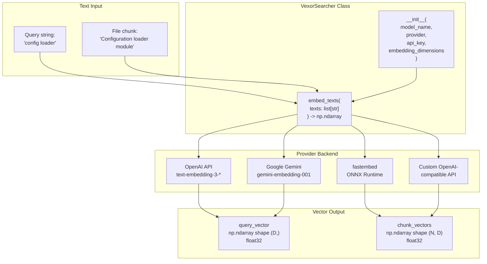
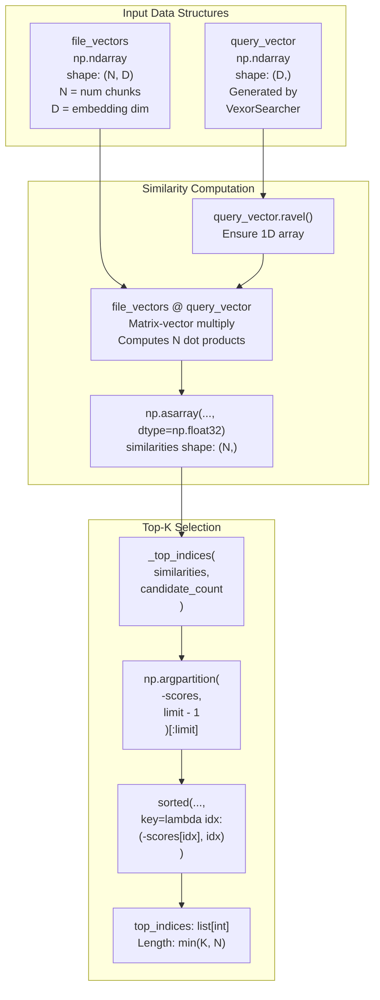
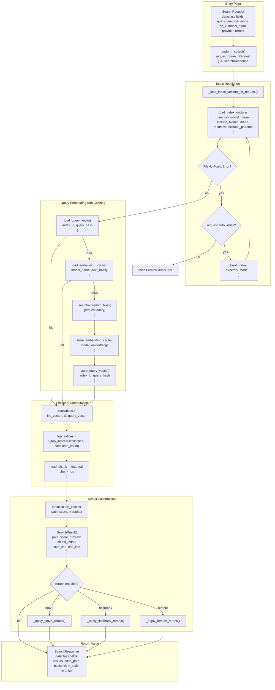
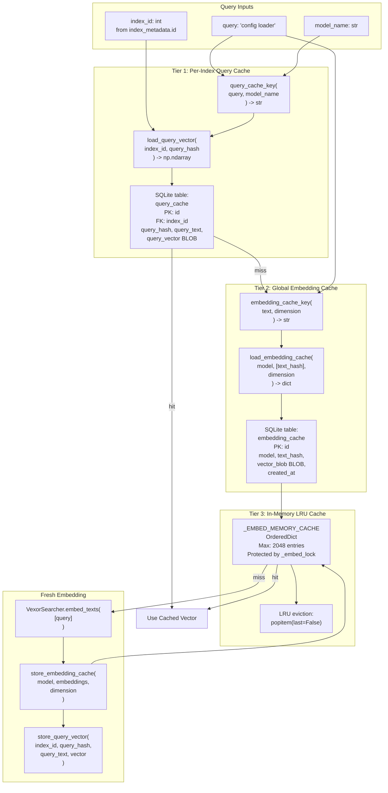

<!-- source: DeepWiki mcp.deepwiki.com · repo scarletkc/vexor · page 3.1 Semantic Search Fundamentals · fetched 2026-10-26 -->

# Semantic Search Fundamentals

<details>
<summary>Relevant source files</summary>

The following files were used as context for generating this wiki page:

- [README.md](README.md)
- [tests/unit/test_search_service.py](tests/unit/test_search_service.py)
- [vexor/services/search_service.py](vexor/services/search_service.py)

</details>


## Purpose and Scope

This page explains the fundamental concepts underlying Vexor's semantic search capabilities: what semantic search is, how it differs from traditional keyword search, and how Vexor implements it through vector embeddings and similarity computation. For information about specific indexing strategies, see [Indexing Modes](#3.2). For details on embedding model providers, see [Embedding Providers](#3.3). For reranking techniques that refine search results, see [Reranking Strategies](#3.4).

---

## What is Semantic Search

Semantic search finds content based on **meaning** rather than exact keyword matches. Unlike traditional text search tools (`grep`, file explorers), which require you to remember specific words or patterns, semantic search understands conceptual similarity.

### Keyword Search vs Semantic Search

| Aspect | Keyword Search | Semantic Search |
|--------|---------------|-----------------|
| **Matching** | Exact text match | Conceptual similarity |
| **Query** | `grep "config"` | `"configuration settings"` |
| **Finds** | Only files containing "config" | Files about configuration, settings, preferences, etc. |
| **Limitations** | Misses synonyms, related concepts | May return conceptually similar but not exact matches |
| **Use Case** | Known exact terms | Remembered functionality, not exact names |

Vexor is designed for the scenario where you remember **what a file does** but not its exact name or location. For example, querying `"api client config"` will find files related to API client configuration even if they use different terminology like "http settings" or "request builder options".

**Sources:** [README.md:18-36]()

---

## Vector Embeddings

Semantic search works by converting text into **vector embeddings**—high-dimensional numerical representations that capture semantic meaning. Similar concepts produce vectors that are close together in vector space, while dissimilar concepts produce distant vectors.

### Embedding Generation Architecture



### Embedding Properties

| Property | Description | Example Values |
|----------|-------------|----------------|
| **Dimensionality** | Vector length (D) | 384, 768, 1536, 3072 |
| **Data Type** | NumPy array dtype | `np.float32` |
| **Normalization** | Most models return L2-normalized vectors | `np.linalg.norm(vec) ≈ 1.0` |
| **Determinism** | Same input always produces same output for a given model | Enables caching |
| **Model-specific** | Vectors from different models are incompatible | Cannot mix in same index |

The `VexorSearcher` class in `vexor/search.py` is instantiated with provider configuration and exposes a single method `embed_texts()` that returns a NumPy array of embeddings. During search, this class is created with request parameters:

```python
# From search_service.py:567-577
searcher = VexorSearcher(
    model_name=request.model_name,
    batch_size=request.batch_size,
    embed_concurrency=request.embed_concurrency,
    provider=request.provider,
    base_url=request.base_url,
    api_key=request.api_key,
    local_cuda=request.local_cuda,
    embedding_dimensions=request.embedding_dimensions,
)
```

Embeddings are cached at multiple levels (in-memory, SQLite `embedding_cache` table, per-index `query_cache` table) to avoid redundant API calls.

**Sources:** [vexor/services/search_service.py:567-577](), [vexor/services/search_service.py:730-741](), [README.md:172-179]()

---

## Similarity Computation

Once both the query and indexed content are converted to vectors, Vexor computes similarity using **cosine similarity**—the cosine of the angle between two vectors. Values range from -1 (opposite) to 1 (identical), with higher values indicating greater semantic similarity.

### Cosine Similarity Formula

For vectors **A** and **B**:

```
cosine_similarity(A, B) = (A · B) / (||A|| × ||B||)
```

In practice, when vectors are normalized (as most embedding models produce), this simplifies to the dot product:

```
cosine_similarity(A, B) = A · B
```

### Vectorized Similarity Computation Flow



### Implementation Details

The core similarity computation happens in three steps in `perform_search()`:

1. **Normalize query vector** ([vexor/services/search_service.py:633]()):
   ```python
   query_vector = np.asarray(query_vector, dtype=np.float32).ravel()
   ```

2. **Compute all similarities** ([vexor/services/search_service.py:646]()):
   ```python
   similarities = np.asarray(file_vectors @ query_vector, dtype=np.float32)
   ```
   This single operation computes the dot product between the query and all N indexed chunks.

3. **Select top candidates** ([vexor/services/search_service.py:647]()):
   ```python
   top_indices = _top_indices(similarities, candidate_count)
   ```

The `_top_indices()` function ([vexor/services/search_service.py:121-127]()) uses partial sorting for efficiency:
- When `limit >= N`: Full sort using Python's `sorted()`
- When `limit < N`: Partial sort using `np.argpartition()` (O(N) vs O(N log N))

### Dimension Validation

Before computing similarities, Vexor validates that query and index dimensions match ([vexor/services/search_service.py:636-644]()):

```python
index_dimension = file_vectors.shape[1] if file_vectors.ndim == 2 else 0
query_dimension = query_vector.shape[0]
if index_dimension != query_dimension:
    raise ValueError(
        f"Embedding dimension mismatch: index has {index_dimension}-dim vectors, "
        f"but query embedding is {query_dimension}-dim. "
        f"Rebuild the index with: vexor index {request.directory}"
    )
```

This prevents cryptic NumPy errors when the embedding model configuration has changed since the index was built.

**Sources:** [vexor/services/search_service.py:633-647](), [vexor/services/search_service.py:121-127](), [vexor/services/search_service.py:636-644]()

---

## Vexor's Search Pipeline

The following diagram shows the complete search execution flow with actual function names and data structures from the codebase.

### perform_search() Execution Flow



### Pipeline Implementation Details

The main search flow is implemented in `perform_search()` ([vexor/services/search_service.py:358-708]()):

| Stage | Function/Line | Purpose |
|-------|---------------|---------|
| **Index Load** | `_load_index_vectors_for_request()` [876-955]() | Load cached index or find superset |
| **Auto-Index** | `build_index()` [395-414]() | Build missing index if `auto_index=True` |
| **Query Cache** | `load_query_vector()` [582-587]() | Check per-index query cache |
| **Embed Cache** | `load_embedding_cache()` [593-599]() | Check global embedding cache |
| **Fresh Embed** | `searcher.embed_texts()` [602]() | Generate new embedding |
| **Similarity** | `file_vectors @ query_vector` [646]() | Vectorized dot product |
| **Top-K** | `_top_indices()` [647]() | Partial sort for top candidates |
| **Metadata** | `load_chunk_metadata()` [655]() | Load previews and line numbers |
| **Results** | `SearchResult()` [669-677]() | Construct result objects |
| **Reranking** | `_apply_*_rerank()` [682-697]() | Optional secondary ranking |

### Temporary Index Path

When `request.no_cache=True` or `request.temporary_index=True`, the flow bypasses SQLite entirely:

```python
# From search_service.py:360-362
if request.temporary_index or request.no_cache:
    return _perform_search_with_temporary_index(request)
```

This calls `build_index_in_memory()` ([vexor/services/search_service.py:844-873]()) which returns in-memory vectors that are then passed to `search_from_vectors()` ([vexor/services/search_service.py:711-841]()).

**Sources:** [vexor/services/search_service.py:358-708](), [vexor/services/search_service.py:711-841](), [vexor/services/search_service.py:844-873](), [vexor/services/search_service.py:876-955]()

---

## Search Request and Response

Vexor's search system is built around two primary data structures that encapsulate all search parameters and results.

### SearchRequest Structure

The `SearchRequest` dataclass contains all parameters needed to execute a search:

| Field | Type | Purpose |
|-------|------|---------|
| `query` | `str` | Search query text |
| `directory` | `Path` | Target directory to search |
| `mode` | `str` | Indexing mode (auto, name, head, code, etc.) |
| `top_k` | `int` | Number of results to return |
| `model_name` | `str` | Embedding model identifier |
| `provider` | `str` | Embedding provider (openai, gemini, local, custom) |
| `auto_index` | `bool` | Whether to build index if missing (default: True) |
| `no_cache` | `bool` | Skip cache and use in-memory index |
| `rerank` | `str` | Reranking strategy (off, bm25, flashrank, remote) |
| `batch_size` | `int` | Embedding batch size |
| `embed_concurrency` | `int` | Parallel embedding requests |
| `extensions` | `tuple[str, ...]` | File extension filters |
| `exclude_patterns` | `tuple[str, ...]` | Gitignore-style exclusion patterns |

**Sources:** [vexor/services/search_service.py:33-58]()

### SearchResponse Structure

The `SearchResponse` dataclass contains search results and metadata:

| Field | Type | Purpose |
|-------|------|---------|
| `results` | `Sequence[SearchResult]` | Ranked search results |
| `base_path` | `Path` | Search root directory |
| `backend` | `str \| None` | Embedding backend used (e.g., "cuda", "cpu") |
| `is_stale` | `bool` | Whether index is out of sync with filesystem |
| `index_empty` | `bool` | Whether no files were indexed |
| `reranker` | `str \| None` | Reranking strategy applied |

Each `SearchResult` contains:
- `path`: File path
- `score`: Similarity score (0.0 to 1.0 typically)
- `preview`: Text preview of the chunk
- `chunk_index`: Chunk number within file (for chunked modes)
- `start_line`, `end_line`: Line range (when available)

**Sources:** [vexor/services/search_service.py:61-68](), [vexor/search.py:SearchResult]()

---

## Result Ranking

Vexor employs a two-stage ranking strategy to balance speed and relevance.

### Primary Ranking: Semantic Similarity

Initial ranking is based purely on cosine similarity scores from vector embeddings. The system retrieves the top-K candidates (or 2×K for reranking) using NumPy's efficient `argpartition`:

```python
# From search_service.py:120-126
def _top_indices(scores: np.ndarray, limit: int) -> list[int]:
    if limit >= scores.size:
        return sorted(range(scores.size), key=lambda idx: (-scores[idx], idx))
    indices = np.argpartition(-scores, limit - 1)[:limit]
    return sorted(indices.tolist(), key=lambda idx: (-scores[idx], idx))
```

This approach uses partial sorting (`argpartition`) for performance when K << N (where N is the number of indexed items), avoiding the cost of fully sorting all similarity scores.

### Secondary Ranking: Reranking (Optional)

When enabled, reranking refines the initial semantic results using complementary signals:

| Strategy | Description | Candidate Pool |
|----------|-------------|----------------|
| `off` | Pure semantic ranking (default) | top_k |
| `bm25` | Lexical scoring (70% semantic + 30% lexical fusion) | `clamp(top_k × 2, 20, 150)` |
| `flashrank` | Neural cross-encoder reranking | `clamp(top_k × 2, 20, 150)` |
| `remote` | External reranking service | `clamp(top_k × 2, 20, 150)` |

The candidate pool is expanded to `2×top_k` (clamped between 20-150) to give the reranker more options for reordering. This prevents missing relevant results that might have slightly lower semantic scores but high reranking scores.

**Example: BM25 Score Fusion**

```python
# From search_service.py:154-161
for result, sem_score, bm25_score in zip(results, semantic_norm, bm25_norm):
    fused_score = _FUSION_SEMANTIC_WEIGHT * sem_score + (
        (1.0 - _FUSION_SEMANTIC_WEIGHT) * bm25_score
    )
    result.score = float(fused_score)
    fused.append(result)
```

The fusion uses `_FUSION_SEMANTIC_WEIGHT = 0.7`, giving 70% weight to semantic similarity and 30% to lexical matching. This helps surface results that contain exact query terms even if their semantic embeddings are slightly less similar.

For detailed information on reranking strategies and their trade-offs, see [Reranking Strategies](#3.4).

**Sources:** [vexor/services/search_service.py:120-126](), [vexor/services/search_service.py:115-118](), [vexor/services/search_service.py:143-162](), [vexor/services/search_service.py:617-681]()

---

## Query Caching Strategy

Vexor implements a three-tier caching system for embeddings to minimize redundant API calls and improve search performance.

### Three-Tier Cache Architecture



### Cache Tier Implementation

**Tier 1: Per-Index Query Cache** (`query_cache` table)
- **Purpose**: Cache query embeddings for specific index + query combinations
- **Key Generation** ([vexor/services/search_service.py:583]()):
  ```python
  query_hash = query_cache_key(request.query, request.model_name)
  query_vector = load_query_vector(int(index_id), query_hash)
  ```
- **Benefit**: Fastest path, skips all embedding computation for repeated queries
- **Scope**: Per-index, deleted when index is cleared

**Tier 2: Global Embedding Cache** (`embedding_cache` table)
- **Purpose**: Cache text embeddings across all indices and contexts
- **Key Generation** ([vexor/services/search_service.py:593-596]()):
  ```python
  query_text_hash = embedding_cache_key(request.query, dimension=request.embedding_dimensions)
  cached = load_embedding_cache(request.model_name, [query_text_hash], dimension=request.embedding_dimensions)
  ```
- **Benefit**: Amortizes embedding cost when searching multiple directories
- **Scope**: Global, shared across indices, max 50K entries with 30-day TTL

**Tier 3: In-Memory LRU Cache** (`_EMBED_MEMORY_CACHE`)
- **Purpose**: Avoid SQLite reads for recently used embeddings
- **Implementation**: `OrderedDict` with max 2048 entries, thread-safe via `_embed_lock`
- **Benefit**: Sub-millisecond cache hits for hot queries
- **Eviction**: LRU via `popitem(last=False)` when full

### Cache Flow Logic

The cache lookup sequence in `perform_search()` is ([vexor/services/search_service.py:578-613]()):

```python
# 1. Try per-index query cache
if index_id is not None and not request.no_cache:
    query_hash = query_cache_key(request.query, request.model_name)
    query_vector = load_query_vector(int(index_id), query_hash)

# 2. Try global embedding cache (with in-memory lookup first)
if query_vector is None and not request.no_cache:
    query_text_hash = embedding_cache_key(request.query, dimension=...)
    cached = load_embedding_cache(request.model_name, [query_text_hash], dimension=...)
    query_vector = cached.get(query_text_hash)

# 3. Generate fresh embedding
if query_vector is None:
    query_vector = searcher.embed_texts([request.query])[0]
    store_embedding_cache(model=request.model_name, embeddings={query_text_hash: query_vector})
    store_query_vector(int(index_id), query_hash, request.query, query_vector)
```

### Cache Bypass Modes

When `request.no_cache=True`, all cache operations are skipped ([vexor/services/search_service.py:360-362](), [vexor/services/search_service.py:582](), [vexor/services/search_service.py:592](), [vexor/services/search_service.py:603]()). This is useful for testing or when privacy concerns require avoiding persistent storage.

**Sources:** [vexor/services/search_service.py:578-623](), [vexor/services/search_service.py:743-769](), [vexor/cache.py:embedding_cache_key](), [vexor/cache.py:query_cache_key]()

---

## Performance Considerations

Vexor's semantic search implementation is optimized for real-world usage patterns:

### Vectorized Operations

All similarity computations use NumPy's optimized matrix operations rather than Python loops:

```python
# Efficient: Single matrix-vector multiplication
similarities = file_vectors @ query_vector  # O(N × D)

# Avoided: Loop-based computation
# for vec in file_vectors:
#     similarity = vec @ query_vector  # O(N × D) but slower
```

For an index with 1,000 files and 1536-dimensional embeddings, this performs 1,536,000 multiply-add operations in a single optimized call.

### Partial Sorting

When `top_k << N`, Vexor uses `np.argpartition()` which is O(N) instead of full sorting which is O(N log N):

```python
# For top_k=5 and N=1000:
# Full sort: ~6,000 comparisons
# Partial sort: ~1,000 comparisons
indices = np.argpartition(-scores, limit - 1)[:limit]
```

### Cache Hierarchy

The multi-level caching strategy minimizes expensive operations:

1. **Query cache hit**: No embedding API call, no computation (~1ms)
2. **Embedding cache hit**: No API call, skip query-specific cache (~5ms)
3. **Fresh embedding**: Full API round-trip (~50-500ms depending on provider)

For repeated searches, the cache hit rate approaches 100%, making Vexor's search feel instantaneous.

**Sources:** [vexor/services/search_service.py:626-628](), [vexor/services/search_service.py:120-126]()

---

