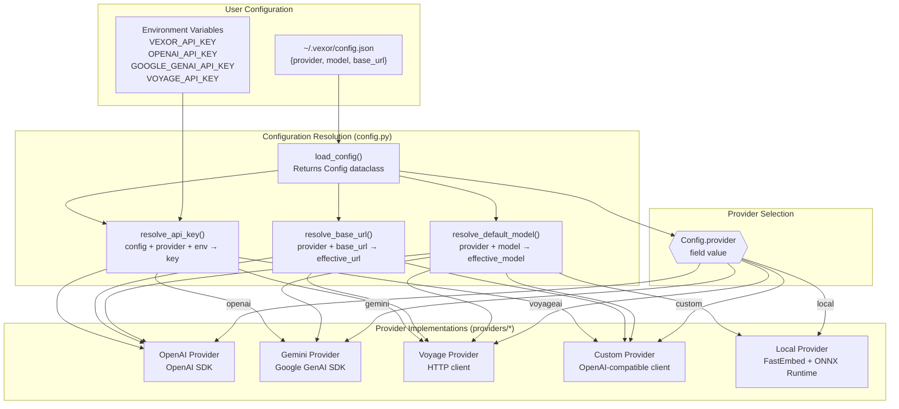
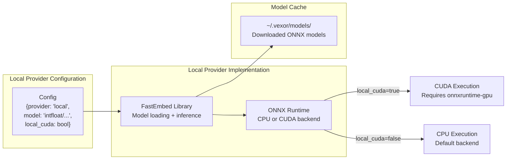
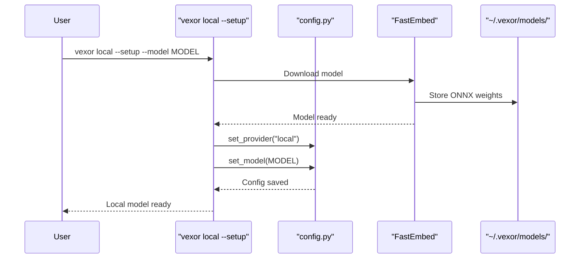
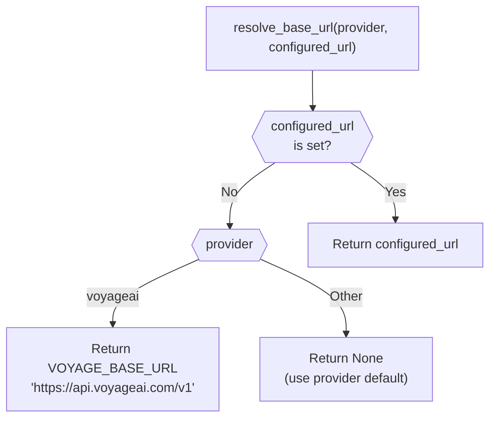
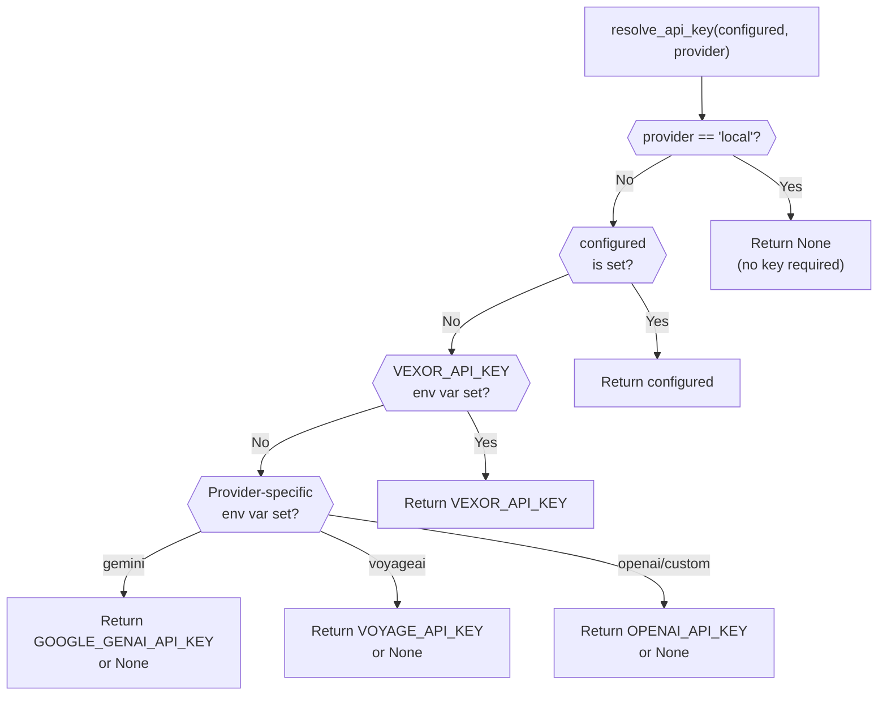
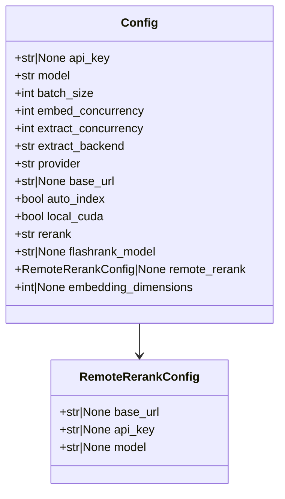
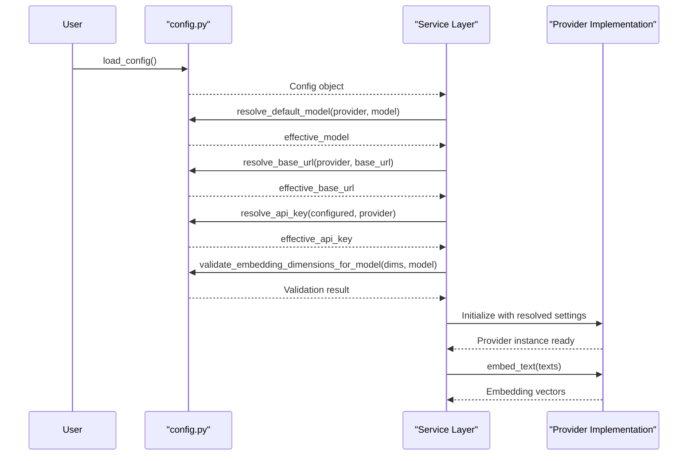

<!-- source: DeepWiki mcp.deepwiki.com · repo scarletkc/vexor · page 3.3 Embedding Providers · fetched 2026-10-26 -->

# Embedding Providers

<details>
<summary>Relevant source files</summary>

The following files were used as context for generating this wiki page:

- [README.md](README.md)
- [vexor/config.py](vexor/config.py)
- [vexor/text.py](vexor/text.py)

</details>


## Purpose and Scope

This document explains the embedding provider system in Vexor, which determines how text and code are converted into vector embeddings for semantic search. It covers the five supported provider types, their configuration, and how Vexor selects and initializes providers at runtime.

For information about configuring providers through the CLI or API, see [Configuration Management](#5.5). For details on how embeddings are generated during indexing, see [Content Processing Pipeline](#7.6).

---

## Overview

Embedding providers are the backend services or models that convert text into vector embeddings. Vexor abstracts these providers behind a unified interface, allowing users to switch between cloud APIs and local models without changing their workflow.

### Supported Providers

Vexor supports five provider types, defined in [vexor/config.py:37]():

| Provider | Type | Default Model | Base URL Behavior | API Key Required |
|----------|------|---------------|-------------------|------------------|
| `openai` | Remote API | `text-embedding-3-small` | Uses OpenAI default | Yes |
| `gemini` | Remote API | `gemini-embedding-001` | Uses Google AI default | Yes |
| `voyageai` | Remote API | `voyage-3-large` | `https://api.voyageai.com/v1` | Yes |
| `custom` | Remote API | User-specified | User-specified (required) | Yes |
| `local` | Local ONNX | `intfloat/multilingual-e5-small` | Not applicable | No |

**Sources:** [vexor/config.py:24-38](), [README.md:174-179]()

---

## Provider Architecture

The following diagram shows how providers integrate with Vexor's configuration and service layers:



**Sources:** [vexor/config.py:54-77](), [vexor/config.py:123-148](), [vexor/config.py:397-417](), [vexor/config.py:469-493]()

---

## Remote Providers

Remote providers use cloud-based embedding APIs. Each has provider-specific defaults and API requirements.

### OpenAI

The default provider, using OpenAI's embedding models.

- **Default model:** `text-embedding-3-small` [vexor/config.py:24]()
- **Base URL:** Uses OpenAI SDK defaults (configurable via `base_url`)
- **API key sources:** `VEXOR_API_KEY` → `OPENAI_API_KEY` environment variables, or configured key [vexor/config.py:488-491]()
- **Dimension support:** `text-embedding-3-small` (256-1536), `text-embedding-3-large` (256-3072) [vexor/config.py:42-43]()

### Gemini

Google's Generative AI embedding service.

- **Default model:** `gemini-embedding-001` [vexor/config.py:25]()
- **Base URL:** Uses Google GenAI SDK defaults
- **API key sources:** `VEXOR_API_KEY` → `GOOGLE_GENAI_API_KEY` environment variables [vexor/config.py:480-483]()
- **Dimension support:** Uses model default dimensions (no custom dimensions)

### Voyage AI

Specialized embedding provider with multiple model families.

- **Default model:** `voyage-3-large` [vexor/config.py:26]()
- **Base URL:** `https://api.voyageai.com/v1` (auto-configured when `base_url` is unset) [vexor/config.py:36](), [vexor/config.py:415-416]()
- **API key sources:** `VEXOR_API_KEY` → `VOYAGE_API_KEY` environment variables [vexor/config.py:484-487]()
- **Dimension support:** `voyage-3*` and `voyage-code-3*` models support 256, 512, 1024, 2048 [vexor/config.py:44-45]()

### Custom

OpenAI-compatible provider for self-hosted or third-party services.

- **Default model:** Must be explicitly configured [vexor/text.py:123-125]()
- **Base URL:** Required; must be explicitly configured [vexor/text.py:120-122]()
- **API key sources:** `VEXOR_API_KEY` → `OPENAI_API_KEY` environment variables [vexor/config.py:488-491]()
- **Dimension support:** Depends on the backing service

**Sources:** [vexor/config.py:397-417](), [vexor/config.py:469-493](), [README.md:172-179]()

---

## Local Provider

The local provider runs embedding models on-device using ONNX Runtime, eliminating API costs and network dependencies.

### Architecture



### Configuration

- **Installation:** Requires `pip install "vexor[local]"` or `pip install "vexor[local-cuda]"` for GPU support [vexor/text.py:109-113]()
- **Default model:** `intfloat/multilingual-e5-small` [vexor/config.py:27]()
- **Model cache:** `~/.vexor/models/` [vexor/config.py:191-192]()
- **CUDA support:** Controlled by `Config.local_cuda` field, requires `onnxruntime-gpu` [vexor/config.py:72]()
- **API key:** Not required [vexor/config.py:473-474]()

### Setup Workflow



**Sources:** [vexor/config.py:27](), [vexor/config.py:72](), [vexor/config.py:191-192](), [vexor/config.py:473-474](), [vexor/text.py:89-94](), [README.md:198-220]()

---

## Model Resolution

Vexor resolves the effective model name based on provider and user configuration using `resolve_default_model()` [vexor/config.py:397-407]():

| Provider | Configured Model | Effective Model |
|----------|------------------|-----------------|
| `openai` | Not set or default | `text-embedding-3-small` |
| `openai` | User-specified | User-specified |
| `gemini` | Not set or default | `gemini-embedding-001` |
| `gemini` | User-specified | User-specified |
| `voyageai` | Not set or default | `voyage-3-large` |
| `voyageai` | User-specified | User-specified |
| `custom` | Not set | **Error:** Model required |
| `custom` | User-specified | User-specified |
| `local` | Not set or default | `intfloat/multilingual-e5-small` |
| `local` | User-specified | User-specified |

**Resolution logic:**
1. If provider is `gemini` and model is unset or `text-embedding-3-small`, return `gemini-embedding-001`
2. If provider is `voyageai` and model is unset or `text-embedding-3-small`, return `voyage-3-large`
3. Otherwise, return configured model or `text-embedding-3-small`

**Sources:** [vexor/config.py:397-407]()

---

## Base URL Resolution

Base URL determines the API endpoint for remote providers. Resolution follows this logic [vexor/config.py:410-417]():



**Key behaviors:**
- **Explicit configuration:** Always takes precedence
- **Voyage AI:** Auto-configured to `https://api.voyageai.com/v1` when `base_url` is unset [vexor/config.py:36]()
- **OpenAI/Gemini:** Use SDK defaults when `base_url` is unset
- **Custom:** Requires explicit `base_url` configuration [vexor/text.py:120-122]()

**Sources:** [vexor/config.py:36](), [vexor/config.py:410-417](), [README.md:172-179]()

---

## API Key Resolution

API keys are resolved from multiple sources with a defined precedence. The `resolve_api_key()` function [vexor/config.py:469-493]() implements this logic:

### Resolution Order



### Environment Variable Mapping

| Provider | Configured Key | Fallback Env Vars (in order) |
|----------|---------------|------------------------------|
| `openai` | `Config.api_key` | `VEXOR_API_KEY` → `OPENAI_API_KEY` |
| `gemini` | `Config.api_key` | `VEXOR_API_KEY` → `GOOGLE_GENAI_API_KEY` |
| `voyageai` | `Config.api_key` | `VEXOR_API_KEY` → `VOYAGE_API_KEY` |
| `custom` | `Config.api_key` | `VEXOR_API_KEY` → `OPENAI_API_KEY` |
| `local` | N/A | None (no key required) |

**Sources:** [vexor/config.py:47-51](), [vexor/config.py:469-493](), [README.md:150-154]()

---

## Embedding Dimensions

Some providers and models support configurable embedding dimensions, allowing users to trade off vector size against semantic fidelity.

### Dimension Support

The `DIMENSION_SUPPORTED_MODELS` mapping [vexor/config.py:41-46]() defines supported models and their valid dimensions:

| Model Prefix | Supported Dimensions |
|--------------|---------------------|
| `text-embedding-3-small` | 256, 512, 1024, 1536 |
| `text-embedding-3-large` | 256, 512, 1024, 1536, 3072 |
| `voyage-3` | 256, 512, 1024, 2048 |
| `voyage-code-3` | 256, 512, 1024, 2048 |

### Validation

Dimension validation occurs in `validate_embedding_dimensions_for_model()` [vexor/config.py:434-448]():

1. Check if model supports custom dimensions using prefix matching
2. If dimensions are supported, validate the value is in the allowed set
3. Raise `ValueError` if model doesn't support dimensions or value is invalid

**Configuration:**
- Set dimensions: `vexor config --set-embedding-dimensions 1024` [README.md:188-189]()
- Clear dimensions: `vexor config --clear-embedding-dimensions` [README.md:189]()
- Validation: Automatically triggered when changing model or provider [vexor/config.py:240-246](), [vexor/config.py:272-277]()

**Sources:** [vexor/config.py:41-46](), [vexor/config.py:314-349](), [vexor/config.py:420-448](), [vexor/config.py:451-467](), [README.md:180-196]()

---

## Provider Configuration in Config Dataclass

The `Config` dataclass [vexor/config.py:62-77]() stores all provider-related settings:



### Key Fields

- **`provider`**: One of `SUPPORTED_PROVIDERS` (`openai`, `gemini`, `voyageai`, `custom`, `local`) [vexor/config.py:37]()
- **`model`**: Model name; defaults resolved by `resolve_default_model()` [vexor/config.py:64]()
- **`api_key`**: Configured API key; resolved by `resolve_api_key()` [vexor/config.py:63]()
- **`base_url`**: Optional base URL override; resolved by `resolve_base_url()` [vexor/config.py:70]()
- **`local_cuda`**: Enable CUDA for local provider [vexor/config.py:72]()
- **`embedding_dimensions`**: Optional dimension override for supported models [vexor/config.py:76]()
- **`batch_size`**: Embeddings per request (0 = single request) [vexor/config.py:65]()
- **`embed_concurrency`**: Parallel embedding requests [vexor/config.py:66]()

**Sources:** [vexor/config.py:54-77]()

---

## Provider Selection Flow

The complete flow from configuration to provider initialization:



**Sources:** [vexor/config.py:123-148](), [vexor/config.py:397-417](), [vexor/config.py:469-493](), [vexor/config.py:434-448]()

---

## Configuration Examples

### Switching Providers

```bash
# Use OpenAI (default)
vexor config --set-provider openai

# Use Gemini
vexor config --set-provider gemini

# Use Voyage AI
vexor config --set-provider voyageai

# Use custom OpenAI-compatible endpoint
vexor config --set-provider custom
vexor config --set-base-url https://api.example.com/v1
vexor config --set-model custom-embed-model

# Use local offline model
pip install "vexor[local]"
vexor local --setup --model intfloat/multilingual-e5-small
```

### Configuring Dimensions

```bash
# Set dimensions for OpenAI text-embedding-3-large
vexor config --set-provider openai
vexor config --set-model text-embedding-3-large
vexor config --set-embedding-dimensions 1024

# Set dimensions for Voyage AI
vexor config --set-provider voyageai
vexor config --set-model voyage-3-large
vexor config --set-embedding-dimensions 2048

# Clear dimensions to use model default
vexor config --clear-embedding-dimensions
```

**Sources:** [README.md:118-148](), [README.md:172-220]()

---

## Summary

Vexor's provider system abstracts five embedding backends behind a unified configuration interface:

- **Remote providers** (`openai`, `gemini`, `voyageai`, `custom`) use cloud APIs with provider-specific defaults
- **Local provider** (`local`) runs on-device using ONNX Runtime with CPU or CUDA backends
- **Model resolution** automatically selects provider-appropriate defaults
- **Base URL resolution** configures API endpoints with provider-specific behaviors
- **API key resolution** checks multiple sources with defined precedence
- **Dimension support** allows customization for compatible models with validation

All provider settings are managed through the `Config` dataclass and persisted in `~/.vexor/config.json`.

**Sources:** [vexor/config.py:1-710](), [README.md:118-220]()

---

