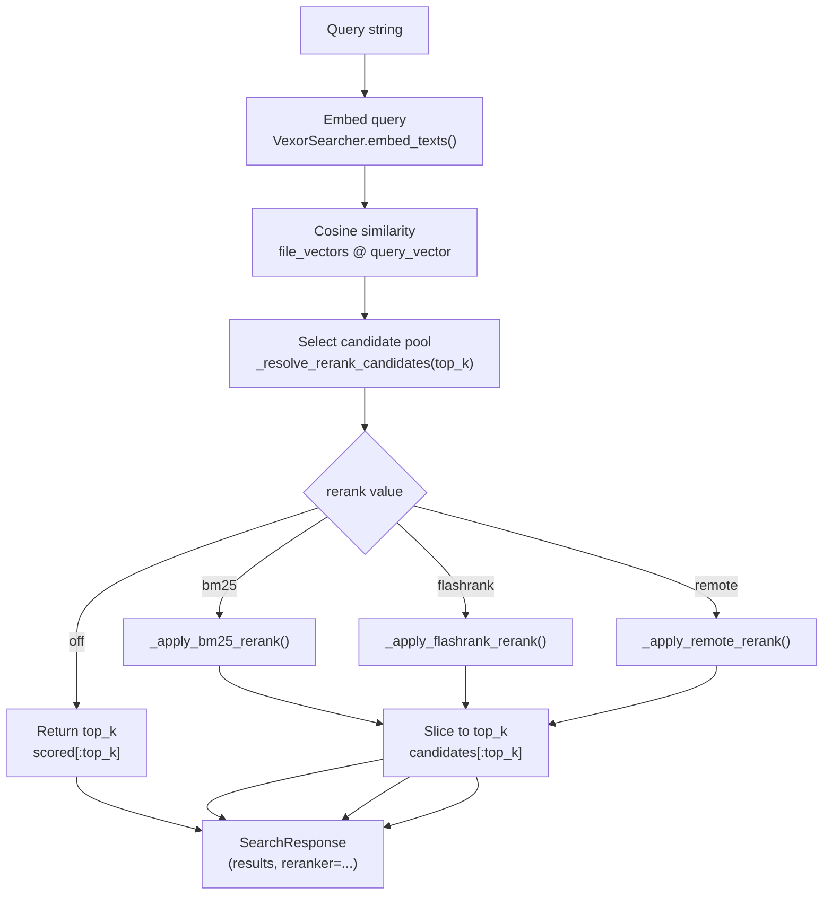
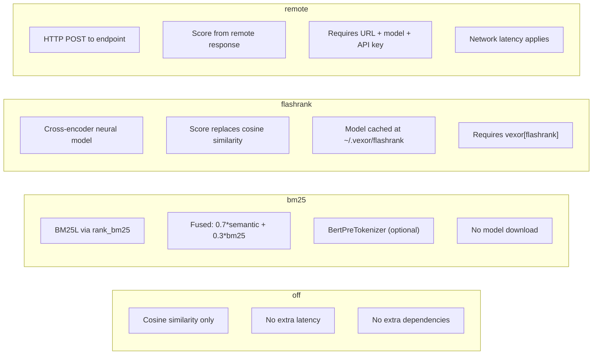
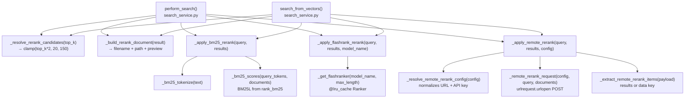

<!-- source: DeepWiki mcp.deepwiki.com · repo scarletkc/vexor · page 3.4 Reranking Strategies · fetched 2026-10-26 -->

# Reranking Strategies

<details>
<summary>Relevant source files</summary>

The following files were used as context for generating this wiki page:

- [README.md](README.md)
- [tests/unit/test_search_service.py](tests/unit/test_search_service.py)
- [vexor/services/search_service.py](vexor/services/search_service.py)
- [vexor/text.py](vexor/text.py)

</details>


This page covers how Vexor optionally reranks semantic search results using a secondary scoring pass, including how each strategy works, its dependencies, and configuration. For the complete search execution flow (embedding, cosine similarity, result assembly), see [7.8](#7.8). For how to configure reranking via the CLI, see [4.4](#4.4).

---

## Overview

Vexor's default search ranks results purely by cosine similarity between the query embedding and indexed chunk embeddings. Reranking adds a second pass over the top candidates to reorder them using a different signal. The default is `off`.

The four supported reranking strategies are defined in `SUPPORTED_RERANKERS` in [vexor/config.py:38]():

| Strategy | Value | Requires | Signal |
|---|---|---|---|
| Off | `"off"` | Nothing | No reranking; order is by cosine similarity only |
| BM25 | `"bm25"` | `rank_bm25` (core dependency) | Lexical term frequency fusion |
| FlashRank | `"flashrank"` | `vexor[flashrank]` extra | Local cross-encoder neural model |
| Remote | `"remote"` | HTTP endpoint + API key + model name | External reranking service |

---

## Where Reranking Fits in the Search Flow

Reranking is applied inside `perform_search()` in [vexor/services/search_service.py:358]() after cosine similarity scoring and before slicing to the final `top_k` result count.

**Search execution flow with reranking**



Sources: [vexor/services/search_service.py:624-700]()

---

## Candidate Pool Sizing

When any reranker is active, Vexor fetches more candidates from the cosine-similarity ranking than the requested `top_k`. This gives the reranker a broader pool to reorder before slicing to the final count.

The candidate count is computed by `_resolve_rerank_candidates()` in [vexor/services/search_service.py:116-118]():

```
candidate_limit = clamp(int(top_k * 2), 20, 150)
```

The result is then further capped to the number of indexed paths:

```
candidate_count = min(len(paths), candidate_limit)
```

| `top_k` | Candidate limit |
|---|---|
| 1–10 | 20 |
| 11 | 22 |
| 50 | 100 |
| 75 | 150 |
| ≥ 75 | 150 (hard cap) |

When `rerank` is `"off"`, the candidate pool is `top_k` exactly — no over-fetching occurs.

Sources: [vexor/services/search_service.py:116-118](), [vexor/services/search_service.py:626-631](), [tests/unit/test_search_service.py:982-992]()

---

## Document Construction

All three active rerankers operate on a plain-text representation of each `SearchResult`. This is assembled by `_build_rerank_document()` in [vexor/services/search_service.py:102-104]():

```
"{filename} {posix_path} {preview}"
```

Where `preview` is the short content snippet stored in the index chunk. If the built string is empty, the full POSIX path is used as a fallback.

Sources: [vexor/services/search_service.py:102-104]()

---

## BM25 Strategy

**How it works**

BM25 does not replace the semantic score — it fuses it with a lexical term frequency score using a weighted sum.

The fusion is computed in `_apply_bm25_rerank()` [vexor/services/search_service.py:144-163]():

1. Tokenize the query and every candidate document using `_bm25_tokenize()`.
2. Score all candidates with `BM25L` from the `rank_bm25` library, with `k1=1.5` and `b=0.75`.
3. Normalize both semantic scores and BM25 scores to `[0, 1]` by dividing by the per-batch maximum.
4. Compute the fused score: `0.7 * semantic_norm + 0.3 * bm25_norm`.
5. Sort by fused score descending.

The semantic weight constant is `_FUSION_SEMANTIC_WEIGHT = 0.7` [vexor/services/search_service.py:75]().

**Tokenizer**

`_bm25_tokenize()` [vexor/services/search_service.py:87-99]() attempts to use `BertPreTokenizer` from the `tokenizers` library (lazy-loaded and cached via `_get_bm25_tokenizer()`). If unavailable, it falls back to a simple ASCII alphanumeric regex `[A-Za-z0-9_]+`. The Bert pre-tokenizer handles CJK and other Unicode scripts correctly.

**Dependencies**

- `rank_bm25` — included in Vexor's core dependencies; always available.
- `tokenizers` — optional; improves CJK tokenization.

**When to use**

BM25 adds lightweight lexical signal at negligible latency cost. It is effective when queries share exact terms with filenames or preview content.

Sources: [vexor/services/search_service.py:72-163](), [vexor/config.py:33]()

---

## FlashRank Strategy

**How it works**

FlashRank runs a local cross-encoder neural model that scores each (query, document) pair directly. It does not fuse with the semantic score — the FlashRank model's output scores entirely replace the cosine similarity scores.

The flow in `_apply_flashrank_rerank()` [vexor/services/search_service.py:178-223]():

1. Build a `passages` list: `[{"id": idx, "text": document_text}, ...]`.
2. Construct a `RerankRequest(query=query, passages=passages)`.
3. Invoke `ranker.rerank(rerank_request)` — this is a `Ranker` instance from `flashrank`.
4. Walk the reranked list; for each item, look up the original `SearchResult` by `id`, update its `.score` from the FlashRank score.
5. Append any results not returned by FlashRank at the end (preserving them rather than dropping them).

**Model caching**

The `Ranker` is cached by `_get_flashranker(model_name, max_length)` using `@lru_cache(maxsize=4)` [vexor/services/search_service.py:166-175](). Models are downloaded to and cached in `flashrank_cache_dir()`, which resolves to `~/.vexor/flashrank` [vexor/config.py:195-199]().

| Config key | Default | Notes |
|---|---|---|
| `flashrank_model` | `ms-marco-TinyBERT-L-2-v2` | See `DEFAULT_FLASHRANK_MODEL` |
| Max token length | `256` | See `DEFAULT_FLASHRANK_MAX_LENGTH` |

For multilingual or CJK content, set `flashrank_model` to `ms-marco-MultiBERT-L-12`.

**Dependencies**

```bash
pip install "vexor[flashrank]"
```

If `flashrank` is not installed when `rerank = "flashrank"`, a `RuntimeError` is raised at search time.

Sources: [vexor/services/search_service.py:166-223](), [vexor/config.py:34-35](), [vexor/config.py:195-199]()

---

## Remote Strategy

**How it works**

Remote reranking calls an external HTTP endpoint that accepts a JSON request and returns a ranked list of document indexes. This allows integration with hosted reranker services (e.g., Cohere, Jina, or self-hosted models).

**Request / Response schema**

The request is a JSON POST to the configured URL [vexor/services/search_service.py:248-290]():

```json
{
  "model": "<configured model name>",
  "query": "<search query>",
  "documents": ["<doc 0 text>", "<doc 1 text>", ...]
}
```

The response is expected in one of two formats:

```json
{ "results": [{ "index": 1, "relevance_score": 0.9 }, ...] }
```
or
```json
{ "data": [{ "index": 1, "score": 0.9 }, ...] }
```

`_extract_remote_rerank_items()` [vexor/services/search_service.py:293-320]() accepts either `results` or `data` as the top-level key, and `relevance_score` or `score` as the per-item score field.

**Result assembly**

1. Walk the returned items in order; look up `results[index]` and optionally update its `.score`.
2. Any original results whose indexes were not present in the response are appended at the end.

**Configuration**

Remote reranking requires three settings stored in the `RemoteRerankConfig` dataclass [vexor/config.py:54-58]():

| Field | Config key | Environment variable |
|---|---|---|
| Endpoint URL | `remote_rerank.base_url` | — |
| Model name | `remote_rerank.model` | — |
| API key | `remote_rerank.api_key` | `VEXOR_REMOTE_RERANK_API_KEY` |

URL normalization is handled by `normalize_remote_rerank_url()` [vexor/config.py:375-394](). If the URL does not end in `/rerank` or `/reranker`, the suffix `/rerank` is appended automatically.

API key resolution is handled by `resolve_remote_rerank_api_key()` [vexor/config.py:495-503]() — it checks the configured value first, then the `VEXOR_REMOTE_RERANK_API_KEY` environment variable.

**Error handling**

HTTP errors from the endpoint are wrapped in a `RuntimeError` with the HTTP status code and up to 200 characters of the response body. Invalid JSON in the response also raises a `RuntimeError`.

Sources: [vexor/services/search_service.py:226-355](), [vexor/config.py:54-58](), [vexor/config.py:375-503]()

---

## Strategy Comparison



| | `off` | `bm25` | `flashrank` | `remote` |
|---|---|---|---|---|
| Score source | Cosine similarity | Fused (semantic + lexical) | Cross-encoder model | External service |
| Extra install | None | None | `vexor[flashrank]` | None |
| Network call | No | No | No (after model download) | Yes |
| Model required | No | No | Yes (auto-downloaded) | Yes (configured) |
| Latency impact | None | Minimal | Moderate (CPU inference) | Network-dependent |
| Handles CJK | Via embeddings | Yes (Bert tokenizer) | Model-dependent | Service-dependent |

Sources: [vexor/config.py:33-38](), [vexor/services/search_service.py:72-355](), [vexor/services/search_service.py:624-700]()

---

## Code Entity Map

**Reranking functions and their roles**



Sources: [vexor/services/search_service.py:72-355](), [vexor/services/search_service.py:624-700](), [vexor/services/search_service.py:711-841]()

---

## Configuration Reference

Reranking is configured via `vexor config` commands or directly in `~/.vexor/config.json`. The `rerank` field in `Config` [vexor/config.py:73]() controls which strategy is active.

```bash
# Select strategy
vexor config --rerank off           # default
vexor config --rerank bm25
vexor config --rerank flashrank
vexor config --rerank remote

# FlashRank model selection
vexor config --set-flashrank-model ms-marco-MultiBERT-L-12   # multilingual
vexor config --set-flashrank-model                           # reset to default

# Remove cached FlashRank model files
vexor config --clear-flashrank

# Remote reranker setup
vexor config --set-remote-rerank-url https://api.example.com/v1/rerank
vexor config --set-remote-rerank-model bge-reranker-v2-m3
vexor config --set-remote-rerank-api-key $VEXOR_REMOTE_RERANK_API_KEY
vexor config --clear-remote-rerank
```

The `remote_rerank` field in `config.json` stores a nested object:

```json
{
  "rerank": "remote",
  "remote_rerank": {
    "base_url": "https://api.example.com/v1/rerank",
    "model": "bge-reranker-v2-m3",
    "api_key": "sk-..."
  }
}
```

Sources: [vexor/config.py:54-58](), [vexor/config.py:62-76](), [vexor/config.py:298-372](), [README.md:130-139]()

---

