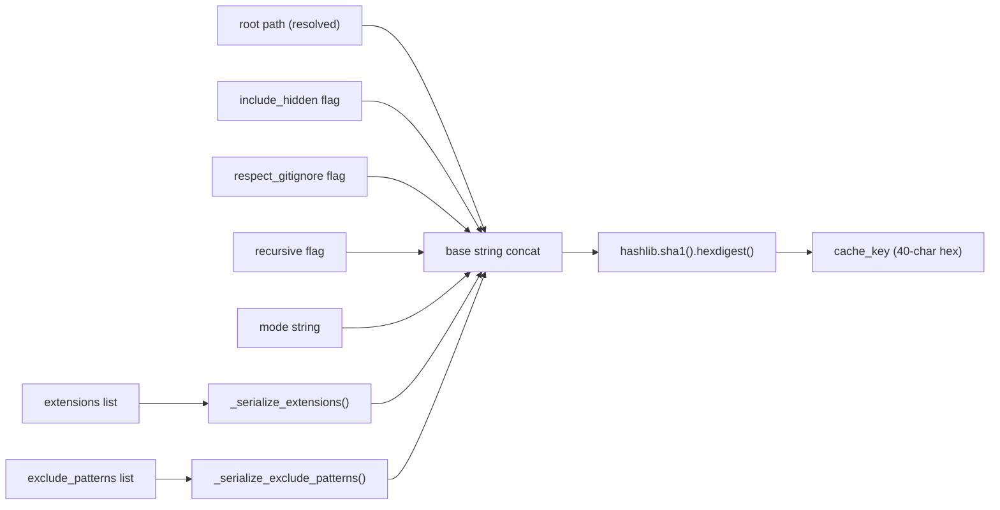
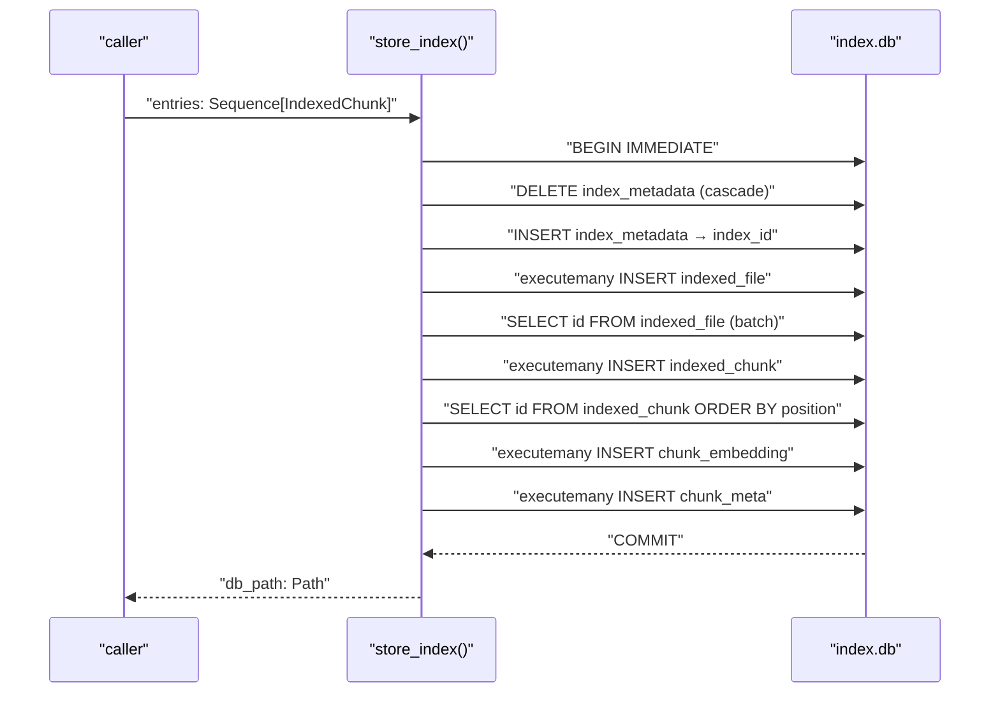
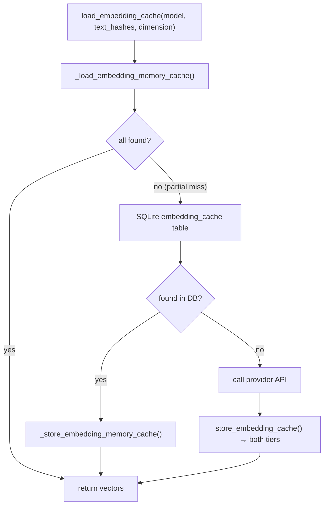
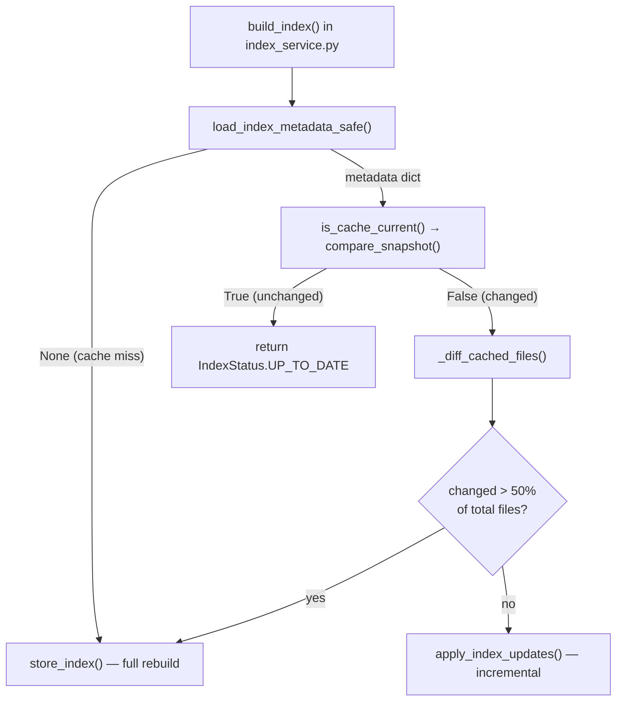

<!-- source: DeepWiki mcp.deepwiki.com · repo scarletkc/vexor · page 3.5 Cache System · fetched 2026-10-26 -->

# Cache System

<details>
<summary>Relevant source files</summary>

The following files were used as context for generating this wiki page:

- [README.md](README.md)
- [tests/unit/test_cache.py](tests/unit/test_cache.py)
- [vexor/cache.py](vexor/cache.py)

</details>


This page covers the SQLite-backed persistence layer that stores index chunks, embedding vectors, and query results. It documents the database schema, cache key derivation, full and incremental write paths, and the two-tier embedding cache.

For how the indexing pipeline *produces* data that gets written here, see [Index Functions](#5.3). For how search reads vectors from this layer and scores them, see [Search Execution Flow](#7.8). For manual cache management commands (`--show`, `--clear`, `--clear-index-all`), see [Cache Management](#8.3).

---

## Storage Location

All cache data is stored in a single SQLite file.

| Constant | Value | Purpose |
|---|---|---|
| `DEFAULT_CACHE_DIR` | `~/.vexor/` | Default parent directory |
| `DB_FILENAME` | `index.db` | Filename of the SQLite database |
| `CACHE_VERSION` | `6` | Current schema version |

The resolved path is returned by `cache_db_path()` [vexor/cache.py:231-235](). The directory can be temporarily overridden per-context using `cache_dir_context()` [vexor/cache.py:197-211](), which sets a `ContextVar` (`_CACHE_DIR_OVERRIDE`) so that concurrent async or threaded callers can use isolated directories. A permanent process-level override is available via `set_cache_dir()` [vexor/cache.py:220-228]().

Sources: [vexor/cache.py:21-32](), [vexor/cache.py:192-236]()

---

## SQLite Schema

The database has seven tables. Foreign keys cascade on delete, so removing a row from `index_metadata` removes all associated files, chunks, embeddings, metadata, and query cache entries automatically.

**Schema: index.db tables**

```mermaid
erDiagram
    index_metadata {
        INTEGER id PK
        TEXT cache_key
        TEXT root_path
        TEXT model
        INTEGER include_hidden
        INTEGER respect_gitignore
        INTEGER recursive
        TEXT mode
        INTEGER dimension
        INTEGER version
        TEXT generated_at
        TEXT exclude_patterns
        TEXT extensions
    }
    indexed_file {
        INTEGER id PK
        INTEGER index_id FK
        TEXT rel_path
        TEXT abs_path
        INTEGER size_bytes
        REAL mtime
    }
    indexed_chunk {
        INTEGER id PK
        INTEGER index_id FK
        INTEGER file_id FK
        INTEGER chunk_index
        INTEGER position
    }
    chunk_embedding {
        INTEGER chunk_id PK_FK
        BLOB vector_blob
    }
    chunk_meta {
        INTEGER chunk_id PK_FK
        TEXT preview
        TEXT label_hash
        INTEGER start_line
        INTEGER end_line
    }
    query_cache {
        INTEGER id PK
        INTEGER index_id FK
        TEXT query_hash
        TEXT query_text
        BLOB query_vector
        TEXT created_at
    }
    embedding_cache {
        INTEGER id PK
        TEXT model
        TEXT text_hash
        BLOB vector_blob
        TEXT created_at
    }

    index_metadata ||--o{ indexed_file : "index_id"
    index_metadata ||--o{ indexed_chunk : "index_id"
    index_metadata ||--o{ query_cache : "index_id"
    indexed_file ||--o{ indexed_chunk : "file_id"
    indexed_chunk ||--o| chunk_embedding : "chunk_id"
    indexed_chunk ||--o| chunk_meta : "chunk_id"
```

Sources: [vexor/cache.py:314-398]()

### Table Roles

| Table | Role |
|---|---|
| `index_metadata` | One row per (cache_key, model) pair. Stores all parameters used to build the index. |
| `indexed_file` | One row per file within an index. Stores path, size, and mtime for change detection. |
| `indexed_chunk` | One row per content chunk. `chunk_index` identifies the chunk within a file; `position` is the global sort order for search result ordering. |
| `chunk_embedding` | Stores the raw `float32` vector blob for each chunk, keyed by `chunk_id`. |
| `chunk_meta` | Stores the human-readable `preview`, a `label_hash` (used for embedding reuse), and optional source line numbers (`start_line`, `end_line`). |
| `query_cache` | Stores a previously embedded query vector so that repeated searches with the same query string avoid a round-trip to the embedding provider. |
| `embedding_cache` | Persistent cross-session cache mapping `(model, text_hash)` → vector blob. Used to avoid re-embedding unchanged file chunks. |

---

## Cache Key Derivation

Each index is identified by a `cache_key` plus a `model` name. The `cache_key` is a SHA-1 hash of a canonical string encoding the index parameters.

**Cache key computation flow**



The `_cache_key()` function [vexor/cache.py:51-71]() builds this string in the form:

```
{root.resolve()}|hidden={bool}|gitignore={bool}|recursive={bool}|mode={mode}[|ext={exts}][|exclude={patterns}]
```

The `UNIQUE(cache_key, model)` constraint on `index_metadata` [vexor/cache.py:333]() ensures that changing the model name for the same directory produces a separate index record rather than overwriting.

Sources: [vexor/cache.py:51-71](), [vexor/cache.py:161-184]()

---

## Connection Management

All connections are opened by the internal `_connect()` function [vexor/cache.py:243-266](). The PRAGMA settings applied to every connection are:

| PRAGMA | Value | Reason |
|---|---|---|
| `journal_mode` | `WAL` | Allows concurrent readers alongside a writer |
| `synchronous` | `NORMAL` | Reduces fsync overhead while maintaining crash safety |
| `temp_store` | `MEMORY` | Keeps temporary tables in RAM |
| `busy_timeout` | `5000` | Waits up to 5 s before returning `SQLITE_BUSY` |
| `foreign_keys` | `ON` | Enables cascade deletes |
| `query_only` | `ON` (read paths) | Prevents accidental writes on read-only connections |

Sources: [vexor/cache.py:243-266]()

---

## Writing an Index

### Full Write: `store_index()`

`store_index()` [vexor/cache.py:402-584]() performs a complete replacement of an existing (cache_key, model) pair in a single `BEGIN IMMEDIATE` transaction:

1. Compute `cache_key` and `dimension` from the first entry's embedding length.
2. `DELETE FROM index_metadata WHERE cache_key = ? AND model = ?` — cascades to all child rows.
3. `INSERT INTO index_metadata` with the new parameters.
4. Bulk-insert rows into `indexed_file`.
5. Query back `indexed_file.id` values and map them by `rel_path`.
6. Bulk-insert rows into `indexed_chunk` (in position order).
7. Query back `indexed_chunk.id` values and bulk-insert into `chunk_embedding` and `chunk_meta`.

**`store_index()` write sequence**



Sources: [vexor/cache.py:402-584]()

### Incremental Write: `apply_index_updates()`

`apply_index_updates()` [vexor/cache.py:587-880]() modifies an existing index in-place without replacing the `index_metadata` row. It accepts three categories of change:

| Parameter | Description |
|---|---|
| `removed_rel_paths` | Paths to delete from `indexed_file` (cascades to chunks and embeddings). |
| `changed_entries` | `IndexedChunk` objects for files that need new embeddings. Old `indexed_file` rows are deleted and re-inserted with new chunks. |
| `touched_entries` | Files whose `mtime`/`size_bytes` changed but whose content embedding can be reused. Only the `indexed_file` stats and `chunk_meta` are updated; `chunk_embedding` is left untouched. |
| `ordered_entries` | `(rel_path, chunk_index)` tuples defining the new global `position` ordering across all chunks after the update. |

After applying all changes, the function updates `index_metadata.generated_at` and `index_metadata.dimension` to reflect the current state [vexor/cache.py:867-876]().

Sources: [vexor/cache.py:587-880]()

---

## Reading an Index

### `load_index()`

`load_index()` [vexor/cache.py:991-1100+]() opens the database read-only, validates the schema version against `CACHE_VERSION`, and returns a `dict` containing:

- `model`, `mode`, `dimension`, `version`, `generated_at`
- `include_hidden`, `respect_gitignore`, `recursive`
- `extensions`, `exclude_patterns` (as tuples)
- `files`: list of `{path, mtime, size}` dicts for change detection
- `chunks`: list of `{path, absolute, chunk_index, preview, label_hash, start_line, end_line}` dicts

If the stored `version < CACHE_VERSION`, the function raises `FileNotFoundError`, which triggers a full rebuild upstream.

### `load_index_vectors()`

`load_index_vectors()` extends `load_index()` by also reading `chunk_embedding.vector_blob` and deserializing the blobs back to a `numpy.ndarray` of shape `(N, dimension)` with `dtype=float32`. It returns `(paths, vectors, meta)`. This is the entry point used by the search service.

Sources: [vexor/cache.py:991-1200+]()

---

## Embedding Cache (Two-Tier)

The embedding cache prevents redundant API calls to the embedding provider when the same text is indexed again. There are two layers, consulted in order on every lookup.

**Two-tier embedding cache lookup**



### In-Memory Cache

- Data structure: `OrderedDict` (`_EMBED_MEMORY_CACHE`) [vexor/cache.py:33-34]() — LRU eviction via `popitem(last=False)`.
- Max entries: `EMBED_MEMORY_CACHE_MAX_ENTRIES = 2_048` [vexor/cache.py:31]().
- Key: `(model: str, dimension: int | None, text_hash: str)`.
- Thread-safe via `_EMBED_MEMORY_LOCK` (a `threading.Lock`).
- Lifetime: process lifetime only; not persisted.

### SQLite Embedding Cache

- Table: `embedding_cache` with columns `(model, text_hash, vector_blob, created_at)`.
- Max entries: `EMBED_CACHE_MAX_ENTRIES = 50_000` [vexor/cache.py:30]().
- TTL: `EMBED_CACHE_TTL_DAYS = 30` [vexor/cache.py:29]().
- Pruning: entries older than the TTL are deleted first, then oldest rows beyond the capacity cap are removed. Pruning runs on each call to `store_embedding_cache()`.

### Embedding Cache Key

`embedding_cache_key(text, dimension)` [vexor/cache.py:92-105]() computes `SHA1(text | "dim=" + dimension)`. Including the dimension in the hash prevents cross-dimension pollution (e.g., a 512-dim embedding for a text must not be returned when a 1024-dim embedding is requested for the same text).

`query_cache_key(query, model)` [vexor/cache.py:83-89]() is a separate function used for the `query_cache` table. It normalizes provider prefixes from the model name (e.g., `openai/text-embedding-3-small` → `text-embedding-3-small`) before hashing, so that a query cached under one interface is reusable from another.

Sources: [vexor/cache.py:29-34](), [vexor/cache.py:83-158]()

---

## Change Detection: `compare_snapshot()`

Before deciding whether to run an incremental update or skip indexing entirely, the index service calls `compare_snapshot()` via `is_cache_current()` in `cache_service.py` [vexor/services/cache_service.py:8-34]().

`compare_snapshot()` collects current files from disk using `collect_files()` and compares each file's `(mtime, size_bytes)` pair against the snapshot stored in `indexed_file`. It returns `False` if any file is added, removed, or changed.

The `IndexedChunk` dataclass [vexor/cache.py:37-49]() carries the `mtime` and `size_bytes` fields so that the write path can record them without a redundant `stat()` call when they are already known.

**Change detection and update routing**



Sources: [vexor/services/cache_service.py:1-63](), [vexor/cache.py:37-49]()

---

## Schema Versioning and Migration

When `_ensure_schema()` [vexor/cache.py:314-399]() is called on an existing database, it first calls `_schema_needs_reset()` [vexor/cache.py:289-295](). This function detects old schema versions by checking whether the legacy `file_embedding` table exists in place of the current `indexed_chunk` / `chunk_embedding` split. If so, `_reset_index_schema()` [vexor/cache.py:298-311]() drops all tables with `DROP TABLE IF EXISTS` before `CREATE TABLE IF NOT EXISTS` runs for the current schema.

On the read path, `load_index()` compares the stored `version` integer against `CACHE_VERSION`. Any index with `version < CACHE_VERSION` is treated as a cache miss and triggers a full rebuild.

| Check | Location | Action on failure |
|---|---|---|
| `_schema_needs_reset()` | `_ensure_schema()` write path | Full schema drop + recreate |
| `version < CACHE_VERSION` | `load_index()` read path | Raise `FileNotFoundError` → caller rebuilds |

Sources: [vexor/cache.py:27](), [vexor/cache.py:289-399](), [vexor/cache.py:1037-1039]()

---

## Clearing the Cache

| Function | Scope |
|---|---|
| `clear_index(root, ...)` | Removes `index_metadata` rows matching the given (cache_key, model) combination. Cascades to all child rows. |
| `clear_all_cache()` | Deletes the entire `index.db` file after confirming it contains only `index_metadata` rows. Returns count of removed indexes. |
| `list_cache_entries()` | Returns all `index_metadata` rows with computed `file_count`. |

`clear_index()` accepts an optional `model` filter; omitting it removes all models for the given directory/mode combination.

Sources: [vexor/cache.py:1200+](), [tests/unit/test_cache.py:301-353]()

---

## Backfilling Line Metadata

`backfill_chunk_lines()` [vexor/cache.py:883-988]() updates `chunk_meta.start_line` and `chunk_meta.end_line` for existing chunks without re-embedding. This is used by `build_index()` when it detects that the cached index exists but has `NULL` line numbers — a state that arises when upgrading from an older cache version that predates line tracking [tests/unit/test_index_service.py:142-210]().

Sources: [vexor/cache.py:883-988](), [tests/unit/test_index_service.py:142-210]()

---

