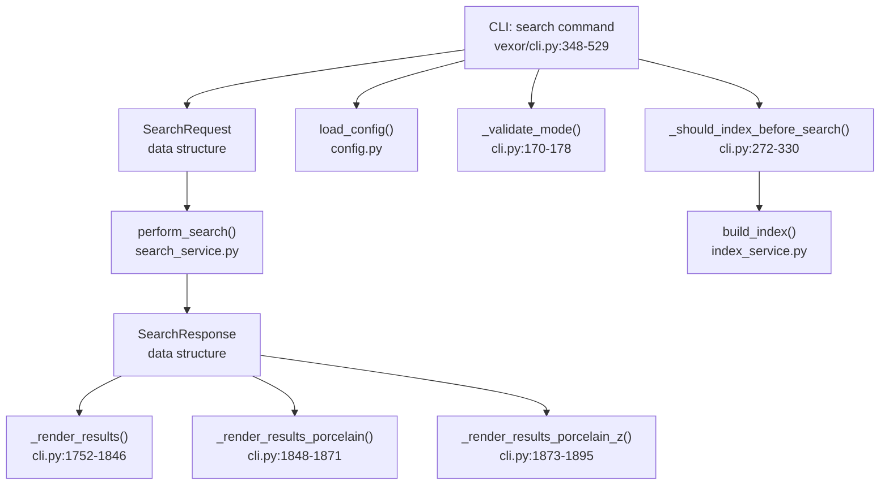
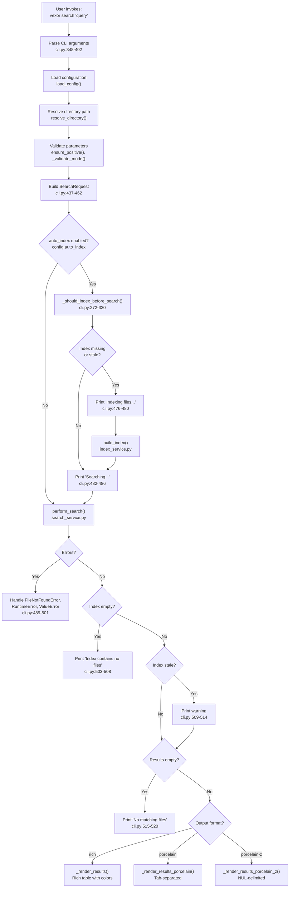
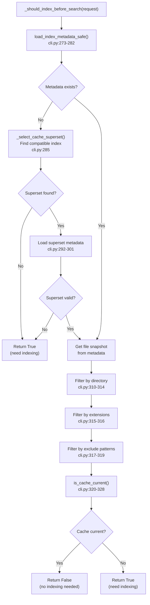
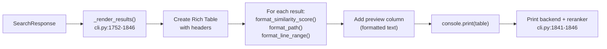

<!-- source: DeepWiki mcp.deepwiki.com · repo scarletkc/vexor · page 4.2 vexor search · fetched 2026-10-26 -->

# vexor search

<details>
<summary>Relevant source files</summary>

The following files were used as context for generating this wiki page:

- [tests/integration/test_cli.py](tests/integration/test_cli.py)
- [vexor/cli.py](vexor/cli.py)
- [vexor/text.py](vexor/text.py)

</details>


## Purpose and Scope

This page documents the `vexor search` CLI command, which performs semantic search over indexed files in a directory. The command executes similarity-based matching by comparing query embeddings against cached file embeddings. For programmatic search via Python, see [Search Functions](#5.2). For information about building and managing indexes, see [vexor index](#4.3). For detailed output format specifications, see [Output Formats](#4.9).

---

## Command Syntax

```bash
vexor search <query> [OPTIONS]
```

The `search` command can also be invoked implicitly when the first argument does not match a known subcommand:

```bash
vexor <query> [OPTIONS]
```

**Sources:** [vexor/cli.py:115-147](), [vexor/cli.py:348-402]()

---

## Search Command Architecture

The following diagram maps the `vexor search` command to its underlying code entities:



**Sources:** [vexor/cli.py:348-529](), [vexor/services/search_service.py:52]()

---

## Flags Reference

| Flag | Short | Type | Default | Description |
|------|-------|------|---------|-------------|
| `query` | - | positional | required | Text used to semantically match files |
| `--path` | `-p` | Path | current directory | Root directory to search |
| `--top` | `-k` | int | 5 | Number of results to display |
| `--include-hidden` | `-i` | flag | false | Search the index built with hidden files included |
| `--no-respect-gitignore` | - | flag | false | Include files normally ignored by .gitignore |
| `--mode` | `-m` | str | `"auto"` | Indexing mode to match (auto, name, head, brief, full, code, outline) |
| `--no-recursive` | `-n` | flag | false | Search only the specified directory, not subdirectories |
| `--ext` | `-e` | list[str] | none | Limit search to specific file extensions |
| `--exclude-pattern` | - | list[str] | none | Exclude files matching gitignore-style patterns |
| `--format` | - | enum | `"rich"` | Output format: rich, porcelain, porcelain-z |
| `--no-cache` | - | flag | false | Disable all disk caches (index + query) |

**Flag Details:**

### `--path` / `-p`
Specifies the root directory for the search. The command searches for a cached index matching this path along with other index parameters (mode, hidden files, recursion settings). The path is resolved to an absolute path before processing.

**Sources:** [vexor/cli.py:351-356](), [vexor/utils.py:resolve_directory]()

### `--top` / `-k`
Controls how many top-scoring results to return. Must be a positive integer. Higher values return more results but may include less relevant matches.

**Sources:** [vexor/cli.py:357](), [vexor/cli.py:426-428]()

### `--include-hidden` / `-i`
When enabled, the search uses an index that was built with hidden files (files/directories starting with `.`) included. This flag must match the indexing settings used when the index was created.

**Sources:** [vexor/cli.py:358-363]()

### `--no-respect-gitignore`
Disables `.gitignore` rules when determining which index to use. By default, Vexor respects `.gitignore` patterns. This flag must match the index's `respect_gitignore` setting.

**Sources:** [vexor/cli.py:364-368](), [vexor/cli.py:419]()

### `--mode` / `-m`
Specifies which indexing mode to search. Must match one of: `auto`, `name`, `head`, `brief`, `full`, `code`, `outline`. The mode determines how file content was extracted and embedded during indexing. For mode details, see [Indexing Modes](#3.2).

**Sources:** [vexor/cli.py:369-374](), [vexor/cli.py:431]()

### `--no-recursive` / `-n`
Restricts search to only the specified directory, excluding subdirectories. By default, search is recursive.

**Sources:** [vexor/cli.py:375-380](), [vexor/cli.py:432]()

### `--ext` / `-e`
Filters search results to only files with specified extensions. Can be specified multiple times or as a comma/space-separated list. Extensions are normalized to lowercase and must start with a dot (e.g., `.py`, `.md`).

```bash
# Multiple flags
vexor search "query" --ext .py --ext .md

# Comma-separated
vexor search "query" --ext .py,.md

# Space-separated
vexor search "query" --ext ".py .md"
```

**Sources:** [vexor/cli.py:381-386](), [vexor/cli.py:433-436](), [vexor/utils.py:normalize_extensions]()

### `--exclude-pattern`
Excludes files matching gitignore-style patterns. Supports wildcards, directory patterns, and plain extensions. Can be specified multiple times.

```bash
vexor search "query" --exclude-pattern "tests/**" --exclude-pattern "*.tmp"
```

**Sources:** [vexor/cli.py:387-391](), [vexor/cli.py:434]()

### `--format`
Controls output format. Options:
- `rich` (default): Human-readable table with colors and formatting
- `porcelain`: Tab-separated values for script parsing
- `porcelain-z`: NUL-delimited fields for safe parsing of filenames with special characters

For format specifications, see [Output Formats](#4.9).

**Sources:** [vexor/cli.py:392-396](), [vexor/cli.py:522-528]()

### `--no-cache`
Disables all disk caching, forcing in-memory index creation and query embedding. Results in slower performance but ensures fresh embeddings without relying on cached data.

**Sources:** [vexor/cli.py:397-401](), [vexor/cli.py:457]()

---

## Search Execution Flow

The following diagram traces the execution path from CLI invocation to result display:



**Sources:** [vexor/cli.py:348-529](), [vexor/cli.py:272-330]()

---

## Auto-Indexing Logic

The `vexor search` command includes automatic indexing when `auto_index` is enabled in the configuration (default). The `_should_index_before_search()` function determines whether indexing is needed:



**Key Behaviors:**

1. **Exact Match:** If an index exists with exact matching parameters (path, mode, hidden files, recursion, extensions, exclude patterns), it checks if the cached file snapshot is current.

2. **Superset Match:** If no exact match exists, the function searches for a "superset" index—a cached index that covers a broader scope (e.g., recursive index when searching non-recursively, or index with no extension filter when searching with extension filter).

3. **Staleness Check:** The `is_cache_current()` function compares cached file metadata (mtime, size) against current filesystem state to detect changes.

**Sources:** [vexor/cli.py:272-330](), [vexor/services/search_service.py:_select_cache_superset](), [vexor/services/cache_service.py:is_cache_current]()

---

## Output Format Processing

### Rich Format (Default)

The rich format renders results as a formatted table using the `rich` library:



**Example Output:**
```
Vexor semantic file search results
━━━━━━━━━━━━━━━━━━━━━━━━━━━━━━━━━━━━━━━━━━━━━━━━━━
#  Similarity  File path      Lines    Preview
━━━━━━━━━━━━━━━━━━━━━━━━━━━━━━━━━━━━━━━━━━━━━━━━━━
1  99.0%      ./config.py    L145-167 Configuration file handling...
2  87.3%      ./api.py       L23-45   API endpoint definitions...
━━━━━━━━━━━━━━━━━━━━━━━━━━━━━━━━━━━━━━━━━━━━━━━━━━
Backend: openai/text-embedding-3-small (1536)
Reranker: bm25
```

**Sources:** [vexor/cli.py:1752-1846]()

### Porcelain Format

Tab-separated format for script parsing. Each line contains:
```
rank\tscore\tpath\tchunk_index\tstart_line\tend_line\tpreview
```

Special characters in preview (tabs, newlines) are escaped as `\t` and `\n`.

**Example Output:**
```
1	0.990	./config.py	0	145	167	Configuration file handling...
2	0.873	./api.py	0	23	45	API endpoint definitions...
```

**Sources:** [vexor/cli.py:1848-1871]()

### Porcelain-Z Format

NUL-delimited format for safe parsing of filenames with special characters:
```
rank\0score\0path\0chunk_index\0start_line\0end_line\0preview\0
```

Each record ends with a NUL byte. Preview text is not escaped.

**Sources:** [vexor/cli.py:1873-1895]()

---

## Error Handling

The search command handles several error conditions:

| Error Type | Condition | Exit Code | Output |
|------------|-----------|-----------|--------|
| `FileNotFoundError` | No cached index found | 1 | "No cached index found for {path}. Run `vexor index` first." |
| `RuntimeError` | Provider/API errors | 1 | Error message from exception |
| `ValueError` | Invalid parameters | 1 | Error message from exception |
| Empty query | Query string is empty/whitespace | 1 | "Query text must not be empty." |
| Empty index | Index contains no files | 0 | "Index contains no files." |
| No results | Search returned no matches | 0 | "No matching files found." |

**Sources:** [vexor/cli.py:421-424](), [vexor/cli.py:489-520]()

---

## Examples

### Basic Search
```bash
# Search current directory
vexor search "configuration settings"

# Search specific directory
vexor search "error handling" --path ~/projects/myapp

# Limit to top 10 results
vexor search "database connection" --top 10
```

### Mode-Specific Search
```bash
# Search using name mode (filename only)
vexor search "config" --mode name

# Search using code mode (AST-aware chunks)
vexor search "authentication" --mode code --ext .py

# Search using outline mode (markdown headings)
vexor search "installation" --mode outline --ext .md
```

### Filtering Results
```bash
# Search only Python files
vexor search "async function" --ext .py

# Search multiple extensions
vexor search "database" --ext .py,.js,.ts

# Exclude test files
vexor search "login" --exclude-pattern "tests/**"

# Non-recursive search
vexor search "README" --no-recursive --mode name
```

### Script-Friendly Output
```bash
# Tab-separated output
vexor search "TODO" --format porcelain | cut -f3

# NUL-delimited for xargs
vexor search "deprecated" --format porcelain-z | xargs -0 -n1 echo

# Process top result in shell script
vexor search "query" --format porcelain --top 1 | while IFS=$'\t' read rank score path chunk start end preview; do
  echo "Top match: $path (score: $score)"
done
```

### Advanced Usage
```bash
# Search with no cache (fresh embeddings)
vexor search "critical bug" --no-cache

# Search including hidden files
vexor search "secrets" --include-hidden

# Search ignoring .gitignore rules
vexor search "build output" --no-respect-gitignore
```

**Sources:** [tests/integration/test_cli.py:34-345]()

---

## Integration with Configuration

The search command reads settings from `~/.vexor/config.json`:

| Config Key | Search Impact |
|------------|---------------|
| `provider` | Determines which embedding service generates query vectors |
| `model` | Specifies the embedding model (must match indexed model) |
| `api_key` | Authenticates with embedding provider |
| `auto_index` | Enables/disables automatic indexing before search |
| `rerank` | Applies reranking strategy (off, bm25, flashrank, remote) |
| `embedding_dimensions` | Must match index dimensions if specified |
| `local_cuda` | Uses CUDA for local provider query embeddings |

**Priority Order:**
1. Command-line flags (e.g., `--path`, `--mode`, `--top`)
2. Runtime configuration (set via Python API)
3. Disk configuration (`~/.vexor/config.json`)
4. Built-in defaults

For configuration management, see [vexor config](#4.4).

**Sources:** [vexor/cli.py:404-416](), [vexor/config.py:load_config]()

---

## Performance Considerations

### Cached vs. Uncached Search

| Aspect | Cached (default) | Uncached (`--no-cache`) |
|--------|------------------|-------------------------|
| Index storage | SQLite database | In-memory only |
| Query embedding | Cached per query string | Computed every time |
| Performance | Fast (milliseconds) | Slower (seconds) |
| Use case | Regular searches | Fresh embeddings needed |

### Auto-Indexing Impact

When auto-indexing triggers, search latency increases significantly:
- **Index creation time:** Depends on file count, size, and provider API latency
- **Recommendation:** Pre-index large directories using `vexor index` to avoid search delays

### Reranking Impact

Reranking adds post-processing latency:
- **BM25:** ~10-50ms for 100 results (lexical scoring)
- **FlashRank:** ~100-500ms for 100 results (neural model)
- **Remote:** Network-dependent (100ms-2s)

**Sources:** [vexor/services/search_service.py:perform_search]()

---

## Related Commands and Concepts

- **[vexor index](#4.3):** Build and manage cached indexes
- **[vexor config](#4.4):** Configure providers, models, and search settings
- **[Search Functions](#5.2):** Programmatic search via Python API
- **[Indexing Modes](#3.2):** Understand extraction strategies
- **[Reranking Strategies](#3.4):** Configure result reordering
- **[Output Formats](#4.9):** Detailed format specifications

---

