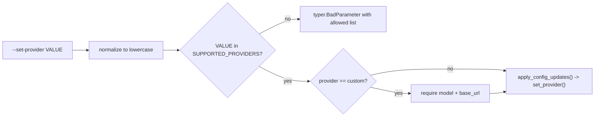
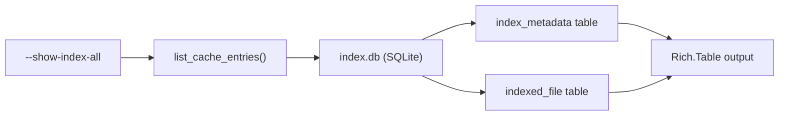
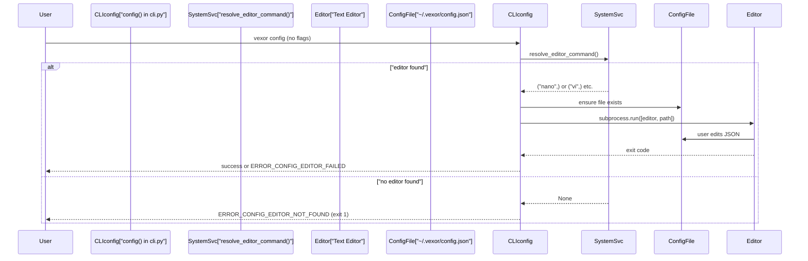
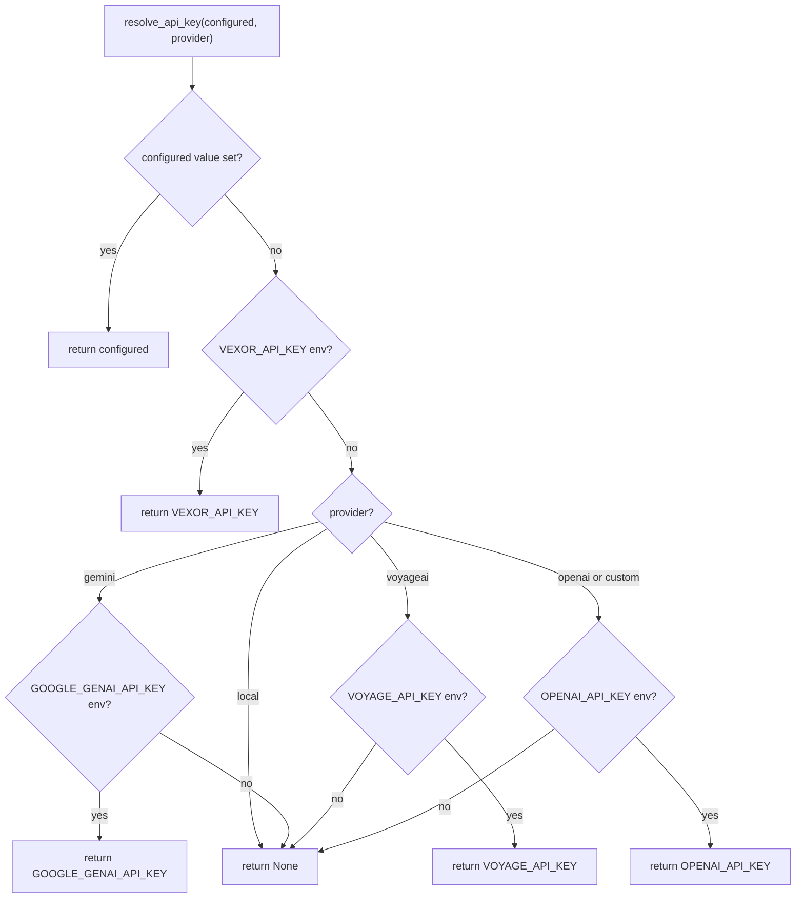
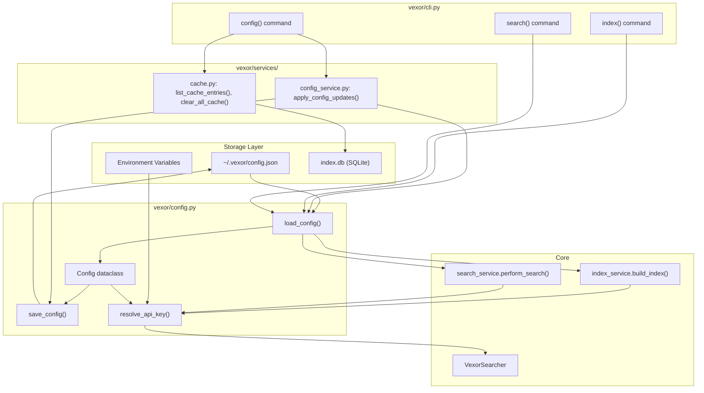

<!-- source: DeepWiki mcp.deepwiki.com · repo scarletkc/vexor · page 4.4 vexor config · fetched 2026-10-26 -->

# vexor config

<details>
<summary>Relevant source files</summary>

The following files were used as context for generating this wiki page:

- [vexor/cli.py](vexor/cli.py)
- [vexor/config.py](vexor/config.py)
- [vexor/text.py](vexor/text.py)

</details>


## Purpose and Scope

The `vexor config` command manages Vexor's persistent configuration settings and cached index data. This page documents all configuration-related operations: setting API keys, selecting embedding models and providers, configuring reranking, managing base URLs for custom endpoints, and performing cache maintenance operations.

For information about how configuration is used during indexing and search operations, see pages 4.3 and 4.2. For details on the underlying configuration service implementation, see page 7.7.

Sources: [vexor/cli.py:725-1052](), [vexor/config.py:1-710](), [vexor/services/config_service.py:1-190]()

---

## Configuration File

Vexor stores all persistent configuration in a JSON file located at `~/.vexor/config.json`. The configuration directory and file are created automatically when first accessed.

### Configuration Schema

All fields are optional; missing fields use the defaults shown. Defined in the `Config` dataclass at [vexor/config.py:62-76]() and constants at [vexor/config.py:24-48]().

| Field | Type | Default | CLI Flag(s) | Description |
|-------|------|---------|-------------|-------------|
| `api_key` | string | none | `--set-api-key` / `--clear-api-key` | Embedding provider API key |
| `model` | string | `"text-embedding-3-small"` | `--set-model` | Embedding model name |
| `batch_size` | integer | `64` | `--set-batch-size` | Texts per embedding request (0 = all-at-once) |
| `embed_concurrency` | integer | `4` | `--set-embed-concurrency` | Concurrent embedding API requests |
| `extract_concurrency` | integer | auto (CPU-based) | `--set-extract-concurrency` | Concurrent file extraction workers |
| `extract_backend` | string | `"auto"` | `--set-extract-backend` | Extraction executor: `auto`, `thread`, `process` |
| `provider` | string | `"openai"` | `--set-provider` | Embedding provider |
| `base_url` | string | none | `--set-base-url` / `--clear-base-url` | Override provider API base URL |
| `auto_index` | boolean | `true` | `--set-auto-index` | Auto-index before search when cache is stale |
| `local_cuda` | boolean | `false` | `vexor local --cuda` / `--cpu` | Use CUDA for local embeddings |
| `rerank` | string | `"off"` | `--rerank` | Rerank strategy: `off`, `bm25`, `flashrank`, `remote` |
| `flashrank_model` | string | none | `--set-flashrank-model` | FlashRank model (default: `ms-marco-TinyBERT-L-2-v2`) |
| `remote_rerank` | object | none | `--set-remote-rerank-*` / `--clear-remote-rerank` | Remote reranker config (see below) |
| `embedding_dimensions` | integer | none | `--set-embedding-dimensions` / `--clear-embedding-dimensions` | Output embedding dimension for models that support it |

The `remote_rerank` nested object has these subfields:

| Subfield | CLI Flag | Description |
|----------|----------|-------------|
| `base_url` | `--set-remote-rerank-url` | HTTP endpoint (auto-appends `/rerank` if absent) |
| `model` | `--set-remote-rerank-model` | Reranker model name |
| `api_key` | `--set-remote-rerank-api-key` | API key (or `VEXOR_REMOTE_RERANK_API_KEY` env var) |

### Example Configuration

```json
{
  "api_key": "sk-...",
  "provider": "openai",
  "model": "text-embedding-3-small",
  "batch_size": 64,
  "embed_concurrency": 4,
  "extract_concurrency": 4,
  "extract_backend": "auto",
  "auto_index": true,
  "local_cuda": false,
  "rerank": "flashrank",
  "flashrank_model": "ms-marco-MiniLM-L-12-v2",
  "embedding_dimensions": 1024,
  "remote_rerank": {
    "base_url": "https://reranker.example.com/v1/rerank",
    "model": "rerank-model",
    "api_key": "rr-key"
  }
}
```

Sources: [vexor/config.py:24-48](), [vexor/config.py:54-76](), [vexor/config.py:123-188]()

---

## Command Options Overview

**All `vexor config` Flags by Category**

```mermaid
graph TB
    ConfigCmd["vexor config"]

    ConfigCmd --> SetOps["Setting Operations"]
    ConfigCmd --> ClearOps["Clearing Operations"]
    ConfigCmd --> ViewOps["Viewing / Cache Operations"]
    ConfigCmd --> EditOps["No args: open editor"]

    SetOps --> SetApiKey["--set-api-key KEY"]
    SetOps --> SetModel["--set-model MODEL"]
    SetOps --> SetBatch["--set-batch-size N"]
    SetOps --> SetEmbedConc["--set-embed-concurrency N"]
    SetOps --> SetExtractConc["--set-extract-concurrency N"]
    SetOps --> SetExtractBack["--set-extract-backend BACKEND"]
    SetOps --> SetProvider["--set-provider PROVIDER"]
    SetOps --> SetBaseUrl["--set-base-url URL"]
    SetOps --> SetDimensions["--set-embedding-dimensions N"]
    SetOps --> SetAutoIndex["--set-auto-index BOOL"]
    SetOps --> SetRerank["--rerank STRATEGY"]
    SetOps --> SetFRModel["--set-flashrank-model MODEL"]
    SetOps --> SetRRUrl["--set-remote-rerank-url URL"]
    SetOps --> SetRRModel["--set-remote-rerank-model MODEL"]
    SetOps --> SetRRKey["--set-remote-rerank-api-key KEY"]

    ClearOps --> ClearApiKey["--clear-api-key"]
    ClearOps --> ClearBaseUrl["--clear-base-url"]
    ClearOps --> ClearDimensions["--clear-embedding-dimensions"]
    ClearOps --> ClearFlashrank["--clear-flashrank (deletes model cache)"]
    ClearOps --> ClearRemote["--clear-remote-rerank"]
    ClearOps --> ClearIndexAll["--clear-index-all"]

    ViewOps --> ShowConfig["--show"]
    ViewOps --> ShowIndexAll["--show-index-all"]
```



Sources: [vexor/cli.py:725-842]()

---

## Setting Configuration Values

### Setting API Keys

```bash
vexor config --set-api-key "sk-your-key"
vexor config --clear-api-key
```

The stored key is used by default for all embedding operations. Environment variables provide a fallback chain — see [API Key Resolution](#api-key-resolution) below.

The CLI calls `apply_config_updates()` in [vexor/services/config_service.py:104-109](), which delegates to `set_api_key()` in [vexor/config.py:234-237]().

Sources: [vexor/cli.py:727-735](), [vexor/config.py:234-237](), [vexor/services/config_service.py:104-109]()

### Setting the Embedding Model

```bash
vexor config --set-model text-embedding-3-small    # OpenAI (default)
vexor config --set-model gemini-embedding-001       # Gemini
vexor config --set-model voyage-3-large             # VoyageAI
vexor config --set-model intfloat/multilingual-e5-small  # local
```

Default models per provider are resolved by `resolve_default_model()` at [vexor/config.py:397-407]():

| Provider | Default Model | Constant |
|----------|--------------|----------|
| `openai` | `text-embedding-3-small` | `DEFAULT_MODEL` |
| `gemini` | `gemini-embedding-001` | `DEFAULT_GEMINI_MODEL` |
| `voyageai` | `voyage-3-large` | `DEFAULT_VOYAGE_MODEL` |
| `local` | `intfloat/multilingual-e5-small` | `DEFAULT_LOCAL_MODEL` |
| `custom` | (required, no default) | — |

Sources: [vexor/cli.py:737-740](), [vexor/config.py:24-27](), [vexor/config.py:397-407]()

### Setting Batch Size

```bash
vexor config --set-batch-size 64   # Default: 64
vexor config --set-batch-size 0    # All texts in one request
vexor config --set-batch-size 128  # Larger batches
```

`DEFAULT_BATCH_SIZE` is `64`. A value of `0` sends all texts as a single request. Negative values are rejected.

Sources: [vexor/cli.py:741-744](), [vexor/cli.py:844-845](), [vexor/config.py:28]()

### Setting Concurrency

```bash
vexor config --set-embed-concurrency 8      # Concurrent embedding API calls (default: 4)
vexor config --set-extract-concurrency 4   # Concurrent file extraction workers (default: CPU-based)
vexor config --set-extract-backend thread  # thread | process | auto (default: auto)
```

`extract_backend` controls the executor for file content extraction. `auto` lets Vexor choose based on workload. Allowed values are defined in `SUPPORTED_EXTRACT_BACKENDS` at [vexor/config.py:39]().

Sources: [vexor/cli.py:747-761](), [vexor/config.py:30-31](), [vexor/config.py:39]()

### Setting the Provider

```bash
vexor config --set-provider openai     # default
vexor config --set-provider gemini
vexor config --set-provider voyageai
vexor config --set-provider local
vexor config --set-provider custom --set-model embed-model --set-base-url https://host/v1
```

Allowed values are in `SUPPORTED_PROVIDERS` at [vexor/config.py:37](): `openai`, `gemini`, `voyageai`, `custom`, `local`. Invalid values produce an error listing the allowed set.

The `custom` provider requires both `--set-model` and `--set-base-url`. Setting `--set-provider custom` without them is rejected.

**Provider Validation and Dispatch**



Sources: [vexor/cli.py:762-765](), [vexor/cli.py:921-974](), [vexor/config.py:37](), [vexor/config.py:272-277]()

### Setting Custom Base URLs

```bash
vexor config --set-base-url https://proxy.example.com
vexor config --set-base-url http://localhost:1234/v1   # LM Studio or llama.cpp
vexor config --clear-base-url
```

Use cases: OpenAI-compatible local servers, organization API gateways, the `custom` provider. `--set-base-url` and `--clear-base-url` cannot be used together.

VoyageAI has a hardcoded base URL (`VOYAGE_BASE_URL`) applied automatically when no override is set; see `resolve_base_url()` at [vexor/config.py:410-417]().

Sources: [vexor/cli.py:767-776](), [vexor/cli.py:850-851](), [vexor/config.py:410-417]()

### Setting Embedding Dimensions

```bash
vexor config --set-embedding-dimensions 1024
vexor config --clear-embedding-dimensions
```

Only models listed in `DIMENSION_SUPPORTED_MODELS` at [vexor/config.py:41-46]() support this setting. Validation checks the model prefix:

| Model Prefix | Supported Dimensions |
|--------------|---------------------|
| `text-embedding-3-small` | 256, 512, 1024, 1536 |
| `text-embedding-3-large` | 256, 512, 1024, 1536, 3072 |
| `voyage-3` | 256, 512, 1024, 2048 |
| `voyage-code-3` | 256, 512, 1024, 2048 |

Setting `--set-embedding-dimensions 0` is equivalent to `--clear-embedding-dimensions`.

Sources: [vexor/cli.py:777-785](), [vexor/cli.py:1008-1033](), [vexor/config.py:41-46](), [vexor/config.py:420-448]()

### Setting Auto-Index

```bash
vexor config --set-auto-index true    # default: enabled
vexor config --set-auto-index false
```

When enabled, `vexor search` checks if the index is stale and re-indexes before searching. Accepts `true/false`, `yes/no`, `1/0`, `on/off` (parsed by `_parse_boolean()` at [vexor/cli.py:181-188]()).

Sources: [vexor/cli.py:787-791](), [vexor/config.py:286-289]()

### Setting Rerank Strategy

```bash
vexor config --rerank off        # default: no reranking
vexor config --rerank bm25       # keyword-based, no extra deps
vexor config --rerank flashrank  # local neural (requires vexor[flashrank])
vexor config --rerank remote     # HTTP reranker endpoint
```

Allowed values are in `SUPPORTED_RERANKERS` at [vexor/config.py:38](). Setting `flashrank` requires the `flashrank` package; the CLI verifies this at [vexor/cli.py:940-943]() and pre-fetches the model by calling `_prepare_flashrank_model()`.

Setting `remote` requires all three remote rerank fields to be present (URL, model, API key) — either already configured or provided in the same command.

Sources: [vexor/cli.py:797-801](), [vexor/cli.py:931-999](), [vexor/config.py:38](), [vexor/config.py:298-304]()

### Setting the FlashRank Model

```bash
vexor config --set-flashrank-model ms-marco-MiniLM-L-12-v2
vexor config --set-flashrank-model       # no value or empty string = reset to default
vexor config --set-flashrank-model ""    # also resets to default
```

When the model name is empty or omitted, the key is removed from `config.json` and the default (`ms-marco-TinyBERT-L-2-v2`, `DEFAULT_FLASHRANK_MODEL`) is used at runtime.

Sources: [vexor/cli.py:802-806](), [vexor/cli.py:852-859](), [vexor/config.py:34](), [vexor/config.py:307-311]()

### Configuring a Remote Reranker

```bash
vexor config --rerank remote \
  --set-remote-rerank-url https://api.example.com/v1 \
  --set-remote-rerank-model rerank-model \
  --set-remote-rerank-api-key rr-key
```

All three fields (URL, model, API key) must be present to activate `remote` reranking. The API key can also be supplied via the `VEXOR_REMOTE_RERANK_API_KEY` environment variable instead of `--set-remote-rerank-api-key`.

The URL is normalized by `normalize_remote_rerank_url()` at [vexor/config.py:375-394](): if the path does not end with `/rerank` or `/reranker`, `/rerank` is appended.

```bash
vexor config --clear-remote-rerank   # wipe all remote rerank config
```

`--clear-remote-rerank` cannot be combined with other `--set-remote-rerank-*` flags.

Sources: [vexor/cli.py:807-825](), [vexor/cli.py:975-999](), [vexor/config.py:351-394]()

---

## Clearing Configuration Values

| Flag | Effect |
|------|--------|
| `--clear-api-key` | Removes `api_key` from `config.json`; falls back to env vars |
| `--clear-base-url` | Removes `base_url`; reverts to provider default endpoint |
| `--clear-embedding-dimensions` | Removes `embedding_dimensions`; model uses its native dimension |
| `--clear-flashrank` | Deletes cached FlashRank model files from `~/.vexor/flashrank/`; cannot be combined with other flags |
| `--clear-remote-rerank` | Removes the `remote_rerank` object from `config.json`; cannot be combined with `--set-remote-rerank-*` |
| `--clear-index-all` | Deletes all index entries from the SQLite cache (see [Cache Management](#cache-management)) |

```bash
vexor config --clear-api-key
vexor config --clear-base-url
vexor config --clear-embedding-dimensions
vexor config --clear-flashrank
vexor config --clear-remote-rerank
```

Sources: [vexor/cli.py:727-841](), [vexor/cli.py:844-920](), [tests/integration/test_cli.py:1113-1159]()

---

## Viewing Configuration

### Displaying Current Settings

```bash
vexor config --show
```

Output fields are defined by `INFO_CONFIG_SUMMARY` in [vexor/text.py:326-341]():

```
API key set: yes
Default provider: openai
Default model: text-embedding-3-small
Embedding dimensions: none
Default batch size: 64
Embedding concurrency: 4
Extract concurrency: 4
Extract backend: auto
Auto index: yes
Rerank: flashrank
FlashRank model: ms-marco-MiniLM-L-12-v2
Local CUDA: no
Custom base URL: none
```

API keys are not displayed; only their presence is reported. When `rerank` is `flashrank`, a `FlashRank model:` line is appended. When `rerank` is `remote`, a `Remote rerank:` summary line is appended.

Sources: [vexor/text.py:326-341](), [vexor/cli.py:827-831]()

---

## Cache Management

### Viewing All Cached Indexes

```bash
vexor config --show-index-all
```

Calls `list_cache_entries()` from [vexor/cache.py]() and renders a `Rich.Table`. Each row is one unique index configuration (root path + mode + model + flags).

**`--show-index-all` Data Flow**



Output table columns:

| Column | Source field |
|--------|-------------|
| Root | `root_path` |
| Mode | `mode` |
| Model | `model` |
| Hidden | `include_hidden` |
| Recursive | `recursive` |
| Gitignore | `respect_gitignore` |
| Exclude | `exclude_patterns` |
| Extensions | `extensions` |
| Files | `file_count` |
| Generated | `generated_at` |

### Clearing All Cached Indexes

```bash
vexor config --clear-index-all
```

Calls `clear_all_cache()` from [vexor/cache.py](). Removes all rows from `index_metadata`, `indexed_file`, `indexed_chunk`, `chunk_embedding`, and related tables; does not delete the SQLite file itself. Outputs `INFO_INDEX_ALL_CLEARED` or `INFO_INDEX_ALL_CLEAR_NONE` from [vexor/text.py:276-277]().

> This operation cannot be undone. All projects must be re-indexed afterward.

Sources: [vexor/cli.py:832-841](), [vexor/cache.py](), [vexor/text.py:274-278](), [tests/integration/test_cli.py:1257-1307]()

---

## Editor Integration

When `vexor config` is invoked with no flags, it opens `~/.vexor/config.json` in your system's default text editor:

```bash
vexor config
```

### Editor Resolution

`resolve_editor_command()` in [vexor/services/system_service.py]() checks in order:
1. `VISUAL` environment variable
2. `EDITOR` environment variable
3. Common editor binaries: `nano`, `vi`, `vim`, `emacs`, `notepad` (Windows)

If no editor is found, `ERROR_CONFIG_EDITOR_NOT_FOUND` is printed and the command exits with code 1.

**Editor Launch Sequence**



Sources: [vexor/cli.py:725-842](), [vexor/services/system_service.py](), [vexor/text.py:320-323](), [tests/integration/test_cli.py:1225-1254]()

---

## API Key Resolution

`resolve_api_key()` at [vexor/config.py:469-492]() applies a priority chain when selecting the active API key:

**`resolve_api_key(configured, provider)` Priority Chain**



### Priority Order

1. `api_key` in `~/.vexor/config.json` (set via `--set-api-key`)
2. `VEXOR_API_KEY` environment variable (any provider)
3. Provider-specific environment variable:

| Provider | Environment Variable |
|----------|---------------------|
| `gemini` | `GOOGLE_GENAI_API_KEY` |
| `voyageai` | `VOYAGE_API_KEY` |
| `openai` / `custom` | `OPENAI_API_KEY` |
| `local` | *(no key required)* |

### Usage Examples

```bash
# Persist key in config (highest priority)
vexor config --set-api-key "sk-..."

# Use general env var (works for all providers)
export VEXOR_API_KEY="sk-..."

# Provider-specific env vars
export OPENAI_API_KEY="sk-..."
export GOOGLE_GENAI_API_KEY="AIza..."
export VOYAGE_API_KEY="pa-..."
```

Sources: [vexor/config.py:469-492](), [vexor/config.py:47-51](), [tests/integration/test_cli.py:950-972]()

---

## Configuration Data Flow

**How `vexor config` writes flow to runtime components**



### Key Integration Points

| Point | Detail |
|-------|--------|
| `load_config()` | Called by every CLI command to read current settings |
| `apply_config_updates()` | Called by `vexor config` to atomically apply flag mutations |
| `resolve_api_key()` | Called at embedding time by `VexorSearcher` |
| `list_cache_entries()` / `clear_all_cache()` | Called by `--show-index-all` / `--clear-index-all` |

Sources: [vexor/config.py:123-148](), [vexor/config.py:151-188](), [vexor/services/config_service.py:78-183](), [vexor/cache.py]()

---

## Configuration Management Operations

### Common Workflows

**Initial Setup:**
```bash
# Set API key and provider
vexor config --set-api-key "your-key"
vexor config --set-provider gemini
vexor config --show
```

**Switching Providers:**
```bash
# Switch from Gemini to OpenAI
vexor config --set-provider openai
vexor config --set-model text-embedding-3-small
export OPENAI_API_KEY="sk-..."
```

**Using Local Embedding Server:**
```bash
# Configure LM Studio endpoint
vexor config --set-base-url http://localhost:1234/v1
vexor config --set-provider openai  # LM Studio uses OpenAI format
```

**Cache Maintenance:**
```bash
# View all indexes
vexor config --show-index-all

# Remove outdated indexes
vexor config --clear-index-all

# Re-index projects as needed
vexor index --path ~/project1 --mode full
vexor index --path ~/project2 --mode name
```

**Sources:** [README.md:31-57](), [vexor/cli.py:343-512]()

---

## Implementation Details

### Config Command Structure

The `config()` function at [vexor/cli.py:343-512]() implements the command logic:

1. **Validation Phase** ([vexor/cli.py:397-410]()):
   - Checks batch size is non-negative
   - Validates `--set-base-url` and `--clear-base-url` are not both set
   - Validates provider against `SUPPORTED_PROVIDERS`
   - Normalizes provider name to lowercase

2. **Update Phase** ([vexor/cli.py:412-443]()):
   - Calls `apply_config_updates()` with all modification flags
   - Returns `ConfigUpdateResult` indicating which fields changed
   - Prints success messages for each modified field

3. **Display Phase** ([vexor/cli.py:470-511]()):
   - `--show`: Calls `get_config_snapshot()` and formats output
   - `--show-index-all`: Calls `list_cache_entries()` and renders table
   - `--clear-index-all`: Calls `clear_all_cache()` and reports count

4. **Editor Phase** ([vexor/cli.py:458-468]()):
   - If no options specified, calls `_edit_config_file()`
   - Opens editor via `resolve_editor_command()` and `subprocess.run()`

**Sources:** [vexor/cli.py:343-512]()

### Configuration Service Layer

The configuration service at [vexor/services/config_service.py]() provides:

- `apply_config_updates()`: Atomic multi-field updates with transactional behavior
- `get_config_snapshot()`: Read-only view of current configuration

These functions abstract the lower-level `config.py` module functions and provide a cleaner interface for the CLI layer.

**Sources:** [vexor/services/config_service.py](), [vexor/cli.py:25]()

### Storage Implementation

Configuration persistence uses the following modules:

| Module | Responsibility |
|--------|----------------|
| [vexor/config.py:11-12]() | Defines `CONFIG_DIR` and `CONFIG_FILE` paths |
| [vexor/config.py:31-41]() | `load_config()`: Reads JSON and returns `Config` dataclass |
| [vexor/config.py:44-56]() | `save_config()`: Serializes `Config` to JSON with proper formatting |
| [vexor/cache.py]() | Manages SQLite database for cached embeddings (separate from config.json) |

The configuration file is plain JSON with 2-space indentation and UTF-8 encoding. Missing fields use default values defined as module constants.

**Sources:** [vexor/config.py:1-107]()

---

