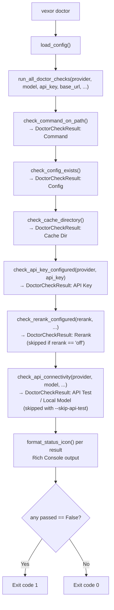
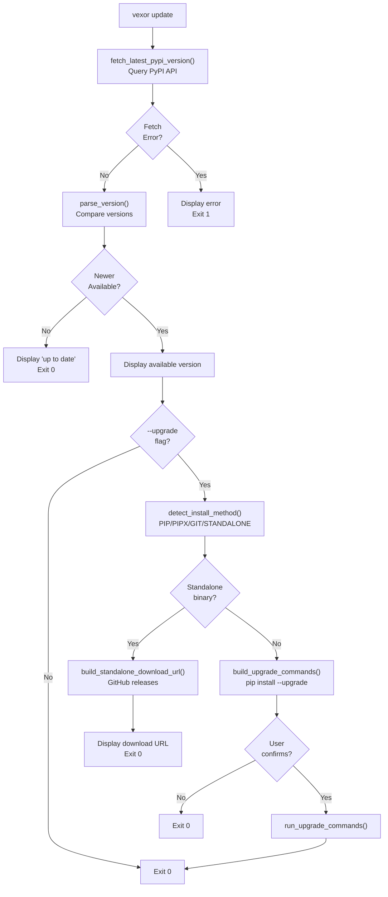
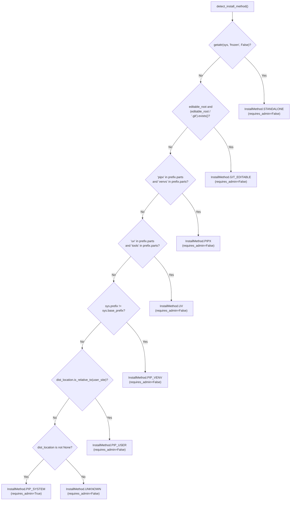
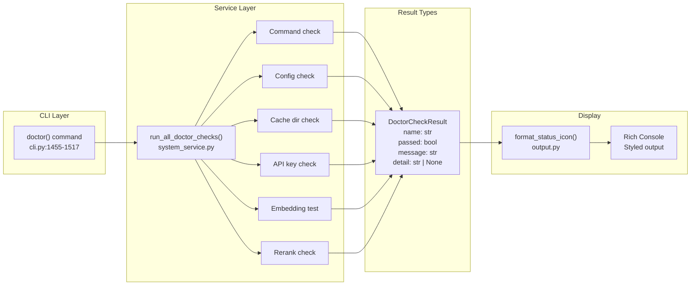
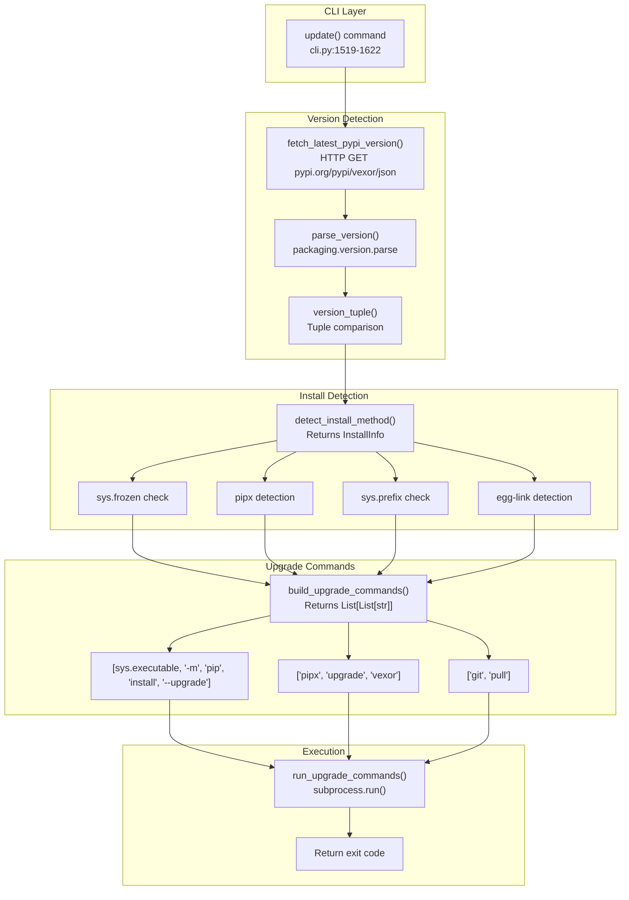
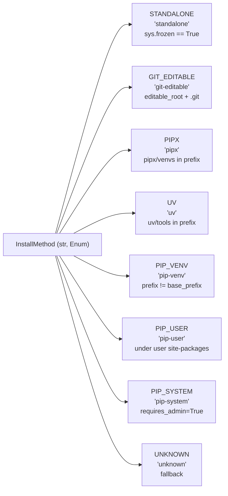

<!-- source: DeepWiki mcp.deepwiki.com · repo scarletkc/vexor · page 4.5 vexor doctor and update · fetched 2026-10-26 -->

# vexor doctor and update

<details>
<summary>Relevant source files</summary>

The following files were used as context for generating this wiki page:

- [tests/integration/test_cli_commands.py](tests/integration/test_cli_commands.py)
- [tests/unit/test_query_cache.py](tests/unit/test_query_cache.py)
- [tests/unit/test_system_service.py](tests/unit/test_system_service.py)
- [vexor/cli.py](vexor/cli.py)
- [vexor/services/system_service.py](vexor/services/system_service.py)
- [vexor/text.py](vexor/text.py)

</details>


This page documents the `vexor doctor` and `vexor update` CLI commands, which provide system diagnostics and version management capabilities.

The `vexor doctor` command runs comprehensive health checks on your Vexor installation, validating configuration, dependencies, API connectivity, and runtime requirements. The `vexor update` command checks for newer releases and optionally performs automatic upgrades.

For general CLI usage patterns, see [4.1](#4.1). For configuration management, see [4.4](#4.4). For installation and setup, see [2.1](#2.1).

---

## vexor doctor

The `doctor` command performs a series of diagnostic checks to verify that Vexor is correctly installed and configured.

### Command Syntax

```bash
vexor doctor [OPTIONS]
```

**Options:**

| Option | Description |
|--------|-------------|
| `--skip-api-test` | Skip the API connectivity test (useful when offline or when API key is not yet configured) |
| `-h, --help` | Show help message |

**Exit Codes:**

| Code | Meaning |
|------|---------|
| `0` | All checks passed |
| `1` | One or more checks failed |

Sources: [vexor/cli.py:1455-1517](), [vexor/text.py:48](), [vexor/text.py:373]()

### Diagnostic Checks

The doctor command runs the following checks in sequence via `run_all_doctor_checks()`.

**Diagnostic Check Flow (`run_all_doctor_checks`):**



**Check Details:**

| Check Name | Function | Pass Condition | Notes |
|------------|----------|----------------|-------|
| `Command` | `check_command_on_path()` | `find_command_on_path("vexor")` returns a path | Fails if `vexor` is not on `PATH` |
| `Config` | `check_config_exists()` | Always passes | Missing config file is not a failure; defaults are used |
| `Cache Dir` | `check_cache_directory()` | `CONFIG_DIR` exists and is writable | Creates the directory if it does not exist |
| `API Key` | `check_api_key_configured()` | API key resolved for non-local providers | Returns pass for `local` provider regardless of key |
| `Rerank` | `check_rerank_configured()` | Reranker dependencies present and configured | Omitted entirely when rerank is `"off"` |
| `API Test` / `Local Model` | `check_api_connectivity()` | Provider generates a test embedding successfully | Name is `"Local Model"` for local provider; skipped with `--skip-api-test` |

Sources: [vexor/services/system_service.py:44-401](), [vexor/cli.py:53-67](), [vexor/text.py:351-387]()

### Output Format

The doctor command outputs a styled table with icons indicating pass/fail status for each check:

```
Vexor Doctor v1.0.0

  ✓ Command: `vexor` found at /usr/local/bin/vexor
  ✓ Config: Config file exists at ~/.vexor/config.json
  ✓ Cache Dir: Cache directory writable at ~/.vexor/cache
  ✓ API Key: API key configured (sk-****)
  ✓ Embedding Provider: API reachable (model: text-embedding-3-small, dim: 1536)
  ✓ Rerank: BM25 rerank ready

All checks passed!
```

If checks fail, additional detail messages are displayed below each failed check:

```
  ✗ API Key: API key not configured
      Run `vexor config --set-api-key <KEY>` or set VEXOR_API_KEY environment variable.
```

Sources: [vexor/cli.py:1502-1516](), [vexor/output.py:1-20](), [vexor/text.py:338-373]()

### Usage Examples

**Basic diagnostic check:**

```bash
vexor doctor
```

**Skip API test (useful during initial setup):**

```bash
vexor doctor --skip-api-test
```

**Check after configuring local provider:**

```bash
vexor config --set-provider local
vexor local --setup
vexor doctor
```

Sources: [tests/integration/test_cli.py:1310-1365]()

---

## vexor update

The `update` command checks for newer Vexor releases on PyPI and optionally performs automatic upgrades.

### Command Syntax

```bash
vexor update [OPTIONS]
```

**Options:**

| Option | Description |
|--------|-------------|
| `--upgrade` | Automatically upgrade to the latest version after confirmation |
| `--pre` | Include pre-release versions (alpha, beta, rc) when checking/upgrading |
| `-h, --help` | Show help message |

**Exit Codes:**

| Code | Meaning |
|------|---------|
| `0` | Check succeeded (or upgrade completed successfully) |
| `1` | Failed to fetch version info or upgrade failed |

Sources: [vexor/cli.py:1519-1622](), [vexor/text.py:49-51]()

### Version Detection Flow



Sources: [vexor/cli.py:1532-1621](), [vexor/services/system_service.py:49-63]()

### Install Method Detection

`detect_install_method()` detects how the current Vexor process was installed and returns an `InstallInfo` dataclass. `build_upgrade_commands()` then uses this to construct the correct upgrade invocation.

| `InstallMethod` | Detection Criteria | Upgrade Command |
|-----------------|-------------------|-----------------|
| `STANDALONE` | `sys.frozen` is `True` (PyInstaller binary) | Manual download from GitHub releases |
| `GIT_EDITABLE` | Editable dist + `.git` dir at editable root | `git pull` then `pip install -e <root>` |
| `PIPX` | `"pipx"` and `"venvs"` both appear in `sys.prefix` parts | `pipx upgrade vexor` |
| `UV` | `"uv"` and `"tools"` both appear in `sys.prefix` parts | `uv tool upgrade vexor` |
| `PIP_VENV` | `sys.prefix != sys.base_prefix` | `pip install --upgrade vexor` |
| `PIP_USER` | `dist_location` is relative to `site.getusersitepackages()` | `pip install --user --upgrade vexor` |
| `PIP_SYSTEM` | `dist_location` present; none of the above match | `pip install --upgrade vexor` (`requires_admin=True`) |
| `UNKNOWN` | Fallback when no dist info is available | `pip install --upgrade vexor` |

**`detect_install_method()` Decision Flow:**



Sources: [vexor/services/system_service.py:542-705](), [vexor/cli.py:53-67]()

### Upgrade Workflow

**Interactive upgrade example:**

```bash
$ vexor update --upgrade
Checking latest Vexor version...
You are running Vexor v1.0.0.
New version available: v1.1.0. Visit https://github.com/scarletkc/vexor or https://pypi.org/project/vexor/ to download the update.
Detected install method: pip_venv
Upgrade command: pip install --upgrade vexor
Proceed with upgrade? [y/N]: y
Upgrading Vexor...
Upgrade finished. Re-run `vexor --version` to confirm.
```

**Standalone binary handling:**

```bash
$ vexor update --upgrade
Checking latest Vexor version...
You are running Vexor v1.0.0.
New version available: v1.1.0.
Detected install method: standalone
Standalone binary detected at /usr/local/bin/vexor.
Suggested asset: vexor-linux-x86_64
Download: https://github.com/scarletkc/vexor/releases/download/v1.1.0/vexor-linux-x86_64
```

**Pre-release versions:**

```bash
vexor update --pre
vexor update --upgrade --pre
```

When `--pre` is passed, `fetch_latest_pypi_version()` is called with `include_prerelease=True`, which causes `select_latest_version()` to include versions whose `ParsedVersion.is_prerelease` is `True` (versions with `a`, `b`, or `rc` suffixes).

Sources: [vexor/services/system_service.py:517-539](), [vexor/text.py:388-406](), [tests/integration/test_cli_commands.py:43-66]()

### Special Cases

**Git editable install with uncommitted changes:**

When `InstallMethod.GIT_EDITABLE` is detected and the working tree has uncommitted changes, the system warns before upgrading:

```
Git working tree has uncommitted changes at /path/to/vexor.
```

This check uses `git_worktree_is_dirty()`, which runs `git status --porcelain` and returns `True` if there is any output.

**System install requiring administrator privileges:**

When `requires_admin=True` is set in `InstallInfo`, the command prints a warning:

```
This installation may require administrator privileges to upgrade.
```

The upgrade command is constructed normally; the user must run it with `sudo` or equivalent.

**Standalone binary handling:**

When `InstallMethod.STANDALONE` is detected, `build_standalone_download_url()` constructs a platform-specific GitHub release download URL. The asset suffix is `windows.exe` on Windows and `linux` on Linux (macOS is not currently handled with a specific asset). The user is shown the URL and must download manually.

Sources: [vexor/services/system_service.py:708-754](), [vexor/text.py:396-406]()

---

## vexor star

The `star` command opens the Vexor GitHub repository so users can star it.

### Command Syntax

```bash
vexor star
```

No flags are accepted. The command uses `find_command_on_path("gh")` to check whether the GitHub CLI is available:

- **If `gh` is present:** runs `gh repo star scarletkc/vexor`. On success, prints the `INFO_STAR_SUCCESS` message.
- **If `gh` is absent or the command fails:** calls `typer.launch()` to open `https://github.com/scarletkc/vexor` in the default browser and prints `INFO_STAR_BROWSER`.

Sources: [vexor/text.py:448-449](), [tests/integration/test_cli_commands.py:134-197](), [vexor/cli.py:91-92]()

---

## vexor feedback

The `feedback` command opens the GitHub issue form to submit feedback or bug reports.

### Command Syntax

```bash
vexor feedback
```

No flags are accepted. The command uses `find_command_on_path("gh")` to check whether the GitHub CLI is available:

- **If `gh` is present:** runs `gh issue create --web`. On success, the browser opens a pre-filled issue form.
- **If `gh` is absent or the command fails:** calls `typer.launch()` to open `https://github.com/scarletkc/vexor/issues/new` in the default browser.

If the browser cannot be opened, the `ERROR_FEEDBACK_LAUNCH` message is printed.

Sources: [vexor/text.py:417-420](), [tests/integration/test_cli_commands.py:200-247](), [vexor/cli.py:91-92]()

---

## vexor alias

The `alias` command prints a shell alias that maps `vx` to `vexor` and optionally writes it to the user's shell profile.

### Command Syntax

```bash
vexor alias
```

No flags are accepted. When invoked, the command:

1. Detects the current shell from environment variables.
2. Prints the appropriate alias syntax to stdout.
3. Prompts the user (interactively) whether to apply the alias to their shell profile.

**Alias output by shell:**

| Shell | Output |
|-------|--------|
| bash / zsh | `alias vx='vexor'` (`INFO_ALIAS_VX`) |
| fish | `alias vx 'vexor'` (`INFO_ALIAS_FISH`) |
| PowerShell | `Set-Alias vx vexor` (`INFO_ALIAS_POWERSHELL`) |

**Profile write behavior:**

| Outcome | Message |
|---------|---------|
| Alias written to profile | `INFO_ALIAS_APPLIED` — "Alias added to {path}. Restart your shell to use it." |
| Alias already present | `INFO_ALIAS_ALREADY_SET` — "Alias already present in {path}." |
| Profile path not determined | `WARNING_ALIAS_PROFILE_MISSING` — prompts user to copy/paste |
| Write error | `ERROR_ALIAS_WRITE` |

Sources: [vexor/text.py:407-416](), [tests/integration/test_cli_commands.py:70-78]()

---

## Doctor Check System Architecture

The diagnostic system is implemented through a service layer that returns structured check results.



**Key Components:**

| Component | Location | Purpose |
|-----------|----------|---------|
| `doctor()` | `vexor/cli.py` | CLI command handler; loads config, calls `run_all_doctor_checks()` |
| `run_all_doctor_checks()` | [vexor/services/system_service.py:364-401]() | Assembles and returns the ordered list of `DoctorCheckResult` objects |
| `DoctorCheckResult` | [vexor/services/system_service.py:35-42]() | Dataclass: `name`, `passed`, `message`, `detail` |
| `format_status_icon()` | `vexor/output.py` | Renders ✓/✗ icons for Rich console output |
| `load_config()` | `vexor/config.py` | Loads config before passing provider/model/key/rerank settings to doctor checks |

**`DoctorCheckResult` dataclass fields:**

| Field | Type | Description |
|-------|------|-------------|
| `name` | `str` | Human-readable check name (e.g., `"Command"`, `"Cache Dir"`) |
| `passed` | `bool` | `True` if the check succeeded |
| `message` | `str` | One-line summary shown in output |
| `detail` | `str \| None` | Extended explanation displayed below failed checks |

Sources: [vexor/services/system_service.py:35-42](), [vexor/services/system_service.py:364-401](), [vexor/text.py:351-387]()

---

## Update System Architecture

The update system queries PyPI, compares versions, and orchestrates platform-specific upgrade commands.



**Data Flow:**

1. **Version Query**: `fetch_latest_pypi_version()` calls `fetch_pypi_versions()` which requests `https://pypi.org/pypi/vexor/json`, then passes the result to `select_latest_version()`.
2. **Version Comparison**: `parse_version()` produces a `ParsedVersion` dataclass (with `release`, `stage`, `stage_num`, `is_prerelease` fields) that is orderable via dataclass comparison.
3. **Install Detection**: `detect_install_method()` returns an `InstallInfo` dataclass:
   - `method: InstallMethod`
   - `executable: Path | None`
   - `editable_root: Path | None`
   - `dist_location: Path | None`
   - `requires_admin: bool`
4. **Command Building**: `build_upgrade_commands()` returns `list[list[str]]` — one sublist per subprocess command.
5. **Execution**: `run_upgrade_commands()` runs each command via `subprocess.run()`, returning the first non-zero exit code.

Sources: [vexor/services/system_service.py:492-540](), [vexor/services/system_service.py:553-740]()

### InstallMethod Enumeration

**`InstallMethod` enum values and their upgrade commands (`build_upgrade_commands`):**



Sources: [vexor/services/system_service.py:542-559](), [vexor/services/system_service.py:674-705]()

---

## Integration with Configuration

Both `doctor` and `update` commands read from the same configuration system used by other CLI commands.

**Configuration Dependencies:**

| Command | Config Keys Used |
|---------|------------------|
| `doctor` | `provider`, `model`, `api_key`, `base_url`, `local_cuda`, `rerank`, `flashrank_model`, `remote_rerank` |
| `update` | None (reads `__version__` from package; queries PyPI) |
| `star` / `feedback` | None |
| `alias` | None |

The `doctor` command uses loaded configuration to conditionally run checks:
- If `provider == "local"` → `check_api_key_configured()` returns pass without checking any key; `check_api_connectivity()` tests the local model instead
- If `rerank` is `"bm25"` / `"flashrank"` / `"remote"` → `check_rerank_configured()` runs; returns `None` (omitted) for `"off"`
- If `local_cuda=True` → `check_api_connectivity()` verifies `CUDAExecutionProvider` in `onnxruntime.get_available_providers()`

Sources: [vexor/services/system_service.py:79-228](), [vexor/services/system_service.py:231-401]()

---

## Error Handling

**Doctor Command Errors:**

| Scenario | Exit Code | Output |
|----------|-----------|--------|
| Config file is invalid JSON | `1` | Check fails with parse error detail |
| No checks fail | `0` | "All checks passed!" |
| One or more checks fail | `1` | "Some checks failed. See details above." |

**Update Command Errors:**

| Scenario | Exit Code | Output |
|----------|-----------|--------|
| Unable to fetch PyPI version | `1` | "Unable to fetch latest version information" |
| Upgrade process fails | `1` | "Upgrade failed (exit code N)" |
| User cancels upgrade | `0` | "Upgrade cancelled." |
| Already at latest version | `0` | "You already have the latest version" |

Sources: [vexor/cli.py:1502-1516](), [vexor/cli.py:1610-1621](), [vexor/text.py:338-392]()

---

