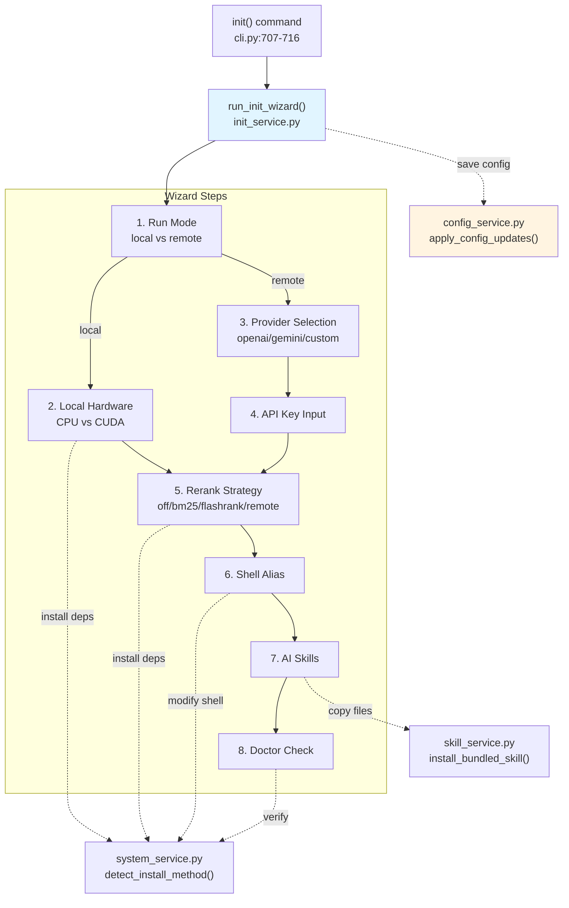
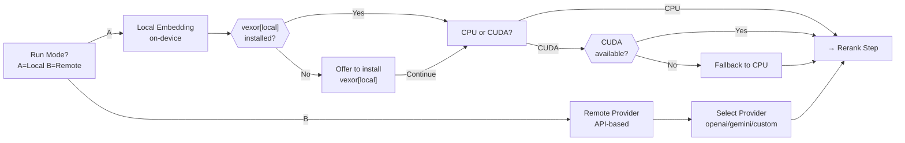
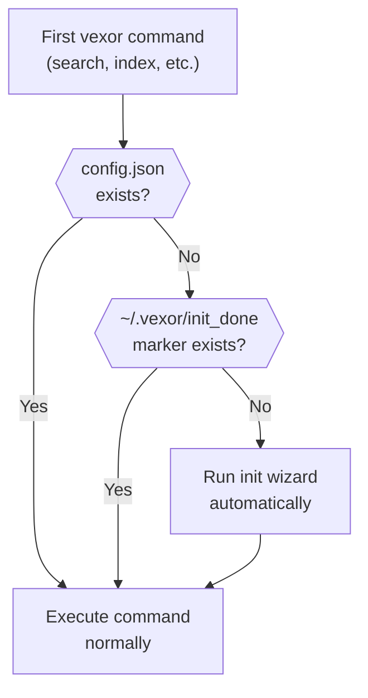
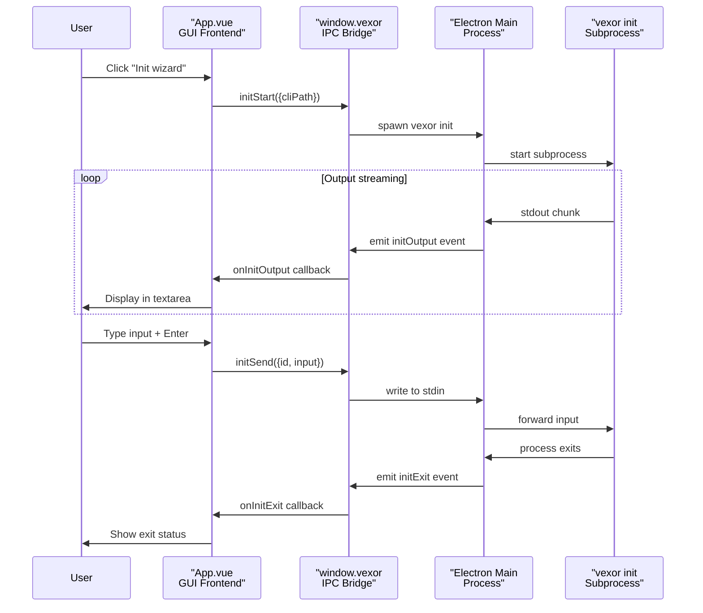

<!-- source: DeepWiki mcp.deepwiki.com · repo scarletkc/vexor · page 4.8 vexor init · fetched 2026-10-26 -->

# vexor init

<details>
<summary>Relevant source files</summary>

The following files were used as context for generating this wiki page:

- [vexor/cli.py](vexor/cli.py)
- [vexor/text.py](vexor/text.py)

</details>


**Purpose**: Document the interactive setup wizard that guides users through first-time Vexor configuration, including provider selection, API key setup, reranking configuration, and optional dependency installation.

This page covers the `vexor init` command, which provides a guided configuration experience. For manual configuration using individual settings, see [vexor config](#4.4). For programmatic configuration via the Python API, see [Configuration Management](#5.5).

---

## Overview

The `vexor init` command launches an interactive wizard that walks users through essential Vexor configuration steps. The wizard handles:

- Choosing between local embeddings (on-device) or remote API providers
- Configuring API keys and provider settings
- Setting up reranking strategies
- Installing optional dependencies (`vexor[local]`, `vexor[flashrank]`)
- Creating shell aliases and AI assistant skill integrations
- Running diagnostic checks to verify the setup

The wizard uses a question-and-answer flow with validation, fallback options, and intelligent defaults.

**Sources**: [vexor/cli.py:707-716](), [vexor/text.py:151-235]()

---

## Command Syntax

```bash
vexor init [--dry]
```

### Options

| Option | Description |
|--------|-------------|
| `--dry` | Run the wizard without writing configuration changes or installing dependencies. Displays what would be configured. |

The command is implemented as a Typer command that delegates to `run_init_wizard()` from the init service.

**Sources**: [vexor/cli.py:707-716](), [vexor/text.py:55-56]()

---

## Wizard Architecture



**Diagram**: Initialization wizard flow showing the sequence of configuration steps and integration with service modules.

**Sources**: [vexor/cli.py:707-716](), [vexor/services/init_service.py:46]()

---

## Configuration Steps

### Step 1: Run Mode Selection

The wizard first asks whether to use local embeddings or remote API providers.



**Diagram**: Decision tree for run mode selection showing dependency checks and hardware configuration.

**Key Messages**:
- `INIT_STEP_RUN_MODE`: "How do you want to run Vexor?"
- `INIT_OPTION_LOCAL`: "Local - run embeddings on this machine"
- `INIT_OPTION_REMOTE`: "Remote - use an API provider"

The wizard checks if local dependencies are installed using `importlib.util.find_spec()` and offers to install them if missing.

**Sources**: [vexor/text.py:156-173](), [vexor/services/init_service.py:46]()

### Step 2: Provider Configuration (Remote Mode)

For remote mode, the wizard guides through provider selection and API key configuration.

| Provider | Default Model | Key Sources |
|----------|---------------|-------------|
| `openai` | `text-embedding-3-small` | `OPENAI_API_KEY`, `VEXOR_API_KEY`, manual input |
| `gemini` | `gemini-embedding-001` | `GOOGLE_GENAI_API_KEY`, `VEXOR_API_KEY`, manual input |
| `custom` | User-specified | Manual input (model + base URL required) |

**Custom Provider Requirements**:
- Base URL must be provided via `INIT_PROMPT_CUSTOM_BASE_URL`
- Model name must be specified via `INIT_PROMPT_CUSTOM_MODEL`
- Must be OpenAI-compatible endpoint

The wizard validates that environment variables like `OPENAI_API_KEY` are present before accepting blank API key input.

**Sources**: [vexor/text.py:174-188](), [vexor/config.py:27-32]()

### Step 3: Rerank Strategy

The wizard offers four reranking options with performance characteristics:

```
1. Off (default)           - no reranking overhead
2. BM25 (almost no latency) - keyword-based score fusion
3. FlashRank (more accurate, slower) - local neural reranker
4. Remote (network-dependent) - external reranking API
```

**FlashRank Setup**:
- Checks if `flashrank` package is installed via `importlib.util.find_spec("flashrank")`
- Offers to install `vexor[flashrank]` if missing
- Downloads the model via `_prepare_flashrank_model()` from [vexor/cli.py:186-202]()
- Default model: `ms-marco-TinyBERT-L-2-v2` (from `DEFAULT_FLASHRANK_MODEL`)

**Remote Rerank Configuration**:
- Requires base URL, model name, and API key
- Validates all three fields are non-empty
- API key can be sourced from `VEXOR_REMOTE_RERANK_API_KEY` environment variable

**Sources**: [vexor/text.py:189-208](), [vexor/cli.py:186-202](), [vexor/config.py:33-37]()

### Step 4: Shell Alias

The wizard offers to create a shell alias mapping `vx` to `vexor`.

**Supported Shells**:

| Shell | Alias Syntax | Profile Path |
|-------|--------------|--------------|
| bash | `alias vx='vexor'` | `~/.bashrc` or `~/.bash_profile` |
| zsh | `alias vx='vexor'` | `~/.zshrc` |
| fish | `alias vx 'vexor'` | `~/.config/fish/config.fish` |
| PowerShell | `Set-Alias vx vexor` | `$PROFILE` |

The wizard detects the current shell via `_detect_shell_name()` and appends the alias to the appropriate profile file if not already present.

**Sources**: [vexor/text.py:210-212](), [vexor/cli.py:1624-1668]()

### Step 5: AI Assistant Skills

The wizard can install the bundled `vexor-cli` skill for AI assistants.

**Install Targets**:

| Target | Description | Resolved Path |
|--------|-------------|---------------|
| `auto` | Claude Code + Codex CLI | Both skill directories |
| `claude` | Claude Code only | `~/.claude/skills/` |
| `codex` | Codex CLI only | `~/.codex/skills/` |
| `custom` | User-specified path | User input |

The installation copies skill definition files from the bundled `skills/` directory to the target location using `install_bundled_skill()`.

**Sources**: [vexor/text.py:212-226](), [vexor/services/skill_service.py:64-69](), [vexor/cli.py:1392-1452]()

### Step 6: Doctor Verification

The wizard optionally runs `vexor doctor` to verify the configuration.

**Checks Performed**:
- Config file validity
- Cache directory writability
- API key configuration
- Provider connectivity (if API key present)
- Local model availability (if local provider selected)
- Reranker setup (BM25/FlashRank/Remote)

See [vexor doctor and update](#4.5) for detailed check descriptions.

**Sources**: [vexor/text.py:214-215](), [vexor/cli.py:1455-1517]()

---

## Dependency Installation

The wizard can automatically install optional Vexor extras using pip.

### Installation Detection

The wizard uses `detect_install_method()` from [vexor/services/system_service.py:244-281]() to determine how Vexor is installed:

| Install Method | Can Auto-Install | Notes |
|----------------|------------------|-------|
| `pip` | Yes | Uses `pip install "vexor[extra]"` |
| `pipx` | Yes | Uses `pipx inject vexor "fastembed"` etc. |
| `git_editable` | Yes | Uses `pip install -e ".[extra]"` |
| `standalone` | No | Binary cannot install extras; shows message |
| `unknown` | No | Cannot determine pip command |

### Installation Commands

The wizard builds installation commands using the detected method:

**Local Embeddings**:
```bash
pip install "vexor[local]"       # CPU-only
pip install "vexor[local-cuda]"  # GPU with CUDA
```

**FlashRank Reranker**:
```bash
pip install "vexor[flashrank]"
```

The wizard executes these commands via `subprocess.run()` and displays progress output.

**Sources**: [vexor/services/system_service.py:244-281](), [vexor/text.py:227-233]()

---

## Dry Run Mode

The `--dry` flag enables dry run mode, which:

1. Displays all prompts and collects user input
2. Shows what configuration would be written
3. Skips actual file writes (`config.json` updates)
4. Skips dependency installation commands
5. Skips shell profile modifications
6. Displays `INIT_DRY_RUN_NOTICE` at the end

**Use Cases**:
- Preview configuration changes before committing
- Test wizard flow in CI/CD pipelines
- Verify wizard behavior without side effects

Example output:
```
Dry run: skipped writing config
Dry run: skipped installing vexor[local]
Dry run: no changes were written.
```

**Sources**: [vexor/cli.py:709-712](), [vexor/text.py:154-155]()

---

## Auto-Run Behavior

The wizard includes an auto-run mechanism via `should_auto_run_init()` that triggers on first use.



**Diagram**: Auto-run logic that triggers the wizard on first use when no configuration exists.

**Marker File**: `~/.vexor/init_done`

The marker file is created after successful wizard completion to prevent repeated prompts. Users can delete this file to re-trigger the wizard automatically.

**Sources**: [vexor/services/init_service.py:46](), [vexor/cli.py:46]()

---

## GUI Integration

The Desktop App provides GUI access to the init wizard via an interactive modal.

### Init Modal Workflow



**Diagram**: GUI workflow for running the init wizard through the Electron desktop app.

**IPC Methods**:
- `window.vexor.initStart({cliPath})` - Start init subprocess
- `window.vexor.initSend({id, input})` - Send user input to stdin
- `window.vexor.initStop({id})` - Terminate subprocess
- `window.vexor.onInitOutput(callback)` - Subscribe to stdout
- `window.vexor.onInitExit(callback)` - Subscribe to exit events

The GUI strips ANSI codes from output using `stripAnsi()` for clean display.

**Sources**: [gui/src/App.vue:498-515](), [gui/src/App.vue:1206-1233]()

---

## Configuration Output

The wizard writes its configuration to `~/.vexor/config.json` via `apply_config_updates()` from [vexor/services/config_service.py:15-144]().

### Example Configuration

**Local Setup**:
```json
{
  "provider": "local",
  "model": "intfloat/multilingual-e5-small",
  "local_cuda": false,
  "auto_index": true,
  "rerank": "bm25"
}
```

**Remote Setup (OpenAI)**:
```json
{
  "provider": "openai",
  "model": "text-embedding-3-small",
  "api_key": "sk-...",
  "auto_index": true,
  "rerank": "flashrank",
  "flashrank_model": "ms-marco-TinyBERT-L-2-v2"
}
```

**Remote Setup (Custom)**:
```json
{
  "provider": "custom",
  "model": "custom-embed-v1",
  "base_url": "https://api.example.com/v1",
  "api_key": "custom-key",
  "auto_index": true,
  "rerank": "off"
}
```

All fields follow the schema defined in [vexor/config.py:48-69]().

**Sources**: [vexor/services/config_service.py:15-144](), [vexor/config.py:48-69]()

---

## Next Steps Display

After completing the wizard, users see a "Next step" message:

```
Next step:
  vexor "retry logic handled"
```

This suggests running a sample search query to verify the setup. The message is stored in `INIT_NEXT_STEP_SEARCH` and `INIT_NEXT_STEPS_TITLE`.

If the original command that triggered auto-run is available, the wizard displays `INIT_RESUME_TITLE` with the original command instead.

**Sources**: [vexor/text.py:209, 234-235]()

---

## Error Handling

The wizard includes validation and error recovery:

### Input Validation

| Field | Validation | Error Message |
|-------|-----------|---------------|
| Run mode | Must be 'A' or 'B' | `INIT_ERROR_INVALID_CHOICE` |
| Provider | Must be in supported list | `INIT_ERROR_INVALID_CHOICE` |
| Custom base URL | Cannot be empty | `INIT_ERROR_REQUIRED` |
| Custom model | Cannot be empty | `INIT_ERROR_REQUIRED` |
| Remote rerank config | All fields required | `INIT_ERROR_REMOTE_RERANK_KEY` |

### Fallback Scenarios

**CUDA Unavailable**:
- Detects missing `CUDAExecutionProvider` in `onnxruntime.get_available_providers()`
- Prompts: `INIT_CONFIRM_FALLBACK_CPU` - "CUDA is unavailable. Switch to CPU?"
- Falls back to CPU if user accepts

**FlashRank Not Installed**:
- Detects via `importlib.util.find_spec("flashrank")`
- Displays: `INIT_FLASHRANK_MISSING`
- Prompts: `INIT_CONFIRM_INSTALL_FLASHRANK`
- Offers fallback: `INIT_PROMPT_RERANK_FALLBACK` - "Fallback rerank (bm25/off)"

**Local Dependencies Missing**:
- Offers to install during wizard
- Prompts: `INIT_CONFIRM_CONTINUE_WITHOUT_LOCAL` if user declines
- Offers to switch: `INIT_CONFIRM_SWITCH_REMOTE`

**Sources**: [vexor/text.py:168-169, 199-202, 206-208](), [vexor/cli.py:1326-1362]()

---

## Related Commands

- [vexor config](#4.4) - Manual configuration management
- [vexor doctor](#4.5) - Diagnostic verification
- [vexor local](#4.6) - Local model setup
- [vexor install](#4.7) - Skill installation

**Sources**: [vexor/cli.py:707-716]()

---

