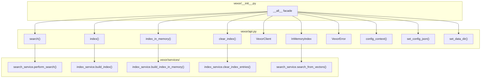
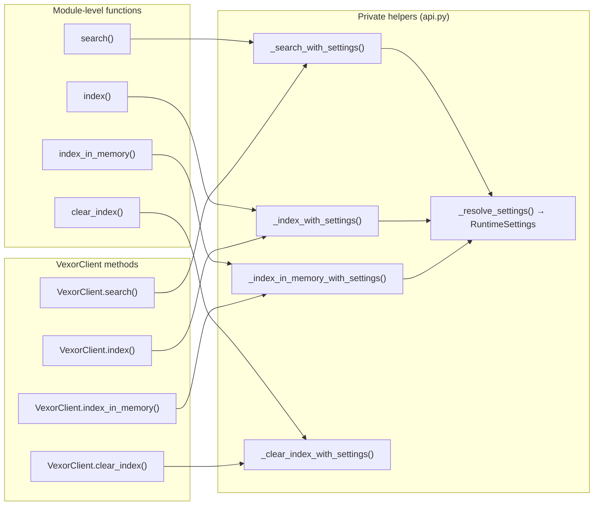
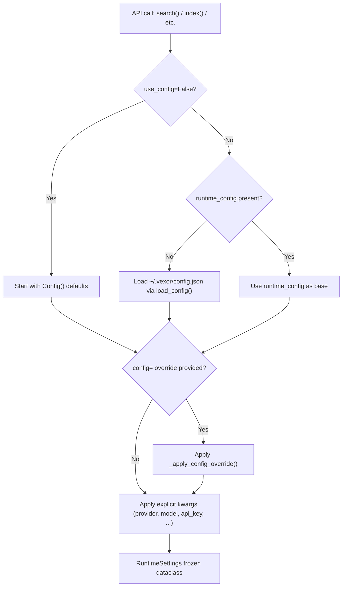

<!-- source: DeepWiki mcp.deepwiki.com · repo scarletkc/vexor · page 5.1 API Overview · fetched 2026-10-26 -->

# API Overview

<details>
<summary>Relevant source files</summary>

The following files were used as context for generating this wiki page:

- [docs/api/python.md](docs/api/python.md)
- [plugins/vexor/.claude-plugin/plugin.json](plugins/vexor/.claude-plugin/plugin.json)
- [tests/unit/test_api.py](tests/unit/test_api.py)
- [vexor/__init__.py](vexor/__init__.py)
- [vexor/api.py](vexor/api.py)

</details>


This page describes the public Python API surface exported by the `vexor` package: what symbols are available, how they are organized, and how configuration is resolved across different override layers. For detailed parameter references, see the child pages: [Search Functions](#5.2), [Index Functions](#5.3), [VexorClient Class](#5.4), [Configuration Management](#5.5), and [InMemoryIndex](#5.6).

---

## Public Surface

All public symbols are re-exported from [vexor/\_\_init\_\_.py:1-38]() via an explicit `__all__` list. The implementation lives in [vexor/api.py]().

### Exported Names

| Symbol | Kind | Description |
|---|---|---|
| `search` | function | Run a semantic search against a directory |
| `index` | function | Build or refresh a persistent disk index |
| `index_in_memory` | function | Build an ephemeral in-memory index |
| `clear_index` | function | Delete cached index entries for a directory |
| `VexorClient` | class | Session-style wrapper; shares `data_dir`/config across calls |
| `InMemoryIndex` | class | Returned by `index_in_memory`; holds vectors and exposes `.search()` |
| `VexorError` | exception | Raised on invalid input to any public API call |
| `config_context` | context manager | Yields a scoped `VexorClient` with a temporary config override |
| `set_config_json` | function | Set a module-level in-memory config (global override) |
| `set_data_dir` | function | Redirect config and cache directories globally |
| `get_version` | function | Return `__version__` string |
| `__version__` | string | Current package version (e.g., `"0.23.1rc1"`) |

Sources: [vexor/\_\_init\_\_.py:1-38]()

---

## Module Structure

The `__init__.py` file is a thin re-export facade. No logic lives there. All callable implementations are in `api.py`, which delegates to the service layer.

**Public surface to implementation mapping:**



Sources: [vexor/\_\_init\_\_.py:1-38](), [vexor/api.py:1-50](), [vexor/api.py:511-707]()

---

## Internal Dispatch Pattern

The top-level functions (`search`, `index`, `index_in_memory`, `clear_index`) and the `VexorClient` methods all delegate to private `_*_with_settings` helpers. This is so that both the module-level functions and the client methods share the same resolution logic.



The key difference between module-level `search()` and `VexorClient.search()` is that the client passes its own `_runtime_config` field into `_search_with_settings`, while the module-level function passes the module-global `_RUNTIME_CONFIG`.

Sources: [vexor/api.py:511-572](), [vexor/api.py:268-334](), [vexor/api.py:710-801]()

---

## Configuration Precedence

Every API call resolves its effective configuration through `_resolve_settings()` [vexor/api.py:1029-1105](). Settings are merged in the following priority order (highest to lowest):

| Priority | Source | How to Set |
|---|---|---|
| 1 (highest) | Explicit keyword arguments | `search(..., provider="gemini", api_key="key")` |
| 2 | Per-call `config=` override | `search(..., config={"provider": "gemini"})` |
| 3 | In-memory runtime config | `set_config_json({"provider": "gemini"})` or `VexorClient._runtime_config` |
| 4 | Disk config file | `~/.vexor/config.json` (loaded by `load_config()`) |
| 5 (lowest) | Built-in defaults | `DEFAULT_PROVIDER`, `DEFAULT_BATCH_SIZE`, etc. in `config.py` |

Setting `use_config=False` skips level 4 entirely, instantiating a bare `Config()` with defaults instead.

The `config=` parameter at level 2 accepts a `dict`, JSON `str`, or a `Config` instance. It is applied on top of whatever config was resolved at levels 3–5 via `_apply_config_override()` [vexor/api.py:1108-1117]().

**Configuration resolution flow:**



Sources: [vexor/api.py:1029-1105](), [docs/api/python.md:42-48]()

---

## Key Types

### `RuntimeSettings`

An internal frozen dataclass [vexor/api.py:56-72]() produced by `_resolve_settings()`. It is not exported publicly, but understanding its fields explains what each API call ultimately passes to the service layer.

| Field | Type | Description |
|---|---|---|
| `provider` | `str` | Embedding provider (`openai`, `gemini`, etc.) |
| `model_name` | `str` | Resolved model name (defaults applied per-provider) |
| `batch_size` | `int` | Embedding batch size |
| `embed_concurrency` | `int` | Parallel embedding request count |
| `extract_concurrency` | `int` | Parallel file extraction worker count |
| `extract_backend` | `str` | `auto`, `thread`, or `process` |
| `base_url` | `str \| None` | API endpoint override |
| `api_key` | `str \| None` | Resolved API key |
| `local_cuda` | `bool` | Use CUDA for local embeddings |
| `auto_index` | `bool` | Whether to auto-index before search |
| `rerank` | `str` | Reranking strategy (`off`, `bm25`, `flashrank`, `remote`) |
| `flashrank_model` | `str \| None` | FlashRank model name override |
| `remote_rerank` | `RemoteRerankConfig \| None` | Remote reranker config |
| `embedding_dimensions` | `int \| None` | Custom embedding dimensions |

### `VexorError`

Subclass of `ValueError` [vexor/api.py:52-53](). Raised by any public API call when input validation fails (empty query, invalid mode, invalid embedding dimensions, malformed config JSON, etc.).

### `InMemoryIndex`

A dataclass [vexor/api.py:74-162]() returned by `index_in_memory()`. Holds the raw `np.ndarray` vectors and associated metadata. Its `.search()` method calls `search_from_vectors()` from `search_service`, bypassing disk entirely.

Sources: [vexor/api.py:52-162]()

---

## Global State

The module maintains one piece of mutable global state:

```python
_RUNTIME_CONFIG: Config | None = None  # vexor/api.py:165
```

`set_config_json()` writes to this variable. `search()` and `index()` read it via `_RUNTIME_CONFIG` when `use_config=True`.

`VexorClient` instances keep their own `_runtime_config` instance variable, which is separate from the module-level `_RUNTIME_CONFIG`. This makes `VexorClient` the preferred approach for library code that needs isolation.

Sources: [vexor/api.py:165-206]()

---

## Directory Override Mechanism

All four top-level functions and their `VexorClient` equivalents accept `data_dir`, `config_dir`, and `cache_dir` keyword arguments. When any of these are set, the call wraps its execution in `_data_dir_context()` [vexor/api.py:168-185](), which temporarily redirects `config_dir_context` (from `vexor/config.py`) and `cache_dir_context` (from `vexor/cache.py`) for the duration of the call. The global state is restored when the call returns.

`set_data_dir(path)` [vexor/api.py:188-191]() is a permanent (non-scoped) version: it calls `set_config_dir()` and `set_cache_dir()` directly, which mutates the module-level `CONFIG_DIR` and `CACHE_DIR` globals in those modules.

For isolated use cases (testing, multi-tenant applications), the per-call `data_dir` argument or `VexorClient(data_dir=...)` is recommended over `set_data_dir()`.

Sources: [vexor/api.py:168-191](), [tests/unit/test_api.py:126-140]()

---

