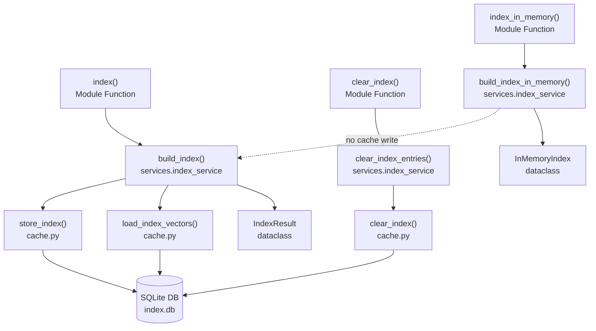
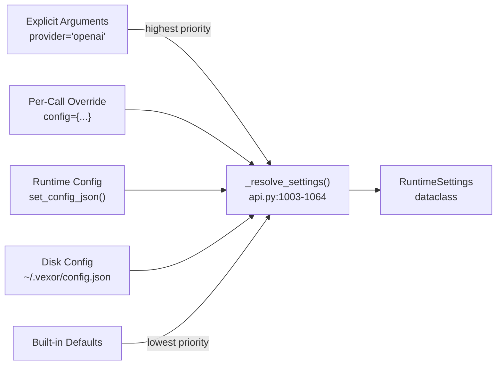
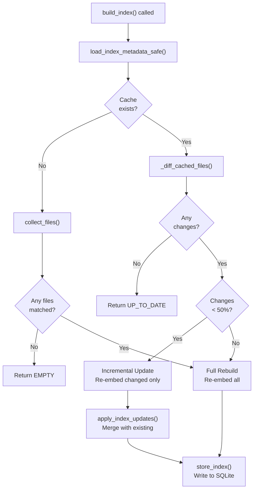
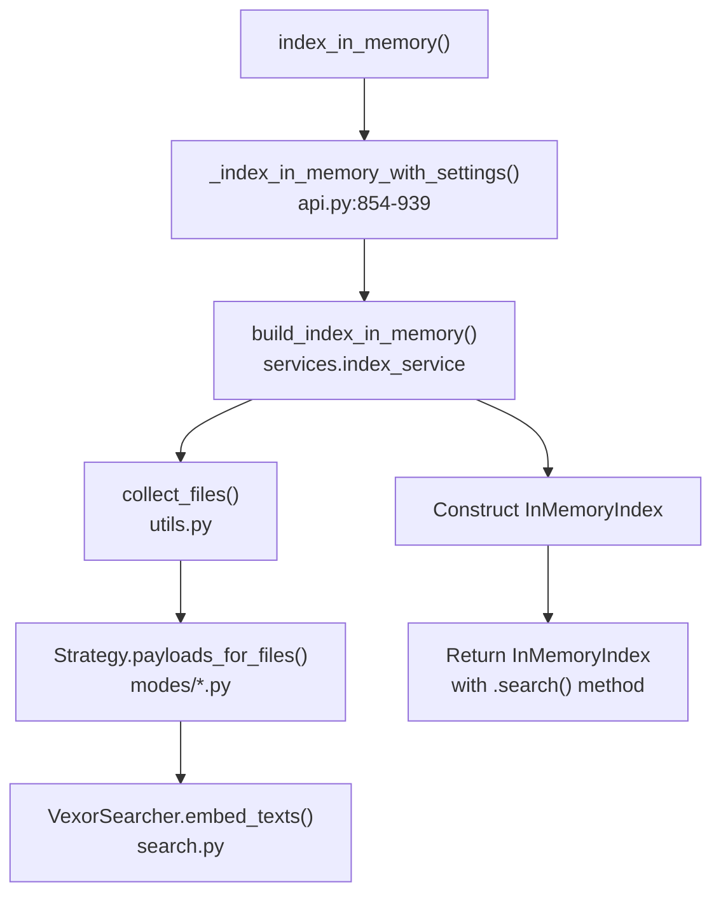
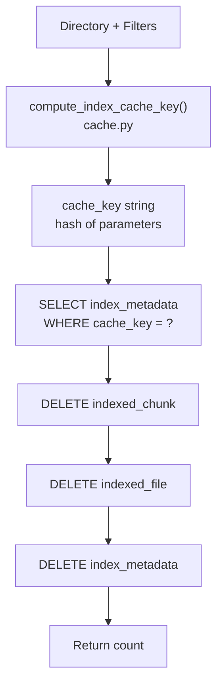
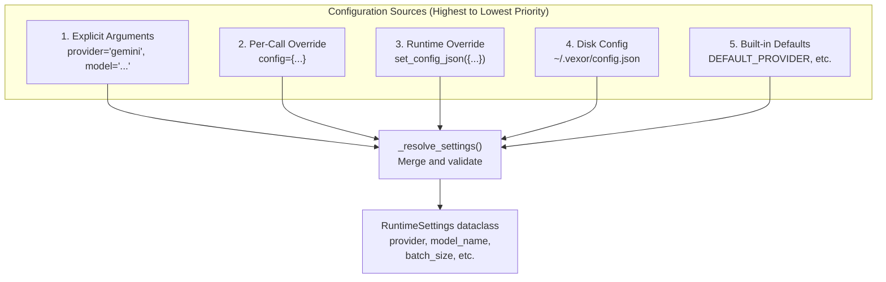
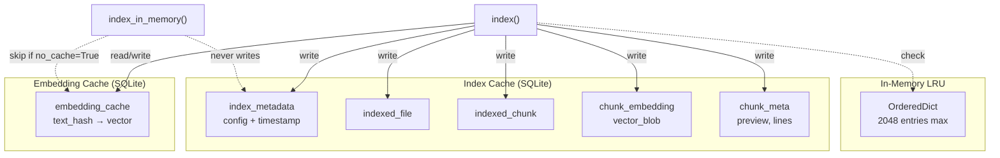

<!-- source: DeepWiki mcp.deepwiki.com · repo scarletkc/vexor · page 5.3 Index Functions · fetched 2026-10-26 -->

# Index Functions

<details>
<summary>Relevant source files</summary>

The following files were used as context for generating this wiki page:

- [docs/api/python.md](docs/api/python.md)
- [docs/roadmap.md](docs/roadmap.md)
- [plugins/vexor/.claude-plugin/plugin.json](plugins/vexor/.claude-plugin/plugin.json)
- [tests/unit/test_api.py](tests/unit/test_api.py)
- [tests/unit/test_cache_upgrade_and_lines.py](tests/unit/test_cache_upgrade_and_lines.py)
- [tests/unit/test_index_service.py](tests/unit/test_index_service.py)
- [vexor/__init__.py](vexor/__init__.py)
- [vexor/api.py](vexor/api.py)

</details>


This page documents the Python API functions for building and managing indexes: `index()`, `index_in_memory()`, and `clear_index()`. These functions create cached embeddings of file content that enable fast semantic search.

For search operations using these indexes, see [Search Functions](#5.2). For session-style usage with `VexorClient`, see [VexorClient Class](#5.4). For in-depth coverage of the `InMemoryIndex` class returned by `index_in_memory()`, see [InMemoryIndex](#5.6).

---

## Overview

The indexing API provides three core functions that interact with Vexor's cache system:



**Sources:** [vexor/api.py:562-691](), [vexor/services/index_service.py:30-34]()

All three functions support the same configuration precedence system and accept optional `data_dir`, `config_dir`, and `cache_dir` parameters for scoped overrides without global state mutation.

---

## `index()` Function

The `index()` function builds or refreshes a persistent index stored in SQLite. If an existing index is found and file changes are below a 50% threshold, it performs an incremental update by re-embedding only changed files.

### Function Signature

```python
def index(
    path: Path | str = Path.cwd(),
    *,
    include_hidden: bool = False,
    respect_gitignore: bool = True,
    mode: str = "auto",
    recursive: bool = True,
    extensions: Sequence[str] | str | None = None,
    exclude_patterns: Sequence[str] | str | None = None,
    provider: str | None = None,
    model: str | None = None,
    batch_size: int | None = None,
    embed_concurrency: int | None = None,
    extract_concurrency: int | None = None,
    extract_backend: str | None = None,
    base_url: str | None = None,
    api_key: str | None = None,
    local_cuda: bool | None = None,
    use_config: bool = True,
    config: Config | Mapping[str, object] | str | None = None,
    data_dir: Path | str | None = None,
    config_dir: Path | str | None = None,
    cache_dir: Path | str | None = None,
) -> IndexResult
```

**Sources:** [vexor/api.py:562-610]()

### Parameters

| Parameter | Type | Default | Description |
|-----------|------|---------|-------------|
| `path` | `Path \| str` | `Path.cwd()` | Root directory to index |
| `include_hidden` | `bool` | `False` | Include hidden files and directories |
| `respect_gitignore` | `bool` | `True` | Honor `.gitignore` patterns |
| `mode` | `str` | `"auto"` | Extraction mode: `auto`, `name`, `head`, `brief`, `code`, `outline`, `full` |
| `recursive` | `bool` | `True` | Recursively traverse subdirectories |
| `extensions` | `Sequence[str] \| str \| None` | `None` | Filter by file extensions (e.g., `[".py", ".md"]` or `".py,.md"`) |
| `exclude_patterns` | `Sequence[str] \| str \| None` | `None` | Exclude patterns (e.g., `["tests/**", "*.log"]`) |
| `provider` | `str \| None` | `None` | Embedding provider: `openai`, `gemini`, `custom`, `local` |
| `model` | `str \| None` | `None` | Embedding model name (provider-specific default if omitted) |
| `batch_size` | `int \| None` | `None` | Number of texts to embed per batch |
| `embed_concurrency` | `int \| None` | `None` | Concurrent embedding requests |
| `extract_concurrency` | `int \| None` | `None` | Concurrent file extraction threads/processes |
| `extract_backend` | `str \| None` | `None` | Extraction parallelism: `auto`, `thread`, `process` |
| `base_url` | `str \| None` | `None` | API base URL for `openai`/`custom` providers |
| `api_key` | `str \| None` | `None` | API key (falls back to environment variables) |
| `local_cuda` | `bool \| None` | `None` | Enable CUDA for local provider |
| `use_config` | `bool` | `True` | Load settings from `~/.vexor/config.json` |
| `config` | `Config \| Mapping \| str \| None` | `None` | Per-call configuration override |
| `data_dir` | `Path \| str \| None` | `None` | Override base directory for config and cache |
| `config_dir` | `Path \| str \| None` | `None` | Override config directory only |
| `cache_dir` | `Path \| str \| None` | `None` | Override cache directory only |

**Sources:** [vexor/api.py:562-610]()

### Return Value

Returns an `IndexResult` dataclass with the following fields:

| Field | Type | Description |
|-------|------|-------------|
| `status` | `IndexStatus` | Result status: `STORED`, `UP_TO_DATE`, or `EMPTY` |
| `cache_path` | `Path \| None` | Path to the cache database file |
| `files_indexed` | `int` | Number of files in the index |

The `IndexStatus` enum values:
- `STORED`: Index was newly created or updated
- `UP_TO_DATE`: No changes detected, existing cache reused
- `EMPTY`: No files matched the filters

**Sources:** [vexor/services/index_service.py:20-28]()

### Configuration Resolution



**Sources:** [vexor/api.py:1003-1064](), [vexor/api.py:785-851]()

The function calls `_index_with_settings()`, which:
1. Resolves the directory path via `resolve_directory()`
2. Validates the mode using `get_strategy()`
3. Normalizes `extensions` and `exclude_patterns` to tuples
4. Resolves configuration precedence via `_resolve_settings()`
5. Delegates to `build_index()` in `services.index_service`

**Sources:** [vexor/api.py:785-851]()

### Incremental Update Logic



**Sources:** [vexor/services/index_service.py:41-175](), [tests/unit/test_index_service.py:32-92]()

The system uses `_diff_cached_files()` to detect added, modified, and removed files. If fewer than 50% of files changed, it performs an incremental update via `apply_index_updates()`, which merges new embeddings with the existing cache.

**Sources:** [vexor/cache.py:456-547](), [tests/unit/test_index_service.py:119-140]()

---

## `index_in_memory()` Function

The `index_in_memory()` function builds a temporary index without writing to disk. It returns an `InMemoryIndex` object that can be searched directly via its `.search()` method.

### Function Signature

```python
def index_in_memory(
    path: Path | str = Path.cwd(),
    *,
    include_hidden: bool = False,
    respect_gitignore: bool = True,
    mode: str = "auto",
    recursive: bool = True,
    extensions: Sequence[str] | str | None = None,
    exclude_patterns: Sequence[str] | str | None = None,
    provider: str | None = None,
    model: str | None = None,
    batch_size: int | None = None,
    embed_concurrency: int | None = None,
    extract_concurrency: int | None = None,
    extract_backend: str | None = None,
    base_url: str | None = None,
    api_key: str | None = None,
    local_cuda: bool | None = None,
    use_config: bool = True,
    config: Config | Mapping[str, object] | str | None = None,
    no_cache: bool = True,
    data_dir: Path | str | None = None,
    config_dir: Path | str | None = None,
    cache_dir: Path | str | None = None,
) -> InMemoryIndex
```

**Sources:** [vexor/api.py:613-663]()

The parameters are identical to `index()` with one addition:

| Parameter | Type | Default | Description |
|-----------|------|---------|-------------|
| `no_cache` | `bool` | `True` | Disable embedding and query caches (forces fresh embeddings) |

**Note:** Unlike `index()`, this function defaults `no_cache=True` to ensure complete isolation from disk caches.

### Return Value

Returns an `InMemoryIndex` dataclass with the following fields:

| Field | Type | Description |
|-------|------|-------------|
| `base_path` | `Path` | Root directory that was indexed |
| `paths` | `Sequence[Path]` | List of indexed file paths |
| `vectors` | `np.ndarray` | Embedding vectors (shape: `[n_chunks, dimension]`) |
| `metadata` | `dict[str, object]` | Index metadata including chunks, mode, filters |
| `model_name` | `str` | Embedding model used |
| `batch_size` | `int` | Batch size configuration |
| `embed_concurrency` | `int` | Concurrency configuration |
| `provider` | `str` | Embedding provider |
| `base_url` | `str \| None` | API base URL |
| `api_key` | `str \| None` | API key |
| `local_cuda` | `bool` | CUDA configuration |
| `rerank` | `str` | Reranking strategy |
| `flashrank_model` | `str \| None` | FlashRank model name |
| `remote_rerank` | `RemoteRerankConfig \| None` | Remote reranking config |

**Sources:** [vexor/api.py:72-88]()

The `InMemoryIndex` class provides a `.search()` method for querying the index. For detailed documentation, see [InMemoryIndex](#5.6).

### Internal Flow



**Sources:** [vexor/api.py:854-939](), [vexor/services/index_service.py:178-246]()

Unlike `index()`, this function:
1. Never reads from or writes to the SQLite cache
2. Returns vectors and metadata in memory
3. Wraps results in an `InMemoryIndex` instance with search capability

**Sources:** [vexor/services/index_service.py:178-246](), [tests/unit/test_api.py:332-360]()

---

## `clear_index()` Function

The `clear_index()` function removes cached index entries from the SQLite database. It identifies entries by matching the root path, mode, filters, and configuration.

### Function Signature

```python
def clear_index(
    path: Path | str = Path.cwd(),
    *,
    include_hidden: bool = False,
    respect_gitignore: bool = True,
    mode: str = "auto",
    recursive: bool = True,
    extensions: Sequence[str] | str | None = None,
    exclude_patterns: Sequence[str] | str | None = None,
    data_dir: Path | str | None = None,
    config_dir: Path | str | None = None,
    cache_dir: Path | str | None = None,
) -> int
```

**Sources:** [vexor/api.py:666-691]()

### Parameters

Only directory and filter parameters are accepted (no provider/embedding configuration needed):

| Parameter | Type | Default | Description |
|-----------|------|---------|-------------|
| `path` | `Path \| str` | `Path.cwd()` | Root directory whose index to clear |
| `include_hidden` | `bool` | `False` | Must match index configuration |
| `respect_gitignore` | `bool` | `True` | Must match index configuration |
| `mode` | `str` | `"auto"` | Must match index configuration |
| `recursive` | `bool` | `True` | Must match index configuration |
| `extensions` | `Sequence[str] \| str \| None` | `None` | Must match index configuration |
| `exclude_patterns` | `Sequence[str] \| str \| None` | `None` | Must match index configuration |

**Note:** To clear an index, you must provide the same directory and filter parameters used to create it. The function generates a cache key from these parameters and deletes all matching entries.

### Return Value

Returns an `int` representing the number of index entries removed from the database.

### Cache Key Matching



**Sources:** [vexor/cache.py:549-604](), [tests/unit/test_index_service.py:275-293]()

The function delegates to `clear_index_entries()` in `services.index_service`, which calls `cache.clear_index()`. The deletion cascades through related tables: `indexed_chunk`, `chunk_embedding`, `chunk_meta`, `indexed_file`, and `index_metadata`.

**Sources:** [vexor/services/index_service.py:249-274](), [vexor/cache.py:549-604]()

---

## VexorClient Methods

The `VexorClient` class provides instance methods that mirror the module-level functions but with session-scoped configuration:

```python
client = VexorClient(data_dir="/custom/path", use_config=False)
client.set_config_json({"provider": "openai", "api_key": "key"})

# All methods use client's config and data_dir
result = client.index(path=".", mode="code")
in_mem = client.index_in_memory(path=".", mode="name")
removed = client.clear_index(path=".", mode="code")
```

**Sources:** [vexor/api.py:330-474]()

### Method Signatures

The client methods have identical signatures to their module-level counterparts, with one difference: they inherit `data_dir`, `config_dir`, `cache_dir`, and `use_config` defaults from the client instance, which can still be overridden per-call.

**Sources:** [vexor/api.py:330-384](), [vexor/api.py:386-442](), [vexor/api.py:444-474]()

For complete documentation of the `VexorClient` class, see [VexorClient Class](#5.4).

---

## Configuration Precedence

All index functions follow the same five-tier configuration precedence system:



**Sources:** [vexor/api.py:1003-1064]()

### Example: Configuration Layering

```python
# Disk config: ~/.vexor/config.json
# {"provider": "openai", "batch_size": 32}

# Runtime override
set_config_json({"provider": "gemini", "api_key": "key"})

# Per-call override
index(
    path=".",
    mode="code",
    config={"model": "text-embedding-3-large"},
    batch_size=64,  # Explicit argument
)

# Final resolved settings:
# - provider: "gemini" (from runtime override)
# - model: "text-embedding-3-large" (from per-call config)
# - batch_size: 64 (from explicit argument)
# - api_key: "key" (from runtime override)
```

**Sources:** [vexor/api.py:1003-1064](), [tests/unit/test_api.py:196-233]()

For more on configuration management, see [Configuration Management](#5.5).

---

## Cache Behavior

The index functions interact with Vexor's two-tier cache system:



**Sources:** [vexor/cache.py:1-50](), [vexor/services/index_service.py:41-175]()

### Cache Control Parameters

| Function | Index Cache | Embedding Cache | Query Cache |
|----------|-------------|-----------------|-------------|
| `index()` | Always writes | Read/write | Read/write |
| `index_in_memory(no_cache=False)` | Never writes | Read/write | Read/write |
| `index_in_memory(no_cache=True)` | Never writes | Skipped | Skipped |
| `clear_index()` | Deletes entries | Preserved | Preserved |

**Sources:** [vexor/api.py:562-691](), [vexor/services/index_service.py:178-246]()

### Cache Staleness Detection

When `index()` is called, the system:
1. Computes a cache key from directory, mode, model, and filters
2. Loads existing metadata if present
3. Compares file modification times and sizes
4. Triggers incremental or full rebuild based on changes

**Sources:** [vexor/cache.py:332-419](), [vexor/services/index_service.py:91-136]()

The staleness check uses `_diff_cached_files()` to produce a `FileDiff` with sets of added, changed, and removed files. If the change ratio exceeds 50%, the entire index is rebuilt.

**Sources:** [vexor/services/index_service.py:91-136](), [tests/unit/test_index_service.py:119-140]()

---

## Usage Patterns

### Basic Persistent Index

```python
from vexor import index, search

# Build index once
result = index(path="./src", mode="code", extensions=[".py", ".js"])
print(f"Indexed {result.files_indexed} files")

# Search uses cached index
response = search("authentication logic", path="./src", mode="code")
for hit in response.results:
    print(f"{hit.path}:{hit.start_line} (score: {hit.score:.3f})")
```

**Sources:** [docs/api/python.md:6-16]()

### Temporary In-Memory Index

```python
from vexor import index_in_memory

# Build index in memory (no disk writes)
index = index_in_memory(
    path="./docs",
    mode="outline",
    extensions=[".md"],
    no_cache=True,  # Disable all caches
)

# Search directly
response = index.search("API reference", top=10)
```

**Sources:** [docs/api/python.md:188-194](), [tests/unit/test_api.py:332-360]()

### Clear Specific Index

```python
from vexor import clear_index

# Must match the exact parameters used to create the index
removed = clear_index(
    path="./src",
    mode="code",
    extensions=[".py", ".js"],
)
print(f"Removed {removed} index entries")
```

**Sources:** [vexor/api.py:666-691](), [tests/unit/test_index_service.py:275-293]()

### Custom Provider Configuration

```python
from vexor import index

# Use custom OpenAI-compatible endpoint
result = index(
    path=".",
    mode="full",
    provider="custom",
    base_url="https://api.example.com/v1",
    api_key="custom-key",
    model="custom-embedding-model",
)
```

**Sources:** [tests/unit/test_api.py:67-122]()

### Session-Scoped Configuration

```python
from vexor import VexorClient

# Create client with isolated config
client = VexorClient(
    data_dir="/tmp/vexor",
    use_config=False,
)
client.set_config_json({
    "provider": "gemini",
    "api_key": "key",
    "batch_size": 128,
})

# All operations use client config
result = client.index(path=".", mode="code")
in_mem = client.index_in_memory(path="./docs", mode="outline")

# Override per-call
result = client.index(
    path="./tests",
    mode="name",
    config={"model": "text-embedding-3-large"},
)
```

**Sources:** [docs/api/python.md:18-29](), [vexor/api.py:205-384]()

### Context Manager with Scoped Override

```python
from vexor import config_context

# Temporarily override configuration
with config_context({"provider": "openai", "api_key": "key"}) as client:
    result = client.index(path=".", mode="code")
    response = client.search("bug fix", path=".")

# Configuration reverted after context exit
```

**Sources:** [vexor/api.py:477-498](), [tests/unit/test_api.py:399-419]()

---

## Error Handling

The index functions raise `VexorError` for validation failures:

```python
from vexor import index, VexorError

try:
    result = index(path=".", mode="invalid_mode")
except VexorError as e:
    print(f"Invalid mode: {e}")

try:
    result = index(
        path=".",
        mode="code",
        extensions=".py,.md",
        config='{"invalid": "json"',  # Malformed JSON
    )
except VexorError as e:
    print(f"Config error: {e}")
```

**Sources:** [vexor/api.py:51-52](), [vexor/api.py:974-982](), [tests/unit/test_api.py:235-248]()

Common validation errors:
- Invalid mode name (must be one of: `auto`, `name`, `head`, `brief`, `code`, `outline`, `full`)
- Empty extensions list (when `extensions` is provided but normalizes to empty)
- Malformed config JSON
- Invalid directory path

**Sources:** [vexor/api.py:974-982](), [vexor/text.py:1-50]()

---

## Summary

The index functions provide flexible APIs for creating and managing semantic search indexes:

- **`index()`**: Persistent cache-backed indexing with incremental updates
- **`index_in_memory()`**: Temporary in-memory indexing without disk writes
- **`clear_index()`**: Targeted cache entry deletion

All functions support:
- Five-tier configuration precedence
- Per-call data directory overrides
- Session-scoped usage via `VexorClient`
- Comprehensive filtering (extensions, exclude patterns, gitignore)
- Seven extraction modes (auto, name, head, brief, code, outline, full)

For search operations using these indexes, see [Search Functions](#5.2). For in-depth `InMemoryIndex` usage, see [InMemoryIndex](#5.6).

**Sources:** [vexor/api.py:1-1077](), [docs/api/python.md:1-195]()

---

