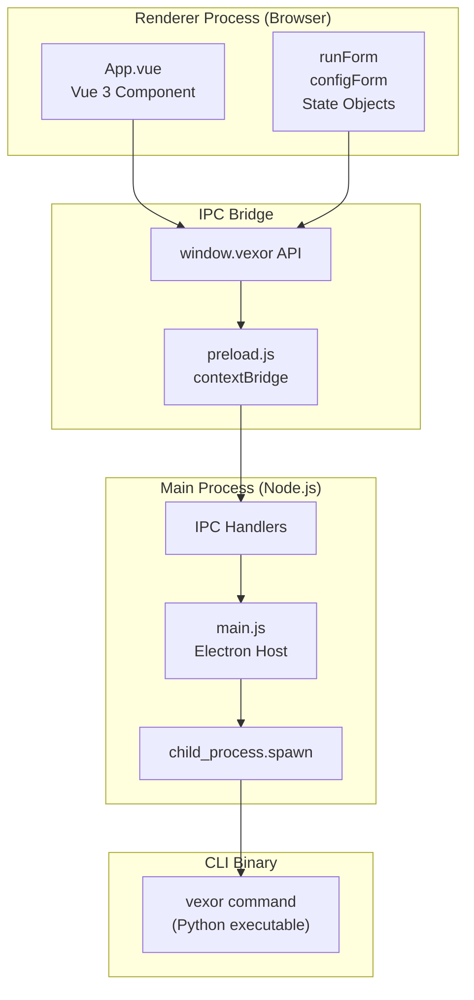
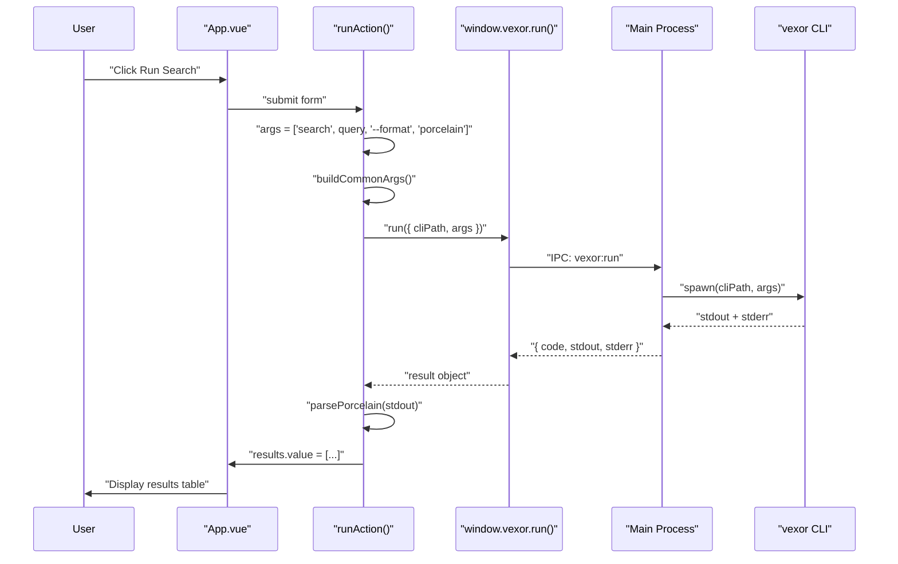
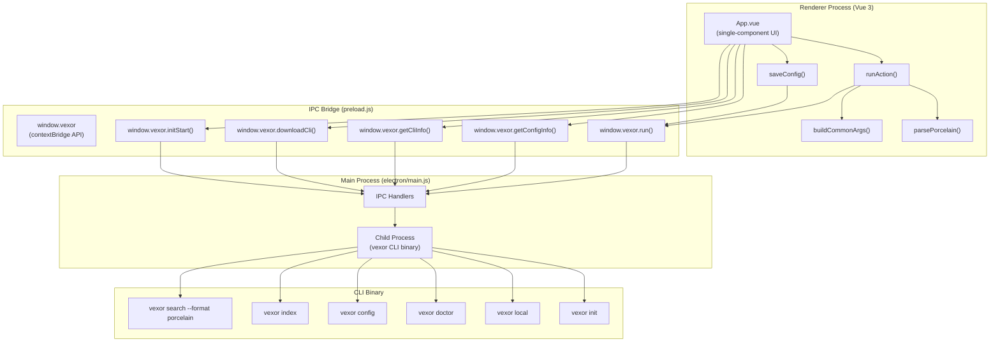
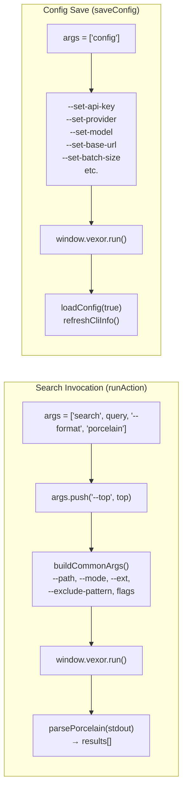
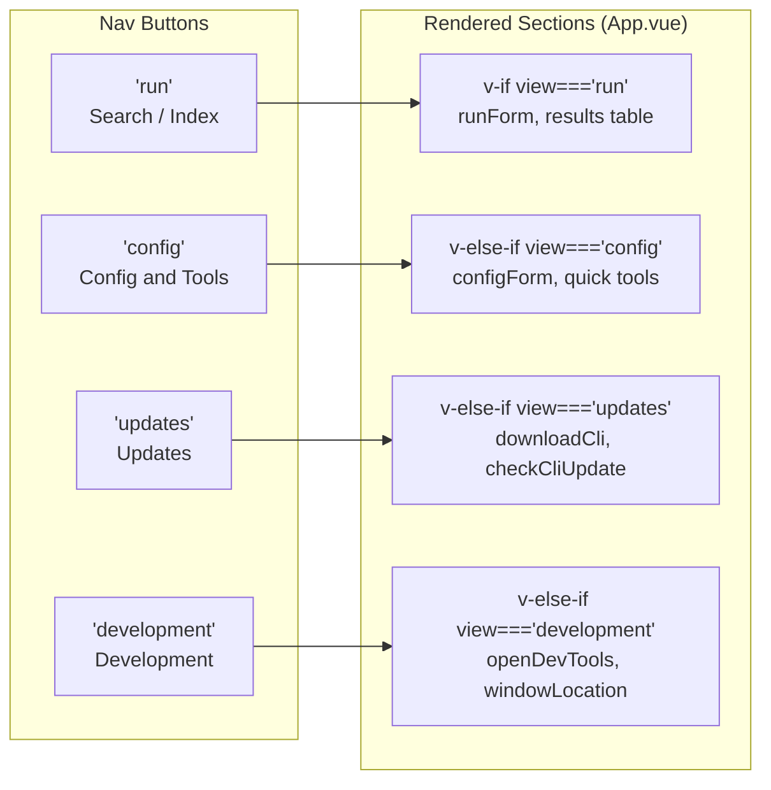

<!-- source: DeepWiki mcp.deepwiki.com · repo scarletkc/vexor · page 6 Desktop Application · fetched 2026-10-26 -->

# Desktop Application

Relevant source files

The following files were used as context for generating this wiki page:

- [gui/src/App.vue](gui/src/App.vue)

Vexor Desktop is an **experimental** Electron-based GUI that provides a graphical interface for Vexor operations. The application does not embed the Python engine directly — instead, it acts as a shell over the Vexor CLI binary, invoking it as a subprocess for all operations.

The desktop app is distributed as a standalone application for Windows, macOS, and Linux. It can automatically download and manage its own CLI binary, or use a system-installed CLI.

**Note**: The desktop application is marked experimental and may have limited functionality compared to the CLI or Python API. For production workflows, the CLI ([CLI Reference](#4)) or Python API ([Python API Reference](#5)) are recommended.

---

## Architecture Overview

The desktop application consists of three main layers:

1. **Electron Main Process** — manages the application window, IPC handlers, and CLI subprocess execution
2. **Vue 3 Renderer Process** — single-component UI that renders all tabs and forms
3. **CLI Binary** — the `vexor` command-line tool invoked as a subprocess

**Diagram: Desktop Application Architecture**

Sources: [gui/src/App.vue:1-517](), [gui/electron/preload.js:1-50](), [gui/electron/main.js:1-200]()

The renderer never imports Python modules or calls the Vexor Python API. All operations flow through the IPC bridge to the main process, which spawns the CLI as a child process and captures its output.

---

## Technology Stack

| Component | Technology | Entry Point |
|---|---|---|
| UI Framework | Vue 3 Composition API | [gui/src/App.vue:1]() |
| Desktop Framework | Electron 39 | [gui/electron/main.js:1]() |
| IPC Bridge | Electron `contextBridge` | [gui/electron/preload.js:1]() |
| Build Tool | Vite | [gui/vite.config.js:1]() |
| Packaging | Electron Forge | [gui/package.json:1]() |

The entire UI is implemented as a single Vue component [gui/src/App.vue:1-1272](). This component manages all state with Vue 3 `ref` and `reactive` objects and renders different sections based on the active tab.

Sources: [gui/package.json:1-30](), [gui/src/App.vue:1-1272]()

---

## Key Features

The desktop application provides:

- **Search Interface** — visual form for `vexor search` with result table
- **Index Management** — GUI controls for building and clearing indexes
- **Configuration** — forms for setting provider, API keys, and all config options
- **CLI Download** — automatic download of platform-specific CLI binaries from GitHub releases
- **Init Wizard** — interactive modal for running `vexor init` setup
- **Update Checking** — version comparison and update notifications
- **Diagnostics** — quick access to `vexor doctor` and system information

All operations use the `--format porcelain` output mode for machine-readable results [gui/src/App.vue:917]().

Sources: [gui/src/App.vue:37-465]()

---

## CLI Binary Discovery

The application locates the CLI binary using this precedence order:

1. **Downloaded Binary** — `~/.vexor-desktop/cli/vexor` or `vexor.exe` (auto-downloaded)
2. **Custom Path** — user-specified path stored in `localStorage` [gui/src/App.vue:530]()
3. **System PATH** — standard CLI installation via `pip` or package manager

The CLI discovery logic is implemented in the main process and exposed via `window.vexor.getCliInfo()` [gui/src/App.vue:795-807](). The renderer displays the current CLI source in the header status bar [gui/src/App.vue:15-17]().

Sources: [gui/src/App.vue:530](), [gui/src/App.vue:795-807](), [gui/src/App.vue:621-635]()

---

## User Interface Structure

The application has four main tabs, selected via the `view` ref [gui/src/App.vue:522]():

| Tab | View Value | Purpose |
|---|---|---|
| Search / Index | `'run'` | Execute searches and build indexes |
| Config & Tools | `'config'` | Manage configuration and run diagnostic commands |
| Updates | `'updates'` | Download CLI, check for updates, manage PATH |
| Development | `'development'` | DevTools access and debugging information |

Each tab shares a common Command Log pane at the bottom that displays CLI stdout/stderr [gui/src/App.vue:170-182]().

Sources: [gui/src/App.vue:22-35](), [gui/src/App.vue:522]()

---

## State Management

All application state is managed in `App.vue` using Vue 3 reactivity primitives:

**Core State Variables**

| Variable | Type | Purpose |
|---|---|---|
| `view` | `ref<string>` | Active tab identifier |
| `runMode` | `ref<string>` | `'search'` or `'index'` mode |
| `busy` | `ref<boolean>` | Disables UI during CLI operations |
| `results` | `ref<Array>` | Parsed search results for display |
| `logOutput` | `ref<string>` | CLI output text |
| `configInfo` | `reactive` | Snapshot of `~/.vexor/config.json` |
| `cliInfo` | `reactive` | CLI version, path, and availability |
| `runForm` | `reactive` | Search/Index form field values |
| `configForm` | `reactive` | Configuration form field values |

Sources: [gui/src/App.vue:522-601]()

State is synchronized with the CLI configuration on mount via `loadConfig()` [gui/src/App.vue:763-772]() and `refreshCliInfo()` [gui/src/App.vue:795-807]().

---

## CLI Invocation Pattern

Every user action constructs an argument array and invokes `window.vexor.run({ cliPath, args })` [gui/src/App.vue:894-940](). The IPC handler spawns the CLI with these arguments and returns the result.

**Example: Search Operation Flow**

Sources: [gui/src/App.vue:894-940](), [gui/src/App.vue:832-856](), [gui/src/App.vue:858-878]()

The `parsePorcelain()` function parses tab-delimited output into result objects [gui/src/App.vue:858-878]().

---

## Experimental Status and Limitations

The desktop application is **experimental** and has known limitations:

1. **No Direct Python Integration** — cannot use in-memory indexes or programmatic API
2. **CLI Dependency** — requires a working CLI binary to function
3. **Standalone Binary Limitations** — downloaded binaries cannot install Python extras like `vexor[local]` or `vexor[flashrank]`
4. **Limited Error Handling** — CLI errors are displayed as raw text in the Command Log
5. **No Background Operations** — all operations block the UI while running

The application detects missing dependencies by scanning CLI error messages [gui/src/App.vue:732-761]() and displays installation instructions when `vexor[local]` or `vexor[flashrank]` features are unavailable.

Sources: [gui/src/App.vue:732-761](), [gui/src/App.vue:172-179]()

---

## Development and Packaging

The desktop app is developed using:

- **Development Server** — `npm run dev` starts Vite + Electron concurrently [gui/package.json:8]()
- **Building** — `npm run build` produces optimized bundles [gui/package.json:9]()
- **Packaging** — `npm run package` creates platform-specific executables [gui/package.json:10]()

The development tab [gui/src/App.vue:264-292]() provides access to Chrome DevTools via `window.vexor.openDevTools()` [gui/src/App.vue:1195-1204]() for debugging the renderer process.

Sources: [gui/package.json:7-13](), [gui/src/App.vue:264-292](), [gui/src/App.vue:1195-1204]()

---

## Related Documentation

For detailed information on specific aspects of the desktop application, see:

- **[Overview](#6.1)** — Download instructions, installation, and first launch
- **[Interface Guide](#6.2)** — Detailed walkthrough of each tab and control
- **[Configuration](#6.3)** — Provider setup, reranking configuration, and settings management
- **[Updates and CLI Management](#6.4)** — CLI binary downloads, version management, and PATH configuration

For information about the CLI commands the desktop app invokes, see [CLI Reference](#4).

---

## Technology Stack

The desktop application is a standard Electron + Vue 3 application, packaged with Electron Forge and bundled with Vite.

| Layer | Technology | Entry Point |
|---|---|---|
| Electron host process | Electron 39 | `electron/main.js` |
| Renderer (UI) | Vue 3 + Vite | `gui/src/App.vue` |
| IPC bridge | Electron `contextBridge` | `gui/electron/preload.js` |
| Packaging | electron-forge | `gui/package.json` |

The package name is `vexor-desktop` and its current version is tracked independently from the Python package.

Sources: [gui/package.json:1-30]()

---

## Architecture: How the GUI Relates to the CLI

The GUI does **not** import or call any Python code at runtime. Instead, it locates a `vexor` CLI binary on the system (or one it has downloaded), then invokes it as a subprocess through Electron's IPC layer. The renderer communicates with the main process via the `window.vexor` object injected by the preload script.

**Diagram: Desktop Application Architecture**

Sources: [gui/src/App.vue:519-607](), [gui/src/App.vue:894-1002]()

---

## Application State Model

`App.vue` manages all UI state with Vue 3 `ref` and `reactive` objects. The most important reactive values are:

| Variable | Type | Purpose |
|---|---|---|
| `view` | `ref` | Active tab: `'run'`, `'config'`, `'updates'`, `'development'` |
| `runMode` | `ref` | `'search'` or `'index'` within the run tab |
| `busy` | `ref` | Disables buttons during any async CLI call |
| `results` | `ref` | Parsed search result rows displayed in the result table |
| `logOutput` | `ref` | Raw CLI stderr/stdout shown in the Command Log pane |
| `configInfo` | `reactive` | Snapshot of `config.json` loaded via `window.vexor.getConfigInfo()` |
| `cliInfo` | `reactive` | CLI binary location, version, and PATH status |
| `runForm` | `reactive` | All fields in the Search/Index form |
| `configForm` | `reactive` | All fields in the Config & Tools form |
| `downloadInfo` | `reactive` | Progress state for CLI binary download |

Sources: [gui/src/App.vue:522-601]()

---

## CLI Invocation Pattern

Every user action constructs an argument array and calls `window.vexor.run({ cliPath, args })`. The optional `cliPath` value is loaded from `localStorage` and allows overriding the auto-detected binary.

**Diagram: Argument Construction for Search and Config**

Sources: [gui/src/App.vue:832-1002]()

The `parsePorcelain` function [gui/src/App.vue:858-878]() splits each line on `\t` and maps the fields to `{ rank, score, path, lines, preview }` objects rendered in the result table. This is why the search command always appends `--format porcelain` when invoked from the GUI.

---

## Tab Overview

The `view` ref determines which `<section>` is rendered. Each tab shares the Command Log pane at the bottom.

**Diagram: Tab → Code Mapping**

Sources: [gui/src/App.vue:22-35](), [gui/src/App.vue:37-465]()

---

## Lifecycle and Event Listeners

On mount (`onMounted`), the app:

1. Calls `loadConfig(true)` to populate `configForm` from disk.
2. Calls `refreshCliInfo()` to detect the CLI binary and its version.
3. Registers three IPC event listeners via the `window.vexor` bridge:
   - `window.vexor.onInitOutput` — streams `vexor init` output into the modal.
   - `window.vexor.onInitExit` — detects when `vexor init` completes and reloads config.
   - `window.vexor.onCliDownloadProgress` — updates `downloadInfo` with byte counts during binary download.

These listeners are cleaned up in `onBeforeUnmount`.

Sources: [gui/src/App.vue:1235-1270]()

---

## Missing Dependency Detection

The `detectMissingDeps` function [gui/src/App.vue:732-761]() scans `logOutput` for known error strings to surface actionable install hints. It detects two conditions:

| Detected String | Hint Shown |
|---|---|
| `"vexor[local]"` or `"local model support is not installed"` | `pip install "vexor[local]"` |
| `"vexor[flashrank]"` or `"flashrank reranker is not installed"` | `pip install "vexor[flashrank]"` |

When the CLI source is `"downloaded"` (a standalone binary), an additional note warns that downloaded binaries cannot install Python extras and that the user should install via pip instead.

Sources: [gui/src/App.vue:609-611](), [gui/src/App.vue:679-681](), [gui/src/App.vue:732-761]()

---

## Development Mode

The Development tab exposes:

- **Loaded URL** — the current `window.location.href` for verifying which Vite dev server or built file is loaded.
- **Open DevTools** — calls `window.vexor.openDevTools()` to open Chromium DevTools in the renderer window.

During development, the app is started with `npm run dev` (defined in `gui/package.json`), which runs Vite and Electron concurrently via `concurrently` and `wait-on`.

Sources: [gui/src/App.vue:264-292](), [gui/package.json:7-13]()

---

