<!-- source: DeepWiki mcp.deepwiki.com · repo scarletkc/vexor · page 6.2 Interface Guide · fetched 2026-10-26 -->

# Interface Guide

Relevant source files

The following files were used as context for generating this wiki page:

- [gui/src/App.vue](gui/src/App.vue)

This document provides a comprehensive guide to using the Vexor Desktop Application interface. It covers the layout, components, interactions, and workflows available in the graphical user interface.

For general information about the desktop app and its architecture, see [Overview](#6.1). For configuration options, see [Configuration](#6.3). For CLI usage, see [CLI Reference](#4).

**Status**: The desktop application is experimental and under active development. Some features may be incomplete or subject to change.

---

## Interface Architecture

The desktop application is built using Electron with a Vue.js frontend, providing a native-feeling cross-platform interface that wraps the Vexor CLI.

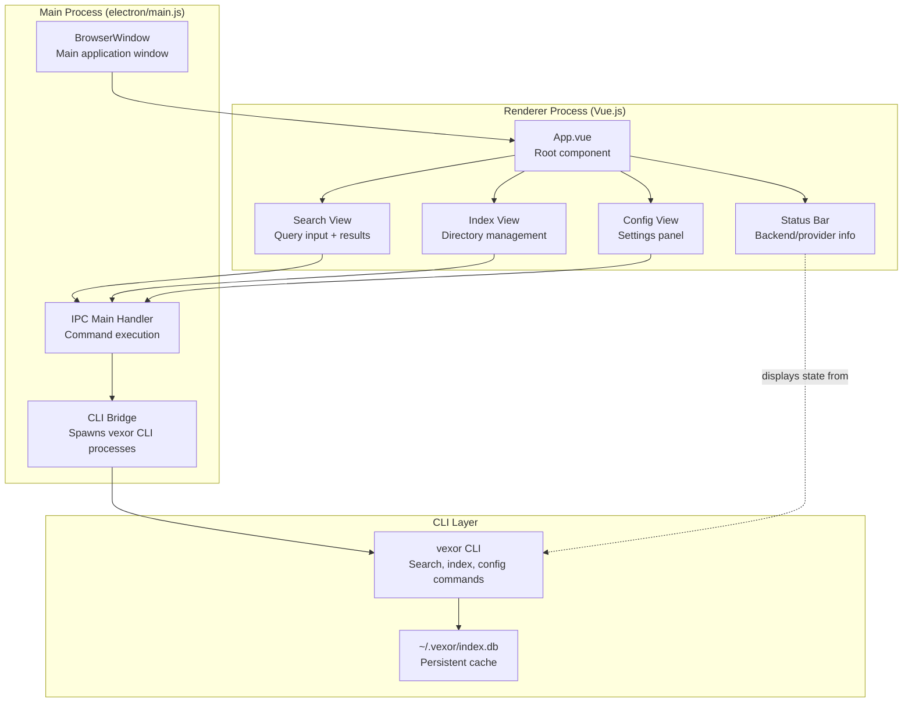

**Sources**: [gui/package.json:1-30]()

---

## Window Layout

The desktop application uses a single-window layout with multiple views accessible via navigation.

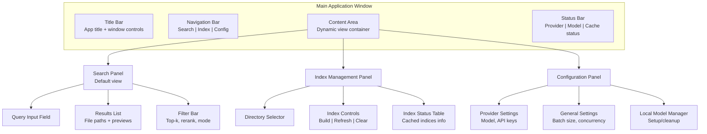

**Sources**: [gui/package.json:1-30]()

---

## Search Interface

The search interface is the primary view and appears on application launch.

### Query Input

| Component | Purpose | CLI Equivalent |
|-----------|---------|----------------|
| **Search Input Field** | Text field for entering semantic queries | `vexor search "query"` |
| **Directory Path Field** | Target directory for search | `--path` flag |
| **Search Button** | Execute search | Enter key / button click |
| **Clear Button** | Reset query and results | N/A (UI only) |

### Search Options Panel

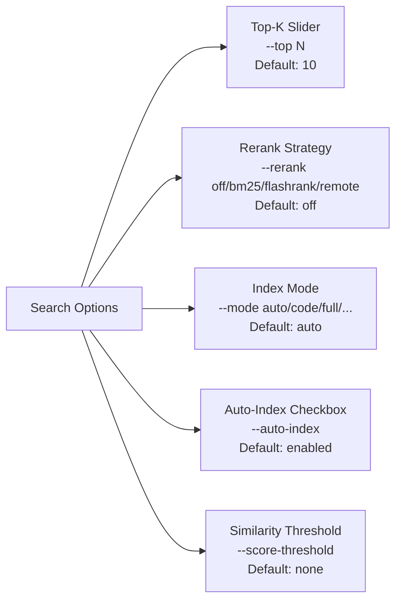

**Interaction Flow**:
1. User enters query text in search field
2. Optionally adjusts top-k, rerank, mode settings
3. Clicks search or presses Enter
4. Application sends IPC message to main process: `ipc.send('search', {query, path, top, rerank, mode})`
5. Main process spawns CLI command: `vexor search "query" --path /dir --top 10 --rerank bm25`
6. CLI output is parsed and sent back to renderer
7. Results are displayed in results panel

**Sources**: [gui/package.json:1-30]()

---

## Results Display

Search results are displayed in a scrollable list with rich formatting.

### Result Card Layout

Each result is displayed as a card containing:

| Element | Content | Purpose |
|---------|---------|---------|
| **File Path** | Relative or absolute path | Identifies the file, clickable to open |
| **Similarity Score** | 0.000 - 1.000 | Indicates semantic relevance |
| **Preview Text** | First ~200 characters | Context snippet |
| **Line Numbers** | start_line - end_line | Location within file (code/outline modes) |
| **Rank Indicator** | #1, #2, #3... | Result position |

### Result Actions

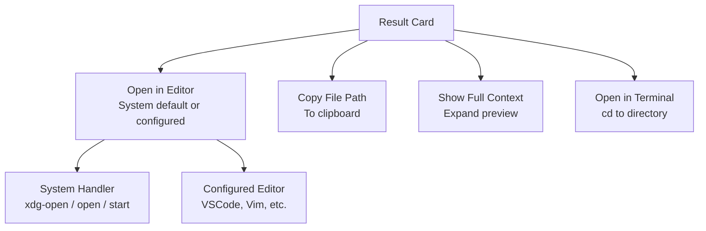

### Empty States

| State | Display | Action |
|-------|---------|--------|
| **No Query** | "Enter a query to search your codebase" | Prompt user |
| **No Results** | "No results found. Try adjusting your query." | Suggest refinement |
| **No Index** | "No index found. Click 'Index' to build one." | Redirect to index view |
| **Search Error** | Error message + stack trace | Show CLI output |

**Sources**: [gui/package.json:1-30]()

---

## Index Management Interface

The index management view provides controls for building and maintaining search indices.

### Directory Selection

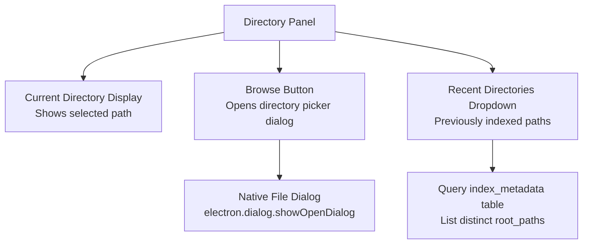

### Index Operations

| Operation | UI Control | CLI Command | Behavior |
|-----------|-----------|-------------|----------|
| **Build Index** | "Build Index" button | `vexor index --path /dir` | Creates new index, full scan |
| **Refresh Index** | "Refresh Index" button | `vexor index --path /dir` | Incremental update of existing index |
| **Clear Index** | "Clear Index" button | `vexor index --clear --path /dir` | Deletes index from cache |
| **Clear All** | "Clear All Indices" button | `vexor index --clear-all` | Removes all cached indices |

### Index Options

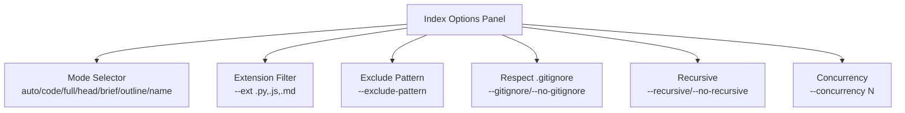

### Index Status Table

The status table displays information about cached indices:

| Column | Source | Description |
|--------|--------|-------------|
| **Directory** | `index_metadata.root_path` | Indexed directory path |
| **Mode** | `index_metadata.mode` | Indexing mode used |
| **Model** | `index_metadata.model` | Embedding model |
| **Files** | Count from `indexed_file` | Number of indexed files |
| **Chunks** | Count from `indexed_chunk` | Number of indexed chunks |
| **Generated** | `index_metadata.generated_at` | Timestamp of index creation |
| **Size** | Calculated | Approximate cache size |

**Interaction**: Clicking a row selects that directory and populates the directory selector field.

**Sources**: [gui/package.json:1-30]()

---

## Configuration Interface

The configuration view provides a graphical interface for managing Vexor settings.

### Provider Configuration

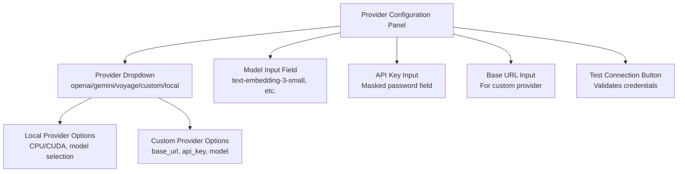

### Provider-Specific Fields

| Provider | Required Fields | Optional Fields |
|----------|----------------|-----------------|
| **OpenAI** | `api_key` | `model` (default: text-embedding-3-small) |
| **Gemini** | `api_key` | `model` (default: gemini-embedding-001) |
| **Voyage** | `api_key` | `model` (default: voyage-3-large) |
| **Custom** | `base_url`, `model` | `api_key` |
| **Local** | None | `device` (cpu/cuda), `model` |

### General Settings

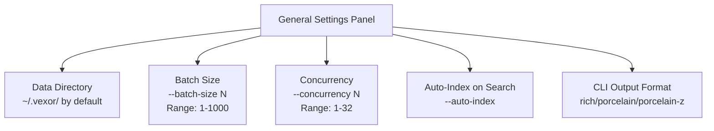

### Reranking Configuration

| Setting | Control Type | Values | Default |
|---------|--------------|--------|---------|
| **Strategy** | Dropdown | off, bm25, flashrank, remote | off |
| **FlashRank Top-N** | Number input | 1-1000 | 100 |
| **Remote Base URL** | Text input | HTTP(S) URL | Empty |
| **Remote Model** | Text input | Model identifier | Empty |
| **Remote API Key** | Password input | API key string | Empty |

### Configuration Actions

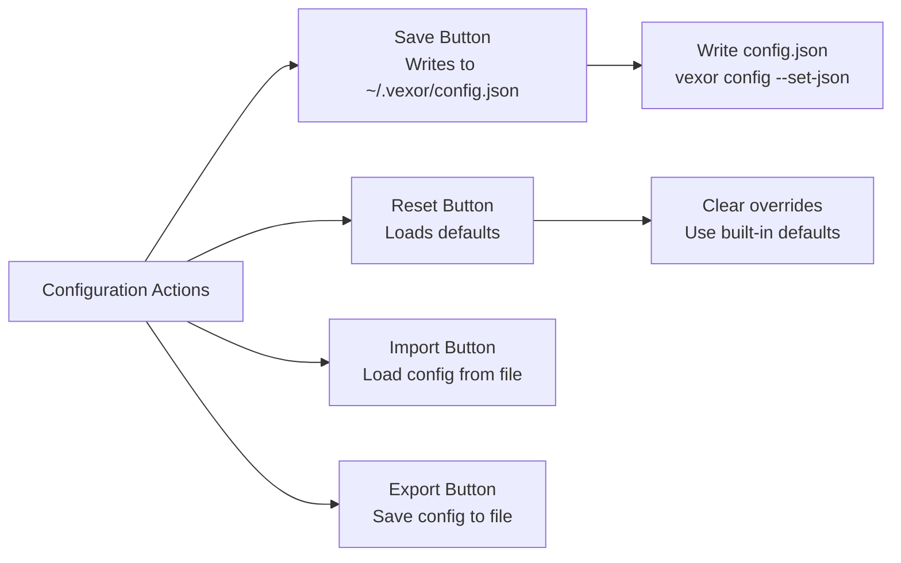

**Sources**: [gui/package.json:1-30]()

---

## Status Bar

The status bar at the bottom of the window displays real-time system status.

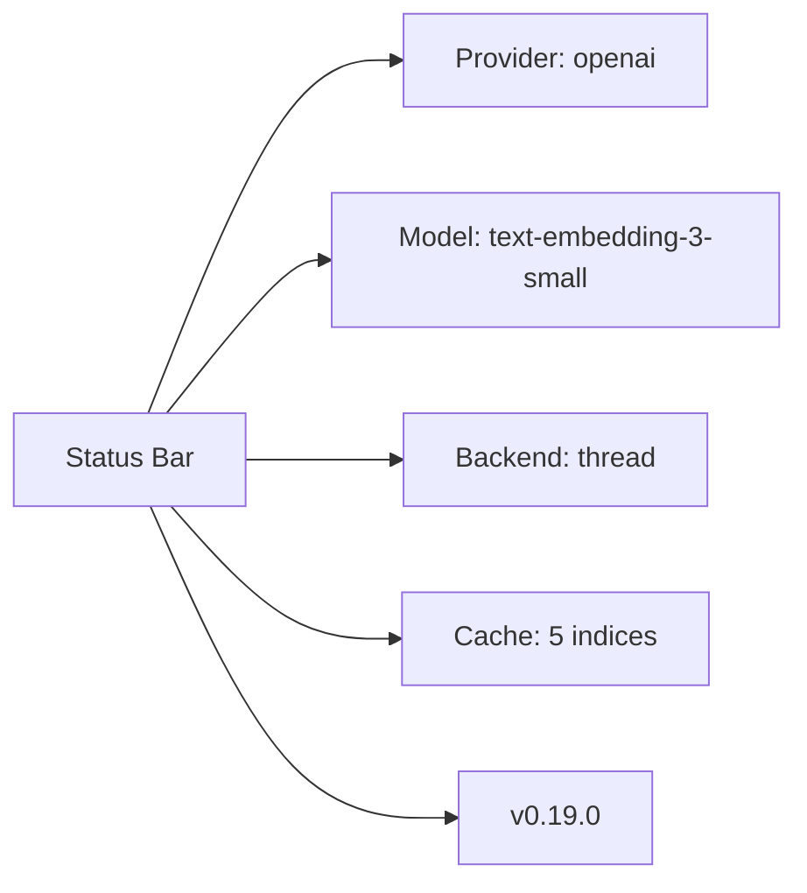

### Status Indicators

| Indicator | Color Coding | States |
|-----------|--------------|--------|
| **Provider Connection** | Green (connected) / Red (error) / Gray (unconfigured) | Shows current provider status |
| **Indexing Progress** | Yellow (in progress) / Blue (complete) | Appears during index operations |
| **Cache Status** | Normal / Warning (large size) | Shows cache size and index count |
| **CLI Version** | Normal / Warning (outdated) | Shows installed CLI version |

### Status Bar Actions

Clicking indicators opens relevant panels:
- **Provider indicator** → Opens configuration panel
- **Cache indicator** → Opens index management panel
- **Version indicator** → Opens about/update dialog

**Sources**: [gui/package.json:1-30]()

---

## Keyboard Shortcuts

The desktop application supports keyboard shortcuts for common operations.

### Global Shortcuts

| Shortcut | Action | Context |
|----------|--------|---------|
| `Ctrl+K` / `Cmd+K` | Focus search field | Any view |
| `Ctrl+I` / `Cmd+I` | Switch to index view | Any view |
| `Ctrl+,` / `Cmd+,` | Open configuration | Any view |
| `Ctrl+R` / `Cmd+R` | Refresh current view | Any view |
| `Ctrl+Q` / `Cmd+Q` | Quit application | Any view |

### Search View Shortcuts

| Shortcut | Action | Context |
|----------|--------|---------|
| `Enter` | Execute search | Search field focused |
| `Escape` | Clear search | Search field focused |
| `↑` / `↓` | Navigate results | Results list focused |
| `Enter` | Open selected result | Result selected |
| `Ctrl+C` / `Cmd+C` | Copy file path | Result selected |
| `Ctrl+Shift+C` | Copy full preview | Result selected |

### Index View Shortcuts

| Shortcut | Action | Context |
|----------|--------|---------|
| `Ctrl+B` / `Cmd+B` | Build index | Index view |
| `Ctrl+Shift+R` | Refresh index | Index view |
| `Delete` | Clear selected index | Index selected |
| `Ctrl+Shift+Delete` | Clear all indices | Index view |

**Sources**: [gui/package.json:1-30]()

---

## Navigation Patterns

The application uses a tabbed navigation model with three primary views.

### View Switching

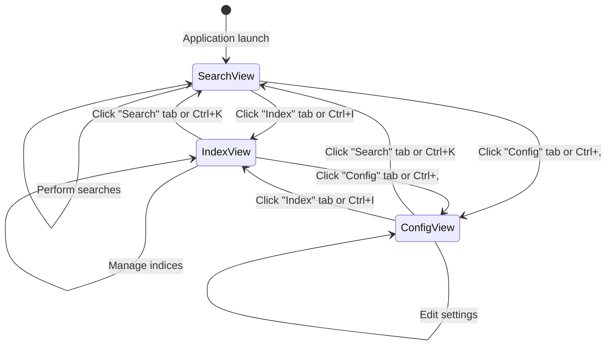

### Navigation State Persistence

The application maintains navigation state across sessions:
- Last selected view is restored on launch
- Recent directories are persisted
- Search history is stored (last 20 queries)
- Filter/option selections are remembered per-view

**Sources**: [gui/package.json:1-30]()

---

## IPC Communication Protocol

The renderer process communicates with the main process via Electron IPC.

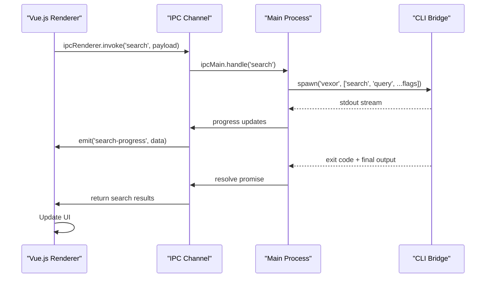

### IPC Message Types

| Channel | Direction | Payload | Response |
|---------|-----------|---------|----------|
| `search` | Renderer → Main | `{query, path, top, rerank, mode, ...}` | `{results: [...], backend: string, is_stale: bool}` |
| `index` | Renderer → Main | `{path, mode, ext, exclude, ...}` | `{success: bool, files_indexed: number, chunks: number}` |
| `config-get` | Renderer → Main | `{}` | `{provider, model, api_key, ...}` |
| `config-set` | Renderer → Main | `{key: value, ...}` | `{success: bool}` |
| `index-list` | Renderer → Main | `{}` | `[{root_path, mode, model, generated_at, ...}]` |
| `index-clear` | Renderer → Main | `{path?}` | `{success: bool}` |
| `search-progress` | Main → Renderer | `{status: string, percent: number}` | N/A (event) |
| `index-progress` | Main → Renderer | `{files_processed: number, total_files: number}` | N/A (event) |

**Sources**: [gui/package.json:1-30]()

---

## Visual Feedback

The interface provides visual feedback for all user actions.

### Loading States

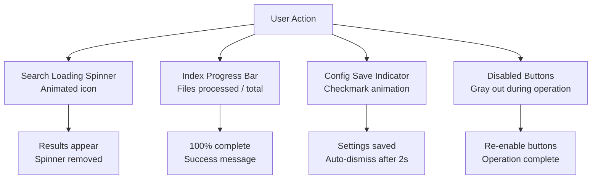

### Error Handling

| Error Type | Visual Indicator | User Action |
|------------|------------------|-------------|
| **No API Key** | Red banner: "API key required" | Link to config panel |
| **Network Error** | Yellow banner: "Connection failed. Retrying..." | Retry button |
| **CLI Error** | Red banner with details | "Show details" expander |
| **Invalid Path** | Red border on path field | Inline error message |
| **No Results** | Info message: "No results found" | Suggest query refinement |

### Success Feedback

- **Search complete**: Results count badge (e.g., "42 results")
- **Index built**: Toast notification with file/chunk counts
- **Config saved**: Checkmark icon + "Saved" message
- **Index cleared**: Toast notification "Index cleared"

**Sources**: [gui/package.json:1-30]()

---

## Responsive Behavior

The application window is resizable with responsive layout adjustments.

### Minimum Window Size

- **Width**: 800px
- **Height**: 600px

### Layout Breakpoints

| Window Width | Layout Behavior |
|--------------|----------------|
| **< 1000px** | Side-by-side panels become vertical stacks |
| **< 800px** | Options panels collapse to dropdowns |
| **≥ 1200px** | Full layout with expanded previews |

### Panel Resizing

Users can resize panels by dragging dividers:
- **Results panel**: 30%-70% of content area
- **Options panel**: 200px-400px width
- **Status table**: Adjustable column widths

**Sources**: [gui/package.json:1-30]()

---

## Accessibility Features

The desktop application implements accessibility best practices.

### Keyboard Navigation

- All interactive elements are keyboard-accessible
- Tab order follows logical flow
- Focus indicators are visible
- Skip links for rapid navigation

### Screen Reader Support

- Semantic HTML for proper structure
- ARIA labels on custom controls
- Status announcements for dynamic updates
- Alternative text for icons

### Visual Accessibility

- High contrast mode support
- Scalable fonts (respect system settings)
- Focus indicators meet WCAG AA standards
- No color-only information encoding

**Sources**: [gui/package.json:1-30]()

---

## Platform-Specific Behaviors

The Electron application adapts to platform conventions.

### macOS

- Menu bar integration with system menu
- Cmd+Q to quit (standard macOS behavior)
- Native title bar styling
- ⌘ shown instead of Ctrl in shortcuts

### Windows

- Window controls in title bar (minimize/maximize/close)
- Ctrl key for shortcuts
- Native file dialogs
- Tray icon support

### Linux

- Respects system theme (GTK/Qt)
- Native window decorations
- XDG desktop integration
- Wayland and X11 support

**Sources**: [gui/package.json:1-30]()

---

