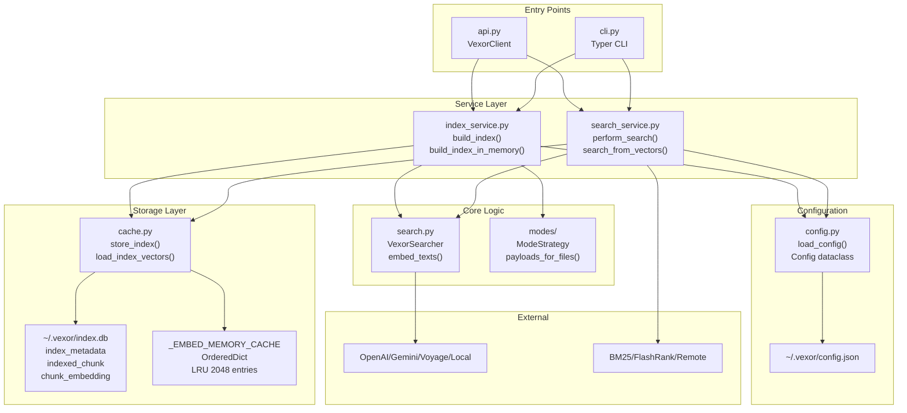
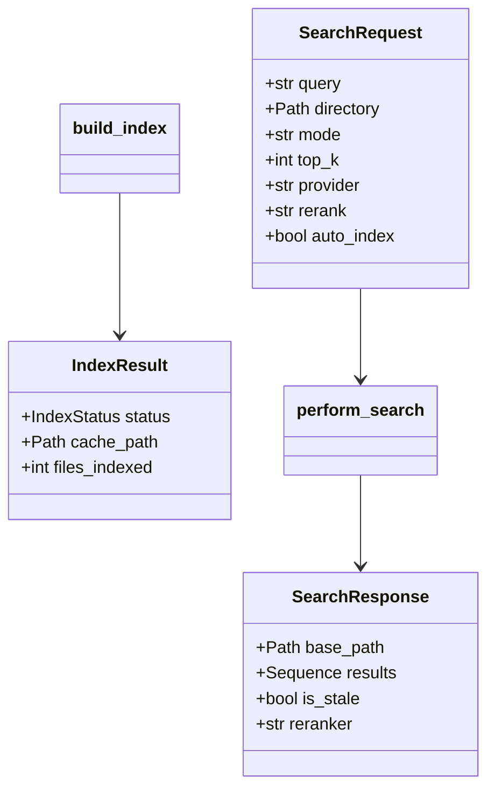
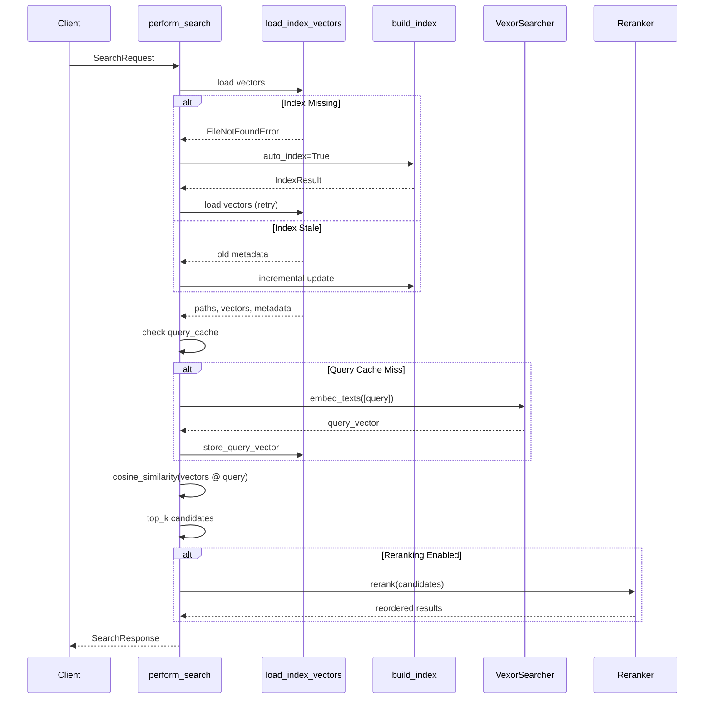
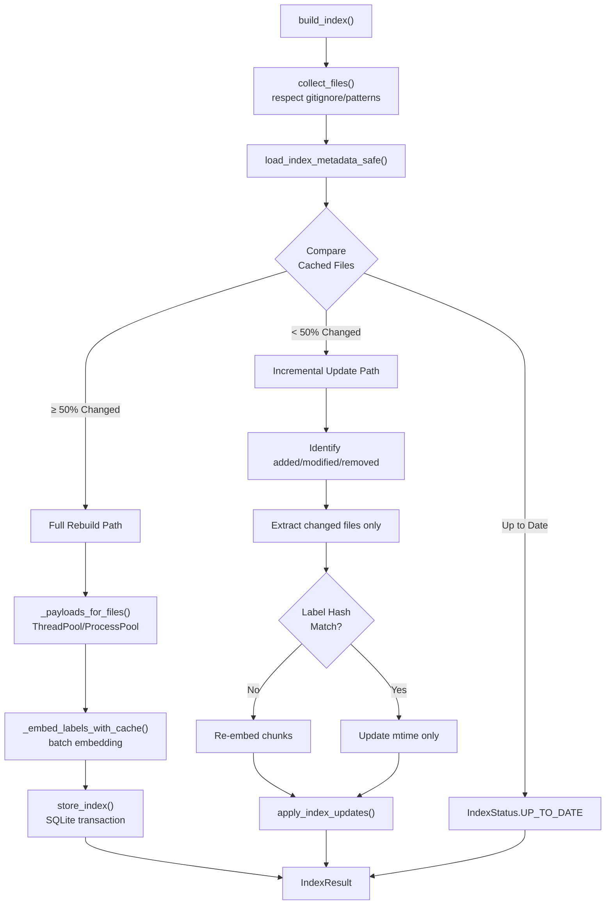
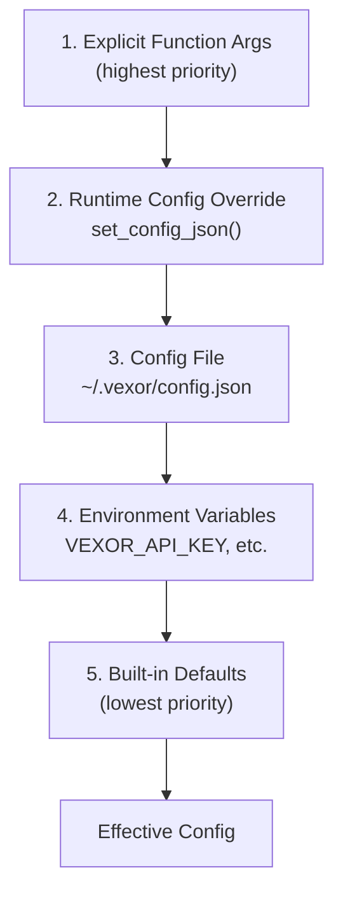
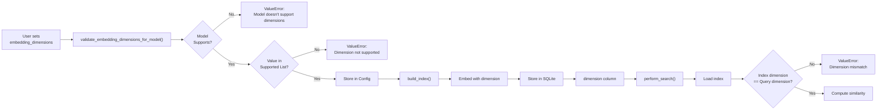

<!-- source: DeepWiki mcp.deepwiki.com · repo scarletkc/vexor · page 7 Architecture Deep Dive · fetched 2026-10-26 -->

# Architecture Deep Dive

<details>
<summary>Relevant source files</summary>

The following files were used as context for generating this wiki page:

- [README.md](README.md)
- [tests/unit/test_cache.py](tests/unit/test_cache.py)
- [tests/unit/test_search_service.py](tests/unit/test_search_service.py)
- [vexor/cache.py](vexor/cache.py)
- [vexor/services/search_service.py](vexor/services/search_service.py)

</details>


## Purpose and Scope

This document provides detailed technical documentation of Vexor's internal architecture, covering the implementation details of core services, data storage, configuration management, and execution flows. This page is intended for developers who want to understand how Vexor works internally, contribute to the codebase, or debug complex issues.

For user-facing concepts like indexing modes and providers, see [Core Concepts](#3). For API usage patterns, see [Python API Reference](#5). For CLI command details, see [CLI Reference](#4).

---

## System Architecture Overview



**Sources:** [vexor/services/search_service.py:1-842](), [vexor/services/index_service.py:1-1049](), [vexor/cache.py:1-1533](), [vexor/config.py:1-710]()

---

## Core Components

### Service Layer

The service layer implements the two primary workflows: indexing and search. Both services are stateless and coordinate between configuration, storage, and external providers.

| Component | Responsibilities | Key Functions |
|-----------|-----------------|---------------|
| `search_service.py` | Query execution, cache checking, reranking | `perform_search()`, `search_from_vectors()` |
| `index_service.py` | File discovery, content extraction, index building | `build_index()`, `build_index_in_memory()` |
| `cache_service.py` | Cache validation, staleness detection | `is_cache_current()`, `load_index_metadata_safe()` |

**Sources:** [vexor/services/search_service.py:358-708](), [vexor/services/index_service.py:126-375]()

### Request/Response Pattern

Both services use dataclass-based request/response objects for explicit parameter passing:



**Sources:** [vexor/services/search_service.py:33-70](), [vexor/services/index_service.py:34-44]()

---

## Storage Architecture

### SQLite Schema

Vexor uses a normalized SQLite schema with foreign key cascades for referential integrity:

```mermaid
erDiagram
    index_metadata ||--o{ indexed_file : "has"
    index_metadata ||--o{ indexed_chunk : "has"
    index_metadata ||--o{ query_cache : "has"
    indexed_file ||--o{ indexed_chunk : "contains"
    indexed_chunk ||--|| chunk_embedding : "has"
    indexed_chunk ||--|| chunk_meta : "has"
    
    index_metadata {
        int id PK
        text cache_key
        text root_path
        text model
        int dimension
        text extensions
        text exclude_patterns
    }
    
    indexed_file {
        int id PK
        int index_id FK
        text rel_path
        real mtime
        int size_bytes
    }
    
    indexed_chunk {
        int id PK
        int index_id FK
        int file_id FK
        int chunk_index
        int position
    }
    
    chunk_embedding {
        int chunk_id PK_FK
        blob vector_blob
    }
    
    chunk_meta {
        int chunk_id PK_FK
        text preview
        text label_hash
        int start_line
        int end_line
    }
    
    query_cache {
        int id PK
        int index_id FK
        text query_hash
        blob query_vector
    }
```

**Sources:** [vexor/cache.py:314-399]()

### Cache Key Generation

Cache keys uniquely identify indices based on configuration:

```python
# Pseudocode from _cache_key()
key = f"{root.resolve()}|hidden={include_hidden}|gitignore={respect_gitignore}"
      f"|recursive={recursive}|mode={mode}|ext={extensions}|exclude={patterns}"
digest = sha1(key.encode("utf-8")).hexdigest()
```

**Sources:** [vexor/cache.py:51-71]()

### Two-Tier Cache System

Vexor implements a two-tier caching strategy for embeddings:

| Tier | Implementation | Size Limit | Eviction |
|------|---------------|------------|----------|
| Memory | `_EMBED_MEMORY_CACHE` OrderedDict | 2048 entries | LRU |
| Disk | `embedding_cache` SQLite table | 50,000 entries | TTL (30 days) + capacity |

The memory cache is dimension-aware to prevent cross-dimension pollution:

```python
# Cache key includes dimension
key = (model, dimension, text_hash)
```

**Sources:** [vexor/cache.py:33-159](), [vexor/cache.py:728-777]()

---

## Search Execution Flow



**Sources:** [vexor/services/search_service.py:358-708]()

### Cache Lookup Strategy

The search service implements a sophisticated cache lookup strategy with superset fallback:

1. **Exact Match**: Try loading with exact parameters
2. **Superset Search**: If not found, search for a compatible parent index
3. **Filter In-Memory**: Apply extension/directory filters to superset
4. **Auto-Index**: Optionally rebuild if stale or missing

The superset selection algorithm prioritizes:
- Same root or parent directory (minimum distance)
- Recursive flag compatibility
- Extension superset matching
- Exclude pattern subset matching

**Sources:** [vexor/services/search_service.py:876-1020]()

---

## Index Building Pipeline



**Sources:** [vexor/services/index_service.py:126-375](), [vexor/services/index_service.py:641-726]()

### Incremental Update Optimization

The incremental update path avoids re-embedding unchanged content by comparing label hashes:

```python
# From _split_payloads_by_label()
for payload in payloads:
    cached_hash = cached_chunks.get(payload.chunk_index)
    new_hash = embedding_cache_key(payload.label)
    if cached_hash == new_hash:
        to_touch.append(payload)  # Only update metadata
    else:
        to_embed.append(payload)  # Re-embed
```

**Sources:** [vexor/services/index_service.py:830-863]()

---

## Configuration Resolution

### Five-Layer Hierarchy

Vexor resolves configuration through a strict precedence system:



**Sources:** [vexor/config.py:123-149](), [vexor/config.py:469-504]()

### Provider-Specific Resolution

Different providers use different environment variables:

| Provider | Config Key | Env Fallback | Default Model |
|----------|-----------|--------------|---------------|
| `openai` | `api_key` | `OPENAI_API_KEY` | `text-embedding-3-small` |
| `gemini` | `api_key` | `GOOGLE_GENAI_API_KEY` | `gemini-embedding-001` |
| `voyageai` | `api_key` | `VOYAGE_API_KEY` | `voyage-3-large` |
| `local` | None | None | `intfloat/multilingual-e5-small` |

**Sources:** [vexor/config.py:397-407](), [vexor/config.py:469-493]()

---

## Reranking Architecture

### Reranking Pipeline

When reranking is enabled, the search service retrieves more candidates than requested and reranks them:

```python
# From perform_search()
if use_rerank:
    candidate_limit = _resolve_rerank_candidates(top_k)  # 2x, min 20, max 150
else:
    candidate_limit = top_k

# After cosine similarity
if rerank == "bm25":
    candidates = _apply_bm25_rerank(query, candidates)
elif rerank == "flashrank":
    candidates = _apply_flashrank_rerank(query, candidates)
else:  # remote
    candidates = _apply_remote_rerank(query, candidates)

results = candidates[:top_k]
```

**Sources:** [vexor/services/search_service.py:624-700]()

### BM25 Score Fusion

The BM25 reranker fuses lexical and semantic scores:

```python
# Normalize both score types
semantic_norm = normalize_by_max(semantic_scores)
bm25_norm = normalize_by_max(bm25_scores)

# Weighted fusion (70% semantic, 30% lexical)
fused_score = 0.7 * semantic_norm + 0.3 * bm25_norm
```

**Sources:** [vexor/services/search_service.py:144-163]()

---

## Embedding Dimension Management

### Dimension Validation

Vexor validates embedding dimensions at multiple points to prevent mismatches:



**Sources:** [vexor/config.py:434-467](), [vexor/services/search_service.py:635-644]()

### Cache Segmentation

Embedding caches are segmented by dimension to prevent cross-pollution:

```python
# Cache key includes dimension
text_hash = embedding_cache_key(text, dimension=512)

# Memory cache key
key = (model, dimension, text_hash)

# Different dimensions = different cache entries
cache_key("hello", dim=512) != cache_key("hello", dim=1024)
```

**Sources:** [vexor/cache.py:92-106](), [vexor/cache.py:137-159]()

---

## Concurrency and Parallelism

### Content Extraction Backend

The index service supports three extraction backends:

| Backend | Implementation | Use Case |
|---------|---------------|----------|
| `thread` | `ThreadPoolExecutor` | I/O-bound, small files |
| `process` | `ProcessPoolExecutor` | CPU-bound, large files |
| `auto` | Automatic selection | ≥16 files + CPU-heavy mode → process |

**Sources:** [vexor/services/index_service.py:51-123]()

### Extraction Backend Selection Logic

```python
def _resolve_extract_backend(value, *, mode, file_count, concurrency):
    if value == "auto":
        if (concurrency > 1 and 
            file_count >= 16 and 
            mode in {"auto", "code", "outline", "full"}):
            return "process"
        return "thread"
    return value
```

**Sources:** [vexor/services/index_service.py:51-69]()

---

## Error Handling and Edge Cases

### Dimension Mismatch Detection

The search service validates dimension compatibility before computing similarities:

```python
# From perform_search()
index_dimension = file_vectors.shape[1]
query_dimension = query_vector.shape[0]

if index_dimension != query_dimension:
    raise ValueError(
        f"Embedding dimension mismatch: index has {index_dimension}-dim vectors, "
        f"but query embedding is {query_dimension}-dim. "
        "Rebuild the index with: vexor index {directory}"
    )
```

**Sources:** [vexor/services/search_service.py:635-644](), [tests/unit/test_search_service.py:995-1046]()

### Staleness Detection

Cache staleness is detected by comparing file metadata:

```python
# From _has_entry_changed()
if abs(entry.mtime - cached_mtime) > MTIME_TOLERANCE:
    if cached_size == entry.size:
        return False  # Size match, likely same content
    return True

if cached_size != entry.size:
    return True
```

**Sources:** [vexor/services/index_service.py:627-638]()

---

## Summary of Key Patterns

| Pattern | Implementation | Purpose |
|---------|---------------|---------|
| Two-tier caching | Memory LRU + SQLite | Balance speed and durability |
| Incremental updates | Label hash comparison | Avoid redundant re-embedding |
| Superset fallback | Parent index reuse | Reduce redundant indexing |
| Dimension segmentation | Dimension-aware cache keys | Prevent cross-dimension pollution |
| Request/Response objects | Dataclasses | Explicit parameter passing |
| Provider abstraction | `VexorSearcher` | Unified embedding interface |
| Foreign key cascades | SQLite constraints | Automatic cleanup on deletion |

**Sources:** [vexor/cache.py:1-1533](), [vexor/services/search_service.py:1-842](), [vexor/services/index_service.py:1-1049]()

---

