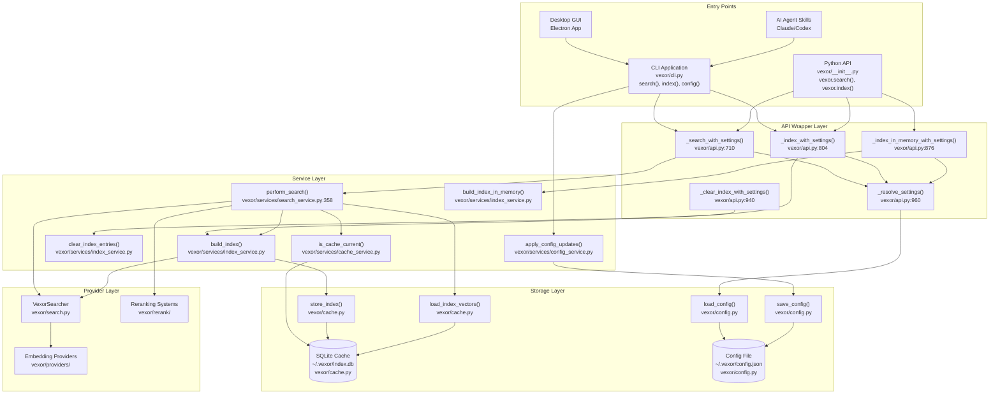
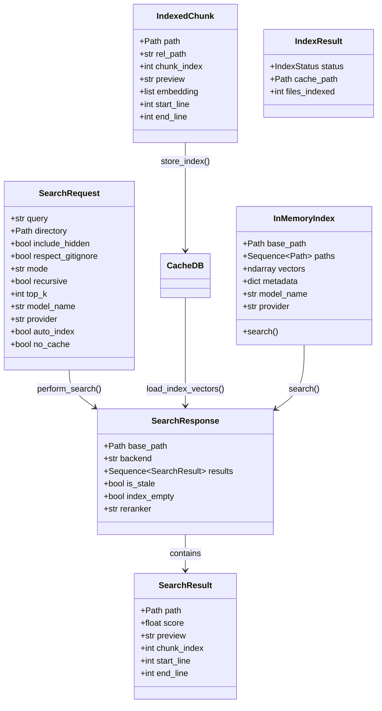
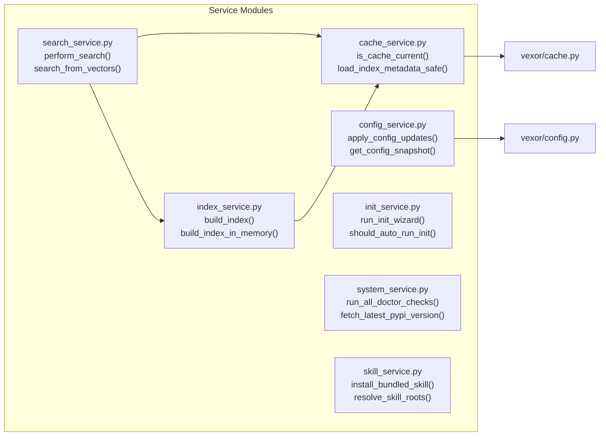
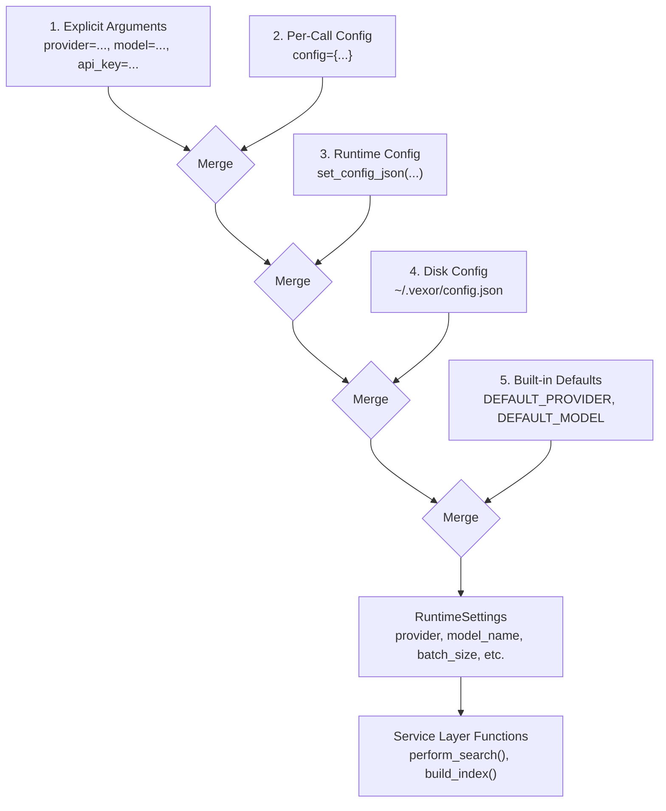
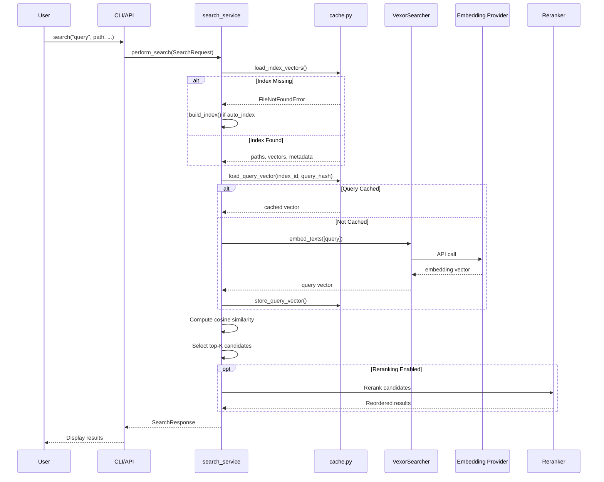
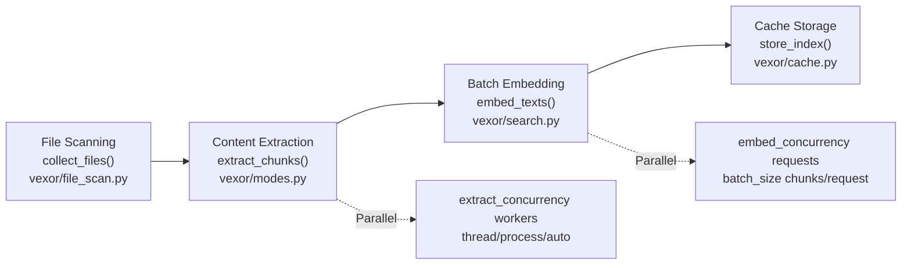

<!-- source: DeepWiki mcp.deepwiki.com · repo scarletkc/vexor · page 7.1 System Overview · fetched 2026-10-26 -->

# System Overview

<details>
<summary>Relevant source files</summary>

The following files were used as context for generating this wiki page:

- [README.md](README.md)
- [docs/api/python.md](docs/api/python.md)
- [tests/unit/test_api.py](tests/unit/test_api.py)
- [tests/unit/test_search_service.py](tests/unit/test_search_service.py)
- [vexor/api.py](vexor/api.py)
- [vexor/cli.py](vexor/cli.py)
- [vexor/services/search_service.py](vexor/services/search_service.py)

</details>


## Purpose and Scope

This document provides a high-level overview of Vexor's internal architecture, describing how major components are organized and interact. It focuses on the structural layers, core data types, and key architectural patterns that unify the system.

For detailed coverage of specific subsystems, see:
- User interface implementations → [User Interface Layer](#7.2)
- Service module responsibilities → [Service Layer](#7.3)
- Cache schema and operations → [Storage Layer](#7.4)
- Embedding provider abstractions → [Provider System](#7.5)
- File extraction strategies → [Content Processing Pipeline](#7.6)
- Configuration resolution logic → [Configuration System](#7.7)
- Search execution internals → [Search Execution Flow](#7.8)

---

## System Architecture Layers

Vexor is organized into five primary layers, each with distinct responsibilities:

### Layer Overview

| Layer | Primary Modules | Responsibility |
|-------|----------------|----------------|
| **Entry Point** | `vexor/cli.py`, `vexor/__init__.py` | User-facing interfaces (CLI, Python API, GUI, AI skills) |
| **API Wrapper** | `vexor/api.py` | Validation, normalization, configuration resolution |
| **Service** | `vexor/services/*.py` | Business logic for search, indexing, configuration, caching |
| **Storage** | `vexor/cache.py`, `vexor/config.py` | Persistent data management (SQLite cache, JSON config) |
| **Provider** | `vexor/providers/*.py`, `vexor/rerank/*.py` | Embedding and reranking backends |

**Sources:** [vexor/cli.py:1-100](), [vexor/api.py:1-100](), [vexor/services/search_service.py:1-60](), [vexor/cache.py](), [vexor/config.py](), README.md

---

## Component Architecture Diagram

The following diagram shows how the major layers and components connect, using actual code symbols from the codebase:



**Sources:** [vexor/cli.py:348-529](), [vexor/api.py:511-801](), [vexor/services/search_service.py:358-708](), [vexor/services/index_service.py](), [vexor/cache.py](), [vexor/config.py]()

---

## Core Data Structures

The system operates on several key data structures that flow between layers:

### Primary Request/Response Types



| Data Structure | Module | Purpose |
|---------------|--------|---------|
| `SearchRequest` | `vexor/services/search_service.py:33` | Encapsulates all search parameters |
| `SearchResponse` | `vexor/services/search_service.py:62` | Wraps search results with metadata |
| `SearchResult` | `vexor/search.py` | Individual result item with path, score, preview |
| `IndexedChunk` | `vexor/cache.py` | Unit of indexed content with embedding |
| `IndexResult` | `vexor/services/index_service.py` | Status of index build operation |
| `InMemoryIndex` | `vexor/api.py:74` | In-memory index with search capability |
| `Config` | `vexor/config.py` | Configuration settings dataclass |
| `RuntimeSettings` | `vexor/api.py:56` | Resolved configuration for a single operation |

**Sources:** [vexor/services/search_service.py:33-70](), [vexor/search.py](), [vexor/cache.py](), [vexor/api.py:56-91](), [vexor/config.py]()

---

## Entry Point Implementations

Each entry point provides the same core functionality through different interfaces:

### Entry Point Comparison

| Entry Point | Implementation | Key Functions | Target Users |
|-------------|---------------|---------------|--------------|
| **CLI** | [vexor/cli.py]() | `search()`, `index()`, `config()`, `init()` | Terminal users, shell scripts |
| **Python API** | [vexor/__init__.py](), [vexor/api.py]() | `search()`, `index()`, `index_in_memory()`, `VexorClient` | Python applications, notebooks |
| **Desktop GUI** | Electron app | UI tabs for search/index/config | Non-technical users |
| **AI Skills** | [plugins/vexor/skills/]() | Skill definitions for Claude/Codex | AI agents, autonomous workflows |

All entry points ultimately delegate to the same service layer functions, ensuring consistent behavior regardless of interface.

**Sources:** [vexor/cli.py:348-711](), [vexor/api.py:511-707](), [vexor/__init__.py](), README.md:108-115

---

## Service Layer Architecture

The service layer isolates business logic from interface concerns:



| Service | Primary Responsibilities | Key Functions |
|---------|-------------------------|---------------|
| `search_service.py` | Execute searches, reranking, cache integration | `perform_search()`, `search_from_vectors()` |
| `index_service.py` | Build/update indexes, parallel extraction | `build_index()`, `build_index_in_memory()` |
| `cache_service.py` | Validate cache freshness, metadata access | `is_cache_current()`, `load_index_metadata_safe()` |
| `config_service.py` | Apply config updates, snapshots | `apply_config_updates()`, `get_config_snapshot()` |
| `init_service.py` | Interactive setup wizard | `run_init_wizard()` |
| `system_service.py` | Diagnostics, version checks, updates | `run_all_doctor_checks()` |
| `skill_service.py` | AI agent skill installation | `install_bundled_skill()` |

**Sources:** [vexor/services/search_service.py:1-100](), [vexor/services/index_service.py](), [vexor/services/cache_service.py](), [vexor/services/config_service.py](), [vexor/services/init_service.py](), [vexor/services/system_service.py](), [vexor/services/skill_service.py]()

---

## Storage Layer Components

The storage layer manages persistent state through two primary mechanisms:

### Cache Database Schema

The SQLite database at `~/.vexor/index.db` stores:

| Table | Purpose | Key Columns |
|-------|---------|-------------|
| `index_metadata` | Index configuration and root path | `id`, `config_hash`, `root_path`, `model`, `mode`, `generated_at` |
| `indexed_chunk` | File chunk metadata | `index_id`, `path`, `chunk_index` |
| `chunk_embedding` | Vector embeddings (binary blobs) | `index_id`, `chunk_id`, `embedding_blob` |
| `chunk_meta` | Line numbers and previews | `chunk_id`, `start_line`, `end_line`, `preview` |
| `query_cache` | Cached query embeddings | `index_id`, `query_hash`, `query_text`, `embedding_blob` |
| `embedding_cache` | General text embeddings | `model`, `text_hash`, `embedding_blob`, `dimension` |

### Configuration File Structure

The JSON file at `~/.vexor/config.json` contains:

```json
{
  "provider": "openai",
  "model": "text-embedding-3-small",
  "api_key": null,
  "base_url": null,
  "batch_size": 0,
  "embed_concurrency": null,
  "extract_concurrency": null,
  "extract_backend": "auto",
  "embedding_dimensions": null,
  "auto_index": true,
  "local_cuda": false,
  "rerank": "off",
  "flashrank_model": null,
  "remote_rerank": {
    "base_url": null,
    "api_key": null,
    "model": null
  }
}
```

**Sources:** [vexor/cache.py](), [vexor/config.py](), [vexor/services/cache_service.py]()

---

## Configuration Resolution Flow

Configuration is resolved through a five-tier precedence system:



The `_resolve_settings()` function at [vexor/api.py:960]() implements this precedence logic, producing a `RuntimeSettings` object that contains all resolved values.

**Sources:** [vexor/api.py:960-1050](), [vexor/config.py:1-200](), [docs/api/python.md:40-51]()

---

## Key Architectural Patterns

### 1. Layered Delegation

Entry points never contain business logic. They validate input, resolve configuration, and delegate to service functions:

```
CLI (vexor/cli.py) → API Wrapper (vexor/api.py) → Service (vexor/services/*.py)
```

This separation allows multiple interfaces to share the same implementation.

### 2. Service Independence

Service modules do not import from entry points. They operate on request objects (`SearchRequest`, etc.) and return response objects. This enables:
- Testing without CLI/API overhead
- Alternative frontends (GUI, skills)
- Library embedding

### 3. Provider Abstraction

All embedding providers implement a common interface through `VexorSearcher` ([vexor/search.py]()), which routes to specific implementations in [vexor/providers/](). This allows transparent switching between OpenAI, Gemini, Voyage, custom, and local backends.

### 4. Cache Layering

The cache system uses three levels:
1. **Process-local LRU** (in-memory, 2048 entries)
2. **SQLite embedding cache** (persistent, text_hash → vector)
3. **SQLite query cache** (persistent, per-index query → vector)

This hierarchy minimizes redundant API calls while maintaining persistence.

### 5. Superset Index Reuse

When searching a directory without a matching index, `perform_search()` checks for a superset index (e.g., parent directory with `recursive=True`) and filters it in-memory. This reduces re-indexing overhead for subdirectory searches.

**Sources:** [vexor/services/search_service.py:358-708](), [vexor/search.py](), [vexor/cache.py](), [vexor/providers/]()

---

## Data Flow: Search Operation

A typical search flows through these stages:



**Sources:** [vexor/services/search_service.py:358-708](), [vexor/cache.py](), [vexor/search.py](), [vexor/cli.py:348-529]()

---

## Data Flow: Index Build

Index building proceeds through these phases:



The `build_index()` function at [vexor/services/index_service.py]() orchestrates these phases:
1. Scan directory for files matching filters
2. Extract content chunks based on mode (name/head/full/code/outline)
3. Embed chunks in parallel batches
4. Store vectors and metadata to SQLite

**Sources:** [vexor/services/index_service.py](), [vexor/file_scan.py](), [vexor/modes.py](), [vexor/search.py](), [vexor/cache.py]()

---

## Extension Points

The architecture provides several extension mechanisms:

### Custom Embedding Providers

Add new providers by implementing the interface in [vexor/providers/]() and updating `VexorSearcher` routing logic. The `custom` provider supports any OpenAI-compatible API.

### Custom Extraction Modes

Register new modes in [vexor/modes.py]() by implementing an extraction strategy class that yields `IndexedChunk` objects.

### Custom Rerankers

Add reranking strategies in [vexor/rerank/]() and update `perform_search()` reranking logic. Supported types: BM25 (built-in), FlashRank (local neural), remote (HTTP API).

### Alternative Frontends

Implement new entry points by importing service functions from [vexor/services/]() and handling configuration resolution. See [vexor/cli.py]() and [vexor/api.py]() as reference implementations.

**Sources:** [vexor/providers/](), [vexor/modes.py](), [vexor/rerank/](), [vexor/services/search_service.py:144-356]()

---

