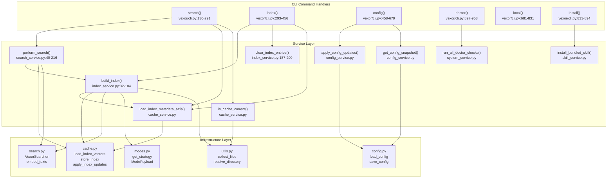
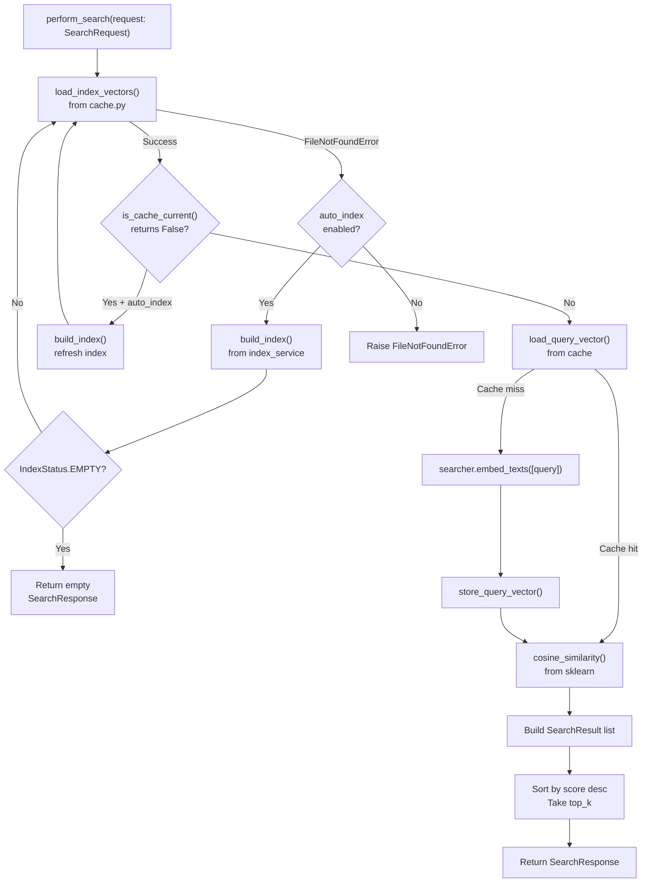
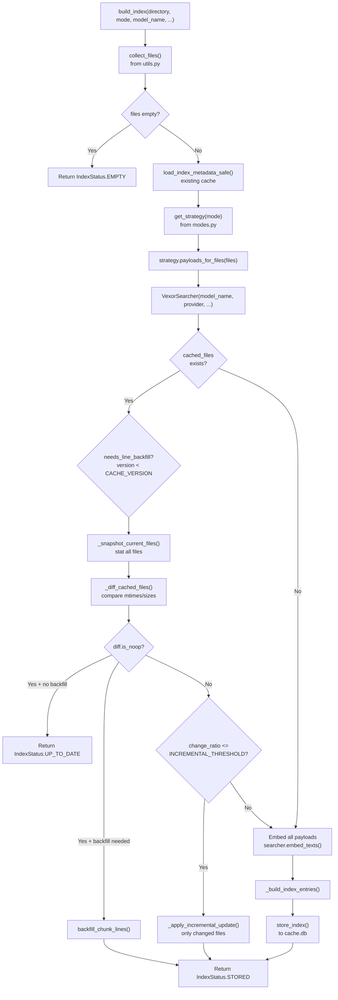
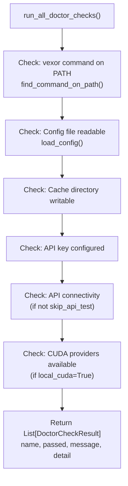

<!-- source: DeepWiki mcp.deepwiki.com · repo scarletkc/vexor · page 7.3 Service Layer · fetched 2026-10-26 -->

# Service Layer

<details>
<summary>Relevant source files</summary>

The following files were used as context for generating this wiki page:

- [docs/roadmap.md](docs/roadmap.md)
- [tests/integration/test_cli_commands.py](tests/integration/test_cli_commands.py)
- [tests/unit/test_cache_upgrade_and_lines.py](tests/unit/test_cache_upgrade_and_lines.py)
- [tests/unit/test_index_service.py](tests/unit/test_index_service.py)
- [tests/unit/test_query_cache.py](tests/unit/test_query_cache.py)
- [tests/unit/test_search_service.py](tests/unit/test_search_service.py)
- [tests/unit/test_system_service.py](tests/unit/test_system_service.py)
- [vexor/services/search_service.py](vexor/services/search_service.py)
- [vexor/services/system_service.py](vexor/services/system_service.py)

</details>


The Service Layer implements Vexor's core business logic as a collection of pure functions organized into domain-specific modules. Each service module exposes stateless functions that orchestrate operations across the infrastructure layer (cache, configuration, embedding providers) while maintaining clear separation from the CLI presentation layer. The services handle search execution, index building, configuration management, system diagnostics, and AI agent skill installation.

For CLI command routing and user interaction, see [CLI Layer](#5.2). For SQLite cache implementation details, see [Storage Layer](#5.4). For mode-specific content extraction, see [Mode System](#5.5).

---

## Service Module Organization

Vexor's service layer is organized into six domain-specific modules under `vexor/services/`:

| Module | Primary Functions | Responsibility |
|--------|------------------|----------------|
| `search_service.py` | `perform_search` | Execute semantic search queries with auto-indexing |
| `index_service.py` | `build_index`, `clear_index_entries` | Build and manage file indices with incremental updates |
| `config_service.py` | `apply_config_updates`, `get_config_snapshot` | Persist and retrieve configuration settings |
| `system_service.py` | `run_all_doctor_checks`, `fetch_latest_pypi_version`, `run_upgrade_commands` | System diagnostics and version management |
| `cache_service.py` | `is_cache_current`, `load_index_metadata_safe` | Cache validation and metadata retrieval |
| `skill_service.py` | `install_bundled_skill`, `resolve_skill_roots` | AI agent skill installation |

All service functions follow a stateless design pattern: they accept explicit parameters and return structured responses without maintaining internal state. This enables straightforward testing and composition.

**Sources**: [vexor/cli.py:1-59]() (service imports), [vexor/services/search_service.py:1-217](), [vexor/services/index_service.py:1-425]()

---

## Service Layer Architecture



The CLI commands delegate business logic to service functions, which orchestrate operations across infrastructure modules. Services never directly depend on CLI presentation logic (Rich tables, Typer options), and infrastructure modules never make decisions about business rules (when to rebuild an index, which files changed).

**Sources**: [vexor/cli.py:130-894]() (command-to-service mappings), [vexor/services/search_service.py:40-216](), [vexor/services/index_service.py:32-184]()

---

## Search Service

The `search_service` module implements semantic search execution with automatic index management.

### Core Function: `perform_search`



**Function signature**:

```python
def perform_search(request: SearchRequest) -> SearchResponse
```

The function accepts a `SearchRequest` dataclass (defined at [vexor/services/search_service.py:12-28]()) containing query parameters, directory path, indexing configuration, and provider settings. It returns a `SearchResponse` dataclass ([vexor/services/search_service.py:31-37]()) with ranked results, staleness indicator, and backend information.

### Auto-Indexing Logic

The service implements two-tier auto-indexing:

1. **Missing Index**: If `load_index_vectors` raises `FileNotFoundError` and `request.auto_index` is `True`, call `build_index` to create a new index ([vexor/services/search_service.py:62-77]())

2. **Stale Index**: After loading vectors, check `is_cache_current()`. If stale and `auto_index` is enabled, rebuild the index ([vexor/services/search_service.py:98-148]())

This enables seamless first-run experience (CLI search without explicit indexing) and automatic refresh when files change.

### Query Vector Caching

To optimize repeated queries, the service implements query-level caching:

1. Generate `query_hash = query_cache_key(query, model_name)` ([vexor/services/search_service.py:173]())
2. Attempt `load_query_vector(index_id, query_hash)` ([vexor/services/search_service.py:175]())
3. On cache miss, embed query and `store_query_vector()` ([vexor/services/search_service.py:183-188]())

This avoids redundant API calls when users iterate on search queries.

### Result Scoring and Ranking

The service uses `cosine_similarity` from sklearn to score all chunks against the query vector ([vexor/services/search_service.py:189-192]()), then constructs `SearchResult` objects with chunk metadata (preview, line numbers, chunk index) from the cache's `chunk_entries` ([vexor/services/search_service.py:194-207]()). Results are sorted by score descending and sliced to `request.top_k` ([vexor/services/search_service.py:208-209]()).

**Sources**: [vexor/services/search_service.py:40-216](), [vexor/cli.py:130-291]()

---

## Index Service

The `index_service` module manages file indexing with support for incremental updates and staleness detection.

### Core Function: `build_index`



**Function signature**:

```python
def build_index(
    directory: Path,
    include_hidden: bool,
    respect_gitignore: bool,
    mode: str,
    recursive: bool,
    model_name: str,
    batch_size: int,
    provider: str,
    base_url: str | None,
    api_key: str | None,
    local_cuda: bool,
    extensions: Sequence[str] | None,
) -> IndexResult
```

Returns an `IndexResult` dataclass ([vexor/services/index_service.py:25-29]()) indicating whether the operation was a no-op (`UP_TO_DATE`), handled no files (`EMPTY`), or persisted data (`STORED`).

### Incremental Update Algorithm

The service implements cost-optimized incremental updates to avoid re-embedding unchanged files:

1. **Snapshot Current State**: Call `_snapshot_current_files()` to stat all discovered files, capturing `mtime` and `size` ([vexor/services/index_service.py:239-255]())

2. **Compute Diff**: `_diff_cached_files()` compares current snapshot against cached metadata, producing `FileDiff` with `added`, `modified`, and `removed` lists ([vexor/services/index_service.py:258-276]())

3. **Staleness Detection**: `_has_entry_changed()` uses mtime tolerance (`MTIME_TOLERANCE = 0.5 seconds`) and size comparison to minimize false positives from filesystem quirks ([vexor/services/index_service.py:279-290]())

4. **Threshold Decision**: If `change_ratio <= INCREMENTAL_CHANGE_THRESHOLD` (0.5), proceed with incremental update. Otherwise, full rebuild is more efficient ([vexor/services/index_service.py:124-139]())

5. **Apply Updates**: `_apply_incremental_update()` only embeds changed files, then calls `apply_index_updates()` from cache module to merge changes ([vexor/services/index_service.py:293-341]())

### Version Migration: Line Metadata Backfill

The service handles cache schema evolution through `_has_missing_line_metadata()` ([vexor/services/index_service.py:352-385]()). When cache version < `CACHE_VERSION` or chunks lack `start_line`/`end_line` fields, the service calls `backfill_chunk_lines()` to update metadata without re-embedding ([vexor/services/index_service.py:107-116]()). This enables graceful upgrades when new modes (like `code` or `outline`) introduce line number tracking.

### Index Entry Construction

The `_build_index_entries()` helper ([vexor/services/index_service.py:388-411]()) constructs `IndexedChunk` dataclasses from `ModePayload` objects and embeddings. It:

- Computes relative paths via `_relative_to_root()` ([vexor/services/index_service.py:344-349]())
- Retrieves filesystem metadata via `_stat_for_path()` with caching ([vexor/services/index_service.py:414-424]())
- Packages chunk metadata (preview text, line ranges, chunk index) alongside embedding vectors

**Sources**: [vexor/services/index_service.py:32-425](), [vexor/cli.py:293-456]()

---

## Configuration Service

The `config_service` module manages persistent configuration through `~/.vexor/config.json`.

### Core Functions

| Function | Signature | Purpose |
|----------|-----------|---------|
| `apply_config_updates` | `(**kwargs) -> UpdateResult` | Persist configuration changes atomically |
| `get_config_snapshot` | `() -> Config` | Load current configuration with environment fallbacks |

The `apply_config_updates` function ([vexor/cli.py:570-579]() shows usage) accepts optional keyword arguments for each configurable field (`api_key`, `model`, `batch_size`, `provider`, `base_url`, `auto_index`, `local_cuda`) and returns an `UpdateResult` indicating which fields were modified.

### Configuration Resolution Hierarchy

Configuration values follow a three-tier resolution:

1. **Config File**: `~/.vexor/config.json` (highest priority)
2. **Environment Variables**: `VEXOR_API_KEY`, `OPENAI_API_KEY`, `GOOGLE_GENAI_API_KEY`
3. **Hardcoded Defaults**: `DEFAULT_MODEL`, `DEFAULT_PROVIDER`, `DEFAULT_BATCH_SIZE`

The `get_config_snapshot` function loads the JSON file and applies environment variable fallbacks as defined in `vexor/config.py`.

**Sources**: [vexor/cli.py:458-679]() (config command implementation), references to `apply_config_updates` and `get_config_snapshot`

---

## System Service

The `system_service` module provides diagnostics and version management.

### Doctor Checks



The `run_all_doctor_checks()` function returns a list of `DoctorCheckResult` dataclasses, each containing:

- `name`: Check identifier (e.g., "Command", "Config", "API Key")
- `passed`: Boolean success indicator
- `message`: User-facing summary
- `detail`: Optional error details for failures

The CLI's `doctor` command ([vexor/cli.py:897-958]()) iterates over results and formats them with colored icons (✓/✗).

### Version Management Functions

| Function | Purpose |
|----------|---------|
| `fetch_latest_pypi_version()` | Query PyPI JSON API for latest release |
| `parse_version()` | Parse semantic version strings into comparable tuples |
| `detect_install_method()` | Identify installation type (pip, pipx, standalone, editable) |
| `build_upgrade_commands()` | Generate appropriate upgrade commands for install method |
| `run_upgrade_commands()` | Execute upgrade commands via subprocess |

The update workflow (implemented in [vexor/cli.py:960-1063]()) uses these functions to provide install-method-specific upgrade instructions.

**Sources**: [vexor/cli.py:897-1063]() (doctor and update commands), references to system_service imports at [vexor/cli.py:35-49]()

---

## Cache Service

The `cache_service` module provides high-level cache operations without exposing SQLite internals.

### Core Functions

```python
def load_index_metadata_safe(
    directory: Path,
    model: str,
    include_hidden: bool,
    respect_gitignore: bool,
    mode: str,
    recursive: bool,
    extensions: Sequence[str] | None = None,
) -> dict | None
```

Returns metadata dictionary or `None` if cache entry doesn't exist. Used by CLI to check whether index exists before search ([vexor/cli.py:203-211]()) and by index service to check for incremental update opportunities ([vexor/services/index_service.py:64-72]()).

```python
def is_cache_current(
    directory: Path,
    include_hidden: bool,
    respect_gitignore: bool,
    file_snapshot: list[dict],
    recursive: bool = True,
    extensions: Sequence[str] | None = None,
) -> bool
```

Validates cache freshness by comparing cached file metadata (`mtime`, `size`) against current filesystem state. Returns `False` if any files changed, were added, or were removed. Used by search service's staleness detection ([vexor/services/search_service.py:98-105]()).

### Staleness Detection Algorithm

1. Collect current files via `collect_files()` with same parameters used to build the cache
2. Convert `file_snapshot` (list of dicts) into lookup map by relative path
3. For each current file:
   - Check if missing from cache → stale
   - Compare mtime (with tolerance) and size → if different, stale
4. For each cached file:
   - Check if missing from current directory → stale

This ensures the cache accurately reflects filesystem state for a given configuration.

**Sources**: [vexor/cli.py:203-222]() (CLI usage), [vexor/services/search_service.py:9]() (import statement), [vexor/services/index_service.py:11]() (import statement)

---

## Skill Service

The `skill_service` module manages AI agent skill installation.

### Core Functions

```python
def resolve_skill_roots(platform_spec: str) -> list[Path]
```

Parses platform specification (e.g., "claude/codex" or "/custom/path") and returns list of skill directory paths. Supports platform presets:

- `claude` → `~/.claude/skills/`
- `codex` → `~/.codex/skills/`

Multiple platforms can be specified with `/` separator ([vexor/cli.py:850]()).

```python
def install_bundled_skill(
    skill_name: str,
    skills_dir: Path,
    force: bool = False,
) -> SkillInstallResult
```

Copies bundled skill from `_bundled_skills` directory (embedded in executable/package) to target directory. Performs integrity check by comparing file contents:

- If destination exists and content matches → `SkillInstallStatus.up_to_date`
- If destination exists and content differs → `FileExistsError` (unless `force=True`)
- If destination doesn't exist → Copy files, return `SkillInstallStatus.installed`

The install command ([vexor/cli.py:833-894]()) iterates over platform roots and calls `install_bundled_skill` for each, handling errors per-destination.

**Sources**: [vexor/cli.py:833-894]() (install command), [vexor/cli.py:50-55]() (skill_service imports)

---

## Request/Response Dataclasses

The service layer uses dataclasses for structured data exchange, avoiding primitive obsession and enabling type checking.

### SearchRequest

```python
@dataclass(slots=True)
class SearchRequest:
    query: str
    directory: Path
    include_hidden: bool
    respect_gitignore: bool
    mode: str
    recursive: bool
    top_k: int
    model_name: str
    batch_size: int
    provider: str
    base_url: str | None
    api_key: str | None
    local_cuda: bool
    extensions: tuple[str, ...]
    auto_index: bool = True
```

Encapsulates all parameters needed for `perform_search`. The CLI constructs this from command options ([vexor/cli.py:232-248]()).

### SearchResponse

```python
@dataclass(slots=True)
class SearchResponse:
    base_path: Path
    backend: str | None  # e.g., "cuda:0", "cpu"
    results: Sequence[SearchResult]
    is_stale: bool
    index_empty: bool
```

Returned by `perform_search`. The `is_stale` flag enables warning messages without blocking search execution ([vexor/cli.py:271-276]()).

### IndexResult

```python
@dataclass(slots=True)
class IndexResult:
    status: IndexStatus  # EMPTY, UP_TO_DATE, STORED
    cache_path: Path | None
    files_indexed: int
```

Returned by `build_index`. The CLI uses `status` to determine success messages ([vexor/cli.py:446-455]()).

### DoctorCheckResult

```python
@dataclass
class DoctorCheckResult:
    name: str
    passed: bool
    message: str
    detail: str | None = None
```

Used by `run_all_doctor_checks` to return structured diagnostic results. The CLI formats these with icons and colors ([vexor/cli.py:942-951]()).

**Sources**: [vexor/services/search_service.py:12-37](), [vexor/services/index_service.py:19-29](), [vexor/cli.py:36]() (DoctorCheckResult import)

---

## Service Integration Patterns

### Pattern 1: Service-to-Service Calls

Services can call other services to implement complex workflows. Example: `perform_search` calls `build_index` when auto-indexing is needed:

```python
# In perform_search (search_service.py:64-77)
if not request.auto_index:
    raise
result = build_index(
    request.directory,
    include_hidden=request.include_hidden,
    # ... other parameters
)
```

This follows the dependency direction: search service depends on index service, not vice versa.

### Pattern 2: Infrastructure Module Delegation

Services delegate to infrastructure modules for I/O operations:

```python
# In build_index (index_service.py:53-59)
files = collect_files(  # from utils.py
    directory,
    include_hidden=include_hidden,
    # ...
)

# In build_index (index_service.py:170-179)
cache_path = store_index(  # from cache.py
    root=directory,
    model=model_name,
    # ...
)
```

Services orchestrate, infrastructure modules execute.

### Pattern 3: Stateless Transformation

All services are pure functions: no global state, no instance methods. Example transformation:

```
User Query
  ↓ (SearchRequest)
perform_search()
  ↓ (SearchResponse)
CLI Rendering
```

This enables testing without mocks ([tests/integration/test_cli.py:34-81]() shows monkeypatching entire service functions).

**Sources**: [vexor/services/search_service.py:40-216]() (service-to-service calls), [vexor/services/index_service.py:32-184]() (infrastructure delegation), [tests/integration/test_cli.py:34-81]() (testing patterns)

---

