<!-- source: DeepWiki mcp.deepwiki.com · repo scarletkc/vexor · page 7.4 Storage Layer · fetched 2026-10-26 -->

# Storage Layer

<details>
<summary>Relevant source files</summary>

The following files were used as context for generating this wiki page:

- [docs/roadmap.md](docs/roadmap.md)
- [tests/unit/test_cache.py](tests/unit/test_cache.py)
- [tests/unit/test_cache_upgrade_and_lines.py](tests/unit/test_cache_upgrade_and_lines.py)
- [tests/unit/test_index_service.py](tests/unit/test_index_service.py)
- [vexor/cache.py](vexor/cache.py)

</details>


This document provides a detailed technical overview of Vexor's persistent storage system, which is built on SQLite. The storage layer manages all index data, embedding vectors, and metadata through a normalized relational schema with optimizations for semantic search workloads.

For high-level architecture context, see [System Overview](#7.1). For information about how indexes are built and updated, see [Content Processing Pipeline](#7.6). For search execution that reads from this storage, see [Search Execution Flow](#7.8).

## Overview

Vexor's storage layer is implemented in [vexor/cache.py]() and provides a persistent SQLite-backed cache for:

- **Index vectors**: File embeddings and associated metadata
- **Query vectors**: Cached query embeddings per index
- **Embedding cache**: Reusable text embeddings across indexes
- **File snapshots**: Metadata for incremental update detection

The storage system uses a single shared database file (`~/.vexor/index.db`) for all indexes, with multi-tier caching to minimize disk I/O and embedding API calls.

**Key design principles:**

| Principle | Implementation |
|-----------|----------------|
| Normalized schema | Separate tables for metadata, files, chunks, and embeddings |
| Incremental updates | Add/modify/delete operations without full rebuilds |
| Cache reuse | Embeddings cached at multiple levels (memory, SQLite) |
| Dimension awareness | Cache keys include embedding dimension to prevent pollution |
| Schema evolution | Version tracking with automatic upgrades |

Sources: [vexor/cache.py:1-31]()

## Database File Management

### Cache Directory Resolution

The database location is determined by a resolution hierarchy:

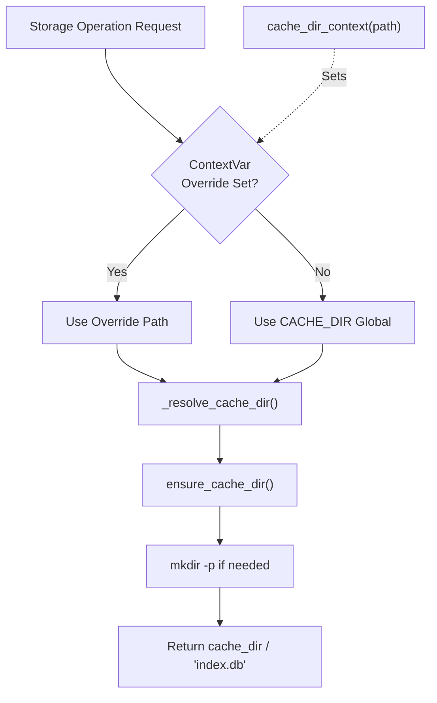

**Cache Directory Context Manager**

The `cache_dir_context()` function ([vexor/cache.py:197-211]()) allows temporary cache directory overrides using Python's `ContextVar` mechanism. This enables isolation for testing or per-session configuration:

```python
# Default location: ~/.vexor/index.db
# Override for specific operation:
with cache_dir_context("/tmp/vexor-test"):
    store_index(...)  # Uses /tmp/vexor-test/index.db
```

**Key functions:**

- `ensure_cache_dir()` - Creates cache directory if missing ([vexor/cache.py:214-217]())
- `cache_db_path()` - Returns absolute path to SQLite database ([vexor/cache.py:231-235]())
- `set_cache_dir()` - Sets global default cache directory ([vexor/cache.py:220-228]())

Sources: [vexor/cache.py:21-28](), [vexor/cache.py:192-235](), [tests/unit/test_cache.py:87-92]()

## SQLite Schema Design

### Entity-Relationship Model

```mermaid
erDiagram
    index_metadata ||--o{ indexed_file : "has files"
    index_metadata ||--o{ query_cache : "has queries"
    indexed_file ||--o{ indexed_chunk : "has chunks"
    indexed_chunk ||--|| chunk_embedding : "has vector"
    indexed_chunk ||--|| chunk_meta : "has metadata"
    
    index_metadata {
        int id PK
        text cache_key "Hash of index config"
        text root_path "Absolute directory path"
        text model "Embedding model name"
        int include_hidden "Flag 0 or 1"
        int respect_gitignore "Flag 0 or 1"
        int recursive "Flag 0 or 1"
        text mode "Index mode"
        int dimension "Vector dimension"
        int version "Schema version"
        text generated_at "ISO timestamp"
        text exclude_patterns "Newline-separated"
        text extensions "Comma-separated"
    }
    
    indexed_file {
        int id PK
        int index_id FK
        text rel_path "Relative to root"
        text abs_path "Absolute path"
        int size_bytes "File size"
        real mtime "Modification time"
    }
    
    indexed_chunk {
        int id PK
        int index_id FK
        int file_id FK
        int chunk_index "Within file"
        int position "Global ordering"
    }
    
    chunk_embedding {
        int chunk_id PK_FK
        blob vector_blob "Float32 array bytes"
    }
    
    chunk_meta {
        int chunk_id PK_FK
        text preview "Display text"
        text label_hash "Cache key for label"
        int start_line "Nullable"
        int end_line "Nullable"
    }
    
    query_cache {
        int id PK
        int index_id FK
        text query_hash "SHA1 of query+model"
        text query_text "Original query"
        blob query_vector "Float32 array bytes"
        text created_at "ISO timestamp"
    }
    
    embedding_cache {
        int id PK
        text model "Embedding model"
        text text_hash "SHA1 of text+dimension"
        blob vector_blob "Float32 array bytes"
        text created_at "ISO timestamp"
    }
```

**Schema Initialization**

The schema is created lazily on first write via `_ensure_schema()` ([vexor/cache.py:314-399]()). Legacy schemas are detected and reset to prevent corruption ([vexor/cache.py:289-311]()).

**Index Definitions**

Performance-critical indexes are created automatically:

| Index Name | Table | Columns | Purpose |
|------------|-------|---------|---------|
| `idx_indexed_chunk_order` | `indexed_chunk` | `(index_id, position)` | Fast sequential loading |
| `idx_indexed_file_lookup` | `indexed_file` | `(index_id, rel_path)` | File existence checks |
| `idx_query_cache_lookup` | `query_cache` | `(index_id, query_hash)` | Query cache hits |
| `idx_embedding_cache_lookup` | `embedding_cache` | `(model, text_hash)` | Embedding cache hits |

**Foreign Key Cascade**

The schema uses `ON DELETE CASCADE` to ensure referential integrity. Deleting an `index_metadata` row automatically removes all associated files, chunks, embeddings, and queries.

Sources: [vexor/cache.py:314-399](), [vexor/cache.py:289-311]()

### Connection Management

```mermaid
graph LR
    Connect["_connect(db_path)"]
    Connect --> Mode{"readonly or<br/>query_only?"}
    Mode -->|Yes| OpenRO["Open with mode=ro URI"]
    Mode -->|No| OpenRW["Open read-write"]
    OpenRO --> SetPragmas["Configure PRAGMAs"]
    OpenRW --> SetPragmas
    
    SetPragmas --> WAL["PRAGMA journal_mode = WAL"]
    WAL --> Sync["PRAGMA synchronous = NORMAL"]
    Sync --> Temp["PRAGMA temp_store = MEMORY"]
    Temp --> Timeout["PRAGMA busy_timeout = 5000"]
    Timeout --> FK["PRAGMA foreign_keys = ON"]
    FK --> QueryOnly{"query_only?"}
    QueryOnly -->|Yes| SetQO["PRAGMA query_only = ON"]
    QueryOnly -->|No| Done["Return Connection"]
    SetQO --> Done
```

**Connection Configuration**

The `_connect()` function ([vexor/cache.py:243-266]()) establishes SQLite connections with optimized settings:

| PRAGMA | Value | Purpose |
|--------|-------|---------|
| `journal_mode` | `WAL` | Write-Ahead Logging for concurrent reads during writes |
| `synchronous` | `NORMAL` | Balance durability vs performance |
| `temp_store` | `MEMORY` | Keep temporary tables in RAM |
| `busy_timeout` | `5000` | Wait up to 5s for locks instead of failing immediately |
| `foreign_keys` | `ON` | Enforce referential integrity |
| `query_only` | `ON` | Prevent writes when readonly=True |

WAL mode allows multiple readers to access the database simultaneously while a writer is active, improving concurrency for search operations.

Sources: [vexor/cache.py:243-266]()

## Storage Operations

### Index Creation: store_index()

The `store_index()` function ([vexor/cache.py:402-584]()) performs a full index write operation:

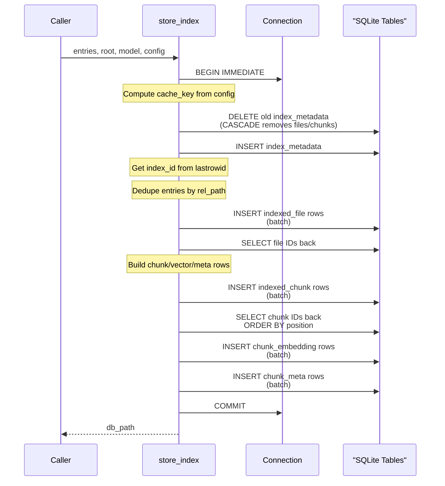

**Key steps:**

1. **Cache key computation** - Hash of all index configuration parameters ([vexor/cache.py:418-426]())
2. **Delete existing** - Remove old index with same cache_key and model ([vexor/cache.py:437-440]())
3. **Insert metadata** - Create `index_metadata` row ([vexor/cache.py:441-473]())
4. **Insert files** - Batch insert deduplicated `indexed_file` rows ([vexor/cache.py:475-504]())
5. **Retrieve file IDs** - Query back auto-generated IDs in chunks of 900 ([vexor/cache.py:506-519]())
6. **Insert chunks** - Write `indexed_chunk`, `chunk_embedding`, and `chunk_meta` rows ([vexor/cache.py:521-580]())

**Batch size limit (900)**: The code uses `_chunk_values(rel_paths, 900)` to avoid SQLite's 999 variable limit in parameterized queries.

Sources: [vexor/cache.py:402-584](), [vexor/cache.py:187-189]()

### Incremental Updates: apply_index_updates()

The `apply_index_updates()` function ([vexor/cache.py:587-880]()) applies surgical modifications to existing indexes:

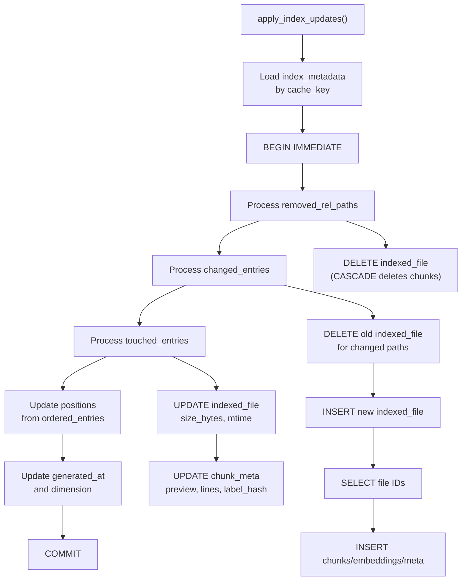

**Update types:**

| Parameter | Purpose | Operation |
|-----------|---------|-----------|
| `removed_rel_paths` | Deleted files | `DELETE FROM indexed_file WHERE ...` (cascades) |
| `changed_entries` | Modified files | Delete old file rows, insert new chunks with embeddings |
| `touched_entries` | Metadata-only changes | Update file attributes and chunk metadata without re-embedding |
| `ordered_entries` | Position reordering | Update `indexed_chunk.position` for result ordering |

**Optimization: touched_entries**

For files where only metadata changed (e.g., whitespace modifications that don't affect embeddings), `touched_entries` updates file size/mtime and chunk metadata without re-computing vectors. This is used when embeddings are reused from cache.

Sources: [vexor/cache.py:587-880](), [tests/unit/test_cache.py:391-458]()

### Index Loading: load_index() and load_index_vectors()

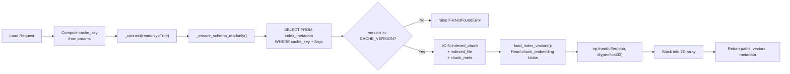

**Function responsibilities:**

- `load_index()` ([vexor/cache.py:991-1107]()) - Returns full metadata dict with file/chunk info
- `load_index_vectors()` ([vexor/cache.py:1110-1184]()) - Returns (paths, vectors, metadata) optimized for search
- `load_chunk_metadata()` ([vexor/cache.py:1187-1231]()) - Returns preview/line info for specific chunk IDs

**Version check**: If `index_metadata.version < CACHE_VERSION`, the cache is considered stale and `FileNotFoundError` is raised ([vexor/cache.py:1037-1039]()).

**Vector deserialization**:
```python
# chunk_embedding.vector_blob stores float32 bytes
vector = np.frombuffer(row["vector_blob"], dtype=np.float32)
```

Sources: [vexor/cache.py:991-1231](), [tests/unit/test_cache.py:35-84]()

### Schema Upgrades: backfill_chunk_lines()

The `backfill_chunk_lines()` function ([vexor/cache.py:883-988]()) updates line number metadata for existing indexes:

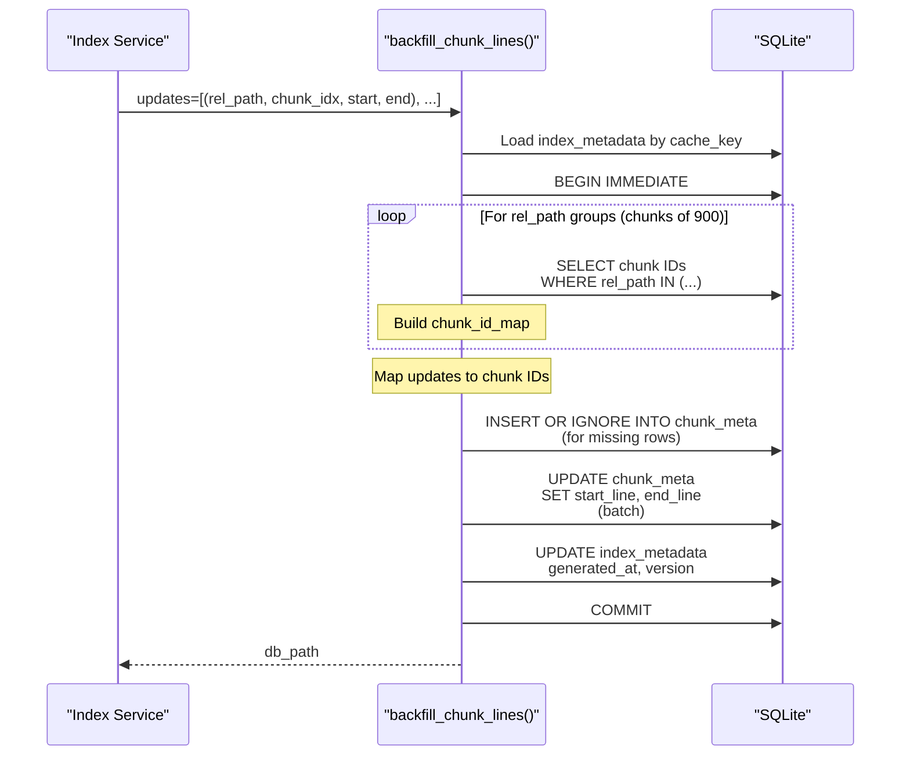

This operation is used when:
1. Old caches lack `start_line`/`end_line` metadata
2. Extraction strategy changes require line number updates
3. Cache version upgrades need metadata enrichment

Sources: [vexor/cache.py:883-988](), [tests/unit/test_index_service.py:142-211]()

### Cache Cleanup Operations

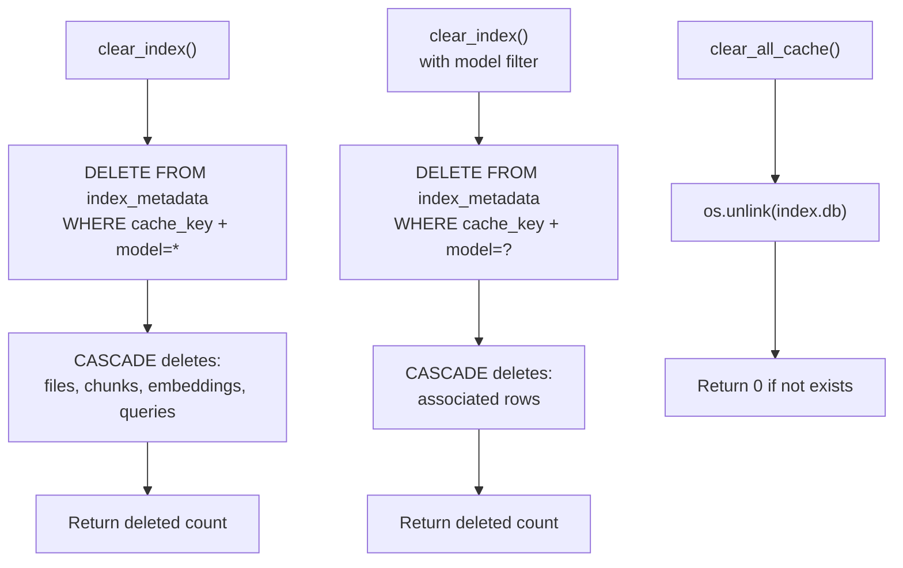

**Functions:**

| Function | Parameters | Behavior |
|----------|-----------|----------|
| `clear_index()` | root, config flags, optional model | Deletes indexes matching cache_key (all models if model=None) |
| `clear_all_cache()` | none | Deletes entire database file |

Sources: [vexor/cache.py:1234-1296](), [tests/unit/test_cache.py:301-354](), [tests/unit/test_cache.py:588-620]()

## Caching Strategy

### Three-Tier Cache Hierarchy

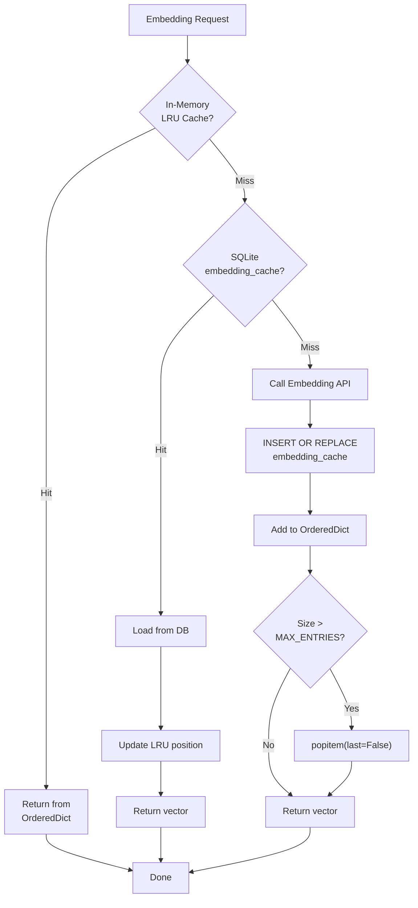

**Cache levels:**

1. **In-memory LRU** - `OrderedDict` with max 2048 entries ([vexor/cache.py:31-33]())
2. **SQLite** - `embedding_cache` table with TTL pruning
3. **Provider API** - Fallback to remote embedding service

**Configuration constants:**

| Constant | Default | Purpose |
|----------|---------|---------|
| `EMBED_MEMORY_CACHE_MAX_ENTRIES` | 2048 | In-memory cache size |
| `EMBED_CACHE_TTL_DAYS` | 30 | SQLite cache expiration |
| `EMBED_CACHE_MAX_ENTRIES` | 50,000 | SQLite cache capacity |

Sources: [vexor/cache.py:29-34]()

### Memory Cache Implementation

**LRU with dimension awareness:**

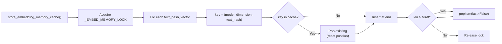

**Key features:**

- **Thread-safe**: Uses `threading.Lock` for concurrent access ([vexor/cache.py:34]())
- **LRU ordering**: `OrderedDict` with `popitem(last=False)` evicts oldest entries ([vexor/cache.py:157-158]())
- **Move-to-end on access**: Re-inserts accessed items to mark as recently used ([vexor/cache.py:132]())
- **Dimension-aware keys**: Tuple `(model, dimension, text_hash)` prevents cross-dimension pollution ([vexor/cache.py:128](), [vexor/cache.py:153]())

Sources: [vexor/cache.py:108-159](), [tests/unit/test_cache.py:108-123]()

### SQLite Embedding Cache

**Storage and retrieval:**

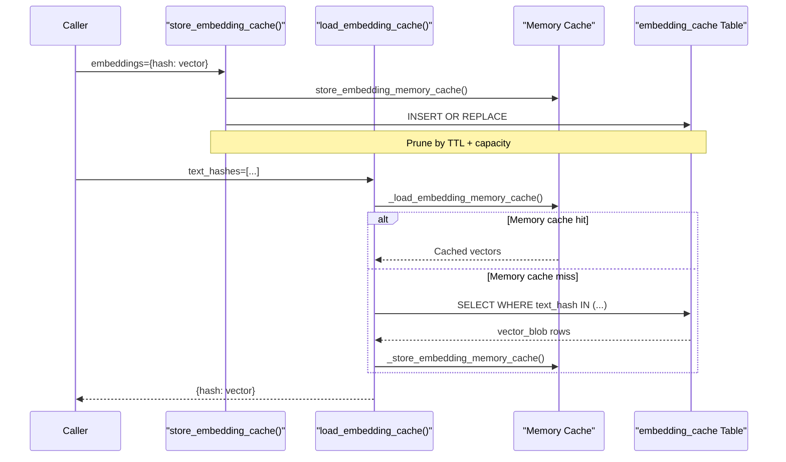

**Pruning logic** ([vexor/cache.py:1299-1366]()):

1. Delete entries older than `EMBED_CACHE_TTL_DAYS`
2. If count still exceeds `EMBED_CACHE_MAX_ENTRIES`, delete oldest by `created_at`

**Dimension-aware hashing:**

The `embedding_cache_key()` function includes dimension in the hash to prevent collisions between different embedding sizes:

```python
# Different hashes for same text at different dimensions
hash_512 = embedding_cache_key("hello", dimension=512)   # "abc123..."
hash_1024 = embedding_cache_key("hello", dimension=1024) # "def456..."
```

Sources: [vexor/cache.py:1299-1366](), [vexor/cache.py:92-106](), [tests/unit/test_cache.py:189-254]()

### Query Cache

The `query_cache` table stores query embeddings per index to avoid re-embedding frequently used queries:

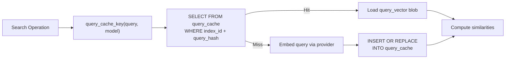

**Key normalization**: Model names are normalized to remove provider prefixes ([vexor/cache.py:74-80]()):

```python
"openai/text-embedding-3-small" → "text-embedding-3-small"
"gemini/text-embedding-004" → "text-embedding-004"
```

This allows query cache hits across different provider configurations using the same underlying model.

Sources: [vexor/cache.py:83-89](), [vexor/cache.py:1369-1427]()

## Performance Optimizations

### Batch Operations

The storage layer uses batch operations extensively to minimize SQLite round-trips:

| Operation | Batch Function | Batch Size |
|-----------|---------------|------------|
| Insert files | `executemany()` | All files in index |
| Insert chunks | `executemany()` | All chunks in index |
| Insert embeddings | `executemany()` | All embeddings in index |
| Query file IDs | `SELECT ... IN (...)` | 900 paths per query |
| Update positions | `executemany()` | All reordered chunks |

**Variable limit workaround**: SQLite has a default limit of 999 variables per query. The code uses `_chunk_values(values, 900)` to stay safely below this limit when building `IN (...)` clauses ([vexor/cache.py:187-189](), [vexor/cache.py:508]()).

Sources: [vexor/cache.py:493-580]()

### WAL Mode Benefits

Write-Ahead Logging provides significant concurrency improvements:

| Scenario | Without WAL | With WAL |
|----------|-------------|----------|
| Multiple searches during index | Blocked by writer | Concurrent reads allowed |
| Index update during search | Readers block writer | Writer proceeds, readers use last commit |
| Database size | Compact | +WAL file overhead |

WAL is enabled via `PRAGMA journal_mode = WAL` ([vexor/cache.py:256]()). The `PRAGMA synchronous = NORMAL` setting balances durability with performance ([vexor/cache.py:260]()).

Sources: [vexor/cache.py:243-266]()

### Connection Pooling Behavior

Each operation opens a fresh connection, but SQLite's `busy_timeout = 5000` PRAGMA provides implicit coordination:

- If a write lock is held, subsequent writers wait up to 5 seconds before raising `sqlite3.OperationalError`
- Prevents "database is locked" errors in concurrent scenarios
- Readers never block each other in WAL mode

Sources: [vexor/cache.py:262]()

### Index Query Optimization

The schema includes strategic indexes for common query patterns:

```sql
-- Fast sequential loading of chunks for search
CREATE INDEX idx_indexed_chunk_order ON indexed_chunk(index_id, position);

-- Fast file lookups during incremental updates
CREATE INDEX idx_indexed_file_lookup ON indexed_file(index_id, rel_path);

-- Fast query cache hits
CREATE INDEX idx_query_cache_lookup ON query_cache(index_id, query_hash);

-- Fast embedding cache hits
CREATE INDEX idx_embedding_cache_lookup ON embedding_cache(model, text_hash);
```

The `position` column in `indexed_chunk` maintains global ordering for result presentation. During search, chunks are loaded with `ORDER BY position ASC` ([vexor/cache.py:1167]()), which uses the index for O(log n) access.

Sources: [vexor/cache.py:387-398]()

## Schema Versioning and Upgrades

### Version Management

The `CACHE_VERSION` constant ([vexor/cache.py:27]()) tracks schema evolution. Each index stores its creation version in `index_metadata.version`.

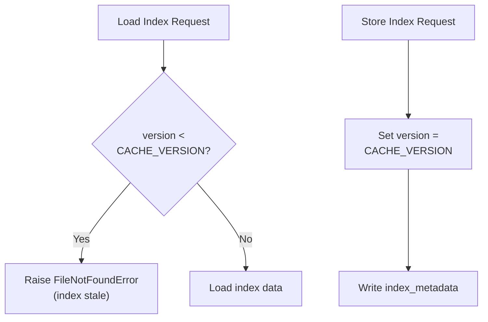

**Current version**: `CACHE_VERSION = 6` (as of this documentation)

Sources: [vexor/cache.py:27](), [vexor/cache.py:1037-1039]()

### Legacy Schema Detection

The `_schema_needs_reset()` function ([vexor/cache.py:289-295]()) detects outdated schemas:

- If `indexed_chunk` table exists, schema is current
- If old tables exist (`indexed_file` without `file_id` FK, `file_embedding`), schema needs reset
- Reset drops all index tables and recreates them ([vexor/cache.py:298-311]())

This ensures clean migrations from pre-v6 schemas that used different normalization.

Sources: [vexor/cache.py:289-311](), [tests/unit/test_cache_upgrade_and_lines.py:12-64]()

### Chunk Line Backfilling

Older indexes may lack `start_line`/`end_line` metadata in `chunk_meta`. The index service detects this and calls `backfill_chunk_lines()` to enrich metadata without re-embedding:

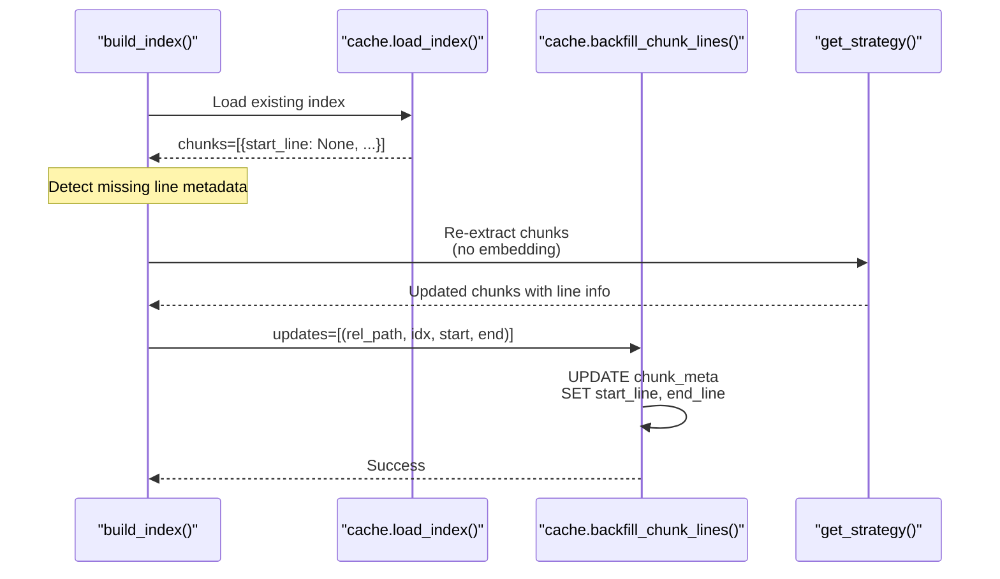

This pattern allows schema evolution without invalidating expensive embeddings.

Sources: [vexor/cache.py:883-988](), [tests/unit/test_index_service.py:142-211]()

## Code Organization

### Key Classes and Functions

| Entity | Type | Purpose | Location |
|--------|------|---------|----------|
| `IndexedChunk` | dataclass | Represents a file chunk with embedding | [vexor/cache.py:37-48]() |
| `store_index()` | function | Full index creation | [vexor/cache.py:402-584]() |
| `apply_index_updates()` | function | Incremental index updates | [vexor/cache.py:587-880]() |
| `load_index()` | function | Load full metadata dict | [vexor/cache.py:991-1107]() |
| `load_index_vectors()` | function | Load vectors for search | [vexor/cache.py:1110-1184]() |
| `backfill_chunk_lines()` | function | Metadata enrichment | [vexor/cache.py:883-988]() |
| `clear_index()` | function | Delete specific indexes | [vexor/cache.py:1234-1278]() |
| `clear_all_cache()` | function | Delete entire database | [vexor/cache.py:1281-1296]() |
| `store_embedding_cache()` | function | Persist embeddings | [vexor/cache.py:1299-1366]() |
| `load_embedding_cache()` | function | Retrieve cached embeddings | [vexor/cache.py:1369-1427]() |

Sources: [vexor/cache.py:1-1427]()

### Testing Coverage

The storage layer is extensively tested:

- **Basic operations**: Store, load, clear indexes ([tests/unit/test_cache.py:35-354]())
- **Incremental updates**: Add, modify, delete operations ([tests/unit/test_cache.py:391-503]())
- **Extension filtering**: Separate caches per extension set ([tests/unit/test_cache.py:538-585]())
- **Embedding cache**: Memory and SQLite tiers, TTL pruning ([tests/unit/test_cache.py:95-187]())
- **Dimension isolation**: Prevents cross-dimension pollution ([tests/unit/test_cache.py:189-254]())
- **Schema upgrades**: Legacy schema detection, line backfilling ([tests/unit/test_cache_upgrade_and_lines.py]())

Sources: [tests/unit/test_cache.py](), [tests/unit/test_cache_upgrade_and_lines.py]()

---

