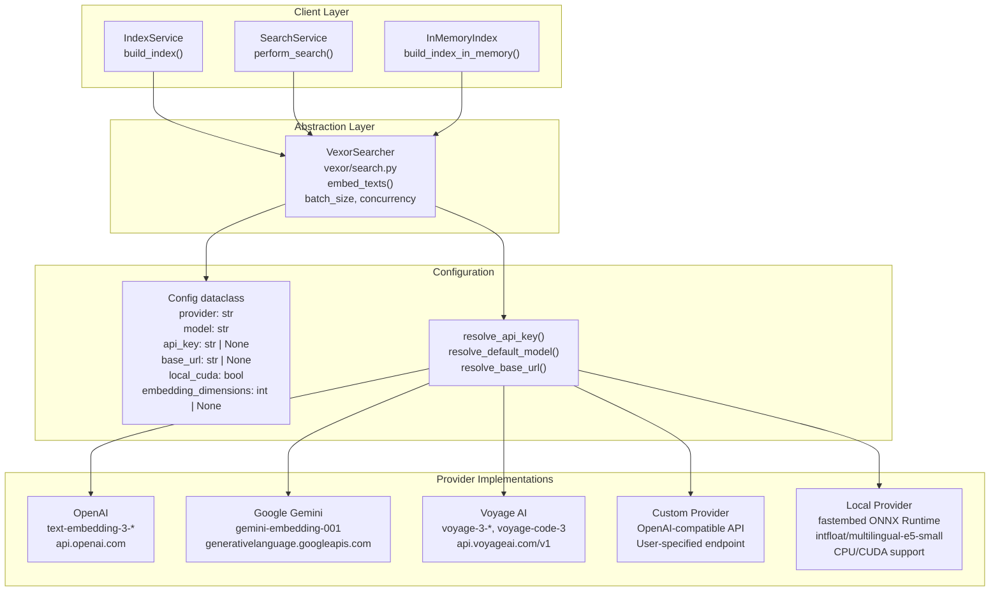
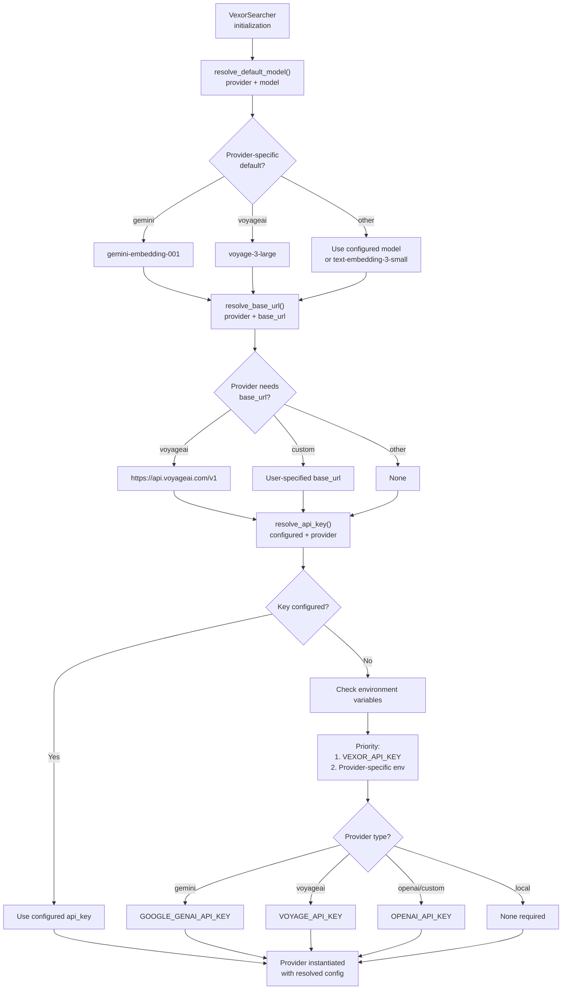
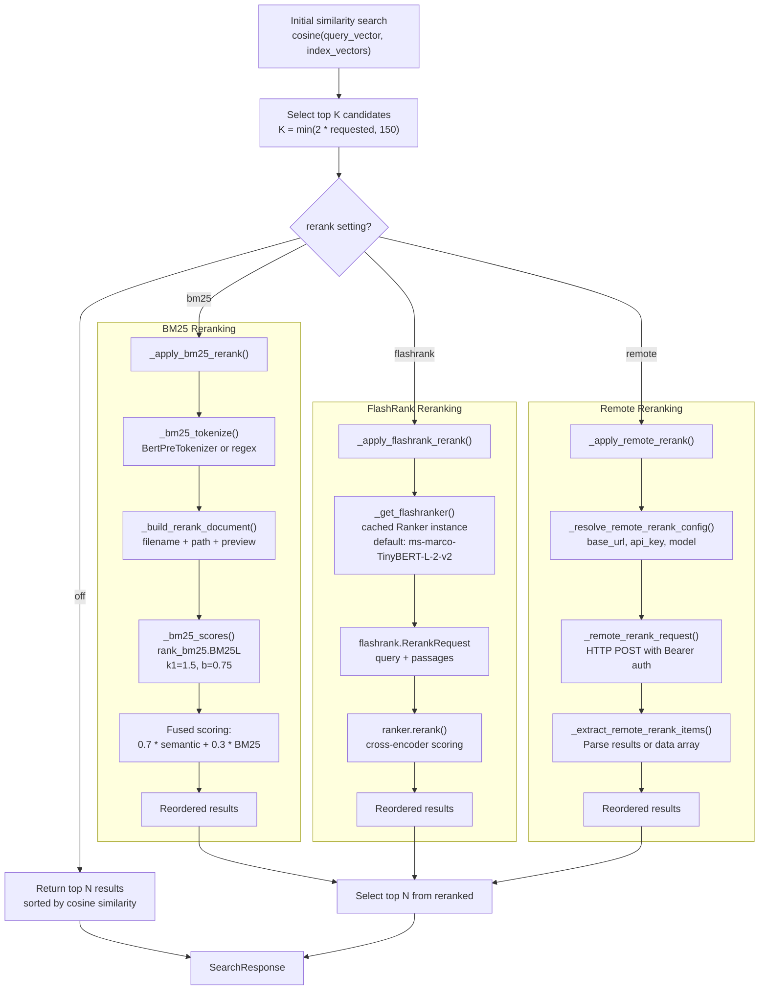

<!-- source: DeepWiki mcp.deepwiki.com · repo scarletkc/vexor · page 7.5 Provider System · fetched 2026-10-26 -->

# Provider System

<details>
<summary>Relevant source files</summary>

The following files were used as context for generating this wiki page:

- [README.md](README.md)
- [vexor/config.py](vexor/config.py)

</details>


This page documents the architecture of Vexor's provider abstraction layer, which enables pluggable embedding and reranking providers. The system supports multiple cloud-based and local embedding providers (OpenAI, Gemini, Voyage AI, custom APIs, local models) and multiple reranking strategies (BM25, FlashRank, remote APIs). For information about how providers are configured by users, see [Configuration Management](#5.5). For search execution flow, see [Search Execution Flow](#7.8).

---

## Provider Abstraction Layer

Vexor implements a two-tier provider system: **embedding providers** generate vector representations of text, and **reranking providers** optionally refine search results after initial similarity-based ranking.

### Embedding Provider Architecture



**Sources:** [vexor/services/index_service.py:149-188](), [vexor/services/search_service.py:567-577](), [vexor/config.py:62-77](), [vexor/config.py:397-418]()

The `VexorSearcher` class serves as the unified interface for all embedding providers. It accepts configuration parameters during initialization and internally routes requests to the appropriate provider based on the `provider` field. All provider-specific logic (authentication, API endpoints, model selection) is encapsulated within this abstraction.

| Provider | Identifier | Default Model | Base URL | API Key Source |
|----------|-----------|---------------|----------|----------------|
| OpenAI | `openai` | `text-embedding-3-small` | `api.openai.com` | `OPENAI_API_KEY` env var |
| Gemini | `gemini` | `gemini-embedding-001` | `generativelanguage.googleapis.com` | `GOOGLE_GENAI_API_KEY` env var |
| Voyage AI | `voyageai` | `voyage-3-large` | `https://api.voyageai.com/v1` | `VOYAGE_API_KEY` env var |
| Custom | `custom` | User-specified | User-specified | `OPENAI_API_KEY` or `VEXOR_API_KEY` |
| Local | `local` | `intfloat/multilingual-e5-small` | N/A | N/A |

**Sources:** [vexor/config.py:24-37]()

### Provider Configuration Resolution



**Sources:** [vexor/config.py:397-418](), [vexor/config.py:469-493]()

The resolution process implements a strict precedence hierarchy:
1. Explicit configuration (via `Config` object or function parameters)
2. General environment variable (`VEXOR_API_KEY`)
3. Provider-specific environment variables (`OPENAI_API_KEY`, `GOOGLE_GENAI_API_KEY`, `VOYAGE_API_KEY`)
4. Built-in defaults

This hierarchy enables flexible deployment: explicit parameters for testing, environment variables for production, and sensible defaults for quick setup.

**Sources:** [vexor/config.py:469-493]()

---

## Reranking Provider Architecture

Reranking refines the initial similarity-based results by applying secondary scoring algorithms. Vexor supports four reranking strategies, each with different performance/accuracy tradeoffs.

### Reranking Pipeline Flow



**Sources:** [vexor/services/search_service.py:624-708](), [vexor/services/search_service.py:144-164](), [vexor/services/search_service.py:178-224](), [vexor/services/search_service.py:323-356]()

### Reranking Strategy Details

#### BM25 Reranking

BM25 (Best Matching 25) is a lexical scoring function that ranks results based on keyword overlap between query and documents. Vexor uses the BM25L variant, which avoids zero IDF scores on small candidate sets.

**Implementation:** [vexor/services/search_service.py:130-164]()

```python
# Tokenization
tokens = _bm25_tokenize(text)  # BertPreTokenizer or regex fallback
# Document construction
document = f"{path.name} {path.as_posix()} {preview}".strip()
# Scoring
bm25 = BM25L(documents, k1=1.5, b=0.75)
scores = bm25.get_scores(query_tokens)
# Fusion
fused_score = 0.7 * semantic_score + 0.3 * bm25_score
```

BM25 reranking is fast (no network/GPU required) and effective for keyword-heavy queries, but performs poorly on semantic queries without literal term overlap.

**Sources:** [vexor/services/search_service.py:87-99](), [vexor/services/search_service.py:130-164]()

#### FlashRank Reranking

FlashRank uses a neural cross-encoder to score query-document pairs. The default model (`ms-marco-TinyBERT-L-2-v2`) is downloaded to `~/.vexor/flashrank/` on first use.

**Implementation:** [vexor/services/search_service.py:166-224]()

The `_get_flashranker` function caches ranker instances via `@lru_cache(maxsize=4)` to avoid repeated model loading. FlashRank requires the `flashrank` package (installed as an optional dependency).

**Sources:** [vexor/services/search_service.py:166-176](), [vexor/services/search_service.py:178-224](), [vexor/config.py:195-200]()

#### Remote Reranking

Remote reranking delegates scoring to an HTTP API. The system sends a POST request with the query and candidate documents, then parses the response to extract reordered results.

**Configuration:** [vexor/config.py:55-59]()

```python
@dataclass
class RemoteRerankConfig:
    base_url: str | None = None  # Auto-normalized to include /rerank
    api_key: str | None = None   # VEXOR_REMOTE_RERANK_API_KEY fallback
    model: str | None = None
```

**Request Format:**
```json
{
  "model": "rerank-model-name",
  "query": "user query",
  "documents": ["doc1 content", "doc2 content", ...]
}
```

**Expected Response Format:**
```json
{
  "results": [
    {"index": 1, "relevance_score": 0.95},
    {"index": 0, "relevance_score": 0.87}
  ]
}
```

The system also accepts `"data"` as a top-level key and `"score"` as an alternative to `"relevance_score"`.

**Sources:** [vexor/services/search_service.py:248-291](), [vexor/services/search_service.py:293-321](), [vexor/services/search_service.py:323-356]()

### Candidate Set Expansion

When reranking is enabled, the system retrieves more candidates than requested to improve reranking quality:

```python
def _resolve_rerank_candidates(top_k: int) -> int:
    candidate = int(top_k * 2)
    return max(20, min(candidate, 150))
```

For `top_k=10`, this retrieves 20 candidates for reranking, then returns the top 10 after reordering. The upper bound (150) prevents excessive memory/compute usage.

**Sources:** [vexor/services/search_service.py:116-119]()

---

## Embedding Dimension Support

Certain providers support customizable embedding dimensions, allowing users to trade accuracy for reduced storage/memory. This feature is controlled via the `embedding_dimensions` configuration parameter.

### Dimension-Aware Models

| Model Prefix | Supported Dimensions |
|-------------|---------------------|
| `text-embedding-3-small` | 256, 512, 1024, 1536 |
| `text-embedding-3-large` | 256, 512, 1024, 1536, 3072 |
| `voyage-3` | 256, 512, 1024, 2048 |
| `voyage-code-3` | 256, 512, 1024, 2048 |

**Sources:** [vexor/config.py:40-46]()

### Dimension Validation and Cache Segmentation

When a user sets `embedding_dimensions`, Vexor validates it against the model's supported values:

```python
def validate_embedding_dimensions_for_model(value: int | None, model: str) -> None:
    if value is None:
        return
    supported = get_supported_dimensions(model)
    if not supported:
        raise ValueError(f"Model '{model}' does not support custom dimensions.")
    if value not in supported:
        raise ValueError(f"Dimension {value} not supported for '{model}'.")
```

**Sources:** [vexor/config.py:434-448]()

The `embedding_dimensions` parameter serves two critical purposes:

1. **Provider API Parameter:** Passed to embedding providers that support dimension control
2. **Cache Segmentation:** Prevents cross-dimension cache pollution

Embedding cache keys include the dimension parameter:

```python
# Cache key construction
text_hash = embedding_cache_key(text, dimension=embedding_dimensions)
```

This ensures that cached embeddings from different dimension settings don't interfere with each other. If the user changes `embedding_dimensions` after indexing, the system detects the mismatch and forces a full rebuild.

**Sources:** [vexor/services/index_service.py:190-204](), [vexor/services/index_service.py:728-778]()

### Dimension Mismatch Detection

The system validates dimension compatibility at multiple points:

1. **Index Load:** When loading a cached index, the system checks if the requested dimension matches the cached dimension
2. **Query Time:** Before computing similarities, the system validates that query and index vectors have matching dimensions
3. **Incremental Update:** When applying incremental updates, the system validates that new embeddings match the existing index dimension

```python
# Query-time validation
index_dimension = file_vectors.shape[1]
query_dimension = query_vector.shape[0]
if index_dimension != query_dimension:
    raise ValueError(
        f"Embedding dimension mismatch: index has {index_dimension}-dim vectors, "
        f"but query embedding is {query_dimension}-dim. "
        f"Rebuild the index with: vexor index {directory}"
    )
```

**Sources:** [vexor/services/search_service.py:636-645](), [vexor/services/index_service.py:686-696]()

---

## Provider Integration Points

This section maps how providers integrate into the broader Vexor architecture.

### IndexService Integration

During indexing, `IndexService` instantiates a `VexorSearcher` and calls `embed_texts()` with content extracted from files:

```python
searcher = VexorSearcher(
    model_name=model_name,
    batch_size=batch_size,
    embed_concurrency=embed_concurrency,
    provider=provider,
    base_url=base_url,
    api_key=api_key,
    local_cuda=local_cuda,
    embedding_dimensions=embedding_dimensions,
)
embeddings = searcher.embed_texts(labels)
```

The `labels` parameter contains text extracted by mode-specific strategies (file names, code chunks, markdown sections, etc.). Embeddings are batched according to `batch_size` and processed with `embed_concurrency` parallelism.

**Sources:** [vexor/services/index_service.py:179-188](), [vexor/services/index_service.py:350-358]()

### SearchService Integration

During search, `SearchService` uses the same `VexorSearcher` interface to embed the user's query:

```python
searcher = VexorSearcher(
    model_name=request.model_name,
    # ... other parameters
)
query_vector = searcher.embed_texts([request.query])[0]
similarities = np.asarray(file_vectors @ query_vector, dtype=np.float32)
```

The resulting query vector is matched against cached index vectors via cosine similarity (implemented as a dot product, since vectors are normalized).

**Sources:** [vexor/services/search_service.py:568-577](), [vexor/services/search_service.py:601-603](), [vexor/services/search_service.py:646]()

### Caching Integration

Both embedding and query vectors are cached to reduce redundant API calls:

**Embedding Cache:**
- Keyed by `hash(text) + model + dimension`
- Two-tier: in-memory LRU (2048 entries) + SQLite persistence
- Shared across index/search operations

**Query Cache:**
- Keyed by `hash(query) + model`
- Index-specific (stored per index_id)
- Enables instant repeated searches

The cache system is dimension-aware: changing `embedding_dimensions` invalidates existing cache entries for that model, forcing re-embedding with the new dimension.

**Sources:** [vexor/services/search_service.py:582-623](), [vexor/services/index_service.py:728-778]()

---

## Provider-Specific Considerations

### Local Provider

The local provider uses fastembed's ONNX Runtime implementation, supporting CPU and CUDA execution:

- **Model Storage:** `~/.vexor/models/`
- **CUDA Support:** Controlled via `local_cuda` flag
- **Offline Operation:** No network required after model download
- **Default Model:** `intfloat/multilingual-e5-small`

The local provider is ideal for privacy-sensitive deployments, air-gapped environments, or cost-conscious workflows.

**Sources:** [vexor/config.py:27](), [vexor/config.py:191-193]()

### Custom Provider

The custom provider accepts any OpenAI-compatible embedding API:

```python
Config(
    provider="custom",
    base_url="https://custom.example.com/v1",
    api_key="custom-key",
    model="custom-embedding-model"
)
```

This enables integration with self-hosted models, proxy services, or third-party providers that implement the OpenAI embeddings API format.

**Sources:** [vexor/config.py:37](), [vexor/config.py:410-418]()

### Remote Rerank API

Remote reranking URLs are auto-normalized to include the `/rerank` endpoint:

```python
def normalize_remote_rerank_url(value: str | None) -> str | None:
    # "https://api.example.com" -> "https://api.example.com/rerank"
    # "https://api.example.com/v1" -> "https://api.example.com/v1/rerank"
    # Already suffixed URLs are preserved
```

This normalization simplifies configuration: users can specify just the base URL without manually appending `/rerank`.

**Sources:** [vexor/config.py:375-395]()

---

## Error Handling and Fallbacks

### Missing Dependencies

FlashRank reranking requires the optional `flashrank` package. If missing, the system raises a clear error:

```python
try:
    from flashrank import RerankRequest
except ImportError as exc:
    raise RuntimeError(Messages.ERROR_FLASHRANK_MISSING) from exc
```

**Sources:** [vexor/services/search_service.py:185-190]()

### Remote Rerank Failures

Remote reranking includes comprehensive error handling:

```python
try:
    response = urlrequest.urlopen(request)
except urlerror.HTTPError as exc:
    reason = f"HTTP {exc.code}"
    detail = exc.read().decode("utf-8").strip()[:200]
    raise RuntimeError(f"Remote rerank failed: {reason}: {detail}")
```

Failed remote rerank requests include the HTTP status code and response body excerpt for debugging.

**Sources:** [vexor/services/search_service.py:265-291]()

### BM25 Tokenizer Fallback

BM25 tokenization attempts to use `BertPreTokenizer` from the `tokenizers` package, falling back to a simple regex if unavailable:

```python
@lru_cache(maxsize=1)
def _get_bm25_tokenizer():
    try:
        from tokenizers.pre_tokenizers import BertPreTokenizer
    except Exception:
        return None
    return BertPreTokenizer()

def _bm25_tokenize(text: str) -> list[str]:
    tokenizer = _get_bm25_tokenizer()
    if tokenizer is None:
        return _TOKEN_RE.findall(text.lower())  # Regex fallback
    # ... BertPreTokenizer logic
```

This ensures BM25 reranking works even without the `tokenizers` package, though with slightly reduced quality.

**Sources:** [vexor/services/search_service.py:78-99]()

---

