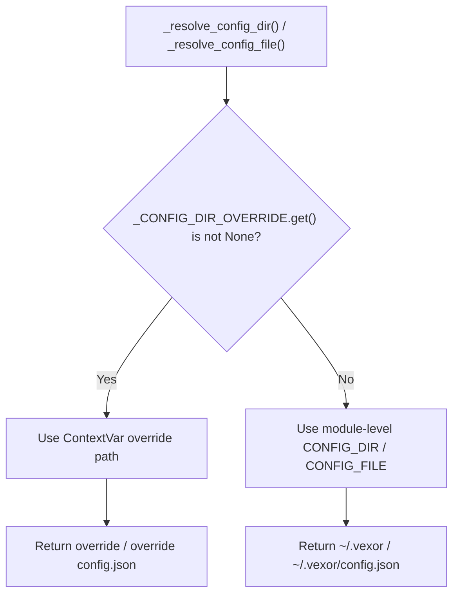
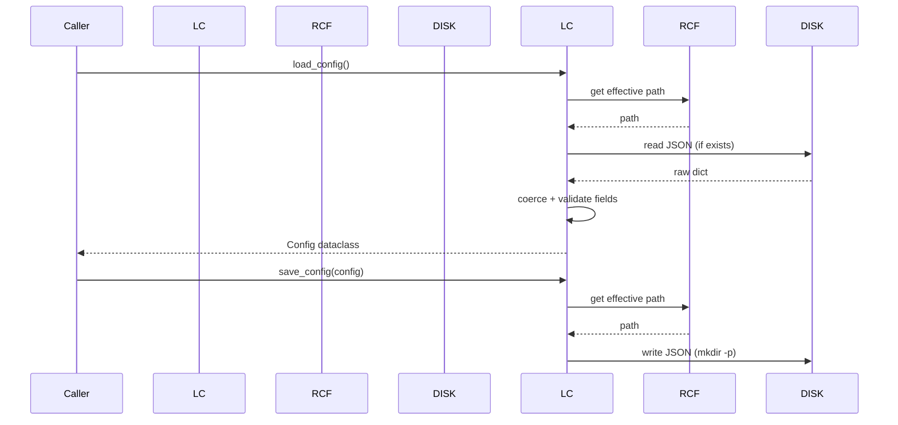
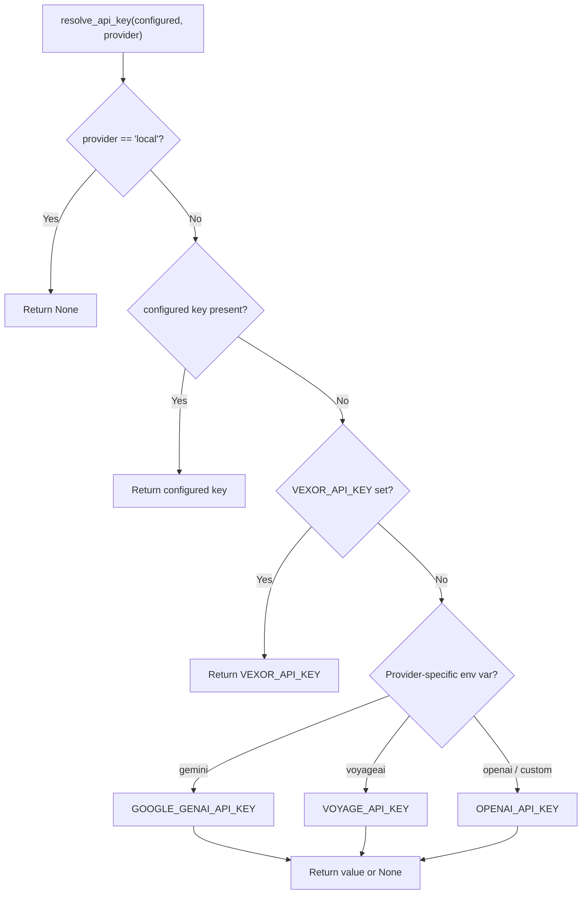
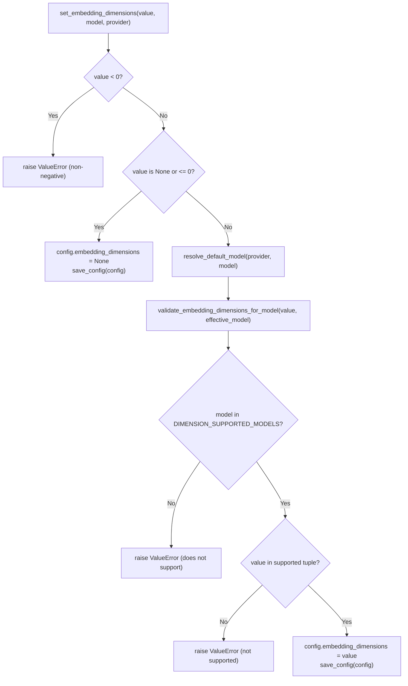
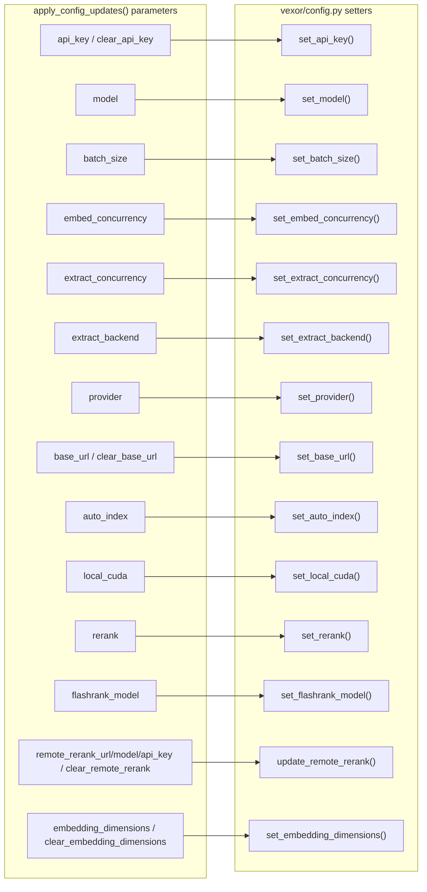

<!-- source: DeepWiki mcp.deepwiki.com · repo scarletkc/vexor · page 7.7 Configuration System · fetched 2026-10-26 -->

# Configuration System

<details>
<summary>Relevant source files</summary>

The following files were used as context for generating this wiki page:

- [docs/api/python.md](docs/api/python.md)
- [tests/unit/test_api.py](tests/unit/test_api.py)
- [vexor/api.py](vexor/api.py)
- [vexor/config.py](vexor/config.py)

</details>


This page covers the internals of `vexor/config.py` and `vexor/services/config_service.py`: the `Config` and `RemoteRerankConfig` dataclasses, the load/save lifecycle, the `ContextVar`-based directory override mechanism, API key resolution, and embedding dimension validation.

For the user-facing `vexor config` CLI command, see [4.4](#4.4). For Python API configuration management (`set_config_json`, `config_context`), see [5.5](#5.5).

---

## Data Structures

**Config dataclass** — [vexor/config.py:62-76]()

| Field | Type | Default | Description |
|---|---|---|---|
| `api_key` | `str \| None` | `None` | Stored API key for the selected provider |
| `model` | `str` | `"text-embedding-3-small"` | Embedding model name |
| `batch_size` | `int` | `64` | Number of texts per embedding API call |
| `embed_concurrency` | `int` | `4` | Max concurrent embedding requests |
| `extract_concurrency` | `int` | `min(4, cpu_count)` | Max concurrent file extraction workers |
| `extract_backend` | `str` | `"auto"` | Extraction executor: `auto`, `thread`, `process` |
| `provider` | `str` | `"openai"` | Embedding provider |
| `base_url` | `str \| None` | `None` | Override base URL for API calls |
| `auto_index` | `bool` | `True` | Re-index before search if cache is stale |
| `local_cuda` | `bool` | `False` | Use CUDA acceleration for local embeddings |
| `rerank` | `str` | `"off"` | Reranking strategy: `off`, `bm25`, `flashrank`, `remote` |
| `flashrank_model` | `str \| None` | `None` | Override FlashRank model name |
| `remote_rerank` | `RemoteRerankConfig \| None` | `None` | Remote reranker configuration |
| `embedding_dimensions` | `int \| None` | `None` | Reduce output dimensions (model-dependent) |

**RemoteRerankConfig dataclass** — [vexor/config.py:54-58]()

| Field | Type | Description |
|---|---|---|
| `base_url` | `str \| None` | HTTP endpoint for reranking |
| `api_key` | `str \| None` | Auth key for the remote endpoint |
| `model` | `str \| None` | Model name to pass in the request body |

Sources: [vexor/config.py:54-76]()

---

## Storage and File Location

The config file is a JSON document at `~/.vexor/config.json` by default.

```
DEFAULT_CONFIG_DIR = ~/.vexor/
CONFIG_FILE        = ~/.vexor/config.json
```

Module-level constants `CONFIG_DIR` and `CONFIG_FILE` hold the active paths. [vexor/config.py:17-19]()

`save_config()` creates the directory if it does not exist. Fields with `None` or default-empty values are omitted from the JSON output. [vexor/config.py:151-188]()

Sources: [vexor/config.py:17-23]()

---

## Config Directory Resolution

Two mechanisms exist for overriding the config directory, targeting different use cases.

**Config directory resolution — `vexor/config.py`**



Sources: [vexor/config.py:94-103]()

### `config_dir_context` (per-context, async-safe)

`config_dir_context(path)` is a `@contextmanager` that sets `_CONFIG_DIR_OVERRIDE` via a `ContextVar` token and resets it on exit. [vexor/config.py:106-120]() This is the recommended override mechanism because `ContextVar` is coroutine-safe — changes in one async context do not bleed into another.

```python
# Used by the Python API's config_context feature
with config_dir_context("/tmp/isolated-vexor"):
    cfg = load_config()   # reads from /tmp/isolated-vexor/config.json
    save_config(cfg)      # writes to /tmp/isolated-vexor/config.json
```

### `set_config_dir` (global, process-wide)

`set_config_dir(path)` mutates the module-level `CONFIG_DIR` and `CONFIG_FILE` variables directly. [vexor/config.py:202-211]() This is a permanent change for the process lifetime and is used by the `VexorClient` class when a `data_dir` is supplied at construction time.

Sources: [vexor/config.py:20-23](), [vexor/config.py:94-120](), [vexor/config.py:202-211]()

---

## Load / Save Lifecycle

**Config lifecycle — `load_config` and `save_config`**



`load_config()` [vexor/config.py:123-148]():
- Returns a default `Config()` if no file exists.
- Normalizes the `rerank` value; falls back to `DEFAULT_RERANK` if unrecognized.
- Delegates `remote_rerank` parsing to `_parse_remote_rerank()`.

`save_config()` [vexor/config.py:151-188]():
- Skips `None` / falsy optional fields from the output dict.
- Always writes `batch_size`, `embed_concurrency`, `extract_concurrency`, `extract_backend`, `auto_index`, `local_cuda`, and `rerank`.
- Serializes `remote_rerank` as a nested object under key `"remote_rerank"`.

Sources: [vexor/config.py:123-188]()

---

## API Key Resolution

`resolve_api_key(configured, provider)` [vexor/config.py:469-492]() returns the first non-empty key from the following priority chain:



| Priority | Source | Env variable name |
|---|---|---|
| 1 (highest) | Stored in `Config.api_key` | — |
| 2 | General override | `VEXOR_API_KEY` |
| 3a | Gemini-specific | `GOOGLE_GENAI_API_KEY` |
| 3b | VoyageAI-specific | `VOYAGE_API_KEY` |
| 3c | OpenAI / custom | `OPENAI_API_KEY` |
| — | Local provider | Always `None` |

The constants for these env variable names are declared at module level [vexor/config.py:47-51]():

```
ENV_API_KEY        = "VEXOR_API_KEY"
REMOTE_RERANK_ENV  = "VEXOR_REMOTE_RERANK_API_KEY"
LEGACY_GEMINI_ENV  = "GOOGLE_GENAI_API_KEY"
OPENAI_ENV         = "OPENAI_API_KEY"
VOYAGE_ENV         = "VOYAGE_API_KEY"
```

Remote rerank key resolution follows the same two-step pattern (config → env) via `resolve_remote_rerank_api_key(configured)`. [vexor/config.py:495-503]()

Sources: [vexor/config.py:47-51](), [vexor/config.py:469-503]()

---

## Model and Base URL Resolution

Two helper functions compute the effective runtime values, accounting for provider-specific defaults.

### `resolve_default_model(provider, model)`

[vexor/config.py:397-407]()

| Condition | Returned model |
|---|---|
| `provider == "gemini"` and model is empty or the OpenAI default | `"gemini-embedding-001"` |
| `provider == "voyageai"` and model is empty or the OpenAI default | `"voyage-3-large"` |
| Any non-empty explicit model | That model string |
| Otherwise | `"text-embedding-3-small"` |

### `resolve_base_url(provider, configured_url)`

[vexor/config.py:410-417]()

Returns the configured URL if present; otherwise injects `"https://api.voyageai.com/v1"` for `voyageai`, and `None` for all other providers.

Sources: [vexor/config.py:397-417]()

---

## Embedding Dimension Validation

Some models accept a `dimensions` parameter to reduce output vector size, saving storage and speeding up similarity search.

**Supported models and valid dimensions** — [vexor/config.py:41-46]()

| Model prefix | Valid dimensions |
|---|---|
| `text-embedding-3-small` | 256, 512, 1024, 1536 |
| `text-embedding-3-large` | 256, 512, 1024, 1536, 3072 |
| `voyage-3` | 256, 512, 1024, 2048 |
| `voyage-code-3` | 256, 512, 1024, 2048 |

Matching is by prefix: `supports_dimensions("voyage-3-large")` returns `True` because `"voyage-3-large"` starts with `"voyage-3"`. [vexor/config.py:420-431]()

**Validation call chain for `set_embedding_dimensions`**



**Cross-field validation** — `_validate_config_embedding_dimensions(config)` [vexor/config.py:451-466]() is called by `set_model()` and `set_provider()` to ensure that a stored `embedding_dimensions` value remains compatible after a model or provider change. If it is not, a `ValueError` is raised before `save_config` is called.

The `apply_config_updates()` function in `config_service.py` suppresses this cross-field validation when a dimension change is part of the same update batch, allowing atomic `model + embedding_dimensions` changes. [vexor/services/config_service.py:110-116](), [vexor/services/config_service.py:130-136]()

Sources: [vexor/config.py:41-46](), [vexor/config.py:314-348](), [vexor/config.py:420-466](), [vexor/services/config_service.py:110-136]()

---

## Remote Rerank URL Normalization

`normalize_remote_rerank_url(value)` [vexor/config.py:375-394]() normalizes any provided URL to end in `/rerank` or `/reranker`:

- Strips whitespace; returns `None` for empty input.
- If the URL already ends with `/rerank` or `/reranker`, it is returned as-is.
- Otherwise, `/rerank` is appended to the path.
- Handles both fully-qualified URLs (with scheme and netloc) and bare paths.

Example: `"https://api.example.com/v1"` → `"https://api.example.com/v1/rerank"`.

Sources: [vexor/config.py:375-394]()

---

## Service Layer: `config_service.py`

`vexor/services/config_service.py` provides a single entry point for multi-field configuration updates, used by both the CLI and the Python API.

### `ConfigUpdateResult`

[vexor/services/config_service.py:27-75]()

A `dataclass(slots=True)` with one `bool` flag per mutable field. The `changed` property returns `True` if any flag is set. This is used by the CLI to decide whether to print a confirmation message.

### `apply_config_updates()`

[vexor/services/config_service.py:78-183]()

All parameters are keyword-only and default to `None`/`False`. The function:

1. Iterates through each optional update parameter.
2. Calls the corresponding `set_*` function from `vexor/config.py` only if the parameter was provided.
3. Handles the `embedding_dimensions` / `clear_embedding_dimensions` interaction with model/provider validation suppression.
4. Returns a `ConfigUpdateResult` reporting which fields changed.

**apply_config_updates — parameter to setter mapping**



Sources: [vexor/services/config_service.py:1-190]()

---

## JSON-Based Config Updates

Two functions support bulk updates from a JSON payload (used by the Python API's `set_config_json` and `config_context`):

| Function | Saves to disk? | Merges with existing? |
|---|---|---|
| `config_from_json(payload, base)` | No | Yes, if `base` is provided |
| `update_config_from_json(payload, replace)` | Yes | Yes, unless `replace=True` |

`config_from_json` [vexor/config.py:214-221]() accepts either a JSON string or a `Mapping` and applies it over a `base` config (or a fresh `Config()` if `base` is `None`) using `_apply_config_payload()`.

`update_config_from_json` [vexor/config.py:224-231]() loads the current disk config as the base (unless `replace=True`), merges, and saves.

`_apply_config_payload()` [vexor/config.py:549-591]() coerces each field through the appropriate `_coerce_*` helper before assignment, so types coming from JSON (e.g. floats where ints are expected) are normalized.

Sources: [vexor/config.py:214-231](), [vexor/config.py:549-591]()

---

## Auxiliary Directory Functions

| Function | Returns | Notes |
|---|---|---|
| `local_model_dir()` | `config_dir / "models"` | Storage path for fastembed downloaded models |
| `flashrank_cache_dir(create)` | `config_dir / "flashrank"` | FlashRank model cache; creates dir by default |

Both respect the active `_CONFIG_DIR_OVERRIDE` via `_resolve_config_dir()`. [vexor/config.py:191-199]()

Sources: [vexor/config.py:191-199]()

---

