<!-- source: DeepWiki mcp.deepwiki.com · repo scarletkc/vexor · page 8 Advanced Usage · fetched 2026-10-26 -->

# Advanced Usage

<details>
<summary>Relevant source files</summary>

The following files were used as context for generating this wiki page:

- [README.md](README.md)
- [tests/unit/test_cache.py](tests/unit/test_cache.py)
- [vexor/cache.py](vexor/cache.py)

</details>


This section covers advanced topics for power users who need fine-grained control over Vexor's behavior. For basic usage patterns, see pages [2.2](#2.2) and [2.3](#2.3). For architectural details, see page [7](#7).

| Sub-page | Topic |
|----------|-------|
| [8.1](#8.1) | Incremental index updates: change detection, delta re-embed, the 50% threshold |
| [8.2](#8.2) | Provider configuration: API keys, embedding dimensions, model selection |
| [8.3](#8.3) | Cache management: inspecting, clearing, and bypassing the SQLite index |
| [8.4](#8.4) | Performance optimization: concurrency, batch size, extract backend selection |
| [8.5](#8.5) | Custom providers: any OpenAI-compatible embedding endpoint |
| [8.6](#8.6) | AI agent integration: `SKILL.md`, `vexor install --skills`, porcelain output |
| [8.7](#8.7) | Multi-interface workflows: shared config, `config_dir_context`, index reuse |
| [8.8](#8.8) | Remote reranking: HTTP schema, endpoint configuration, candidate pool sizing |

---

## Incremental Index Updates

Vexor implements intelligent incremental updates to avoid re-indexing unchanged files. The system compares file metadata (mtime, size) to detect changes and selectively re-embeds only modified content.

### Change Detection Algorithm

The incremental update flow uses a threshold-based strategy to decide between incremental updates and full rebuilds:

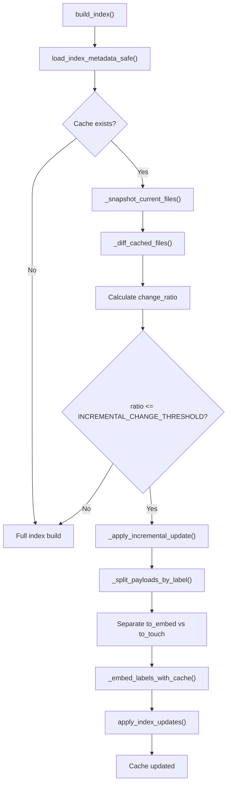

**Sources:** [vexor/services/index_service.py:126-375]()

### Key Parameters

| Parameter | Default | Description |
|-----------|---------|-------------|
| `INCREMENTAL_CHANGE_THRESHOLD` | 0.5 | Maximum ratio of changed files for incremental update |
| `MTIME_TOLERANCE` | 0.5s | Tolerance for mtime comparisons to handle filesystem precision |

The `_diff_cached_files` function at [vexor/services/index_service.py:606-624]() computes three change categories:
- **Added**: Files present in current snapshot but not in cache
- **Modified**: Files with changed mtime or size
- **Removed**: Files in cache but not in current snapshot

**Sources:** [vexor/services/index_service.py:606-639]()

### Label-Based Caching

The incremental update system uses content hashes (`label_hash`) to detect when a file's chunked content is identical to the cached version, even if mtime changed:

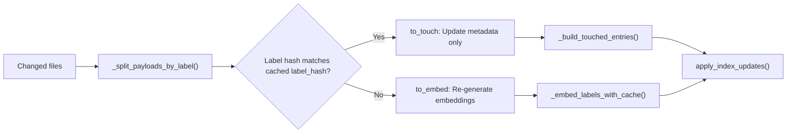

The `embedding_cache_key` function generates deterministic hashes from content labels, enabling cache hits across different index builds.

**Sources:** [vexor/services/index_service.py:830-863](), [vexor/services/index_service.py:866-891]()

### Dimension Change Detection

When `embedding_dimensions` changes, the system forces a full rebuild to prevent dimension mismatches:

[vexor/services/index_service.py:190-204]()

The check compares `cached_dimension` from metadata against the requested `embedding_dimensions`, setting `force_no_cache=True` to bypass the embedding cache (which would contain wrong-dimension vectors).

**Sources:** [vexor/services/index_service.py:190-204](), [vexor/services/index_service.py:686-695]()

---

## Advanced Provider Configuration

### Embedding Dimensions

Certain providers support custom embedding dimensions for reduced storage and faster similarity computation:

| Provider | Models | Supported Dimensions |
|----------|--------|---------------------|
| OpenAI | `text-embedding-3-small` | 256, 512, 1024, 1536 |
| OpenAI | `text-embedding-3-large` | 256, 512, 1024, 1536, 3072 |
| Voyage AI | `voyage-3*` | 256, 512, 1024, 2048 |
| Voyage AI | `voyage-code-3*` | 256, 512, 1024, 2048 |

**CLI Configuration:**
```bash
vexor config --set-embedding-dimensions 512
vexor index  # Rebuild with new dimensions
```

**Python API:**
```python
from vexor.config import set_embedding_dimensions

set_embedding_dimensions(512, model="text-embedding-3-small", provider="openai")
```

**Sources:** [vexor/config.py:40-46](), [vexor/config.py:314-348](), [vexor/config.py:434-448]()

### Dimension Validation Flow

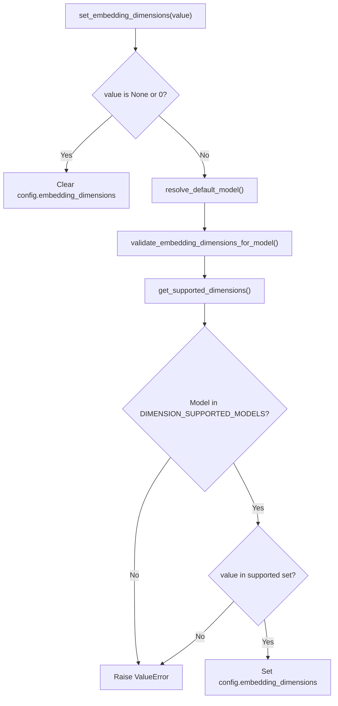

The validation ensures that only models with explicit dimension support (defined in `DIMENSION_SUPPORTED_MODELS`) can use custom dimensions, and only valid values are accepted.

**Sources:** [vexor/config.py:314-348](), [vexor/config.py:420-448]()

### Provider Resolution Hierarchy

The configuration resolution follows a strict precedence order:

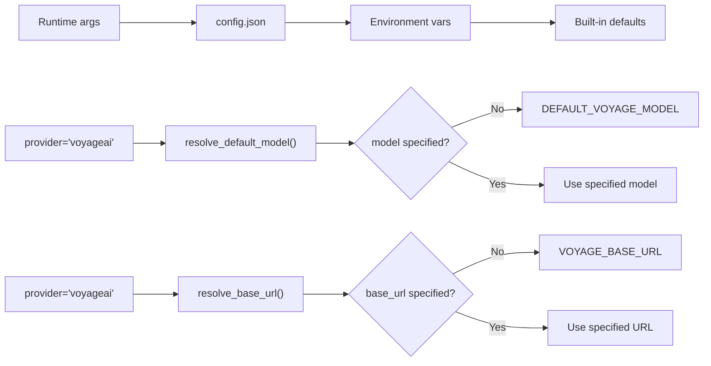

For API key resolution, the `resolve_api_key` function at [vexor/config.py:469-492]() checks:
1. Configured `api_key` parameter
2. `VEXOR_API_KEY` environment variable
3. Provider-specific env vars (`OPENAI_API_KEY`, `VOYAGE_API_KEY`, `GOOGLE_GENAI_API_KEY`)

**Sources:** [vexor/config.py:397-417](), [vexor/config.py:469-492]()

---

## Cache Management Strategies

### Three-Tier Cache Architecture

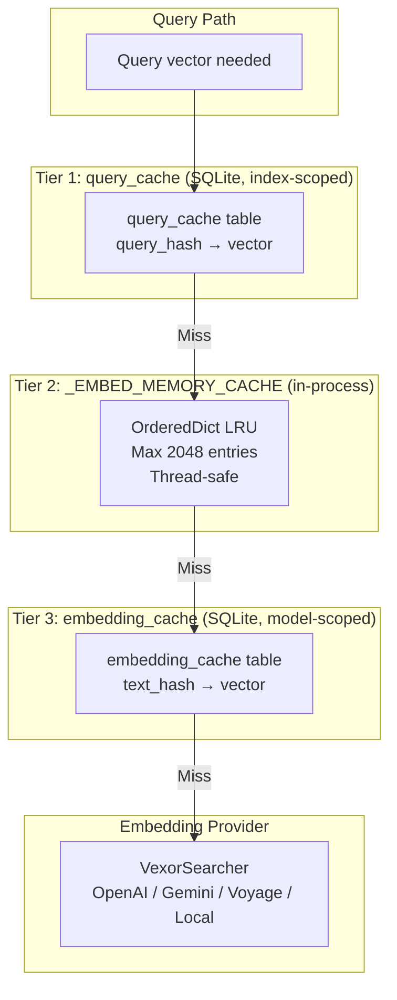

**Sources:** [vexor/services/search_service.py:578-623](), [vexor/services/index_service.py:728-777]()

### Cache Key Generation

Cache keys use content-based hashing with optional dimension segmentation:

[vexor/services/index_service.py:753-755]()

The `embedding_cache_key` function (defined in `vexor/cache.py`) generates SHA-256 hashes from:
- Text content
- Optional dimension parameter (prevents cross-dimension cache pollution)

This allows cache hits even when:
- Files are moved (path changes but content stays same)
- Indexes are rebuilt with same content
- Multiple projects share common content

**Sources:** [vexor/services/index_service.py:753-755](), [vexor/services/index_service.py:1018-1034]()

### Cache Bypass Strategies

Use `no_cache=True` when:
- Testing embedding provider changes
- Debugging dimension mismatches
- Using ephemeral/temporary indexes
- Memory pressure from large cache

**CLI:**
```bash
vexor search "query" --no-cache
vexor index --no-cache
```

**Python API:**
```python
from vexor import search, index

results = search("query", path=".", no_cache=True)
index(".", no_cache=True)
```

The `no_cache` flag prevents both reads and writes to all cache tiers.

**Sources:** [vexor/services/search_service.py:361-362](), [vexor/services/index_service.py:355-357](), [vexor/services/index_service.py:472-473]()

---

## Performance Optimization

### Concurrency Configuration

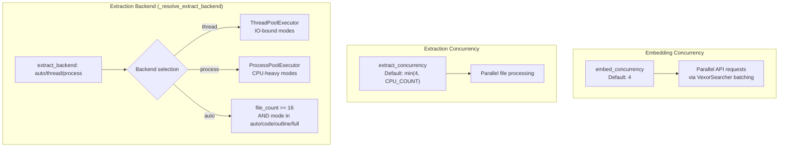

**Sources:** [vexor/config.py:28-31](), [vexor/services/index_service.py:47-69](), [vexor/services/index_service.py:92-123]()

### Backend Selection Logic

The `_resolve_extract_backend` function at [vexor/services/index_service.py:51-69]() uses these criteria:

| Mode | File Count | Concurrency | Backend |
|------|------------|-------------|---------|
| name, head, brief | Any | Any | thread |
| code, outline, full, auto | < 16 | Any | thread |
| code, outline, full, auto | >= 16 | > 1 | process |

CPU-heavy modes (`code`, `outline`, `full`, `auto`) benefit from multiprocessing because:
- Python AST parsing releases GIL during tree construction
- Markdown parsing is CPU-intensive
- Text chunking involves regex and string operations

**Configuration:**
```bash
# Force process backend
vexor config --set-extract-backend process

# Force thread backend for memory constraints
vexor config --set-extract-backend thread

# Let Vexor decide (recommended)
vexor config --set-extract-backend auto
```

**Sources:** [vexor/services/index_service.py:51-69](), [vexor/config.py:672-689]()

### Batch Size Tuning

The `batch_size` parameter controls embedding API batching:

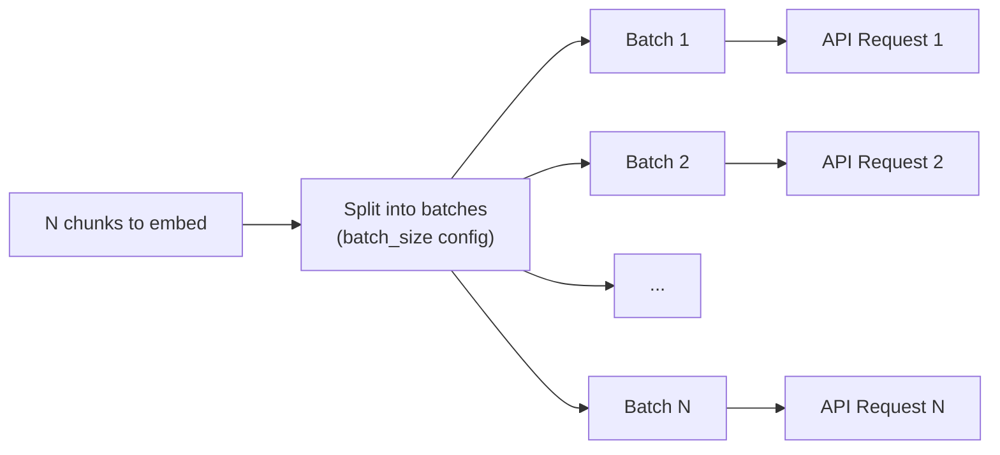

**Tuning Guidelines:**

| Scenario | Recommended Batch Size | Rationale |
|----------|----------------------|-----------|
| OpenAI API | 64-128 | Balance throughput vs rate limits |
| Gemini API | 32-64 | Lower rate limits |
| Voyage AI | 64-128 | High throughput support |
| Local models | 16-32 | Memory constraints |
| Custom API | Test & tune | Depends on endpoint |

**Configuration:**
```bash
vexor config --set-batch-size 128
```

**Sources:** [vexor/config.py:28]()

---

## Custom Embedding Providers

Vexor supports any OpenAI-compatible embedding API endpoint via the `custom` provider.

### Configuration Structure

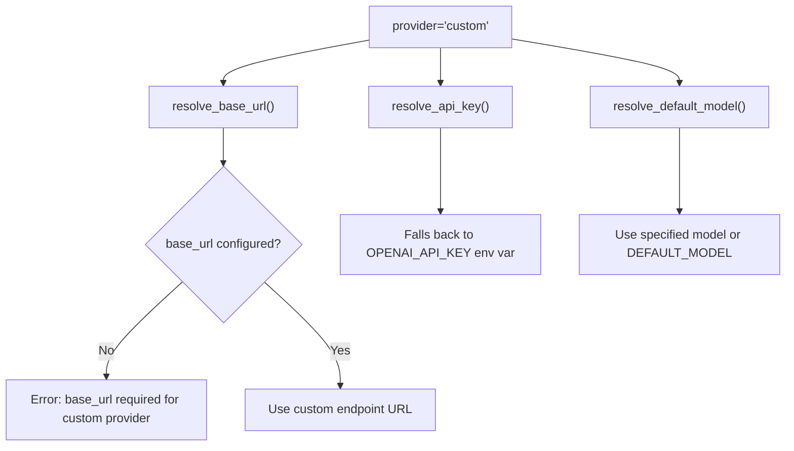

**Sources:** [vexor/config.py:410-417](), [vexor/config.py:469-492]()

### Setup Example

**CLI:**
```bash
vexor config --set-provider custom
vexor config --set-base-url https://api.example.com/v1
vexor config --set-model custom-embed-v1
export OPENAI_API_KEY="your-custom-api-key"

vexor index
vexor search "query"
```

**Python API:**
```python
from vexor import VexorClient

client = VexorClient(
    provider="custom",
    base_url="https://api.example.com/v1",
    model="custom-embed-v1",
    api_key="your-custom-api-key"
)

client.index(".")
results = client.search("query")
```

### Custom Provider Requirements

The custom endpoint must implement the OpenAI embeddings API contract:

**Request:**
```json
POST {base_url}/embeddings
Content-Type: application/json
Authorization: Bearer {api_key}

{
  "model": "custom-embed-v1",
  "input": ["text 1", "text 2", ...],
  "dimensions": 512  // Optional, if supported
}
```

**Response:**
```json
{
  "object": "list",
  "data": [
    {
      "object": "embedding",
      "index": 0,
      "embedding": [0.1, 0.2, ...]
    },
    ...
  ]
}
```

**Sources:** Based on OpenAI API compatibility requirements

---

## Remote Reranking

Remote reranking delegates result re-ordering to an external API, useful for:
- Enterprise reranking services
- Custom neural rerankers
- Domain-specific relevance models

### Configuration Flow

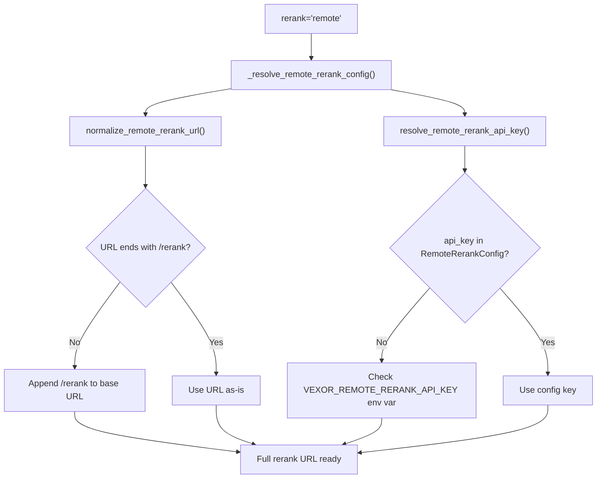

**Sources:** [vexor/services/search_service.py:226-245](), [vexor/config.py:375-394](), [vexor/config.py:495-503]()

### Setup Example

**CLI:**
```bash
vexor config --set-rerank remote
vexor config --remote-rerank-url https://api.example.com/v1/rerank
vexor config --remote-rerank-model rerank-v1
export VEXOR_REMOTE_RERANK_API_KEY="your-rerank-key"

vexor search "query" --rerank remote
```

**Python API:**
```python
from vexor import search
from vexor.config import RemoteRerankConfig, update_remote_rerank

update_remote_rerank(
    base_url="https://api.example.com/v1/rerank",
    api_key="your-rerank-key",
    model="rerank-v1"
)

results = search("query", path=".", rerank="remote")
```

### Remote API Contract

**Request:**
```json
POST {base_url}/rerank
Content-Type: application/json
Authorization: Bearer {api_key}

{
  "model": "rerank-v1",
  "query": "user query",
  "documents": [
    "filename1 path/to/file1 preview text...",
    "filename2 path/to/file2 preview text...",
    ...
  ]
}
```

**Response:**
```json
{
  "results": [
    {
      "index": 0,
      "relevance_score": 0.95
    },
    {
      "index": 2,
      "relevance_score": 0.87
    },
    ...
  ]
}
```

Alternative response format using `data` key is also supported:
```json
{
  "data": [
    {"index": 0, "score": 0.95},
    ...
  ]
}
```

**Sources:** [vexor/services/search_service.py:248-291](), [vexor/services/search_service.py:293-320](), [vexor/services/search_service.py:323-355]()

### Reranking Pipeline

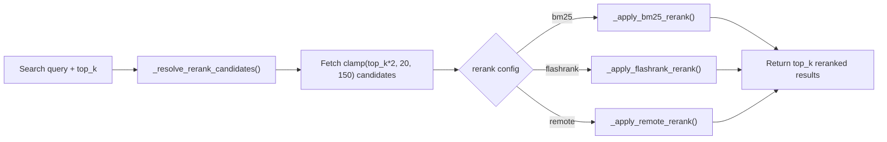

The candidate expansion at [vexor/services/search_service.py:116-118]() uses `clamp(top_k * 2, 20, 150)` — equivalent to `max(20, min(top_k * 2, 150))` — to ensure sufficient candidates for effective reranking while limiting API costs.

**Sources:** [vexor/services/search_service.py:116-118](), [vexor/services/search_service.py:144-163](), [vexor/services/search_service.py:178-223](), [vexor/services/search_service.py:323-355]()

---

## Multi-Interface Workflows

### Shared Configuration Context

All interfaces (CLI, Python API, Desktop App) share the same configuration file at `~/.vexor/config.json`. Changes made in one interface are immediately visible in others.

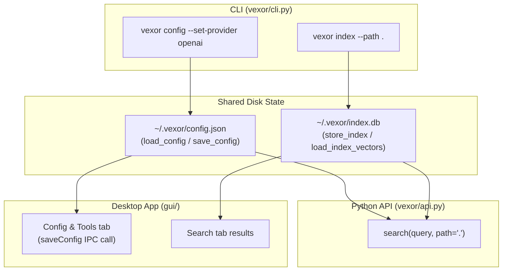

**Sources:** [vexor/config.py:17-19](), [vexor/config.py:94-103]()

### Context-Scoped Configuration

Use `config_dir_context` or `VexorClient` for isolated configuration:

**Option 1: Directory Context**
```python
from vexor import search, index
from vexor.config import config_dir_context

# Use project-specific config
with config_dir_context("/path/to/project/.vexor"):
    index(".", provider="local")
    results = search("query")

# Back to default ~/.vexor config
results = search("another query")
```

**Option 2: Client Scoping**
```python
from vexor import VexorClient

# Client A: Production config
client_a = VexorClient(provider="openai", model="text-embedding-3-large")
client_a.index("./prod")

# Client B: Development config  
client_b = VexorClient(provider="local", local_cuda=False)
client_b.index("./dev")

# Different configs, no interference
results_a = client_a.search("prod query")
results_b = client_b.search("dev query")
```

**Sources:** [vexor/config.py:106-120]()

### Temporary vs Persistent Indexes

**Use Case Comparison:**

| Scenario | Index Type | CLI Flag | Python Param |
|----------|-----------|----------|--------------|
| One-time search | Temporary | `--temporary` | `temporary_index=True` |
| Repeated searches | Persistent | (default) | (default) |
| CI/CD pipelines | Temporary | `--temporary` | `temporary_index=True` |
| Local development | Persistent | (default) | (default) |
| Memory-constrained | Persistent | `--no-cache` | `no_cache=True` |

**Example: CI/CD Pipeline**
```bash
#!/bin/bash
# Search codebase without polluting cache
vexor search "TODO" --temporary --rerank bm25 > todos.txt
vexor search "FIXME" --temporary --rerank bm25 >> todos.txt
```

**Example: Python Script**
```python
from vexor import search

# Ad-hoc search without cache
results = search(
    "security vulnerability",
    path="/tmp/audit",
    temporary_index=True,
    no_cache=True
)
```

**Sources:** [vexor/services/search_service.py:361-373](), [vexor/services/search_service.py:844-873]()

### Index Reuse Across Interfaces

The cache superset mechanism allows searching subdirectories and filtered extensions without rebuilding:

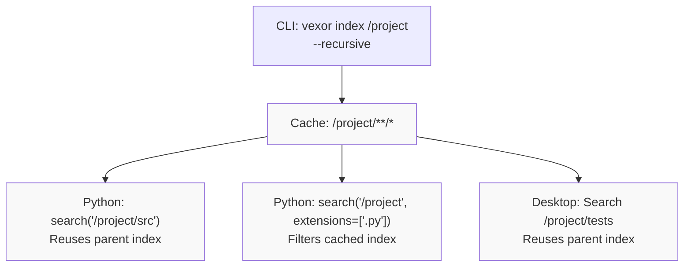

The `_select_cache_superset` function at [vexor/services/search_service.py:958-1020]() matches search requests to cached indexes based on:
- Root path containment (search path is subdirectory of cached path)
- Matching model, mode, include_hidden, respect_gitignore
- Extension superset (cached extensions contain all requested extensions)
- Exclude pattern superset (cached excludes are subset of requested excludes)
- Recursion compatibility (cached recursive=true allows non-recursive search)

**Sources:** [vexor/services/search_service.py:958-1020](), [vexor/services/search_service.py:876-955]()

---

