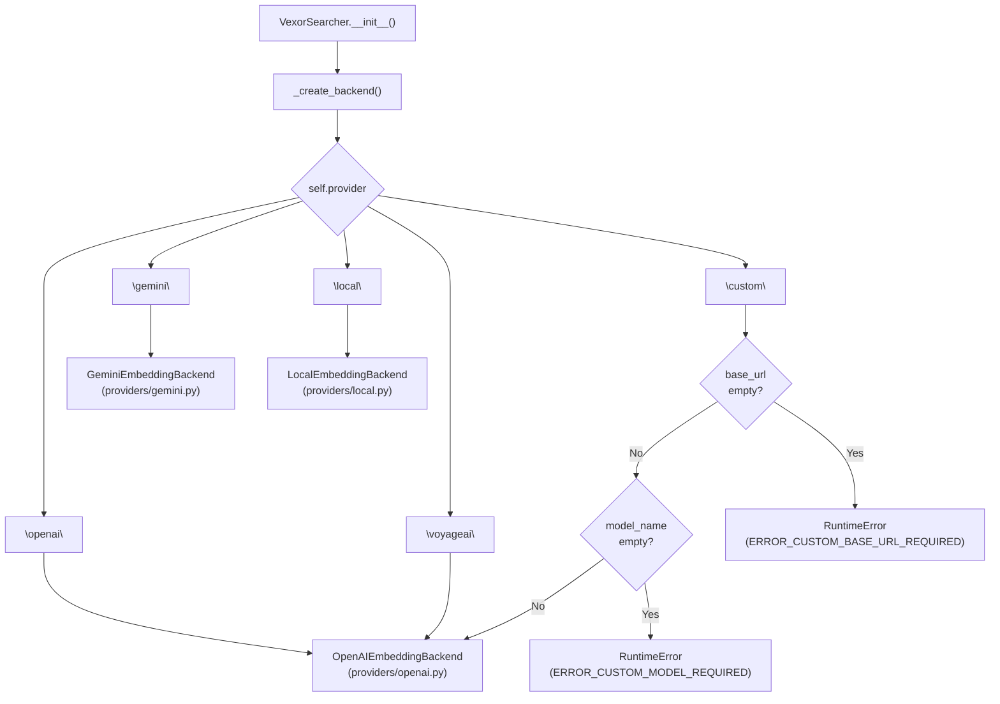
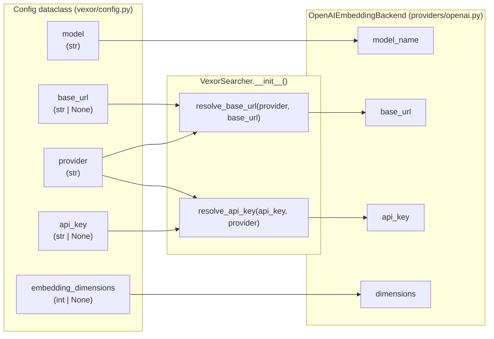

<!-- source: DeepWiki mcp.deepwiki.com · repo scarletkc/vexor · page 8.5 Custom Providers · fetched 2026-10-26 -->

# Custom Providers

<details>
<summary>Relevant source files</summary>

The following files were used as context for generating this wiki page:

- [README.md](README.md)
- [vexor/config.py](vexor/config.py)

</details>


This page explains how to configure the `custom` embedding provider to use any OpenAI-compatible embedding endpoint with Vexor. This allows integration with proxy services, self-hosted model servers, or any third-party service that implements the OpenAI embeddings API.

For general provider configuration and selection, see page [8.2](). For the overall provider architecture, see page [7.5](). For remote reranking configuration (including the `remote` reranker and `RemoteRerankConfig`), see page [8.8]().

---

## Overview

The `custom` provider routes embedding requests to any endpoint that implements the OpenAI `/v1/embeddings` API contract. Internally, it uses `OpenAIEmbeddingBackend` from `vexor/providers/openai.py`, with the official OpenAI endpoint replaced by the configured `base_url`.

Two configuration fields are **required** when `provider` is set to `"custom"`:

| Field | Required | Description |
|-------|----------|-------------|
| `provider` | Yes | Must be `"custom"` |
| `model` | Yes | Model identifier sent to the endpoint |
| `base_url` | Yes | Base URL of the OpenAI-compatible endpoint |
| `api_key` | Optional | Authentication token if required by the endpoint |

If either `model` or `base_url` is missing at runtime, `VexorSearcher._create_backend()` raises a `RuntimeError` before any API call is made.

Sources: [README.md:172-178](), [vexor/search.py:158-172](), [vexor/config.py:37]()

---

## Custom Embedding Providers

### Configuration

The `custom` provider type requires two parameters:

| Parameter | Required | Description |
|-----------|----------|-------------|
| `provider` | Yes | Must be set to `"custom"` |
| `model` | Yes | Model identifier sent to the endpoint |
| `base_url` | Yes | Full URL of the OpenAI-compatible endpoint |
| `api_key` | Optional | Authentication token if required |

Configuration via CLI:

```bash
vexor config --set-provider custom
vexor config --set-model your-model-name
vexor config --set-base-url https://your-endpoint.com/v1
vexor config --set-api-key your-api-key  # if needed
```

Configuration via Python API:

```python
import vexor

vexor.set_config_json({
    "provider": "custom",
    "model": "your-model-name",
    "base_url": "https://your-endpoint.com/v1",
    "api_key": "your-api-key"
})
```

**Sources:** [README.md:119-137](), [vexor/config.py:256-265]()

### Provider Selection Logic

For API key resolution, the `custom` provider is treated identically to `openai` — both check `VEXOR_API_KEY` then `OPENAI_API_KEY`. The key distinction is that `custom` enforces explicit `base_url` and `model` fields that other providers don't require.

**`VexorSearcher._create_backend()` — custom provider branch**



Sources: [vexor/search.py:130-186](), [vexor/config.py:469-492]()

### OpenAI API Compatibility

Custom embedding providers must implement the OpenAI embeddings API contract:

**Request Format:**
```json
POST /v1/embeddings
Content-Type: application/json
Authorization: Bearer <api_key>

{
  "model": "your-model-name",
  "input": ["text1", "text2", ...],
  "encoding_format": "float"
}
```

**Response Format:**
```json
{
  "object": "list",
  "data": [
    {
      "object": "embedding",
      "index": 0,
      "embedding": [0.123, -0.456, ...]
    },
    {
      "object": "embedding",
      "index": 1,
      "embedding": [0.789, -0.012, ...]
    }
  ],
  "model": "your-model-name",
  "usage": {
    "prompt_tokens": 8,
    "total_tokens": 8
  }
}
```

Vexor extracts embeddings from the `data[i].embedding` field and preserves input order using the `index` field.

**Sources:** [vexor/config.py:35](), [README.md:172]()

---

## Configuration Resolution

### Provider Settings

Custom embedding provider configuration follows the standard Vexor configuration precedence. The `Config` dataclass stores all relevant fields, loaded from `~/.vexor/config.json` by `load_config()`. Validation of the `custom` provider's required fields (`model`, `base_url`) happens at runtime inside `VexorSearcher._create_backend()`, not at config load time.

**Config fields relevant to the `custom` provider**



Sources: [vexor/config.py:62-76](), [vexor/search.py:46-75](), [vexor/search.py:158-172](), [vexor/config.py:410-418]()

### API Key Resolution

The `custom` provider shares API key resolution logic with `openai`. The `resolve_api_key()` function in `vexor/config.py` checks sources in this order:

| Priority | Source |
|----------|--------|
| 1 | `api_key` field in `Config` (from `config.json` or runtime override) |
| 2 | `VEXOR_API_KEY` environment variable |
| 3 | `OPENAI_API_KEY` environment variable |

If the endpoint does not require authentication, none of the above need to be set — `OpenAIEmbeddingBackend` will raise a `RuntimeError` only if the resolved API key is `None` or empty. For unauthenticated local endpoints, pass a non-empty placeholder (e.g., `"none"`).

Sources: [vexor/config.py:469-492](), [vexor/config.py:47-51](), [vexor/providers/openai.py:33-36]()

---

## Configuration Persistence

Custom provider settings are stored in `~/.vexor/config.json` by `save_config()`. Only non-`None` fields are written. A typical custom provider configuration in `config.json` looks like:

```json
{
  "provider": "custom",
  "model": "your-embedding-model",
  "base_url": "https://your-endpoint.com/v1",
  "api_key": "your-api-key"
}
```

`save_config()` only writes `base_url` when it is set, so switching back to `openai` and clearing `base_url` via `vexor config --clear-base-url` removes it entirely from the file.

Sources: [vexor/config.py:151-188](), [vexor/config.py:62-76]()

---

## Common Use Cases

### Proxy Services

Custom providers are commonly used to route requests through proxy services that add caching, rate limiting, or cost controls:

```bash
vexor config --set-provider custom
vexor config --set-model text-embedding-3-small
vexor config --set-base-url https://proxy.yourcompany.com/openai/v1
vexor config --set-api-key your-proxy-token
```

The `base_url` replaces the official OpenAI endpoint while maintaining full API compatibility. The `model` name passed here is forwarded verbatim to the proxy in the request body.

Sources: [README.md:136-137](), [vexor/providers/openai.py:74-89]()

### Self-Hosted Embedding Servers

Services like Ollama, LocalAI, or a custom FastAPI server can expose an OpenAI-compatible embeddings endpoint:

```bash
vexor config --set-provider custom
vexor config --set-model nomic-embed-text
vexor config --set-base-url http://localhost:11434/v1
vexor config --set-api-key none
```

> **Note:** `OpenAIEmbeddingBackend` requires a non-empty API key string. Pass a placeholder such as `"none"` for endpoints that do not authenticate.

Sources: [vexor/providers/openai.py:33-40](), [vexor/search.py:158-172]()

### OpenAI-Compatible Cloud APIs

Third-party cloud providers that expose OpenAI-compatible embeddings (e.g., Together AI, Fireworks AI, Anyscale) can be used the same way:

```bash
vexor config --set-provider custom
vexor config --set-model togethercomputer/m2-bert-80M-8k-retrieval
vexor config --set-base-url https://api.together.xyz/v1
vexor config --set-api-key your-together-key
```

Sources: [README.md:172-178](), [vexor/search.py:158-172]()

---

## Validation and Error Handling

### Custom Provider Validation

The configuration system validates custom provider settings at load time:

```python
def _apply_config_payload(config: Config, payload: Mapping[str, object]) -> None:
    if "provider" in payload:
        config.provider = _coerce_required_str(
            payload["provider"], "provider", DEFAULT_PROVIDER
        )
    if "base_url" in payload:
        config.base_url = _coerce_optional_str(payload["base_url"], "base_url")
```

While validation happens during payload application, runtime validation ensures both `model` and `base_url` are present when `provider="custom"` before making API calls.

**Sources:** [vexor/config.py:428-468]()

### URL Parsing Errors

The `normalize_remote_rerank_url` function handles malformed URLs gracefully:

- Empty strings or whitespace-only values return `None`
- URLs without schemes are treated as paths and `/rerank` is appended
- Invalid URL structures are passed through with minimal processing
- Trailing slashes are removed before appending `/rerank`

**Sources:** [vexor/config.py:320-339]()

---

