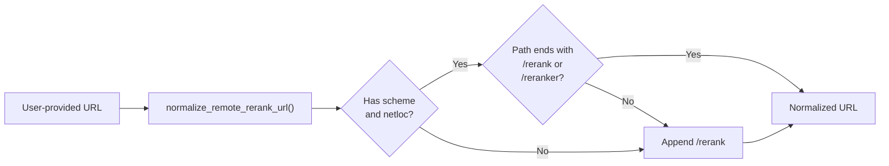
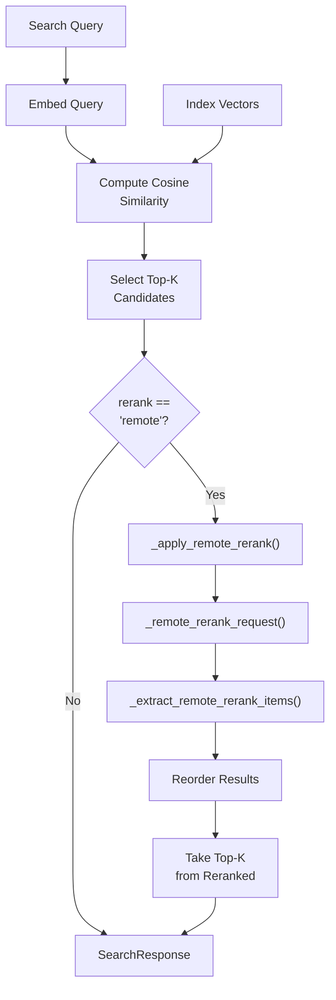
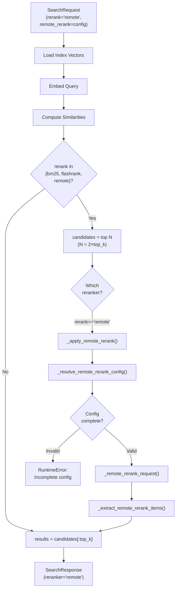
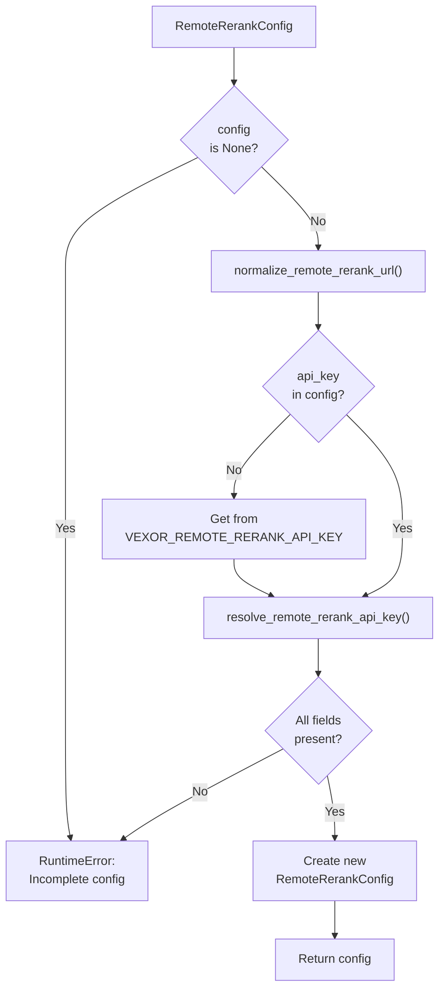

<!-- source: DeepWiki mcp.deepwiki.com · repo scarletkc/vexor · page 8.8 Remote Reranking · fetched 2026-10-26 -->

# Remote Reranking

<details>
<summary>Relevant source files</summary>

The following files were used as context for generating this wiki page:

- [tests/unit/test_search_service.py](tests/unit/test_search_service.py)
- [vexor/config.py](vexor/config.py)
- [vexor/services/search_service.py](vexor/services/search_service.py)

</details>


This page documents how to configure and use remote HTTP-based reranking services with Vexor. Remote reranking allows you to delegate result reordering to an external API endpoint, enabling integration with specialized reranking models or services.

For information about other reranking strategies (BM25, FlashRank), see [Reranking Strategies](#3.4). For general search configuration, see [Python API Reference](#5).

---

## Overview

Remote reranking is one of four reranking strategies available in Vexor (`off`, `bm25`, `flashrank`, `remote`). When enabled, Vexor sends candidate search results to a configured HTTP endpoint, which returns reordered results based on relevance scores from a specialized reranking model.

**Use remote reranking when:**
- You need domain-specific reranking models not available locally
- You want to leverage cloud-based reranking services (e.g., Cohere, Jina AI)
- You have custom reranking infrastructure
- You need consistent reranking across multiple clients

**Key characteristics:**
- Operates on top-K candidate results from vector similarity search
- Requires network access to an HTTP API endpoint
- Supports standard reranking API formats
- Falls back gracefully on API errors

Sources: [vexor/services/search_service.py:1-70](), [vexor/config.py:54-59]()

---

## Configuration Structure

Remote reranking requires three configuration parameters, represented by the `RemoteRerankConfig` dataclass:

| Parameter | Type | Description | Required |
|-----------|------|-------------|----------|
| `base_url` | `str` | HTTP endpoint for reranking requests | Yes |
| `api_key` | `str` | Authentication token (or environment variable) | Yes |
| `model` | `str` | Model identifier to use for reranking | Yes |

The configuration is stored as a nested object in the main Vexor configuration:

```json
{
  "rerank": "remote",
  "remote_rerank": {
    "base_url": "https://api.example.com/v1/rerank",
    "api_key": "your-api-key",
    "model": "rerank-english-v2.0"
  }
}
```

Sources: [vexor/config.py:54-91](), [vexor/config.py:174-183]()

---

## Configuration Methods

### CLI Configuration

Use the `vexor config` command to set remote reranking parameters:

```bash
# Enable remote reranking and set all parameters
vexor config --rerank remote \
  --remote-rerank-url "https://api.cohere.ai/v1/rerank" \
  --remote-rerank-key "your-api-key" \
  --remote-rerank-model "rerank-english-v2.0"

# Clear remote reranking configuration
vexor config --clear-remote-rerank
```

### Python API Configuration

Configure remote reranking programmatically:

```python
import vexor

# Set via config update
vexor.update_config_from_json({
    "rerank": "remote",
    "remote_rerank": {
        "base_url": "https://api.cohere.ai/v1/rerank",
        "api_key": "your-api-key",
        "model": "rerank-english-v2.0"
    }
})

# Or use the dedicated function
from vexor.config import update_remote_rerank
update_remote_rerank(
    base_url="https://api.cohere.ai/v1/rerank",
    api_key="your-api-key",
    model="rerank-english-v2.0"
)

# Search with remote reranking
results = vexor.search("query", path="/path/to/code")
```

### Direct API Call with RemoteRerankConfig

Pass configuration directly to search functions:

```python
from vexor.config import RemoteRerankConfig

config = RemoteRerankConfig(
    base_url="https://api.cohere.ai/v1/rerank",
    api_key="your-api-key",
    model="rerank-english-v2.0"
)

results = vexor.search(
    "query",
    path="/path/to/code",
    rerank="remote",
    remote_rerank=config
)
```

### Environment Variable Fallback

The API key can be provided via environment variable instead of storing it in the config file:

```bash
export VEXOR_REMOTE_RERANK_API_KEY="your-api-key"
```

When the `api_key` field in `RemoteRerankConfig` is `None`, Vexor automatically checks the `VEXOR_REMOTE_RERANK_API_KEY` environment variable.

Sources: [vexor/config.py:351-372](), [vexor/config.py:495-503](), [vexor/config.py:48]()

---

## URL Normalization

Vexor automatically normalizes reranking URLs to ensure consistent formatting:



**Examples:**

| Input | Normalized Output |
|-------|-------------------|
| `https://api.example.com/v1` | `https://api.example.com/v1/rerank` |
| `https://api.example.com/v1/rerank` | `https://api.example.com/v1/rerank` |
| `https://api.example.com/v1/reranker` | `https://api.example.com/v1/reranker` |
| `api.example.com` | `api.example.com/rerank` |

Sources: [vexor/config.py:375-394]()

---

## HTTP Request/Response Protocol

### Request Format

Vexor sends HTTP POST requests with the following JSON payload:

```json
{
  "model": "rerank-english-v2.0",
  "query": "user search query",
  "documents": [
    "file1.py path/to/file1.py preview text...",
    "file2.py path/to/file2.py more preview text...",
    "..."
  ]
}
```

Request headers:
- `Content-Type: application/json`
- `Authorization: Bearer {api_key}`

Each document string is constructed by the `_build_rerank_document()` function, combining:
1. File name (`result.path.name`)
2. Full file path (`result.path.as_posix()`)
3. Preview text (`result.preview`)

Sources: [vexor/services/search_service.py:248-264](), [vexor/services/search_service.py:102-104](), [vexor/services/search_service.py:331-333]()

### Response Format

Vexor accepts two response formats. The API can return results under either `"results"` or `"data"` keys:

**Format 1 (Cohere-style):**
```json
{
  "results": [
    {"index": 2, "relevance_score": 0.95},
    {"index": 0, "relevance_score": 0.87},
    {"index": 1, "relevance_score": 0.72}
  ]
}
```

**Format 2 (Alternative):**
```json
{
  "data": [
    {"index": 2, "score": 0.95},
    {"index": 0, "score": 0.87},
    {"index": 1, "score": 0.72}
  ]
}
```

Each item must include:
- `index` (integer): Zero-based index into the original `documents` array
- `relevance_score` or `score` (float, optional): New relevance score

The response parsing logic in `_extract_remote_rerank_items()` handles both formats and gracefully handles missing scores.

Sources: [vexor/services/search_service.py:293-320](), [tests/unit/test_search_service.py:876-878](), [tests/unit/test_search_service.py:937-938]()

---

## Integration with Search Pipeline

Remote reranking operates within the broader search execution flow:



### Candidate Selection

When remote reranking is enabled, Vexor retrieves more candidates than the final `top_k`:

```python
candidate_limit = _resolve_rerank_candidates(top_k)
# Returns max(20, min(top_k * 2, 150))
```

**Examples:**
- `top_k=10` → 20 candidates
- `top_k=50` → 100 candidates  
- `top_k=100` → 150 candidates (capped)

This oversampling ensures the reranker has sufficient candidates to improve result quality.

Sources: [vexor/services/search_service.py:116-118](), [vexor/services/search_service.py:626-630](), [tests/unit/test_search_service.py:982-992]()

### Result Reordering

The `_apply_remote_rerank()` function processes the API response:

1. **Build documents**: Convert each `SearchResult` to a document string
2. **Send request**: POST to configured endpoint with query and documents
3. **Parse response**: Extract `(index, score)` tuples from response
4. **Reorder results**: 
   - Place returned items in order specified by API
   - Update `result.score` with `relevance_score` if provided
   - Append any unreturned items to the end
5. **Trim to top_k**: Return only the requested number of results

Sources: [vexor/services/search_service.py:323-355](), [vexor/services/search_service.py:692-698]()

---

## Search Service Integration

The main search function `perform_search()` integrates remote reranking:



Sources: [vexor/services/search_service.py:358-708](), [vexor/services/search_service.py:691-697]()

---

## Configuration Resolution

The `_resolve_remote_rerank_config()` function ensures all required parameters are present:



The function returns an error with message `ERROR_REMOTE_RERANK_INCOMPLETE` if:
- Config is `None`
- `base_url` is empty after normalization
- `model` is empty
- `api_key` is empty (and not in environment)

Sources: [vexor/services/search_service.py:226-245](), [vexor/config.py:495-503]()

---

## Error Handling

Remote reranking implements comprehensive error handling:

### HTTP Errors

```python
try:
    with urlrequest.urlopen(request) as response:
        body = response.read().decode("utf-8", errors="replace")
except urlerror.HTTPError as exc:
    # Includes status code and response body (first 200 chars)
    raise RuntimeError(f"Remote rerank failed: HTTP {exc.code}: {detail}")
except urlerror.URLError as exc:
    # Network/connection errors
    raise RuntimeError(f"Remote rerank failed: {str(exc)}")
```

### JSON Parsing Errors

```python
try:
    return json.loads(body)
except json.JSONDecodeError:
    raise RuntimeError("Remote rerank failed: Invalid JSON response")
```

### Graceful Degradation

If the response cannot be parsed or contains no items, `_apply_remote_rerank()` returns the original candidate list unchanged rather than failing the search entirely:

```python
items = _extract_remote_rerank_items(payload)
if not items:
    return list(results)  # Return original order
```

Sources: [vexor/services/search_service.py:265-290](), [vexor/services/search_service.py:339-341]()

---

## Complete Usage Example

### Cohere Reranking

```python
import vexor
from vexor.config import RemoteRerankConfig

# Configure Cohere reranking
config = RemoteRerankConfig(
    base_url="https://api.cohere.ai/v1/rerank",
    api_key="your-cohere-api-key",
    model="rerank-english-v2.0"
)

# Search with remote reranking
results = vexor.search(
    "authentication implementation",
    path="~/projects/myapp/src",
    rerank="remote",
    remote_rerank=config,
    top_k=10
)

# Process results
for result in results:
    print(f"{result.path}: {result.score:.3f}")
    if result.preview:
        print(f"  {result.preview}")
```

### Jina AI Reranking

```bash
# Configure via CLI
export VEXOR_REMOTE_RERANK_API_KEY="your-jina-api-key"

vexor config --rerank remote \
  --remote-rerank-url "https://api.jina.ai/v1/rerank" \
  --remote-rerank-model "jina-reranker-v1-base-en"

# Search from CLI
vexor search "error handling patterns" --path ~/code --top 10
```

Sources: [tests/unit/test_search_service.py:860-918](), [tests/unit/test_search_service.py:921-979]()

---

## Comparison with Other Rerankers

| Feature | Remote | BM25 | FlashRank |
|---------|--------|------|-----------|
| Requires network | Yes | No | No |
| Requires API key | Yes | No | No |
| Model quality | Variable (service-dependent) | Basic lexical | Neural (local) |
| Latency | Higher (HTTP round-trip) | Low | Medium |
| Cost | Per-request (service-dependent) | Free | Free |
| Setup complexity | Medium | Low | Low (requires pip install) |
| Customization | Service-dependent | None | Model selection only |

**Choose remote reranking when:**
- You need state-of-the-art reranking quality
- You want to leverage commercial reranking services
- You have existing reranking infrastructure
- Network latency is acceptable for your use case

**Choose BM25 when:**
- You need purely local execution
- You want lexical matching (keyword-based)
- Latency must be minimal

**Choose FlashRank when:**
- You need neural reranking without network dependencies
- You can install additional Python packages
- You want a balance between quality and latency

Sources: [vexor/services/search_service.py:56](), [vexor/config.py:33-38]()

---

## Troubleshooting

### Configuration Incomplete Error

**Error:** `RuntimeError: Remote reranking requires base_url, api_key, and model to be configured`

**Solutions:**
1. Verify all three fields are set in config: `vexor config --show`
2. Check environment variable: `echo $VEXOR_REMOTE_RERANK_API_KEY`
3. Pass configuration explicitly in API calls

### HTTP Errors

**Error:** `RuntimeError: Remote rerank failed: HTTP 401: ...`

**Solutions:**
1. Verify API key is correct and not expired
2. Check if service requires different authentication headers
3. Ensure `base_url` points to correct endpoint

### Network Timeout

**Error:** `RuntimeError: Remote rerank failed: timed out`

**Solutions:**
1. Check network connectivity to service
2. Verify firewall/proxy settings
3. Consider using local reranking (BM25/FlashRank) as fallback

### No Results Reordered

**Symptom:** Results returned but order unchanged

**Solutions:**
1. Check service response format matches expected structure
2. Verify service is returning valid index values
3. Enable debug logging to inspect response payload

### Dimension Mismatch Before Reranking

**Error:** `ValueError: Embedding dimension mismatch: index has 1536-dim vectors, but query embedding is 512-dim`

**Solution:** This occurs before reranking. Rebuild index with correct embedding dimensions:
```bash
vexor index --clear /path/to/code
```

Sources: [vexor/services/search_service.py:230-238](), [vexor/services/search_service.py:268-284]()

---

## API Reference Summary

### Core Functions

| Function | Location | Purpose |
|----------|----------|---------|
| `_resolve_remote_rerank_config()` | [vexor/services/search_service.py:226-245]() | Validate and resolve configuration |
| `_remote_rerank_request()` | [vexor/services/search_service.py:248-290]() | Send HTTP POST request to reranking API |
| `_extract_remote_rerank_items()` | [vexor/services/search_service.py:293-320]() | Parse response and extract (index, score) pairs |
| `_apply_remote_rerank()` | [vexor/services/search_service.py:323-355]() | Orchestrate reranking and reorder results |
| `normalize_remote_rerank_url()` | [vexor/config.py:375-394]() | Normalize URL to standard format |
| `resolve_remote_rerank_api_key()` | [vexor/config.py:495-503]() | Resolve API key from config or environment |
| `update_remote_rerank()` | [vexor/config.py:351-372]() | Update remote reranking configuration |

### Configuration Classes

| Class | Location | Purpose |
|-------|----------|---------|
| `RemoteRerankConfig` | [vexor/config.py:54-59]() | Remote reranking configuration container |
| `SearchRequest` | [vexor/services/search_service.py:33-60]() | Search parameters including `remote_rerank` field |

### Environment Variables

| Variable | Purpose |
|----------|---------|
| `VEXOR_REMOTE_RERANK_API_KEY` | Fallback API key for remote reranking |

Sources: [vexor/services/search_service.py:1-355](), [vexor/config.py:54-503]()

---

