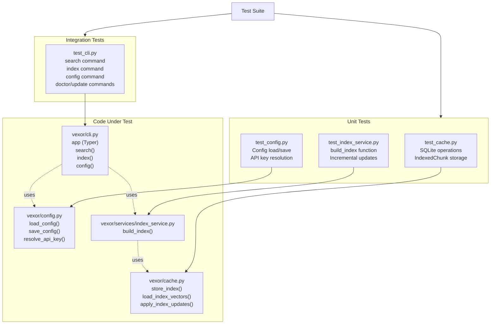
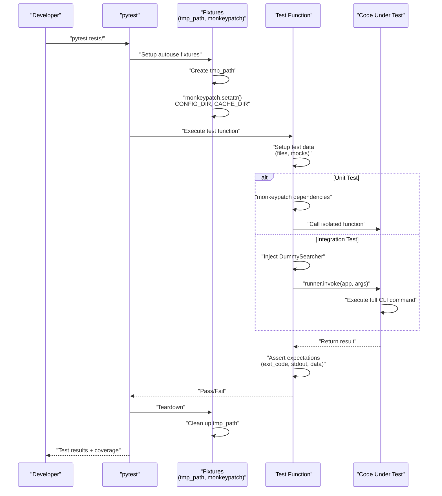
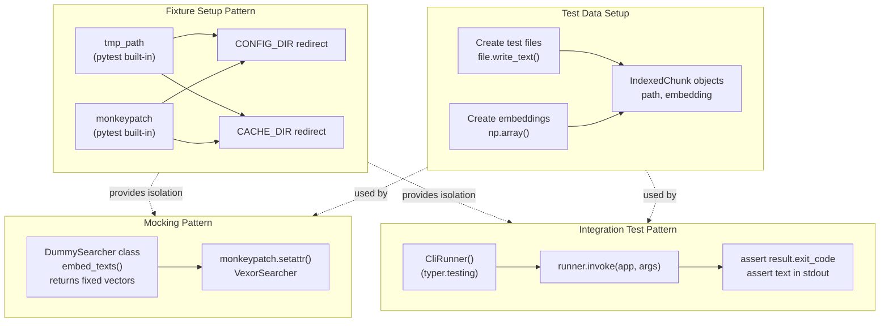

<!-- source: DeepWiki mcp.deepwiki.com · repo scarletkc/vexor · page 9.2 Testing · fetched 2026-10-26 -->

# Testing

<details>
<summary>Relevant source files</summary>

The following files were used as context for generating this wiki page:

- [tests/integration/test_cli.py](tests/integration/test_cli.py)
- [tests/integration/test_cli_commands.py](tests/integration/test_cli_commands.py)
- [tests/unit/test_query_cache.py](tests/unit/test_query_cache.py)
- [tests/unit/test_system_service.py](tests/unit/test_system_service.py)
- [vexor/services/system_service.py](vexor/services/system_service.py)

</details>


This page documents Vexor's test suite, including test organization, frameworks, testing patterns, and execution procedures. Tests are divided into unit tests (isolated component testing) and integration tests (end-to-end CLI workflow validation). For information about the development setup required before running tests, see [Development Setup](#7.1).

---

## Test Organization

Vexor's test suite is organized into two primary categories under the `tests/` directory:

| Directory | Purpose | Scope |
|-----------|---------|-------|
| `tests/unit/` | Component-level tests | Individual modules tested in isolation with dependencies mocked |
| `tests/integration/` | End-to-end tests | Complete CLI workflows tested with simulated backends |

The test files follow a naming convention matching the modules they test:

- [tests/unit/test_cache.py]() tests [vexor/cache.py]()
- [tests/unit/test_config.py]() tests [vexor/config.py]()
- [tests/unit/test_index_service.py]() tests [vexor/services/index_service.py]()
- [tests/integration/test_cli.py]() tests all CLI commands in [vexor/cli.py]()

**Sources:** [tests/integration/test_cli.py](), [tests/unit/test_cache.py](), [tests/unit/test_index_service.py](), [tests/unit/test_config.py]()

---

## Test Framework and Dependencies

Vexor uses **pytest** as its primary test framework with additional tooling for coverage and assertions:

| Package | Version | Purpose |
|---------|---------|---------|
| `pytest` | ≥7.4 | Test runner and assertion framework |
| `pytest-cov` | ≥4.1 | Code coverage measurement |
| `typer.testing.CliRunner` | (via typer) | CLI command invocation testing |

These dependencies are declared in both [pyproject.toml:46-48]() under `[project.optional-dependencies]` and [requirements.txt:12-14]().

### Pytest Configuration

The test configuration is defined in [pyproject.toml:73-75]():

```toml
[tool.pytest.ini_options]
addopts = "-ra"
pythonpath = ["."]
```

The `-ra` option displays summary information for all test outcomes except passed tests.

**Sources:** [pyproject.toml:46-51](), [requirements.txt:12-14](), [pyproject.toml:73-75]()

---

## Test Suite Architecture



**Sources:** [tests/unit/test_cache.py](), [tests/unit/test_config.py](), [tests/unit/test_index_service.py](), [tests/integration/test_cli.py]()

---

## Key Testing Patterns

### Temporary Directory Fixtures

All tests use temporary directories to avoid polluting the user's file system or test environment. The primary pattern uses `tmp_path` (pytest built-in) combined with `monkeypatch` to redirect configuration:

```python
@pytest.fixture(autouse=True)
def temp_config_home(tmp_path, monkeypatch):
    config_dir = tmp_path / "config"
    config_file = config_dir / "config.json"
    monkeypatch.setattr("vexor.config.CONFIG_DIR", config_dir)
    monkeypatch.setattr("vexor.config.CONFIG_FILE", config_file)
    return config_file
```

This fixture pattern appears in [tests/integration/test_cli.py:25-31]() and is marked `autouse=True` to apply automatically to all tests in that module.

For cache-related tests, the `CACHE_DIR` is similarly redirected:

```python
monkeypatch.setattr(cache, "CACHE_DIR", tmp_path)
```

This pattern appears throughout [tests/unit/test_cache.py]() in functions like [tests/unit/test_cache.py:34-36]().

### DummySearcher Pattern

To test indexing and search functionality without making real API calls to Gemini or OpenAI, tests use a `DummySearcher` class that mimics the `VexorSearcher` interface:

```python
class DummySearcher:
    def __init__(self, *args, **kwargs):
        self.device = "dummy"

    def embed_texts(self, texts):
        if not texts:
            return np.zeros((0, 3), dtype=np.float32)
        return np.ones((len(texts), 3), dtype=np.float32)
```

This pattern appears in [tests/integration/test_cli.py:618-625](), [tests/integration/test_cli.py:676-683](), and [tests/unit/test_index_service.py:7-19](). The `DummySearcher` returns fixed-dimension vectors (typically 3D for testing) instead of calling external APIs.

Tests inject this mock using monkeypatch:

```python
monkeypatch.setattr("vexor.search.VexorSearcher", DummySearcher)
```

### CliRunner Pattern

Integration tests use Typer's `CliRunner` to invoke CLI commands programmatically:

```python
from typer.testing import CliRunner

runner = CliRunner()
result = runner.invoke(
    app,
    [
        "search",
        "query",
        "--path",
        str(tmp_path),
        "--mode",
        "name",
    ],
)

assert result.exit_code == 0
assert "expected output" in result.stdout
```

This pattern is used extensively in [tests/integration/test_cli.py]() for testing commands like `search` [tests/integration/test_cli.py:34-70](), `index` [tests/integration/test_cli.py:155-182](), and `config` [tests/integration/test_cli.py:409-439]().

### ANSI Code Stripping

CLI output contains ANSI escape codes for colors and formatting. Tests use a utility function to strip these when checking output:

```python
ANSI_RE = re.compile(r"\x1b\[[0-9;]*m")

def strip_ansi(text: str) -> str:
    return ANSI_RE.sub("", text)
```

Defined in [tests/integration/test_cli.py:18-22](), this function enables clean assertion of text content without worrying about terminal formatting codes.

**Sources:** [tests/integration/test_cli.py:25-31](), [tests/unit/test_cache.py:34-36](), [tests/integration/test_cli.py:618-625](), [tests/integration/test_cli.py:34-70](), [tests/integration/test_cli.py:18-22]()

---

## Test Execution Flow



**Sources:** [tests/integration/test_cli.py:25-31](), [tests/integration/test_cli.py:34-70](), [tests/unit/test_index_service.py:27-88]()

---

## Running Tests

### Basic Test Execution

Run all tests:
```bash
pytest
```

Run only unit tests:
```bash
pytest tests/unit/
```

Run only integration tests:
```bash
pytest tests/integration/
```

Run a specific test file:
```bash
pytest tests/unit/test_cache.py
```

Run a specific test function:
```bash
pytest tests/unit/test_cache.py::test_store_and_load_index
```

### Coverage Reporting

Generate coverage report:
```bash
pytest --cov=vexor
```

Generate HTML coverage report:
```bash
pytest --cov=vexor --cov-report=html
```

The HTML report is generated in `htmlcov/index.html` and can be viewed in a browser.

### Verbose Output

Run tests with verbose output to see individual test names:
```bash
pytest -v
```

Combine with coverage for detailed reporting:
```bash
pytest -v --cov=vexor
```

**Sources:** [pyproject.toml:73-75]()

---

## Test Coverage Areas

### Cache Module Tests ([tests/unit/test_cache.py]())

The cache test suite validates the SQLite-based storage layer:

| Test Function | Purpose | Key Assertions |
|---------------|---------|----------------|
| `test_store_and_load_index` | Round-trip storage | Paths, vectors, metadata preserved [tests/unit/test_cache.py:34-80]() |
| `test_compare_snapshot_matches` | Change detection | Timestamp/size comparison accuracy [tests/unit/test_cache.py:89-103]() |
| `test_compare_snapshot_detects_changes` | Modified file detection | Returns False for changed files [tests/unit/test_cache.py:106-124]() |
| `test_apply_index_updates_handles_add_modify_delete` | Incremental updates | Add, modify, delete operations [tests/unit/test_cache.py:216-283]() |
| `test_clear_index_removes_cached_entries` | Cache clearing | Selective removal by cache key [tests/unit/test_cache.py:126-178]() |
| `test_extension_specific_caches_have_distinct_metadata` | Extension filtering | Separate caches per extension tuple [tests/unit/test_cache.py:363-410]() |

### Config Module Tests ([tests/unit/test_config.py]())

Configuration management tests:

| Test Function | Purpose |
|---------------|---------|
| `test_load_config_defaults` | Default values loaded correctly [tests/unit/test_config.py:14-20]() |
| `test_set_provider_and_base_url` | Provider/URL persistence [tests/unit/test_config.py:23-35]() |
| `test_resolve_api_key_prefers_config` | API key precedence order [tests/unit/test_config.py:38-39]() |
| `test_resolve_api_key_env_fallback` | Environment variable fallback [tests/unit/test_config.py:42-45]() |

### Index Service Tests ([tests/unit/test_index_service.py]())

Index building logic tests:

| Test Function | Purpose |
|---------------|---------|
| `test_build_index_runs_incremental_update` | Incremental update execution [tests/unit/test_index_service.py:27-88]() |
| `test_build_index_falls_back_to_full_rebuild` | Full rebuild on large changes [tests/unit/test_index_service.py:90-111]() |

These tests track `DummySearcher.calls` to verify that only modified files are re-embedded during incremental updates.

### Integration Tests ([tests/integration/test_cli.py]())

End-to-end CLI command tests covering all five commands:

#### Search Command Tests

- `test_search_outputs_table`: Validates result table formatting [tests/integration/test_cli.py:34-70]()
- `test_search_respects_no_recursive_flag`: Tests `--no-recursive` flag [tests/integration/test_cli.py:73-105]()
- `test_search_missing_index_prompts_user`: Error handling for missing cache [tests/integration/test_cli.py:108-129]()
- `test_search_warns_when_stale`: Staleness warning display [tests/integration/test_cli.py:377-406]()

#### Index Command Tests

- `test_index_handles_empty_directory`: Empty directory handling [tests/integration/test_cli.py:132-152]()
- `test_index_writes_cache`: Cache creation verification [tests/integration/test_cli.py:155-182]()
- `test_index_skips_when_up_to_date`: UP_TO_DATE status handling [tests/integration/test_cli.py:185-210]()
- `test_index_show_displays_metadata`: `--show` flag output [tests/integration/test_cli.py:241-270]()
- `test_index_clear_option`: `--clear` flag functionality [tests/integration/test_cli.py:314-345]()

#### Config Command Tests

- `test_config_set_and_show`: Configuration persistence [tests/integration/test_cli.py:409-439]()
- `test_config_clear_api_key`: API key removal [tests/integration/test_cli.py:442-452]()
- `test_config_rejects_unknown_provider`: Provider validation [tests/integration/test_cli.py:470-476]()
- `test_config_without_args_opens_editor`: Editor invocation [tests/integration/test_cli.py:479-498]()

#### Doctor and Update Command Tests

- `test_doctor_reports_success`: PATH validation success [tests/integration/test_cli.py:564-571]()
- `test_doctor_reports_failure`: PATH validation failure [tests/integration/test_cli.py:574-581]()
- `test_update_detects_newer_version`: Version comparison [tests/integration/test_cli.py:584-591]()

#### Mode-Specific End-to-End Tests

- `test_head_mode_end_to_end`: Head mode indexing and search [tests/integration/test_cli.py:617-672]()
- `test_full_mode_chunked_previews`: Full mode chunking behavior [tests/integration/test_cli.py:675-729]()
- `test_brief_mode_keywords`: Brief mode keyword extraction [tests/integration/test_cli.py:732-778]()

**Sources:** [tests/unit/test_cache.py](), [tests/unit/test_config.py](), [tests/unit/test_index_service.py](), [tests/integration/test_cli.py]()

---

## Testing Patterns Reference



**Sources:** [tests/integration/test_cli.py:25-31](), [tests/integration/test_cli.py:618-625](), [tests/unit/test_cache.py:12-31]()

---

## Writing New Tests

### Unit Test Template

For testing a new module function:

```python
import pytest
from pathlib import Path

def test_new_function(tmp_path, monkeypatch):
    # Setup: redirect cache/config dirs
    monkeypatch.setattr("vexor.cache.CACHE_DIR", tmp_path)
    
    # Setup: create test data
    test_file = tmp_path / "test.txt"
    test_file.write_text("content")
    
    # Execute: call function under test
    result = module.new_function(test_file)
    
    # Assert: verify expected behavior
    assert result.status == ExpectedStatus.SUCCESS
    assert result.data == "expected_value"
```

### Integration Test Template

For testing a new CLI command:

```python
from typer.testing import CliRunner
from vexor.cli import app

def test_new_command(tmp_path, monkeypatch):
    # Setup: redirect config
    monkeypatch.setattr("vexor.config.CONFIG_DIR", tmp_path / "config")
    
    # Setup: mock external dependencies
    class DummyBackend:
        def method(self, args):
            return "mocked_result"
    
    monkeypatch.setattr("vexor.module.RealBackend", DummyBackend)
    
    # Execute: invoke CLI command
    runner = CliRunner()
    result = runner.invoke(app, ["command", "--arg", "value"])
    
    # Assert: verify exit code and output
    assert result.exit_code == 0
    assert "expected message" in result.stdout
```

### Test Naming Conventions

- Test files: `test_<module_name>.py`
- Test functions: `test_<functionality_being_tested>`
- Use descriptive names that explain what is being tested
- Unit tests should match the module they test
- Integration tests should describe the workflow being tested

### Common Assertions

- Exit codes: `assert result.exit_code == 0` (success) or `!= 0` (failure)
- Output content: `assert "text" in result.stdout`
- File existence: `assert cache_path.exists()`
- Array equality: `assert np.allclose(actual, expected)`
- Collection contents: `assert [p.name for p in paths] == ["a.txt", "b.txt"]`
- Exception raising: `with pytest.raises(FileNotFoundError):`

**Sources:** [tests/integration/test_cli.py](), [tests/unit/test_cache.py](), [tests/unit/test_index_service.py]()

---

## Summary

Vexor's test suite provides comprehensive coverage through:

1. **Unit tests** that isolate individual modules using mocking and temporary directories
2. **Integration tests** that validate complete CLI workflows end-to-end
3. **Standard patterns** including `tmp_path` fixtures, `DummySearcher` mocks, and `CliRunner` invocation
4. **pytest framework** with coverage reporting capabilities

Tests ensure correctness of core functionality including cache operations, configuration management, incremental index updates, and all CLI commands. The testing infrastructure makes heavy use of pytest fixtures and monkeypatching to achieve isolation without requiring external API credentials or polluting the user's file system.

---

