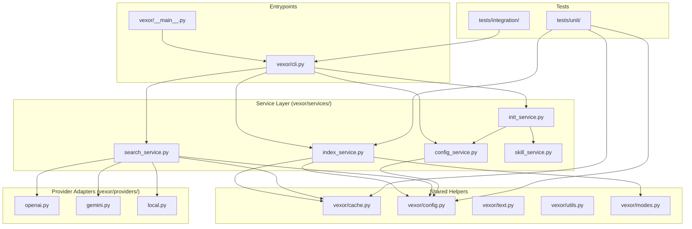
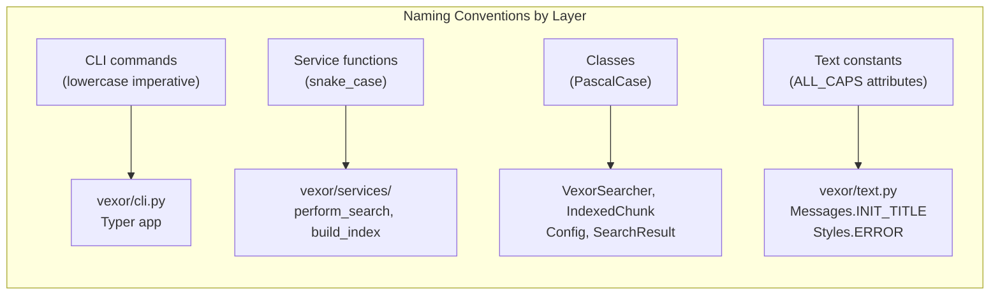
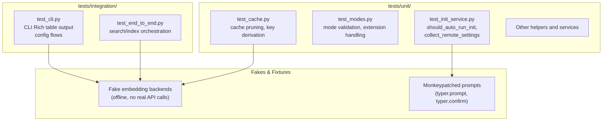

<!-- source: DeepWiki mcp.deepwiki.com · repo scarletkc/vexor · page 9.4 Contributing Guidelines · fetched 2026-10-26 -->

# Contributing Guidelines

<details>
<summary>Relevant source files</summary>

The following files were used as context for generating this wiki page:

- [README.md](README.md)

</details>


This page covers the conventions, workflows, and standards required to contribute to the Vexor codebase. It is drawn primarily from [AGENTS.md]() and supplemented by [pyproject.toml]().

For information on setting up a local development environment, see [Development Setup (9.1)](#9.1). For details on how tests are structured and run, see [Testing (9.2)](#9.2). For a map of where files live in the repository, see [Project Structure (9.3)](#9.3).

---

## Repository Structure & Module Organization

The codebase is divided into layers with strict separation of concerns. The Typer CLI entrypoints delegate to service modules, which in turn call shared helpers, provider adapters, and storage utilities.

**Module Dependency Map**



Key conventions enforced by this structure:

- All user-facing copy (strings, error messages) must go through `vexor/text.py` (`Messages`, `Styles`) so that Rich styling is applied consistently.
- CLI validation errors are surfaced via `typer.BadParameter`, not raw `ValueError` or `print()` calls.
- Provider adapters for VoyageAI reuse the OpenAI-compatible backend path (see [Provider System (7.5)](#7.5)).

Sources: [AGENTS.md:1-4](), [vexor/services/init_service.py:1-48]()

---

## Development Environment Setup

Install the package in editable mode with all development dependencies using the `dev` extra defined in `pyproject.toml`:

```
pip install -e .[dev]
```

The `dev` extra installs `pytest`, `pytest-cov`, `build`, `twine`, and `pyinstaller`. Optional feature extras used during development:

| Extra | Packages installed | Purpose |
|---|---|---|
| `local` | `fastembed>=0.4.0` | Local embedding inference |
| `local-cuda` | `fastembed`, `onnxruntime-gpu` | Local inference with CUDA |
| `flashrank` | `flashrank>=0.2.9` | Local neural reranking |
| `dev` | `pytest`, `pytest-cov`, `build`, `twine`, `pyinstaller` | Development tooling |

To smoke-test the CLI after setup:

```
python -m vexor --help
```

Realistic functional tests:

```
vexor index --path . --mode head
vexor search "config loader" --path . --mode name
```

Sources: [AGENTS.md:6-11](), [pyproject.toml:51-68]()

---

## Build Commands

| Command | Purpose |
|---|---|
| `pip install -e .[dev]` | Editable install with dev dependencies |
| `python -m vexor --help` | Smoke-test the CLI entrypoint |
| `pytest` | Run the full offline test suite |
| `pytest tests/unit -k cache` | Scope to a specific area |
| `pytest --maxfail=1 -ra` | Fail fast with full summary |
| `pytest --cov=vexor --cov-report=term-missing` | Coverage report (required before merging) |
| `python -m build` | Build wheel and sdist release artifacts |

The `pytest.ini_options` section in `pyproject.toml` sets `addopts = "-ra"` and `pythonpath = ["."]`, so running bare `pytest` applies those flags automatically.

Sources: [AGENTS.md:6-11](), [pyproject.toml:94-96]()

---

## Coding Style & Naming Conventions

| Convention | Rule |
|---|---|
| Indentation | 4 spaces |
| Line length | ~100 characters |
| Module and function names | `snake_case` |
| Class names | `PascalCase` |
| CLI command names | lowercase imperative (e.g., `search`, `index`) |
| User-facing strings | Route through `vexor/text.py` (`Messages`, `Styles`) |
| CLI validation errors | Raise `typer.BadParameter` |
| Type annotations | Required on all new code |

**Naming conventions across layers:**



Sources: [AGENTS.md:13-14](), [vexor/services/init_service.py:855-856]()

---

## Testing Guidelines

Tests are split into two suites, mirroring the source structure:

**Testing Architecture**



**Testing rules:**

- Unit suites validate deterministic, isolated logic: cache pruning, mode validation, extension handling.
- Integration suites spawn the CLI process to verify Rich tables, config flows, and search/index orchestration.
- Fake provider fixtures must be kept current so all tests run **offline** without real API calls.
- Every change must include:
  - A happy-path test
  - A failure-path test (invalid mode, missing config, empty query)
  - A regression test when cache or provider layers change

**Example test pattern from the unit suite** (illustrating monkeypatching of prompts):

[tests/unit/test_init_service.py:29-54]()

The test in that range patches `_prompt_choice` and `_prompt_api_key` so that `_collect_remote_settings` can be tested without any TTY interaction.

Sources: [AGENTS.md:16-17](), [tests/unit/test_init_service.py:1-84]()

---

## Commit & Pull Request Guidelines

Commit message format: concise, **imperative** subject line.

> Example: `Add vexor logo image`

Pull requests must include:

| Item | Details |
|---|---|
| Motivation | Why the change is needed |
| Verification | Commands run, screenshots, or output snippets |
| Issue link | Link to related issue if applicable |
| Coverage confirmation | Confirm `pytest --cov` passes |
| Backward compatibility note | Call out any changes to config paths, cache schema, or provider behavior |
| Documentation update | Update `README` and `docs/` when behavior changes |

Sources: [AGENTS.md:19-20]()

---

## Security, Configuration & Maintenance

| Rule | Detail |
|---|---|
| **No API keys in source** | Use `vexor config --set-api-key`, provider env vars, or `.env` files (which are gitignored) |
| **Config and cache location** | `~/.vexor/config.json` and `~/.vexor/index.db` — never check these in |
| **Stale index recovery** | `vexor config --clear-index-all` resets all cached indexes |
| **Path sanitization** | Sanitize all filesystem paths before use |
| **Embedding output trust** | Treat embedding vectors as untrusted before writing to disk |
| **Docs synchronization** | Update `README`, `docs/`, and `AGENTS.md` whenever workflows change |

The config and cache system is described in detail in [Cache System (3.5)](#3.5) and [Configuration System (7.7)](#7.7).

Sources: [AGENTS.md:22-23]()

---

