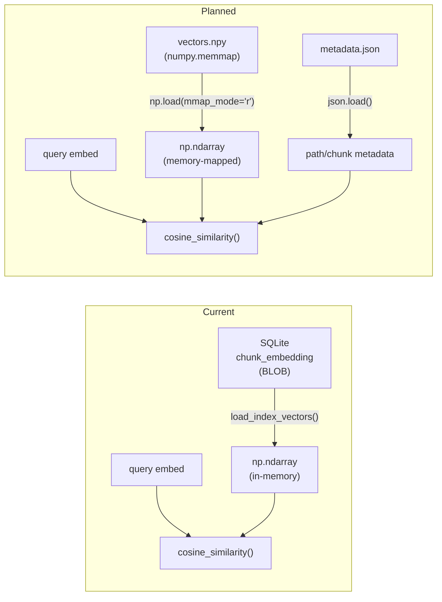
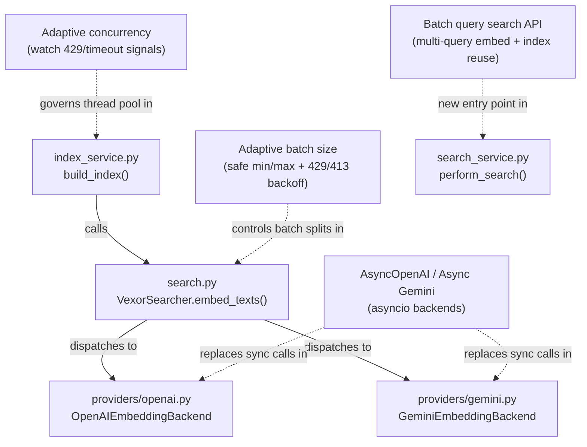
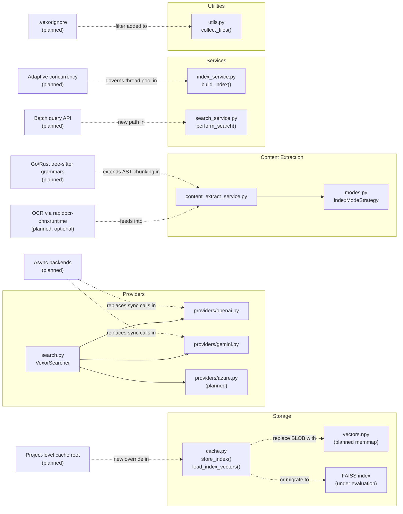

<!-- source: DeepWiki mcp.deepwiki.com · repo scarletkc/vexor · page 9.5 Roadmap · fetched 2026-10-26 -->

# Roadmap

Relevant source files

The following files were used as context for generating this wiki page:

- [docs/roadmap.md](docs/roadmap.md)
- [tests/unit/test_cache_upgrade_and_lines.py](tests/unit/test_cache_upgrade_and_lines.py)
- [tests/unit/test_index_service.py](tests/unit/test_index_service.py)

This page documents planned future work for the Vexor project. Items are drawn directly from [docs/roadmap.md:1-20]() and reflect the development team's current intentions, not commitments. For documentation on features that already exist, see [Architecture Deep Dive](#7) and [Advanced Usage](#8).

---

## Overview of Planned Work

The planned items fall into five broad categories:

| Category | Items |
|---|---|
| **Performance — Search** | `vectors.npy` memmap storage; FAISS migration |
| **Performance — API** | Adaptive concurrency; async backends; adaptive batch size; batch query API |
| **Content Extraction** | OCR for images; Go/Rust AST chunking |
| **Provider Expansion** | Azure embedding provider; official Vexor API relay |
| **Integrations & UX** | VS Code extension; `.vexorignore`; project-level cache root override |

Sources: [docs/roadmap.md:1-20]()

---

## Search Performance

### Replace SQLite Vector Blobs with Memmap Storage

Currently, embeddings are stored as binary blobs inside the SQLite database (see `vexor/cache.py`, the `chunk_embedding` table). On each search, `load_index_vectors()` deserializes all vectors from SQLite into a NumPy array before computing cosine similarity.

The planned approach replaces that with a `vectors.npy` + `metadata.json` pair loaded via `numpy.memmap`. This allows the OS to keep the file mapped across searches, avoiding repeated deserialization and reducing per-search I/O. The `metadata.json` file would carry the path/chunk data that currently lives in the `indexed_chunk` and `chunk_meta` tables.

**Affected code area:** `vexor/cache.py` (`store_index`, `load_index_vectors`, `load_index`), `vexor/services/search_service.py`.

**Diagram — Current vs. Planned Vector Storage Path**

Sources: [docs/roadmap.md:9](), [vexor/cache.py]()

### FAISS Migration

The roadmap lists evaluation of FAISS (or a comparable vector database) to replace the current NumPy cosine similarity loop. This would enable faster approximate nearest-neighbor search for large indexes and more expressive metadata filtering without manual post-processing.

**Affected code area:** `vexor/search.py` (`VexorSearcher`), `vexor/cache.py`.

Sources: [docs/roadmap.md:15]()

---

## API / Embedding Performance

These improvements target throughput and latency of the embedding pipeline, primarily inside `vexor/search.py` and `vexor/services/index_service.py`.

**Diagram — Planned API Performance Changes by Code Location**

| Improvement | Description | Signal / Guard |
|---|---|---|
| Adaptive embedding concurrency | Dynamically reduce thread count on `429` or timeout; never writes to config on disk | `429` / timeout — in-process only |
| Async embedding backends | Replace synchronous `openai` / `gemini` calls with `AsyncOpenAI` / async Gemini client | Reduces thread overhead; improves connection reuse |
| Adaptive batch size | Adjust per-batch size for remote providers; back off on `429` / `413` | Bounded by safe min/max |
| Batch query search API | Accept multiple queries per call; embed them together and load index vectors once | Reduces repeated I/O across queries |

Sources: [docs/roadmap.md:11-14]()

---

## Content Extraction

### OCR for Images

The planned feature adds OCR-backed content to `head` (and `full`) mode snippets for image files. The preferred backend is `rapidocr-onnxruntime`, chosen because it is pure Python + ONNX Runtime with no cloud upload requirement.

**Blocker:** Current RapidOCR wheels require `numpy<2`. Until the upstream stack supports NumPy 2.x, OCR will remain an optional extra rather than a default dependency, to avoid constraining users' NumPy version.

**Affected code area:** `vexor/services/content_extract_service.py` (the `extract_head` / `extract_full` functions), `vexor/modes.py` (`IndexModeStrategy`).

**Design constraints:**
- Lazy initialization — OCR engine is not loaded unless an image file is encountered.
- Per-file caching — avoid re-running OCR on unchanged files.
- Optional distribution — not bundled in the default `vexor` package.

Sources: [docs/roadmap.md:2-6]()

### AST-Aware Code Chunking for Go and Rust

The `code` indexing mode already uses tree-sitter to extract function/class-level chunks from Python, JavaScript, and TypeScript (see [Content Processing Pipeline](#7.6)). The roadmap extends this to Go and Rust by adding the corresponding tree-sitter grammars.

**Affected code area:** `vexor/services/content_extract_service.py` (AST chunking logic), `vexor/modes.py`.

Sources: [docs/roadmap.md:7]()

---

## Provider Expansion

### Azure Embedding Provider

An Azure OpenAI-compatible embedding backend is planned. Given that the `custom` provider already supports OpenAI-compatible endpoints (see [Custom Providers](#8.5)), the Azure backend would likely formalize Azure-specific authentication (Managed Identity, `api-version` query parameter) as a first-class provider alongside `openai`, `gemini`, `voyageai`, `local`, and `custom`.

**Affected code area:** `vexor/providers/` (new `azure.py`), `vexor/search.py` (`VexorSearcher` provider dispatch), `vexor/config.py` (`Config` dataclass).

Sources: [docs/roadmap.md:6]()

### Official Vexor API Relay Service

A hosted relay service would accept embedding requests and proxy them to upstream providers, removing the need for users to supply their own API keys. This would reduce per-request latency by pre-warming connections and potentially batching requests across users.

**Impact on codebase:** The `custom` provider path in `VexorSearcher` would be the most natural integration point. Configuration would be surfaced through `vexor config` and `vexor/config.py`.

Sources: [docs/roadmap.md:16]()

---

## Integrations and UX

### VS Code Extension

A VS Code extension would expose Vexor search directly from the editor. Implementation details are not yet specified; the most likely approach is wrapping the CLI in porcelain mode (see [Output Formats](#4.9)) or calling the Python API from a language server process.

Sources: [docs/roadmap.md:17]()

### `.vexorignore` Support

`.vexorignore` would work analogously to `.gitignore` but scoped to Vexor's file collection step. The affected function is `collect_files()` in `vexor/utils.py`, which already applies `.gitignore` rules via the `respect_gitignore` flag.

**Affected code area:** `vexor/utils.py` (`collect_files`), `vexor/services/index_service.py` (`build_index`).

Sources: [docs/roadmap.md:19]()

### Project-Level Cache Root Override

Currently, all indexes are stored under a single global cache directory (`~/.vexor/`). The roadmap plans a per-project cache root override so teams can place the index database alongside the project (e.g., inside `.vexor/` in the repo root).

**Affected code area:** `vexor/cache.py` (`CACHE_DIR`, `cache_db_path()`), `vexor/config.py` (`Config`), the `config_dir_context` `ContextVar` in `vexor/config.py`.

Sources: [docs/roadmap.md:18]()

---

## Summary Diagram

**Diagram — Roadmap Items Mapped to Affected Modules**

Sources: [docs/roadmap.md:1-20]()

---

