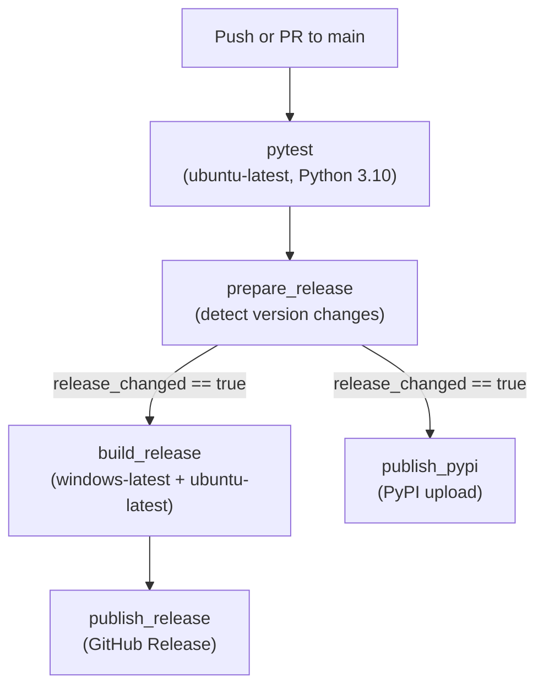
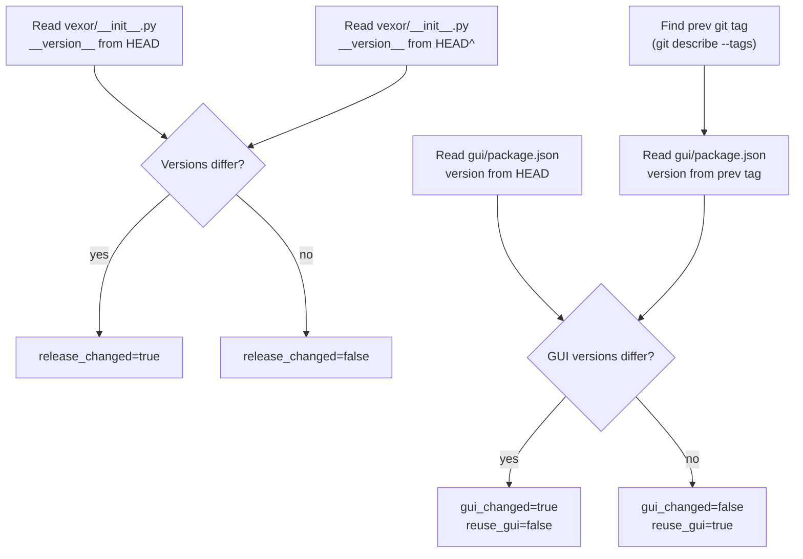
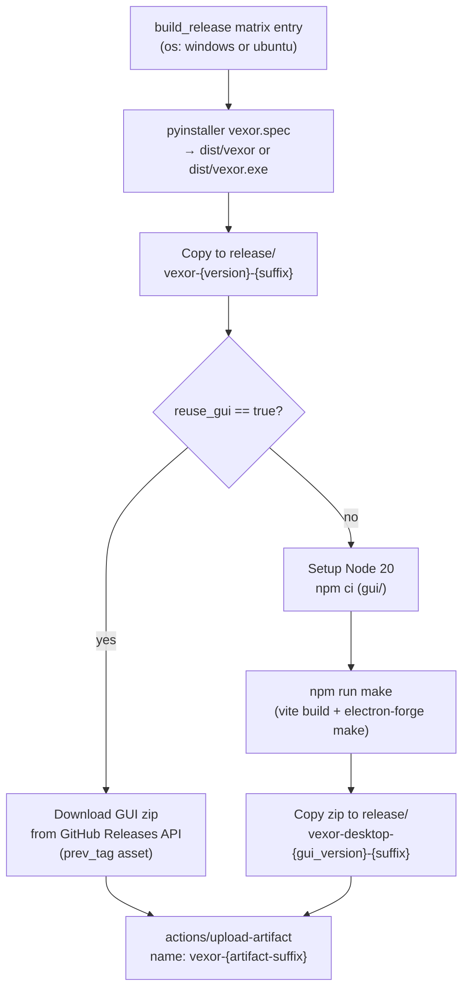
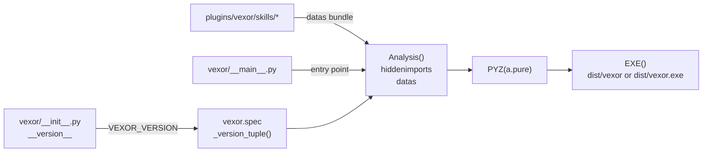

<!-- source: DeepWiki mcp.deepwiki.com · repo scarletkc/vexor · page 9.6 Build and Release · fetched 2026-10-26 -->

# Build and Release

<details>
<summary>Relevant source files</summary>

The following files were used as context for generating this wiki page:

- [README.md](README.md)

</details>


This page documents the CI/CD pipeline, binary packaging process, and version management tooling for Vexor. It covers how commits on `main` are tested, how platform executables are built with PyInstaller, how the Electron GUI is packaged with `electron-forge`, and how the `bump_version.py` script is used to advance version numbers before a release.

For information about the development environment setup and running tests locally, see [Development Setup](#9.1) and [Testing](#9.2). For repository layout, see [Project Structure](#9.3).

---

## CI/CD Pipeline Overview

The entire pipeline is defined in [.github/workflows/publish.yml:1-444](). It is triggered on every push and pull request to `main`. Five jobs run in sequence; not all jobs execute on every trigger.

**Pipeline job dependency diagram:**



Sources: [.github/workflows/publish.yml:1-444]()

---

## Job Reference

| Job | Runs on | Condition | Outputs |
|---|---|---|---|
| `pytest` | `ubuntu-latest` | Always (skipped for doc-only changes) | Pass/fail |
| `prepare_release` | `ubuntu-latest` | Push to `main` only | `release_changed`, `version`, `gui_changed`, `gui_version`, `prev_gui_version`, `prev_tag`, `reuse_gui` |
| `build_release` | `windows-latest` + `ubuntu-latest` | `release_changed == true` | Platform binary + GUI zip artifacts |
| `publish_release` | `ubuntu-latest` | `release_changed == true` | GitHub Release with tag `v{version}` |
| `publish_pypi` | `ubuntu-latest` | `release_changed == true` | PyPI wheel + sdist |

Sources: [.github/workflows/publish.yml:12-444]()

---

## Job: pytest

[.github/workflows/publish.yml:13-98]()

Before running any tests, a shell script diffs the changed files between the current commit and its parent. If **no `.py` files changed**, the job emits `changed=false` and all subsequent steps are skipped. This avoids unnecessary test runs on documentation-only commits.

When Python files have changed:
- Python 3.10 is set up via `actions/setup-python`.
- The package is installed in editable mode with dev extras: `pip install -e ".[dev]"`.
- Tests run as: `python -m pytest -q --cov=vexor --cov-report=xml`.
- Coverage is uploaded to Codecov (push-to-main only), controlled by the `CODECOV_TOKEN` secret.

The Codecov configuration at [.github/codecov.yml:1-8]() marks both `patch` and `project` coverage checks as `informational`, meaning they will not block CI.

Sources: [.github/workflows/publish.yml:13-98](), [.github/codecov.yml:1-8]()

---

## Job: prepare_release

[.github/workflows/publish.yml:101-196]()

This job runs an inline Python script that compares version strings between the current commit and `HEAD^` to decide whether a release should be published.

**Version detection logic:**



The `reuse_gui` flag is the key optimization: if the GUI version has not changed since the last tagged release, the `build_release` job skips the Electron build entirely and downloads the previous release's GUI artifact instead.

**Outputs emitted to `GITHUB_OUTPUT`:**

| Output | Type | Description |
|---|---|---|
| `release_changed` | bool | Whether `__version__` changed since `HEAD^` |
| `version` | string | Current Python package version |
| `gui_changed` | bool | Whether `gui/package.json` version changed since `prev_tag` |
| `gui_version` | string | Current GUI version |
| `prev_gui_version` | string | GUI version at previous tag |
| `prev_tag` | string | Most recent `v*` git tag before this one |
| `reuse_gui` | bool | `true` when `gui_changed=false` and a previous tag exists |

Sources: [.github/workflows/publish.yml:101-196]()

---

## Job: build_release

[.github/workflows/publish.yml:198-345]()

This job runs in a matrix across two platforms:

| Matrix key | Runner | CLI binary | GUI artifact |
|---|---|---|---|
| `windows-latest` | `windows-latest` | `dist/vexor.exe` → `vexor-{version}-windows.exe` | `gui/out/make/zip/win32/*/*.zip` → `vexor-desktop-{gui_version}-windows.zip` |
| `ubuntu-latest` | `ubuntu-latest` | `dist/vexor` → `vexor-{version}-linux` | `gui/out/make/zip/linux/*/*.zip` → `vexor-desktop-{gui_version}-linux.zip` |

### CLI Binary Build (PyInstaller)

[.github/workflows/publish.yml:233-254]()

Steps:
1. Install package with dev extras: `pip install ".[dev]"`.
2. Remove previous `dist/` and `build/` directories.
3. Run `pyinstaller vexor.spec` to produce the single-file executable.
4. Copy the binary to `release/vexor-{version}-{suffix}`.

### GUI Build (Electron Forge)

[.github/workflows/publish.yml:307-338]()

When `reuse_gui != true`:
1. Node 20 is set up; `npm ci` is run in the `gui/` directory.
2. `npm run make` is executed, which internally runs `vite build && electron-forge make` (see [gui/package.json:12-13]()).
3. The output zip is copied to `release/vexor-desktop-{gui_version}-{suffix}`.

### GUI Artifact Reuse

[.github/workflows/publish.yml:256-305]()

When `reuse_gui == true`, an inline Python script uses the GitHub REST API to:
1. Fetch the release at `prev_tag`.
2. Locate the asset named `vexor-desktop-{prev_gui_version}-{suffix}`.
3. Download it and write it to `release/vexor-desktop-{gui_version}-{suffix}`.

This skips the full Node/Electron build when only the Python package changed.

**Build flow per platform:**



Sources: [.github/workflows/publish.yml:198-345](), [gui/package.json:6-13]()

---

## Job: publish_release

[.github/workflows/publish.yml:347-405]()

Steps:
1. Downloads all platform artifacts using `actions/download-artifact` with `merge-multiple: true`.
2. Generates `release_notes.md` containing a git log between the previous `v*` tag and `HEAD`.
3. Creates a GitHub Release using `softprops/action-gh-release@v1`:
   - Tag: `v{version}`
   - Name: `Vexor v{version}`
   - `prerelease: true` when the version string contains `a`, `b`, or `rc`.
   - Attaches all files from the `release/` directory.

Sources: [.github/workflows/publish.yml:347-405]()

---

## Job: publish_pypi

[.github/workflows/publish.yml:407-444]()

Runs in parallel with `build_release`, depending only on `prepare_release`.

Steps:
1. Install `build`, `hatchling`, `twine`.
2. Remove previous `dist/` and `build/` directories.
3. Run `python -m build` to produce the wheel and source distribution.
4. Publish using `pypa/gh-action-pypi-publish@v1.13.0`, which uses OIDC trusted publishing (`id-token: write` permission).

Sources: [.github/workflows/publish.yml:407-444]()

---

## PyInstaller Packaging (`vexor.spec`)

[vexor.spec:1-171]()

The spec file produces a single-file executable from `vexor/__main__.py`.

**Key configuration decisions:**

| Setting | Value | Reason |
|---|---|---|
| Entry point | `vexor/__main__.py` | Package `__main__` entry |
| `upx=True` | On | Reduces binary size |
| `console=True` | On | CLI application |
| `noarchive=False` | Off | Embeds all Python into one file |
| Windows icon | `assets/vexor.ico` | Only applied on Windows |

**Hidden imports** declared explicitly because PyInstaller cannot detect them through static analysis:

```
google.genai (all submodules)
sklearn (all submodules)
tokenizers (all submodules)
tree_sitter (all submodules)
tree_sitter_javascript
tree_sitter_typescript
rank_bm25
```

**Bundled skill files:**

The spec copies all files from `plugins/vexor/skills/` into `vexor/_bundled_skills/` inside the frozen executable. This makes agent skills available at runtime without a separate installation step.

**Windows version metadata** is embedded as a `VSVersionInfo` struct with `CompanyName`, `FileDescription`, `FileVersion`, `ProductName`, and `ProductVersion` fields derived from `__version__` in `vexor/__init__.py`.

**`_version_tuple` function** [vexor.spec:37-62]() converts PEP 440 version strings (e.g. `0.19.0rc1`) into the 4-tuple format required by Windows version resources (e.g. `(0, 19, 0, 1)`).



Sources: [vexor.spec:1-171]()

---

## Version Management (`bump_version.py`)

[scripts/bump_version.py:1-159]()

`bump_version.py` is a standalone script for updating version strings across the repository in a single command.

**Usage:**

```
python scripts/bump_version.py 0.6.4
python scripts/bump_version.py v0.6.4
python scripts/bump_version.py --gui 0.6.4
```

**Files updated (without `--gui`):**

| File | Field updated | Function |
|---|---|---|
| `vexor/__init__.py` | `__version__ = "..."` | `_set_python_version()` |
| `plugins/vexor/.claude-plugin/plugin.json` | `"version"` key | `_set_plugin_version()` |

**Additional files updated (with `--gui`):**

| File | Field updated | Function |
|---|---|---|
| `gui/package.json` | `"version"` key | `_set_gui_version()` |
| `gui/package-lock.json` | top-level `"version"` and `packages[""]["version"]` | `_set_gui_lock_version()` |

**SemVer normalization:** Because `npm` requires strict SemVer and the Python package uses PEP 440 pre-release notation (e.g. `0.19.0rc1`), the `_to_gui_semver()` function [scripts/bump_version.py:140-155]() converts PEP 440 suffixes to SemVer pre-release notation:

| Python version | GUI version |
|---|---|
| `0.19.0` | `0.19.0` |
| `0.19.0rc1` | `0.19.0-rc1` |
| `0.19.0a2` | `0.19.0-a2` |

The Python package and plugin manifest always retain the original PEP 440 string; only the GUI files are normalized.

**File relationships managed by `bump_version.py`:**

```mermaid
flowchart LR
    script["scripts/bump_version.py\nmain() → _run()"]

    py["vexor/__init__.py\n__version__ = \"...\""]
    plugin["plugins/vexor/.claude-plugin/plugin.json\n{\"version\": \"...\"}"]
    pkg["gui/package.json\n{\"version\": \"...\"}"]
    lock["gui/package-lock.json\n{\"version\": \"...\",\n \"packages\": {\"\":{\"version\":\"...\"}}}"]

    semver["_to_gui_semver()\nPEP 440 → SemVer"]

    script -->|"_set_python_version()"| py
    script -->|"_set_plugin_version()"| plugin
    script -->|"--gui flag"| semver
    semver -->|"_set_gui_version()"| pkg
    semver -->|"_set_gui_lock_version()"| lock
```

Sources: [scripts/bump_version.py:1-159]()

---

## Release Artifacts Summary

Each GitHub Release produced by `publish_release` contains the following files:

| Artifact name pattern | Contents |
|---|---|
| `vexor-{version}-linux` | Single-file Linux CLI executable (PyInstaller) |
| `vexor-{version}-windows.exe` | Single-file Windows CLI executable (PyInstaller) |
| `vexor-desktop-{gui_version}-linux.zip` | Linux Electron app zip (electron-forge) |
| `vexor-desktop-{gui_version}-windows.zip` | Windows Electron app zip (electron-forge) |

Note that CLI artifacts are versioned with the Python package version, while GUI artifacts are versioned with the GUI package version from `gui/package.json`. These may differ if the GUI version is not bumped alongside the Python version—a deliberate choice that enables the GUI artifact reuse optimization.

Sources: [.github/workflows/publish.yml:198-344](), [gui/package.json:1-30]()