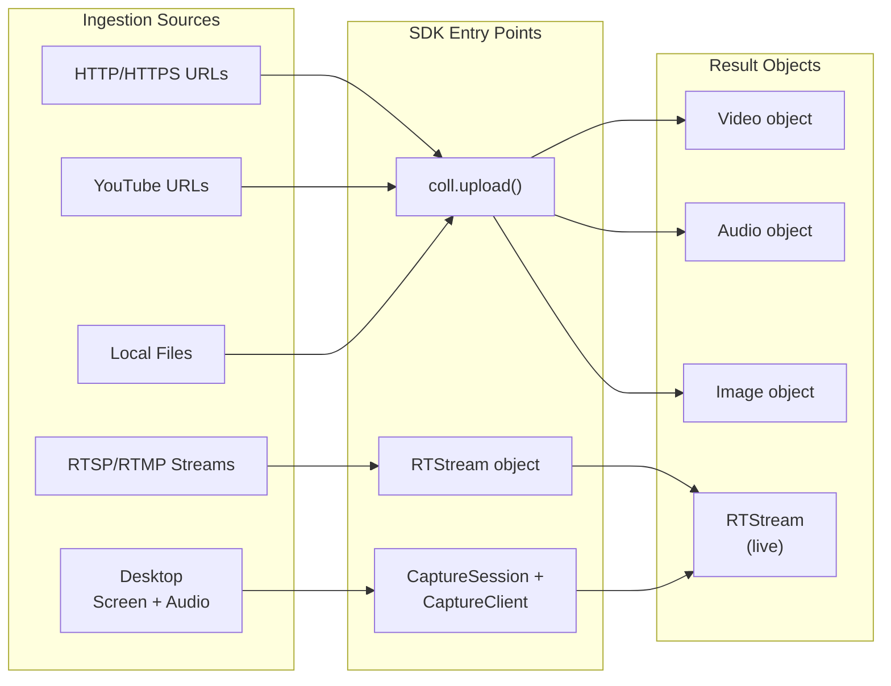
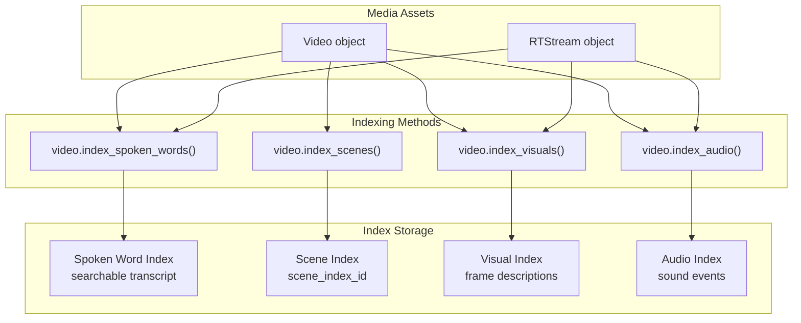
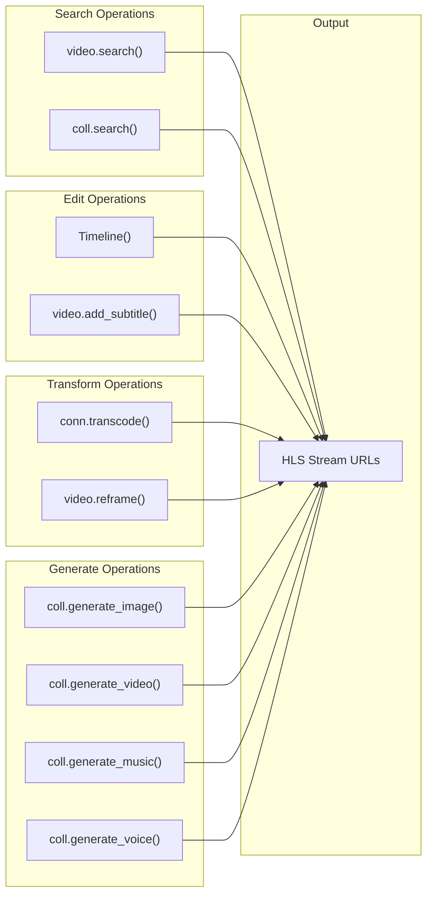
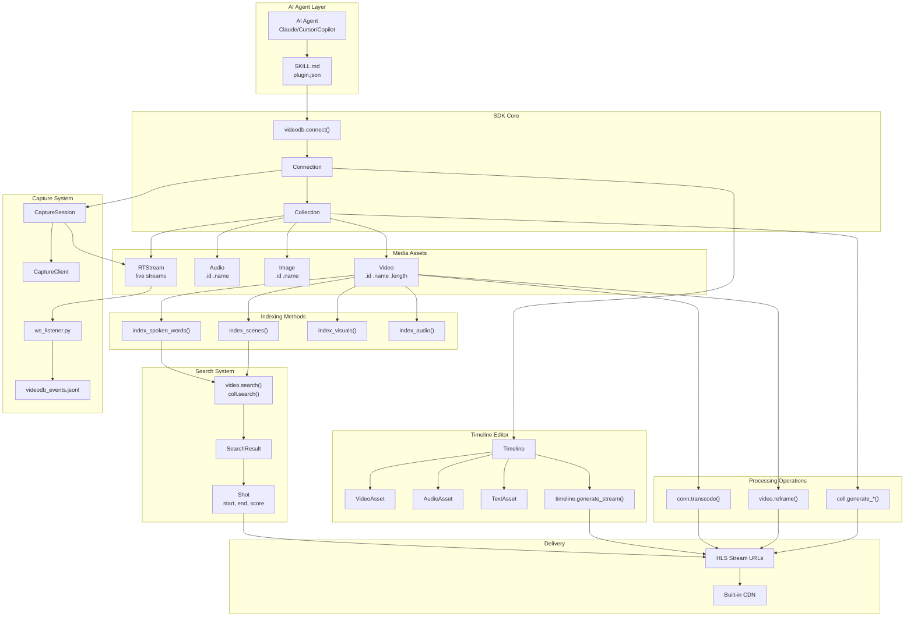

<!-- source: DeepWiki mcp.deepwiki.com · repo video-db/skills · page 1 Overview · fetched 2026-10-26 -->

# Overview

<details>
<summary>Relevant source files</summary>

The following files were used as context for generating this wiki page:

- [README.md](README.md)
- [python/SKILL.md](python/SKILL.md)

</details>


VideoDB Skills is a perception and action interface for AI agents to work with video, audio, and real-time streams. It provides a Python SDK that enables agents to ingest media from multiple sources (URLs, files, RTSP streams, desktop capture), understand content through AI indexing, and perform server-side operations (search, edit, transcode, generate) without local encoding tools.

This document provides a high-level overview of the system architecture, the core See → Understand → Act paradigm, and how components interact. For detailed setup and configuration, see [Installation and Setup](#1.1). For practical examples, see [Quick Start](#1.2).

**Sources:** [README.md:1-143](), [python/SKILL.md:1-362]()

---

## Purpose and Scope

VideoDB Skills solves the problem of making video and audio as programmatically accessible as text for AI agents. Instead of requiring agents to orchestrate ffmpeg pipelines, manage codecs, or handle file I/O, the system provides a unified interface where:

- All processing happens server-side on VideoDB infrastructure
- All outputs are immediately playable HLS stream URLs
- All operations are exposed as natural language commands through AI agent plugins
- All real-time streams (desktop capture, RTSP feeds) emit structured event logs

The system is designed for three primary use cases:

1. **Desktop perception**: Real-time screen and audio capture with AI understanding
2. **Video/audio search**: Semantic and scene-based search across media libraries
3. **Media workflows**: Timeline editing, transcoding, generation, and streaming

For the complete object model hierarchy, see [Object Model](#2.1). For authentication details, see [Authentication](#2.2).

**Sources:** [README.md:20-31](), [python/SKILL.md:8-19]()

---

## The See → Understand → Act Paradigm

The system operates in three sequential phases:

### See: Ingestion

The SDK accepts media from five sources:

| Source Type | SDK Method | Description |
|------------|-----------|-------------|
| **URLs** | `coll.upload(url=...)` | HTTP/HTTPS video, audio, image files |
| **YouTube** | `coll.upload(url="youtube.com/...")` | YouTube video URLs |
| **Local Files** | `coll.upload(file_path=...)` | Local filesystem paths |
| **RTSP/RTMP** | `RTStream` | Live network streams from cameras or encoders |
| **Desktop Capture** | `CaptureSession` + `CaptureClient` | Real-time screen, mic, system audio |

**Diagram: Ingestion Sources to SDK Entry Points**



**Sources:** [python/SKILL.md:127-138](), [README.md:37-42]()

### Understand: AI Analysis

Once ingested, content flows through AI processing pipelines that extract structured, searchable metadata:

| Pipeline | SDK Method | Output |
|---------|-----------|--------|
| **Transcription** | `video.index_spoken_words()` | Timestamped transcript, keyword-searchable |
| **Scene Indexing** | `video.index_scenes()` | AI-generated scene descriptions, returns `scene_index_id` |
| **Visual Indexing** | `video.index_visuals()` | Frame-level visual analysis |
| **Audio Indexing** | `video.index_audio()` | Audio content detection (profanity, music, events) |

For live streams and desktop capture, these pipelines run in real-time and emit events via WebSocket. For details, see [Capture Events](#8.3) and [Real-time AI Pipelines](#9.2).

**Diagram: Understanding Pipeline with SDK Methods**



**Sources:** [python/SKILL.md:140-206](), [README.md:117-120]()

### Act: Operations

With structured metadata available, the SDK enables five categories of action:

1. **Search**: Find moments by speech, scenes, or metadata
2. **Edit**: Compose timelines with clips, overlays, subtitles
3. **Transcode**: Change resolution, quality, codec, aspect ratio
4. **Generate**: Create AI media (images, videos, music, voice)
5. **Stream**: Deliver HLS URLs for instant playback

**Diagram: Action Operations with SDK Methods**



**Sources:** [python/SKILL.md:149-167](), [python/SKILL.md:225-262](), [README.md:121-124]()

---

## System Architecture

The system consists of seven layers:

### Layer 1: AI Agent Integration

AI agents (Claude Code, Cursor, Copilot) translate natural language commands into SDK method calls. The integration is defined by:

- [python/SKILL.md:1-6]() - Plugin metadata (`name`, `description`, `allowed-tools`)
- `plugin.json` - Claude plugin configuration
- `marketplace.json` - Plugin marketplace listing

For details on plugin architecture, see [Plugin Architecture](#3.1).

### Layer 2: Python SDK

The `videodb` Python package provides the core API surface. Authentication uses the `VIDEO_DB_API_KEY` environment variable:

```python
import videodb
conn = videodb.connect()  # Reads VIDEO_DB_API_KEY
```

All operations originate from the `Connection` object, which creates `Collection` and `Timeline` instances. For the complete object hierarchy, see [Object Model](#2.1).

**Sources:** [python/SKILL.md:66-80]()

### Layer 3: Media Asset Management

Media assets are stored in `Collection` objects and represented by four classes:

- `Video` - Uploaded or generated video with `.id`, `.name`, `.length`
- `Audio` - Music, sound effects, or voice with duration metadata
- `Image` - Static images for overlays or standalone use
- `RTStream` - Live streams from capture or RTSP/RTMP sources

For details on collections and organization, see [Collections](#4.2).

### Layer 4: Processing Infrastructure

All processing happens server-side on VideoDB infrastructure. The SDK sends requests and receives results asynchronously:

- **Indexing**: AI pipelines run on ingested content
- **Search**: Semantic and keyword queries against indexes
- **Timeline**: Server-side composition engine
- **Transcode**: Format conversion and quality adjustment
- **Generate**: AI content creation (images, video, audio)

For transcoding details, see [Transcoding](#10.1). For generation, see [AI Media Generation](#11).

### Layer 5: Real-time Event Delivery

For live streams and desktop capture, real-time events are delivered via WebSocket:

- `ws_listener.py` script connects to WebSocket and logs events to `videodb_events.jsonl`
- Each session is identified by a `ws_connection_id`
- Events include transcripts, visual descriptions, audio analysis, and alerts

For the complete event format, see [Event Format and Consumption](#13.2).

**Sources:** [python/SKILL.md:315-346]()

### Layer 6: HLS Streaming Delivery

All outputs are delivered as HLS stream URLs through a built-in CDN:

- Videos are playable at: `https://console.videodb.io/player?url={STREAM_URL}`
- No pre-rendering required - streams are compiled on-demand
- Timeline edits and search results generate instant playback URLs

### Layer 7: WebSocket Listener

The `ws_listener.py` script provides a command-line tool for capturing real-time events:

```bash
python scripts/ws_listener.py &
cat /tmp/videodb_ws_id  # Get ws_connection_id
# Events written to /tmp/videodb_events.jsonl
```

For running instructions, see [Running the Listener](#13.1).

**Sources:** [python/SKILL.md:316-325]()

**Diagram: Complete System Architecture with Code Entities**



**Sources:** [python/SKILL.md:1-362](), [README.md:1-143]()

---

## Key Design Principles

### Server-Side Processing

All video operations execute on VideoDB infrastructure. The client SDK only sends requests and receives URLs. This eliminates:

- Local codec dependencies (no ffmpeg installation required)
- Client-side compute resources for encoding
- File upload/download for intermediate results
- Synchronous blocking during long operations

For async operations, methods accept a `callback_url` parameter for webhook delivery. See [Transcoding](#10.1) for examples.

**Sources:** [python/SKILL.md:349-362](), [README.md:103-111]()

### Instant Playback

The system returns HLS stream URLs that are playable immediately:

- No pre-rendering required
- Timeline edits compile on-demand during first playback
- Search results generate clip streams without export
- All URLs are CDN-backed for global delivery

**Sources:** [README.md:44](), [python/SKILL.md:46-51]()

### Asynchronous Event Model

Real-time operations (capture, live streams) use an asynchronous event model:

1. Client creates a session and gets a `ws_connection_id`
2. `ws_listener.py` connects to WebSocket and logs events to JSONL
3. Client starts operation (capture, indexing)
4. Events stream in real-time to the listener
5. Client stops operation and queries the event log

This pattern decouples event production from consumption, allowing flexible processing strategies. For details, see [WebSocket Listener](#13).

**Sources:** [python/SKILL.md:315-346]()

### Idempotency and Error Handling

Several operations handle idempotency differently:

| Operation | Behavior on Duplicate | Workaround |
|-----------|---------------------|------------|
| `index_spoken_words()` | Raises error | Use `force=True` parameter to skip |
| `index_scenes()` | Raises error, includes existing `scene_index_id` | Extract ID from error message with regex |
| `search()` | Raises `InvalidRequestError("No results found")` | Catch exception and treat as empty list |

**Example: Handling scene index idempotency**

```python
import re
from videodb.exceptions import InvalidRequestError

try:
    scene_index_id = video.index_scenes(
        extraction_type=SceneExtractionType.shot_based,
        prompt="Describe the visual content."
    )
except Exception as e:
    match = re.search(r"id\s+([a-f0-9]+)", str(e))
    if match:
        scene_index_id = match.group(1)
    else:
        raise
```

For complete error handling patterns, see [Error Handling](#14).

**Sources:** [python/SKILL.md:289-298](), [python/SKILL.md:172-206]()

---

## Natural Language to Code Mapping

AI agents translate natural language commands into SDK method calls. The following table shows common mappings:

| Natural Language Command | SDK Translation |
|------------------------|-----------------|
| "Upload this YouTube video" | `coll.upload(url="youtube.com/...")` |
| "Transcribe the video" | `video.index_spoken_words()` |
| "Find scenes with a product" | `video.index_scenes()` then `video.search(query="product", index_type=IndexType.scene)` |
| "Generate subtitles" | `video.add_subtitle()` |
| "Create a clip from 10s to 30s" | `timeline.add_inline(VideoAsset(asset_id=video.id, start=10, end=30))` |
| "Change aspect ratio to vertical" | `video.reframe(target="vertical")` |
| "Generate background music" | `coll.generate_music(prompt="upbeat background")` |
| "Start recording my screen" | `session.start()` after `CaptureSession` + `CaptureClient` setup |
| "Monitor this RTSP stream" | `RTStream` + `index_visuals()` + `create_alert()` |

For detailed natural language examples, see [Natural Language Commands](#3.2).

**Sources:** [python/SKILL.md:55-62](), [README.md:87-98]()

---

## Entry Points and Workflow

### Typical Workflow for Batch Processing

```python
import videodb
from dotenv import load_dotenv

load_dotenv(".env")
conn = videodb.connect()

# 1. See: Upload media
coll = conn.get_collection()
video = coll.upload(url="https://example.com/video.mp4")

# 2. Understand: Index content
video.index_spoken_words()
scene_index_id = video.index_scenes()

# 3. Act: Search and create clip
results = video.search("product demo")
shots = results.get_shots()
stream_url = results.compile()

print(f"Playable clip: https://console.videodb.io/player?url={stream_url}")
```

**Sources:** [python/SKILL.md:66-96](), [python/SKILL.md:127-167]()

### Typical Workflow for Real-Time Capture

```bash
# Terminal 1: Start WebSocket listener
python scripts/ws_listener.py &
ws_connection_id=$(cat /tmp/videodb_ws_id)

# Terminal 2: Run capture code
python << 'EOF'
import videodb
conn = videodb.connect()

# Create session with WebSocket ID from listener
session = conn.create_capture_session(ws_connection_id="...")

# Initialize local client and start capture
from videodb.capture import CaptureClient
client = CaptureClient(session_id=session.session_id)
channels = client.get_channels()
session.start()

# ... capture runs, events stream to /tmp/videodb_events.jsonl ...

session.stop()
video = session.export()
EOF

# Query events
python -c "import json; events = [json.loads(l) for l in open('/tmp/videodb_events.jsonl')]; print(len(events))"
```

For the complete capture workflow, see [Capture Workflow](#8.1).

**Sources:** [python/SKILL.md:315-346]()

---

## Summary

VideoDB Skills provides a unified interface for AI agents to process video, audio, and real-time streams through a three-phase paradigm:

1. **See**: Ingest from URLs, files, RTSP streams, or desktop capture
2. **Understand**: AI indexing extracts searchable structure (transcripts, scenes, visual analysis)
3. **Act**: Search, edit, transcode, generate, and stream results

All processing occurs server-side, all outputs are instant-playback HLS URLs, and all operations are exposed as natural language commands through AI agent plugins. The system supports both batch workflows (uploaded videos) and real-time workflows (desktop capture, live streams) with asynchronous event delivery via WebSocket.

For installation and initial setup, proceed to [Installation and Setup](#1.1). For a hands-on walkthrough, see [Quick Start](#1.2).

**Sources:** [README.md:1-143](), [python/SKILL.md:1-362]()

---

