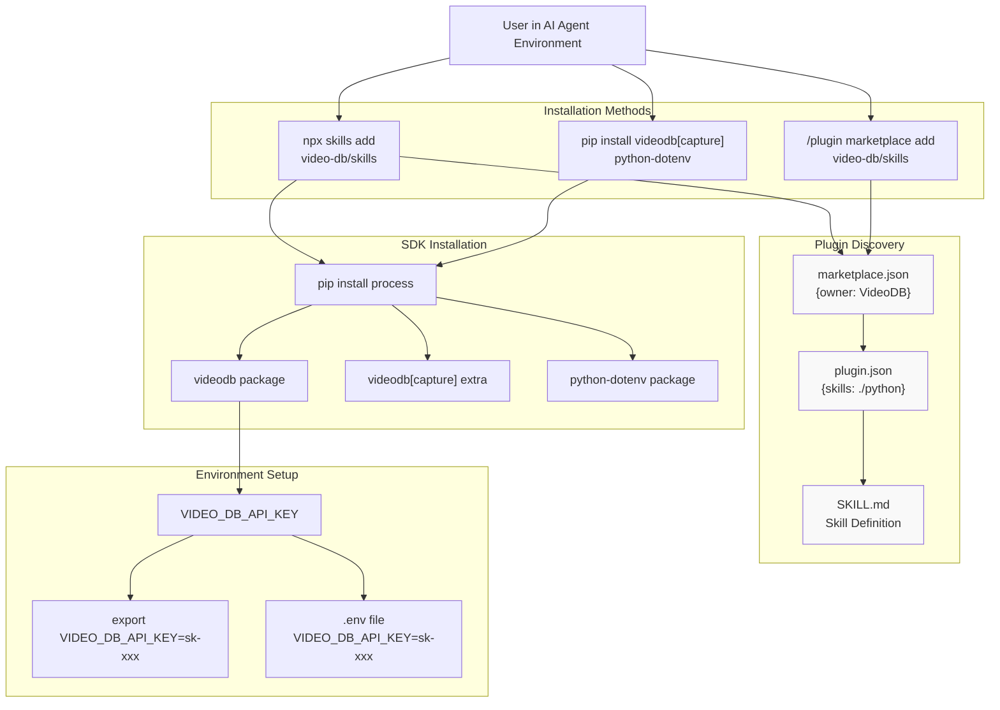
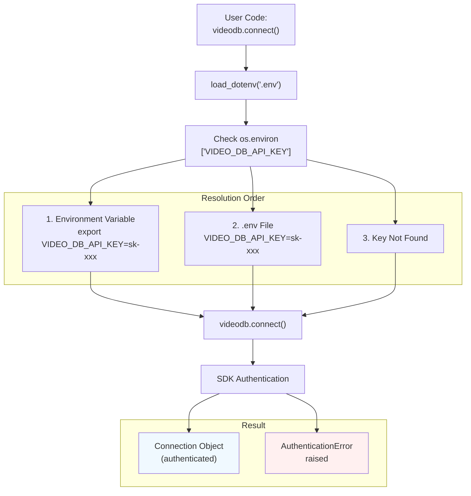
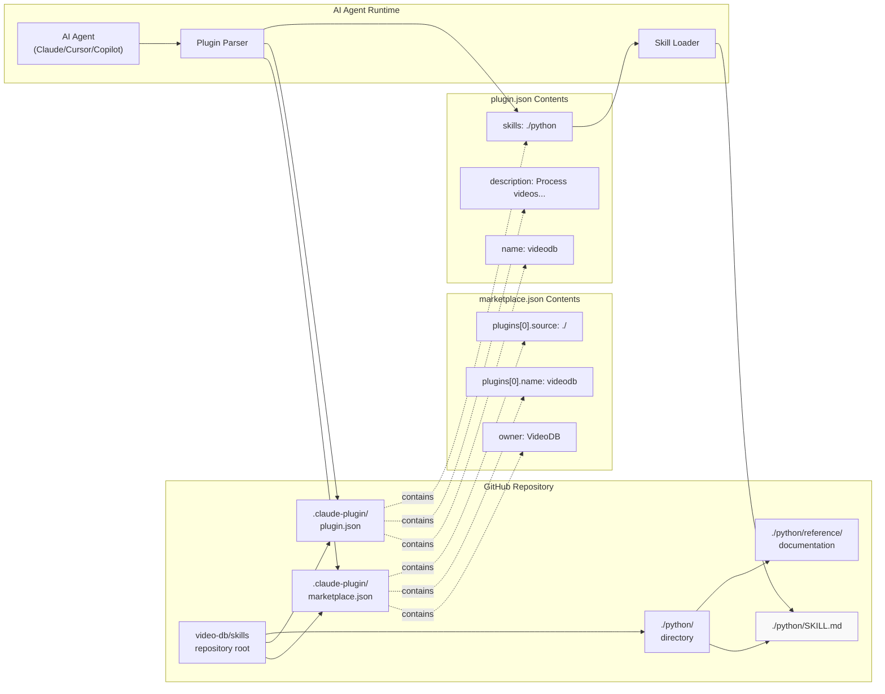

<!-- source: DeepWiki mcp.deepwiki.com · repo video-db/skills · page 1.1 Installation and Setup · fetched 2026-10-26 -->

# Installation and Setup

<details>
<summary>Relevant source files</summary>

The following files were used as context for generating this wiki page:

- [.claude-plugin/marketplace.json](.claude-plugin/marketplace.json)
- [.claude-plugin/plugin.json](.claude-plugin/plugin.json)
- [README.md](README.md)
- [python/SKILL.md](python/SKILL.md)

</details>


This page guides you through installing the VideoDB Skills system in your AI agent environment (Claude Code, Cursor, Copilot), configuring authentication, and verifying that the installation is working correctly. For a quick walkthrough of uploading and searching your first video, see [Quick Start](#1.2). For detailed information about authentication internals and API key management, see [Authentication](#2.2).

---

## Prerequisites

Before installing VideoDB Skills, ensure you have:

| Requirement | Minimum Version | Notes |
|-------------|----------------|-------|
| **Python** | 3.9+ | Required for the SDK |
| **pip** | Any recent version | Python package installer |
| **API Key** | N/A | Free tier available at https://console.videodb.io ($20 free credits, no credit card required) |
| **Operating System** | macOS, Linux, Windows (PowerShell) | Desktop capture requires macOS |

**Sources:** [README.md:49](), [python/SKILL.md:317]()

---

## Installation Methods

The VideoDB skill can be installed using three different methods, depending on your AI agent environment.

### Installation Flow Diagram



**Sources:** [README.md:52-85](), [python/SKILL.md:98-123](), [.claude-plugin/marketplace.json:1-14](), [.claude-plugin/plugin.json:1-7]()

---

### Method 1: Skills Command (Recommended)

The `npx skills` command automatically discovers and installs the VideoDB skill from the GitHub repository.

```bash
npx skills add video-db/skills
```

This command:
1. Downloads the skill from https://github.com/video-db/skills
2. Reads [.claude-plugin/marketplace.json:1-14]() to identify the `videodb-skills` package
3. Loads [.claude-plugin/plugin.json:1-7]() to map the skill to `./python` directory
4. Makes [python/SKILL.md:1-362]() available to the AI agent

After installation, run the setup command:

```bash
/videodb setup
```

The AI agent will guide you through SDK installation and API key configuration.

**Sources:** [README.md:52-56]()

---

### Method 2: Claude Code Plugin

For Claude Code specifically, use the built-in plugin marketplace:

```bash
/plugin marketplace add video-db/skills
/plugin install videodb@videodb-skills
```

The marketplace integration is defined in [.claude-plugin/marketplace.json:1-14](), which contains:

```json
{
  "name": "videodb-skills",
  "owner": {
    "name": "VideoDB"
  },
  "plugins": [
    {
      "name": "videodb",
      "description": "Process videos using VideoDB Python SDK...",
      "source": "./"
    }
  ]
}
```

After installation, run:

```bash
/videodb setup
```

**Sources:** [README.md:58-63](), [.claude-plugin/marketplace.json:1-14]()

---

### Method 3: Manual Installation

For Cursor, Copilot, or other environments, install the SDK directly and ask your agent to "setup videodb":

```bash
pip install "videodb[capture]" python-dotenv
```

The installation includes:

| Package | Purpose |
|---------|---------|
| `videodb` | Core SDK with `Connection`, `Collection`, `Video`, `Audio`, `Image`, `Timeline` classes |
| `[capture]` | Extra dependencies for `CaptureClient` and desktop recording |
| `python-dotenv` | `.env` file parsing for `load_dotenv(".env")` |

**Linux Note:** If `videodb[capture]` fails on Linux, install without the capture extra:

```bash
pip install videodb python-dotenv
```

Desktop capture functionality will be unavailable, but all other features work normally.

**Sources:** [python/SKILL.md:102-112](), [README.md:74]()

---

## API Key Configuration

The VideoDB SDK requires `VIDEO_DB_API_KEY` to authenticate requests. The key is resolved in this order:

1. Environment variable (if exported)
2. Project's `.env` file in current directory
3. Raises `AuthenticationError` if not found

### API Key Resolution Flow



**Sources:** [python/SKILL.md:66-80](), [python/SKILL.md:114-123]()

---

### Option 1: Environment Variable (Recommended)

Export the key in your terminal session:

```bash
export VIDEO_DB_API_KEY=sk-xxx
```

This approach:
- Works for all projects in the current shell session
- Keeps secrets out of version control
- Is checked first by `videodb.connect()`

When running Python code, the SDK automatically reads this variable:

```python
import videodb
conn = videodb.connect()  # Reads VIDEO_DB_API_KEY from environment
```

**Sources:** [README.md:79-80](), [python/SKILL.md:116-117]()

---

### Option 2: Project .env File

Create a `.env` file in your project directory:

```
VIDEO_DB_API_KEY=sk-xxx
```

Load it with `python-dotenv` before calling `videodb.connect()`:

```python
from dotenv import load_dotenv
load_dotenv(".env")

import videodb
conn = videodb.connect()
```

**Critical:** The skill instructions at [python/SKILL.md:66]() emphasize that you must `cd` to the project directory before running Python code. This ensures `load_dotenv(".env")` finds the correct `.env` file.

**Sources:** [README.md:82-84](), [python/SKILL.md:68-70](), [python/SKILL.md:118-119]()

---

### Obtaining an API Key

Get a free API key at https://console.videodb.io:

- **$20 free credits** on sign-up
- **No credit card required**
- Sufficient for testing and development

**Important Security Note:** As stated in [python/SKILL.md:123](), AI agents should never read, write, or handle the API key directly. Always let the user set it manually.

**Sources:** [python/SKILL.md:121-123](), [README.md:71]()

---

## Verifying Installation

After installation and API key configuration, verify the setup by connecting to VideoDB and retrieving your default collection.

### Verification Code Example

```python
from dotenv import load_dotenv
load_dotenv(".env")

import videodb
conn = videodb.connect()
coll = conn.get_collection()
print(f"Videos: {len(coll.get_videos())}")
```

This code:
1. Loads `VIDEO_DB_API_KEY` from `.env` or environment
2. Calls `videodb.connect()` which validates the key
3. Retrieves the default `Collection` object
4. Prints the count of existing videos

### Expected Outcomes

| Scenario | Result |
|----------|--------|
| **Key valid, first time** | Prints `Videos: 0` (empty collection) |
| **Key valid, has uploads** | Prints `Videos: N` (N = number of videos) |
| **Key missing** | `AuthenticationError: Check your VIDEO_DB_API_KEY` |
| **Key invalid** | `AuthenticationError` with invalid key message |

**Sources:** [python/SKILL.md:86-96](), [python/SKILL.md:275-281]()

---

## Plugin Architecture and Skill Loading

Understanding how AI agents discover and load the VideoDB skill helps with troubleshooting and customization.

### Plugin Structure Diagram



**Sources:** [.claude-plugin/marketplace.json:1-14](), [.claude-plugin/plugin.json:1-7]()

### Key Files

| File | Purpose | Key Content |
|------|---------|-------------|
| [.claude-plugin/marketplace.json:1-14]() | Marketplace discovery | Identifies `videodb-skills` package, owner, and source location |
| [.claude-plugin/plugin.json:1-7]() | Plugin definition | Maps skill name `videodb` to `./python` directory |
| [python/SKILL.md:1-362]() | Skill documentation | Loaded by AI agents to understand available operations |
| `./python/reference/` | API reference | Detailed documentation for specific subsystems |

---

## Platform-Specific Considerations

### macOS

- **Full support** for all features including desktop capture
- `CaptureClient` requires Screen Recording permissions (prompted on first use)
- System audio capture requires additional configuration

### Linux

- **Full support** except desktop capture
- Install without `[capture]` extra: `pip install videodb python-dotenv`
- All video processing, search, and timeline features work normally

### Windows

- **Full support** except desktop capture
- Use PowerShell for commands
- File paths: Use forward slashes `/` or escaped backslashes `\\`

**Sources:** [README.md:130](), [python/SKILL.md:108-111]()

---

## Troubleshooting Common Installation Issues

### Authentication Errors

```python
from videodb.exceptions import AuthenticationError

try:
    conn = videodb.connect()
except AuthenticationError:
    print("Check your VIDEO_DB_API_KEY")
```

**Causes:**
- `VIDEO_DB_API_KEY` not set in environment or `.env`
- API key copied incorrectly (whitespace, truncation)
- Project directory mismatch (not in same directory as `.env`)

**Solution:** Re-export the key or verify `.env` contents. Ensure you're in the correct project directory when running code.

**Sources:** [python/SKILL.md:275-281]()

---

### Import Errors

```
ModuleNotFoundError: No module named 'videodb'
```

**Causes:**
- SDK not installed
- Using wrong Python interpreter (virtualenv mismatch)
- Installation failed silently

**Solution:**
```bash
# Verify installation
pip show videodb

# Reinstall if needed
pip install --force-reinstall "videodb[capture]" python-dotenv
```

---

### Capture Extra Installation Failure (Linux)

```
ERROR: Could not find a version that satisfies the requirement pyobjc-framework-ScreenCaptureKit
```

**Cause:** The `[capture]` extra includes macOS-specific dependencies that don't exist on Linux.

**Solution:** Install without the capture extra:

```bash
pip install videodb python-dotenv
```

Desktop capture will be unavailable, but all server-side features (upload, search, edit, transcode) work normally.

**Sources:** [python/SKILL.md:108-111]()

---

### Working Directory Errors

```python
# .env not found
FileNotFoundError: [Errno 2] No such file or directory: '.env'
```

**Cause:** Running Python code from a different directory than where `.env` is located.

**Solution:** Always `cd` to the project directory before running code:

```bash
cd /path/to/project
python script.py
```

The skill instructions at [python/SKILL.md:66]() explicitly state: **"CRITICAL: Always `cd` to the user's project directory before running Python code."**

**Sources:** [python/SKILL.md:66]()

---

## Next Steps

After successful installation and verification:

1. **Quick Start:** Follow the [Quick Start](#1.2) guide to upload and search your first video
2. **Core Concepts:** Understand the [Object Model](#2.1) and [See→Understand→Act workflow](#2)
3. **Natural Language:** Learn how to use [Natural Language Commands](#3.2) with AI agents
4. **Explore Capabilities:** Review [Common Use Cases](#12) for real-world applications

**Sources:** Table of contents context

---

