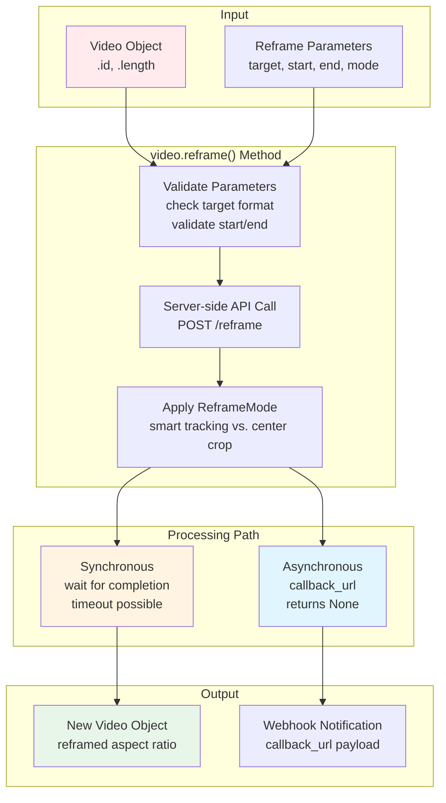
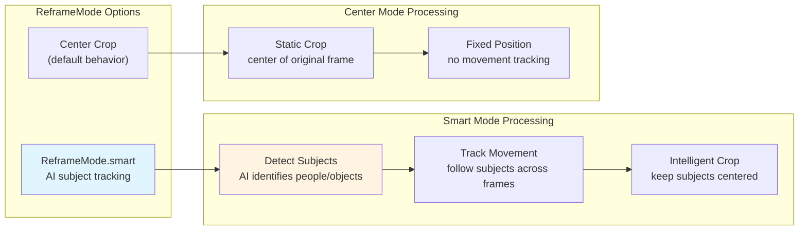
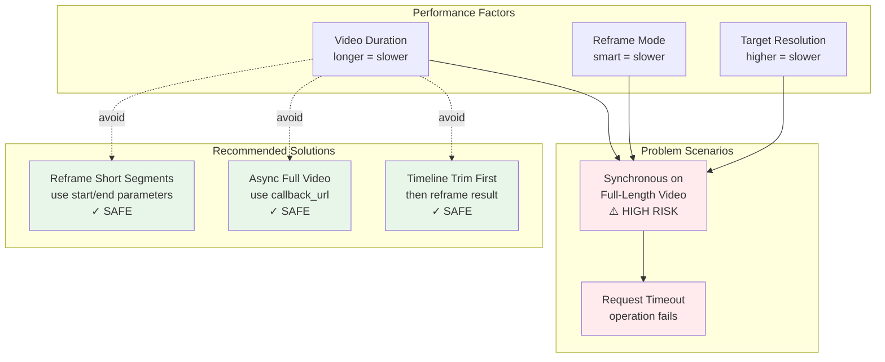
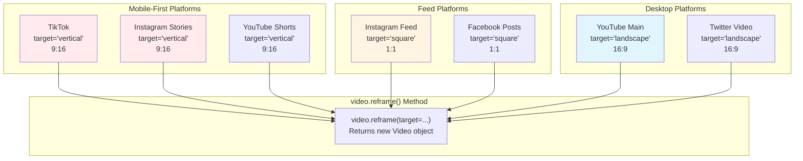

<!-- source: DeepWiki mcp.deepwiki.com · repo video-db/skills · page 10.2 Reframing · fetched 2026-10-26 -->

# Reframing

<details>
<summary>Relevant source files</summary>

The following files were used as context for generating this wiki page:

- [python/SKILL.md](python/SKILL.md)

</details>


## Purpose and Scope

This page documents aspect ratio conversion using the `video.reframe()` method. Reframing allows you to convert video content to different aspect ratios suitable for various platforms (vertical for mobile, square for social feeds, landscape for desktop).

For general resolution and quality changes without aspect ratio conversion, see [Transcoding](#10.1). For timeline-based composition operations, see [Timeline Editing](#7).

**Sources:** [python/SKILL.md:240-262]()

---

## Overview

Reframing is a server-side operation that converts video aspect ratios by intelligently cropping or padding the frame to match a target format. Unlike simple cropping, reframing can track subjects within the frame using AI-powered tracking modes.

The operation is performed by calling `video.reframe()` on a `Video` object. The method returns a new `Video` object with the converted aspect ratio, leaving the original video unchanged.

**Key characteristics:**
- **Server-side processing**: No local computation required
- **Non-destructive**: Original video remains unmodified
- **Slow operation**: Can take several minutes for long videos
- **Subject tracking**: `ReframeMode.smart` intelligently tracks and centers subjects

**Sources:** [python/SKILL.md:240-262]()

---

## Reframe Workflow



**Workflow stages:**

1. **Input Validation**: The `video.reframe()` method validates the target format and optional `start`/`end` timestamps
2. **Server Call**: Request is sent to VideoDB's reframe service with specified parameters
3. **Mode Application**: Either AI-powered smart tracking or center crop is applied based on `ReframeMode`
4. **Processing Path**: 
   - **Synchronous**: Blocks until complete, returns new `Video` object (can timeout)
   - **Asynchronous**: Returns `None` immediately, sends result to `callback_url` when complete

**Sources:** [python/SKILL.md:240-262]()

---

## Target Formats

The `target` parameter accepts either preset strings or custom dimension dictionaries.

### Preset Targets

| Preset | Aspect Ratio | Dimensions Example | Common Use Case |
|--------|--------------|-------------------|-----------------|
| `"vertical"` | 9:16 | 1080×1920 | Instagram Stories, TikTok, YouTube Shorts |
| `"square"` | 1:1 | 1080×1080 | Instagram feed posts, Facebook posts |
| `"landscape"` | 16:9 | 1920×1080 | YouTube videos, desktop viewing |

### Custom Dimensions

For non-standard aspect ratios, pass a dictionary with `width` and `height` keys:

```python
# Custom aspect ratio example (not from codebase)
reframed = video.reframe(
    start=0, 
    end=60,
    target={"width": 1280, "height": 720}
)
```

**Sources:** [python/SKILL.md:257-261]()

---

## Reframe Modes



### ReframeMode.smart

The `mode` parameter controls how the reframe operation handles the aspect ratio conversion:

- **`ReframeMode.smart`**: AI-powered subject tracking
  - Detects and tracks subjects (people, objects) in the frame
  - Dynamically adjusts crop position to keep subjects centered
  - Recommended for content with moving subjects or camera movement
  - Slower processing time due to AI analysis

- **Default (no mode specified)**: Center crop
  - Crops from the center of the original frame
  - Static crop position throughout the video
  - Faster processing time
  - Suitable for static shots or centered content

**Sources:** [python/SKILL.md:252]()

---

## API Method Signature

The `video.reframe()` method is called on a `Video` object and supports the following parameters:

| Parameter | Type | Required | Description |
|-----------|------|----------|-------------|
| `target` | `str` or `dict` | Yes | Preset (`"vertical"`, `"square"`, `"landscape"`) or `{"width": int, "height": int}` |
| `start` | `float` | No | Start timestamp in seconds (default: 0) |
| `end` | `float` | No | End timestamp in seconds (default: video.length) |
| `mode` | `ReframeMode` | No | `ReframeMode.smart` for AI tracking or omit for center crop |
| `callback_url` | `str` | No | Webhook URL for async processing notifications |

**Return value:**
- With `callback_url`: Returns `None` (result delivered to webhook)
- Without `callback_url`: Returns new `Video` object with reframed content

**Example usage patterns:**

```python
# Synchronous reframe of short segment (from SKILL.md)
reframed = video.reframe(start=0, end=60, target="vertical", mode=ReframeMode.smart)

# Async reframe for full-length video (from SKILL.md)
video.reframe(target="vertical", callback_url="https://example.com/webhook")

# Preset target (from SKILL.md)
reframed = video.reframe(start=0, end=60, target="square")

# Custom dimensions (from SKILL.md)
reframed = video.reframe(start=0, end=60, target={"width": 1280, "height": 720})
```

**Sources:** [python/SKILL.md:240-262]()

---

## Performance Considerations

### Critical Warning

Reframing is a **computationally intensive server-side operation** that can take several minutes for long videos. The synchronous API call may timeout on extended content.



### Best Practices

| Scenario | Recommended Approach | Reason |
|----------|---------------------|---------|
| Short clip (< 2 minutes) | Synchronous with `start`/`end` | Fast enough for direct wait |
| Long video (> 5 minutes) | Use `callback_url` for async | Prevents timeout failures |
| Specific segment needed | `Timeline` trim → reframe result | Process only necessary content |
| Full video required | Always use `callback_url` | Avoid blocking and timeouts |

### Example: Safe Reframe Workflow

```python
# From SKILL.md - preferred approach for short segments
reframed = video.reframe(start=0, end=60, target="vertical", mode=ReframeMode.smart)

# From SKILL.md - async for full videos
video.reframe(target="vertical", callback_url="https://example.com/webhook")
```

**Sources:** [python/SKILL.md:240-247]()

---

## Social Media Optimization

### Platform-Specific Targets



### Use Case Table

| Platform | Target | Mode Recommendation | Notes |
|----------|--------|---------------------|-------|
| TikTok | `"vertical"` | `ReframeMode.smart` | Track subjects for dynamic content |
| Instagram Stories | `"vertical"` | `ReframeMode.smart` | Keep subjects centered in portrait |
| YouTube Shorts | `"vertical"` | `ReframeMode.smart` | Mobile-optimized vertical video |
| Instagram Feed | `"square"` | Center crop | Square format fits feed layout |
| Facebook Posts | `"square"` | Center crop | Maximum feed visibility |
| YouTube | `"landscape"` | Not needed | Already 16:9 typically |
| Twitter | `"landscape"` | Center crop | Desktop-first platform |

### When to Use Reframe vs. Transcode

From [python/SKILL.md:353-361]():

| Problem | Solution | Method |
|---------|----------|--------|
| Platform rejects aspect ratio | Reframe | `video.reframe(target="vertical")` |
| Need vertical for mobile | Reframe | `video.reframe(target="vertical")` |
| Need square for Instagram | Reframe | `video.reframe(target="square")` |
| Change resolution (1080p→720p) | Transcode | `conn.transcode()` with `VideoConfig` |
| Change codec or bitrate | Transcode | See [Transcoding](#10.1) |

**Sources:** [python/SKILL.md:353-361](), [python/SKILL.md:257-262]()

---

## Error Handling

### Common Issues

| Error Scenario | Cause | Solution |
|----------------|-------|----------|
| Request timeout | Video too long for sync call | Use `callback_url` for async processing |
| Invalid target format | Unrecognized preset or malformed dict | Use `"vertical"`, `"square"`, `"landscape"`, or `{"width": int, "height": int}` |
| Invalid timestamp range | `start >= end` or `end > video.length` | Validate timestamps against `video.length` |
| Operation not allowed | Plan limits or permissions | Check account plan capabilities |

### Validation Pattern

Before calling `video.reframe()`, validate parameters:

```python
# Validation pattern (not from codebase, but recommended)
if start < 0:
    raise ValueError("start must be >= 0")
if end > video.length:
    raise ValueError(f"end must be <= video.length ({video.length})")
if start >= end:
    raise ValueError("start must be < end")
```

**Sources:** [python/SKILL.md:240-247]()

---

## Integration with Timeline Editor

For complex compositions, reframe operations can be combined with timeline editing:

### Workflow Pattern

1. **Trim on Timeline**: Use `VideoAsset` with `start`/`end` to select segment
2. **Generate Temporary Stream**: Call `timeline.generate_stream()` to create trimmed version
3. **Upload Result**: Upload the timeline result as a new video
4. **Reframe**: Call `reframe()` on the shorter video

This approach avoids reframing unnecessary content and reduces processing time.

**Alternative**: Reframe first, then use the reframed video in timeline compositions if multiple edits are needed.

For timeline editing details, see [Timeline Editing](#7).

**Sources:** [python/SKILL.md:245-247]()

---

