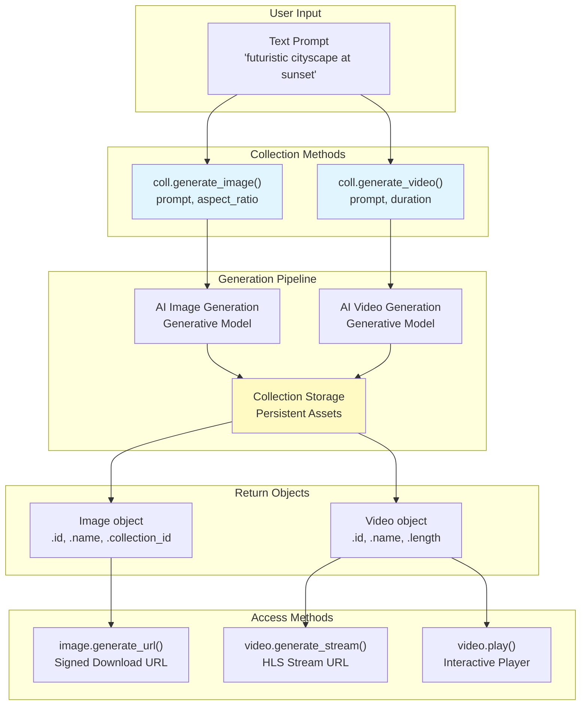
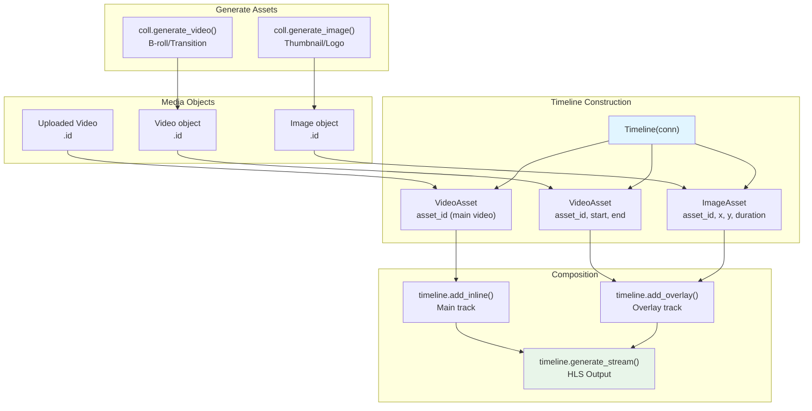
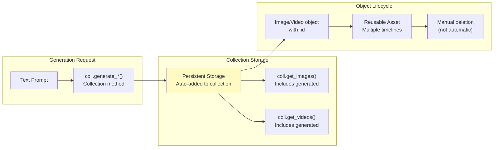

<!-- source: DeepWiki mcp.deepwiki.com · repo video-db/skills · page 11.1 Image and Video Generation · fetched 2026-10-26 -->

# Image and Video Generation

<details>
<summary>Relevant source files</summary>

The following files were used as context for generating this wiki page:

- [.gitignore](.gitignore)
- [python/.env.example](python/.env.example)
- [python/reference/generative.md](python/reference/generative.md)

</details>


This page documents the AI-powered generation of images and videos from text prompts. Both operations are methods on the `Collection` object and produce media assets that are automatically stored in your collection for immediate use in timelines, overlays, or standalone playback.

For audio generation (music, sound effects, voice), see [Audio Generation](#11.2). For text generation and LLM analysis, see [Text and LLM](#11.3).

---

## Overview

VideoDB provides two generative AI methods on the `Collection` object:

- **`generate_image()`**: Creates still images from text descriptions
- **`generate_video()`**: Creates short video clips from text descriptions

Both methods accept a text prompt and optional configuration parameters. Generated media is persistent—it remains in your collection and can be used like any uploaded asset.

**Sources:** [python/reference/generative.md:1-66]()

---

## Generation Workflow



**Diagram: Image and Video Generation Pipeline**

Both generation methods follow the same pattern: accept a prompt, invoke an AI generation pipeline, store the result in the collection, and return an object with access methods. The key difference is the access pattern—`Image` objects use `.generate_url()` while `Video` objects use `.generate_stream()`.

**Sources:** [python/reference/generative.md:16-66]()

---

## Image Generation

### Method Signature

```python
coll.generate_image(
    prompt: str,
    aspect_ratio: str = "1:1",
    callback_url: str | None = None
) -> Image
```

The `generate_image()` method creates a still image from a text description and returns an `Image` object.

**Sources:** [python/reference/generative.md:16-42]()

### Parameters

| Parameter | Type | Default | Description |
|-----------|------|---------|-------------|
| `prompt` | `str` | required | Text description of the image to generate |
| `aspect_ratio` | `str` | `"1:1"` | Aspect ratio: `"1:1"`, `"9:16"`, `"16:9"`, `"4:3"`, or `"3:4"` |
| `callback_url` | `str \| None` | `None` | URL to receive async completion callback |

**Sources:** [python/reference/generative.md:31-38]()

### Aspect Ratios

The `aspect_ratio` parameter supports five formats:

| Aspect Ratio | Common Use |
|--------------|------------|
| `"1:1"` | Square (social media posts) |
| `"9:16"` | Vertical (mobile, stories, reels) |
| `"16:9"` | Widescreen (YouTube thumbnails, TV) |
| `"4:3"` | Standard (presentations) |
| `"3:4"` | Portrait (print, posters) |

**Sources:** [python/reference/generative.md:36](), [python/reference/generative.md:321]()

### Return Object and URL Access

The method returns an `Image` object with these properties:

- `.id`: Unique identifier
- `.name`: Generated name
- `.collection_id`: Parent collection ID
- `.url`: May be `None` for generated images

**Important:** Unlike uploaded images, generated images do not have a reliable `.url` property. Always use `image.generate_url()` to retrieve a signed download URL:

```python
image = coll.generate_image(
    prompt="a futuristic cityscape at sunset with flying cars",
    aspect_ratio="16:9",
)

# Correct access pattern
url = image.generate_url()  # Returns signed download URL
print(f"Image ID: {image.id}")
```

The `.generate_url()` method returns a time-limited signed URL that can be embedded in web pages or downloaded.

**Sources:** [python/reference/generative.md:21-29](), [python/reference/generative.md:39-41]()

---

## Video Generation

### Method Signature

```python
coll.generate_video(
    prompt: str,
    duration: float = 5,
    callback_url: str | None = None
) -> Video
```

The `generate_video()` method creates a short video clip from a text description and returns a `Video` object.

**Sources:** [python/reference/generative.md:44-66]()

### Parameters

| Parameter | Type | Default | Description |
|-----------|------|---------|-------------|
| `prompt` | `str` | required | Text description of the video to generate |
| `duration` | `float` | `5` | Duration in seconds (must be integer value, 5-8) |
| `callback_url` | `str \| None` | `None` | URL to receive async completion callback |

**Sources:** [python/reference/generative.md:58-64]()

### Duration Constraints

The `duration` parameter has specific constraints:
- Must be an integer value (5, 6, 7, or 8)
- Range: 5-8 seconds
- Default: 5 seconds

**Sources:** [python/reference/generative.md:62]()

### Return Object and Playback

The method returns a `Video` object identical to uploaded videos. It has all standard `Video` properties and methods:

```python
video = coll.generate_video(
    prompt="a timelapse of a flower blooming in a garden",
    duration=5,
)

# Access methods
stream_url = video.generate_stream()  # HLS stream URL
video.play()                          # Interactive playback

# Standard Video properties
print(video.id)
print(video.name)
print(video.length)
```

Generated videos are automatically added to the collection and can be used in all operations that accept `Video` objects: timelines, searches, indexing, transcoding, and reframing.

**Sources:** [python/reference/generative.md:47-55](), [python/reference/generative.md:65-66]()

---

## Integration with Timeline Editor

Generated images and videos integrate seamlessly with the Timeline editor. This enables composition workflows that combine AI-generated content with uploaded media.



**Diagram: Generated Media in Timeline Composition**

Generated media can be used in any Timeline asset type:
- **VideoAsset**: Reference generated video with `asset_id=video.id`
- **ImageAsset**: Reference generated image with `asset_id=image.id`

Both inline and overlay tracks accept generated assets.

**Sources:** [python/reference/generative.md:269-292]()

### Example: Add Generated Logo Overlay

```python
from videodb.timeline import Timeline
from videodb.asset import VideoAsset, ImageAsset

# Generate a logo
logo = coll.generate_image(
    prompt="professional tech company logo, modern design, transparent background",
    aspect_ratio="1:1",
)

# Upload or get main video
video = coll.get_video("main-video-id")

# Build timeline
timeline = Timeline(conn)
timeline.add_inline(VideoAsset(asset_id=video.id))

# Add logo as overlay (top-right corner)
timeline.add_overlay(
    0,  # Start at beginning
    ImageAsset(
        asset_id=logo.id,
        x=1280 - 150,  # Assuming 1920x1080, position 150px from right
        y=50,           # 50px from top
        duration=video.length,
    )
)

stream_url = timeline.generate_stream()
```

**Sources:** [python/reference/generative.md:269-292]()

### Example: Generate B-roll Clip

```python
# Generate transition video
transition = coll.generate_video(
    prompt="smooth cloud transition with blue sky background",
    duration=5,
)

# Insert between two clips
timeline = Timeline(conn)
timeline.add_inline(VideoAsset(asset_id=clip1.id))
timeline.add_inline(VideoAsset(asset_id=transition.id))  # Generated video
timeline.add_inline(VideoAsset(asset_id=clip2.id))

stream_url = timeline.generate_stream()
```

**Sources:** [python/reference/generative.md:47-55]()

---

## Object Lifecycle and Storage



**Diagram: Generated Media Lifecycle**

Key lifecycle characteristics:

1. **Automatic Storage**: Generated media is immediately added to the collection
2. **Persistent**: Assets remain in the collection until explicitly deleted
3. **Discoverable**: Included in `coll.get_images()` and `coll.get_videos()` results
4. **Reusable**: Same asset can be referenced in multiple timelines or operations
5. **No Auto-deletion**: Generated assets are not temporary; they consume storage quota

**Sources:** [python/reference/generative.md:315]()

---

## Callback URL Pattern

Both `generate_image()` and `generate_video()` support asynchronous callbacks:

```python
# Image generation with callback
image = coll.generate_image(
    prompt="product photo on white background",
    aspect_ratio="1:1",
    callback_url="https://your-domain.com/webhook/image-complete",
)

# Video generation with callback
video = coll.generate_video(
    prompt="product demo animation",
    duration=6,
    callback_url="https://your-domain.com/webhook/video-complete",
)
```

When generation completes, VideoDB sends a POST request to the `callback_url` with the asset metadata. This enables non-blocking workflows where generation happens in the background.

**Sources:** [python/reference/generative.md:37](), [python/reference/generative.md:63]()

---

## Code Entity Reference

| Entity | Type | Location | Purpose |
|--------|------|----------|---------|
| `Collection.generate_image()` | Method | Collection object | Generate image from prompt |
| `Collection.generate_video()` | Method | Collection object | Generate video from prompt |
| `Image` | Class | Return type | Image asset with `.generate_url()` |
| `Video` | Class | Return type | Video asset with `.generate_stream()` |
| `Image.generate_url()` | Method | Image object | Get signed download URL |
| `Video.generate_stream()` | Method | Video object | Get HLS stream URL |
| `Video.play()` | Method | Video object | Launch interactive player |
| `ImageAsset` | Class | Timeline asset | Reference image in timeline |
| `VideoAsset` | Class | Timeline asset | Reference video in timeline |

**Sources:** [python/reference/generative.md:1-322]()

---

## Comparison: Image vs Video Generation

| Aspect | `generate_image()` | `generate_video()` |
|--------|-------------------|-------------------|
| **Return Type** | `Image` object | `Video` object |
| **Access Method** | `.generate_url()` | `.generate_stream()` |
| **Key Parameter** | `aspect_ratio` (5 options) | `duration` (5-8 seconds) |
| **Typical Use** | Thumbnails, logos, overlays | B-roll, transitions, animations |
| **Timeline Asset** | `ImageAsset` | `VideoAsset` |
| **Indexing** | Not applicable | Supports `index_spoken_words()`, `index_scenes()` |
| **Search** | Not applicable | Can be searched like uploaded videos |

**Sources:** [python/reference/generative.md:16-66]()

---

## Common Usage Patterns

### Generate Thumbnail for Video

```python
video = coll.get_video("video-id")

# Generate thumbnail matching video aspect ratio
thumbnail = coll.generate_image(
    prompt="professional video thumbnail showing data analytics dashboard, modern design",
    aspect_ratio="16:9",
)

print(f"Thumbnail URL: {thumbnail.generate_url()}")
```

**Sources:** [python/reference/generative.md:258-266]()

### Generate Multiple Aspect Ratios

```python
prompt = "company logo on gradient background"

# Generate for different platforms
square = coll.generate_image(prompt, aspect_ratio="1:1")      # Social posts
vertical = coll.generate_image(prompt, aspect_ratio="9:16")   # Stories
wide = coll.generate_image(prompt, aspect_ratio="16:9")       # YouTube
```

**Sources:** [python/reference/generative.md:36]()

### Generate and Index Video

```python
# Generate a video
video = coll.generate_video(
    prompt="tutorial demonstration of software interface",
    duration=7,
)

# Index like any other video
video.index_spoken_words()
video.index_scenes()

# Now searchable
results = video.search("interface", search_type="semantic")
```

**Sources:** [python/reference/generative.md:65-66]()

---

## Best Practices

### Prompt Quality

- **Be specific**: "modern minimalist office interior with large windows and natural light" produces better results than "office"
- **Include style details**: "photorealistic", "cartoon style", "watercolor painting"
- **Specify composition**: "centered subject", "aerial view", "close-up"

**Sources:** [python/reference/generative.md:320]()

### Aspect Ratio Selection

| Use Case | Recommended Aspect Ratio |
|----------|-------------------------|
| YouTube thumbnails | `"16:9"` |
| Instagram posts | `"1:1"` |
| Instagram/TikTok stories | `"9:16"` |
| Presentation slides | `"16:9"` or `"4:3"` |
| Print posters | `"3:4"` |

**Sources:** [python/reference/generative.md:321]()

### Asset Reuse

Generated assets are persistent—store the `.id` and reuse across projects:

```python
# Generate once
logo = coll.generate_image(prompt="company logo", aspect_ratio="1:1")
logo_id = logo.id  # Store for reuse

# Later, in different workflow
timeline = Timeline(conn)
timeline.add_overlay(0, ImageAsset(asset_id=logo_id, x=50, y=50))
```

**Sources:** [python/reference/generative.md:315]()

### Video Duration Limits

Keep prompts realistic for the 5-8 second constraint. Complex sequences may not render fully:

```python
# Good: Single action
video = coll.generate_video("car driving down highway", duration=5)

# Problematic: Too much for 5 seconds
# "car starting, driving through city, parking, person exiting"
```

**Sources:** [python/reference/generative.md:62]()

---

## Error Handling

Both methods may raise exceptions for invalid parameters or quota issues:

```python
from videodb import InvalidRequestError

try:
    video = coll.generate_video(
        prompt="complex animation",
        duration=10,  # Invalid: exceeds 8 second limit
    )
except InvalidRequestError as e:
    print(f"Generation failed: {e}")
```

Common error scenarios:
- **Invalid aspect ratio**: Must be one of the five supported ratios
- **Invalid duration**: Must be integer 5-8 for video
- **Empty prompt**: Prompt cannot be empty string
- **Quota exceeded**: Account limits on generation operations

**Sources:** [python/reference/generative.md:58-64]()

---

**Sources:**
- [python/reference/generative.md:1-322]()
- [python/.env.example:1-2]()

---

