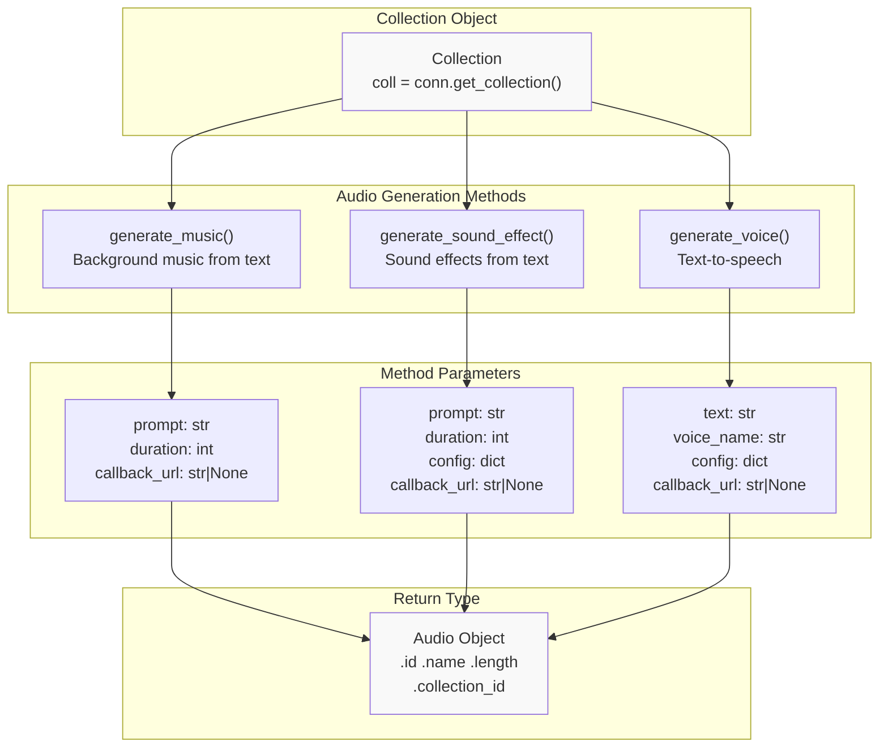
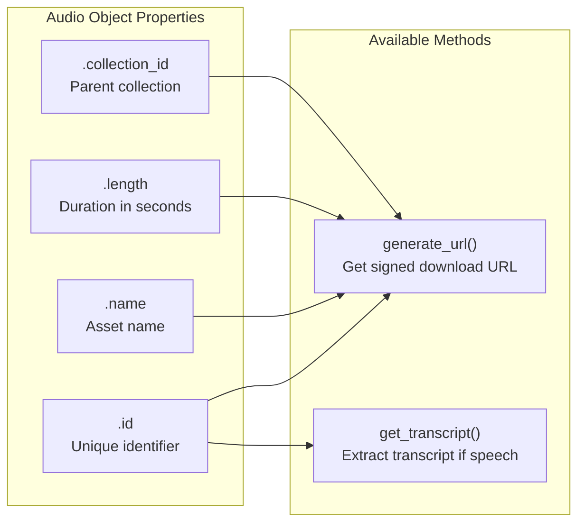
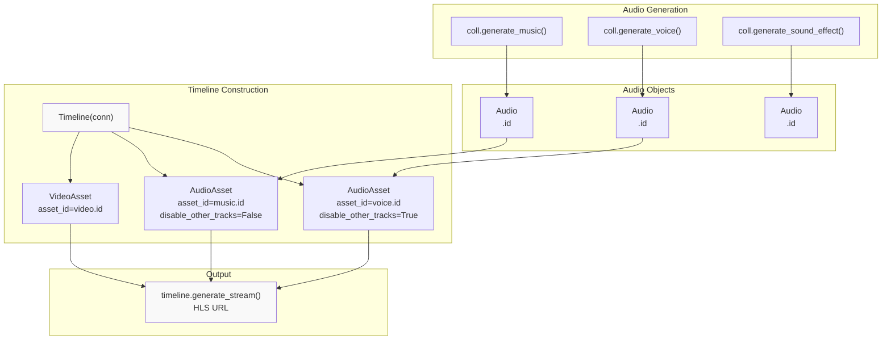
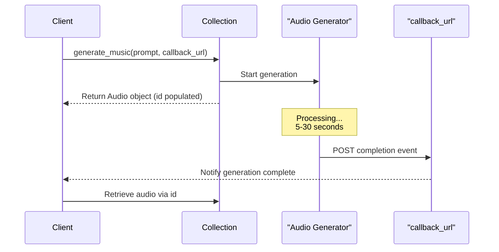

<!-- source: DeepWiki mcp.deepwiki.com · repo video-db/skills · page 11.2 Audio Generation · fetched 2026-10-26 -->

# Audio Generation

<details>
<summary>Relevant source files</summary>

The following files were used as context for generating this wiki page:

- [.gitignore](.gitignore)
- [python/.env.example](python/.env.example)
- [python/reference/generative.md](python/reference/generative.md)

</details>


## Purpose and Scope

This document covers the three audio generation methods provided by VideoDB: `generate_music()`, `generate_sound_effect()`, and `generate_voice()`. These methods enable AI-powered creation of background music, sound effects, and text-to-speech audio that can be used in timelines, overlays, and standalone playback.

All audio generation methods are **Collection-level operations** that return `Audio` objects. These generated audio assets are automatically stored in your collection and can be reused across multiple projects.

For image and video generation, see [Image and Video Generation](#11.1). For dubbing and translation workflows, see [Dubbing and Translation](#11.4).

**Sources:** [python/reference/generative.md:67-126]()

---

## Overview of Audio Generation Methods

VideoDB provides three distinct methods for different audio generation use cases, each accessible through the `Collection` object:



**Method Selection Guidelines:**

| Method | Use Case | Typical Duration |
|--------|----------|------------------|
| `generate_music()` | Background music, intros, outros, transitions | 5-60+ seconds |
| `generate_sound_effect()` | Short audio cues, ambient sounds, effects | 2-10 seconds |
| `generate_voice()` | Narration, voiceovers, announcements | Variable (based on text length) |

**Sources:** [python/reference/generative.md:67-126]()

---

## Music Generation

The `generate_music()` method creates background music from text descriptions. It is designed for longer-form musical content suitable for video backgrounds, intros, or standalone tracks.

### Method Signature

```python
coll.generate_music(
    prompt: str,
    duration: int = 5,
    callback_url: str | None = None
) -> Audio
```

### Parameters

| Parameter | Type | Default | Description |
|-----------|------|---------|-------------|
| `prompt` | `str` | required | Text description of the music style, mood, and characteristics |
| `duration` | `int` | `5` | Duration in seconds |
| `callback_url` | `str \| None` | `None` | URL to receive async notification when generation completes |

### Example Usage

```python
import videodb

conn = videodb.connect()
coll = conn.get_collection()

# Generate upbeat music for a tech demo
music = coll.generate_music(
    prompt="upbeat electronic music with a driving beat, suitable for a tech demo",
    duration=30,
)

print(f"Generated music ID: {music.id}")
print(f"Duration: {music.length} seconds")
```

### Prompt Guidelines

Effective music prompts typically include:
- **Genre/Style**: "electronic", "acoustic guitar", "orchestral", "jazz"
- **Tempo**: "upbeat", "slow", "driving beat", "relaxed"
- **Mood**: "energetic", "calm", "dramatic", "happy"
- **Purpose**: "suitable for tutorial video", "background music", "intro theme"

**Example prompts:**
- `"calm ambient background music for a meditation video"`
- `"energetic rock music with electric guitars and drums"`
- `"cinematic orchestral music with rising intensity"`

**Sources:** [python/reference/generative.md:72-88]()

---

## Sound Effect Generation

The `generate_sound_effect()` method creates specific sound effects from text descriptions. It is optimized for shorter audio clips that represent discrete sounds or ambient effects.

### Method Signature

```python
coll.generate_sound_effect(
    prompt: str,
    duration: int = 2,
    config: dict = {},
    callback_url: str | None = None
) -> Audio
```

### Parameters

| Parameter | Type | Default | Description |
|-----------|------|---------|-------------|
| `prompt` | `str` | required | Text description of the sound effect |
| `duration` | `int` | `2` | Duration in seconds |
| `config` | `dict` | `{}` | Additional configuration options |
| `callback_url` | `str \| None` | `None` | URL to receive async notification when generation completes |

### Example Usage

```python
# Generate a thunderstorm sound effect
sfx = coll.generate_sound_effect(
    prompt="thunderstorm with heavy rain and distant thunder",
    duration=10,
)

print(f"Sound effect ID: {sfx.id}")

# Generate a notification sound
notification = coll.generate_sound_effect(
    prompt="soft notification bell chime",
    duration=2,
)
```

### Prompt Guidelines

Effective sound effect prompts are specific and concrete:
- **Environmental**: "ocean waves crashing", "city traffic ambience", "wind through trees"
- **Mechanical**: "car engine starting", "door creaking open", "keyboard typing"
- **Natural**: "bird chirping", "footsteps on gravel", "fire crackling"
- **Abstract**: "magical sparkle", "sci-fi interface beep", "whoosh transition"

**Sources:** [python/reference/generative.md:90-106]()

---

## Voice Generation (Text-to-Speech)

The `generate_voice()` method converts text into spoken audio using AI voice synthesis. It is designed for narration, voiceovers, and any scenario requiring synthesized speech.

### Method Signature

```python
coll.generate_voice(
    text: str,
    voice_name: str = "Default",
    config: dict = {},
    callback_url: str | None = None
) -> Audio
```

### Parameters

| Parameter | Type | Default | Description |
|-----------|------|---------|-------------|
| `text` | `str` | required | Text to convert to speech |
| `voice_name` | `str` | `"Default"` | Voice identifier to use for synthesis |
| `config` | `dict` | `{}` | Additional configuration options |
| `callback_url` | `str \| None` | `None` | URL to receive async notification when generation completes |

### Example Usage

```python
# Generate narration for a video
voice = coll.generate_voice(
    text="Welcome to our product demo. Today we'll walk through the key features.",
    voice_name="Default",
)

print(f"Voice audio ID: {voice.id}")
print(f"Duration: {voice.length} seconds")
```

### Voice Selection

The `voice_name` parameter determines the voice characteristics. While `"Default"` is available in all configurations, additional voices may be available depending on your VideoDB plan.

### Text Guidelines

For natural-sounding voice synthesis:
- Use proper punctuation to control pacing and pauses
- Break long passages into separate sentences
- Avoid special characters that may not be pronounced correctly
- Consider the intended speaking rate when determining text length

**Sources:** [python/reference/generative.md:108-125]()

---

## Audio Object Properties

All three generation methods return an `Audio` object with the following properties:



### Property Reference

| Property | Type | Description |
|----------|------|-------------|
| `.id` | `str` | Unique identifier for the audio asset |
| `.name` | `str` | Display name of the audio asset |
| `.length` | `float` | Duration of the audio in seconds |
| `.collection_id` | `str` | ID of the collection containing this audio |

### Example Access

```python
music = coll.generate_music(prompt="calm music", duration=30)

print(f"ID: {music.id}")
print(f"Name: {music.name}")
print(f"Length: {music.length} seconds")
print(f"Collection: {music.collection_id}")

# Get download URL
url = music.generate_url()
print(f"Download URL: {url}")
```

**Sources:** [python/reference/generative.md:126]()

---

## Using Generated Audio in Timelines

Generated audio can be integrated into video compositions using the Timeline system. This allows overlaying music, sound effects, or narration onto video content.



### Example: Adding Background Music to Video

```python
from videodb.timeline import Timeline
from videodb.asset import VideoAsset, AudioAsset

# Generate background music
music = coll.generate_music(
    prompt="calm ambient background music for a tutorial video",
    duration=60,
)

# Get existing video
video = coll.get_video("your-video-id")

# Build timeline with video + music overlay
timeline = Timeline(conn)
timeline.add_inline(VideoAsset(asset_id=video.id))
timeline.add_overlay(0, AudioAsset(
    asset_id=music.id,
    disable_other_tracks=False  # Mix with video's original audio
))

stream_url = timeline.generate_stream()
print(f"Video with music: {stream_url}")
```

### Example: Replacing Video Audio with Narration

```python
# Generate narration
voice = coll.generate_voice(
    text="In this tutorial, we will demonstrate the key features of our platform.",
)

# Replace video audio with narration
timeline = Timeline(conn)
timeline.add_inline(VideoAsset(asset_id=video.id))
timeline.add_overlay(0, AudioAsset(
    asset_id=voice.id,
    disable_other_tracks=True  # Mute video's original audio
))

stream_url = timeline.generate_stream()
```

For complete details on timeline editing, see [Timeline Editing](#7).

**Sources:** [python/reference/generative.md:268-292]()

---

## Asynchronous Callbacks

All audio generation methods support asynchronous operation through the `callback_url` parameter. This is useful for long-running generation tasks where you want to be notified when processing completes.

### Callback Workflow



### Example with Callback

```python
# Set up callback endpoint (pseudocode)
callback_url = "https://your-domain.com/webhook/audio-complete"

# Start generation with callback
music = coll.generate_music(
    prompt="cinematic orchestral music",
    duration=60,
    callback_url=callback_url,
)

# Audio object is returned immediately with id
print(f"Generation started: {music.id}")

# Your callback endpoint will receive POST when complete
# Then you can use the audio in timelines or download it
```

The callback receives a POST request with details about the completed audio generation, including the audio ID and status.

**Sources:** [python/reference/generative.md:37, 63, 88, 106, 124]()

---

## Configuration Options

The `generate_sound_effect()` and `generate_voice()` methods accept a `config` dictionary for advanced options. The specific configuration keys depend on the underlying generation models.

### Configuration Structure

```python
# Sound effect with configuration
sfx = coll.generate_sound_effect(
    prompt="door slam",
    duration=2,
    config={
        # Configuration keys depend on generation backend
        # Consult VideoDB documentation for available options
    }
)

# Voice with configuration
voice = coll.generate_voice(
    text="Hello world",
    config={
        # Voice-specific configuration options
    }
)
```

The `config` parameter is optional and defaults to an empty dictionary. Configuration options are generation-backend specific and may include parameters like quality settings, variation controls, or output format preferences.

**Sources:** [python/reference/generative.md:103-106, 121-124]()

---

## Common Patterns and Workflows

### Pattern 1: Generate Narration from Video Transcript

```python
# Extract transcript from existing video
video = coll.get_video("video-id")
transcript_text = video.get_transcript_text()

# Use LLM to create narration script
result = coll.generate_text(
    prompt=f"Write a professional narration script for this video:\n{transcript_text[:2000]}",
    model_name="pro",
)
script = result["output"]

# Convert script to speech
narration = coll.generate_voice(text=script)
print(f"Narration audio: {narration.id}")
```

### Pattern 2: Multi-Layer Audio Composition

```python
# Generate multiple audio layers
background_music = coll.generate_music(
    prompt="ambient electronic background",
    duration=30,
)

narration = coll.generate_voice(
    text="Welcome to our demonstration.",
)

intro_sfx = coll.generate_sound_effect(
    prompt="whoosh transition",
    duration=2,
)

# Compose in timeline
timeline = Timeline(conn)
timeline.add_inline(VideoAsset(asset_id=video.id))

# Add background music (mixed)
timeline.add_overlay(0, AudioAsset(
    asset_id=background_music.id,
    disable_other_tracks=False,
))

# Add narration at specific time (replaces other audio)
timeline.add_overlay(5, AudioAsset(
    asset_id=narration.id,
    disable_other_tracks=True,
))

# Add transition effect
timeline.add_overlay(0, AudioAsset(
    asset_id=intro_sfx.id,
    disable_other_tracks=False,
))

stream_url = timeline.generate_stream()
```

### Pattern 3: Generate Audio Library

```python
# Pre-generate a library of reusable audio assets
audio_library = {}

# Generate multiple music tracks
music_prompts = [
    ("intro", "upbeat energetic intro music", 10),
    ("background", "calm ambient background", 60),
    ("outro", "concluding theme with fade out", 15),
]

for name, prompt, duration in music_prompts:
    audio = coll.generate_music(prompt=prompt, duration=duration)
    audio_library[name] = audio.id
    print(f"Generated {name}: {audio.id}")

# Generate sound effects
sfx_prompts = [
    ("transition", "smooth whoosh transition", 2),
    ("notification", "gentle chime", 1),
    ("success", "positive achievement sound", 2),
]

for name, prompt, duration in sfx_prompts:
    sfx = coll.generate_sound_effect(prompt=prompt, duration=duration)
    audio_library[f"sfx_{name}"] = sfx.id
    print(f"Generated sfx_{name}: {sfx.id}")

# Reuse in multiple timelines
print(f"Audio library: {audio_library}")
```

**Sources:** [python/reference/generative.md:232-256, 268-292]()

---

## Key Differences from Other Generation Methods

### Audio vs. Video Generation

| Aspect | Audio Generation | Video Generation |
|--------|------------------|------------------|
| Methods | Three separate methods: `generate_music()`, `generate_sound_effect()`, `generate_voice()` | Single method: `generate_video()` |
| Input | Text prompts or speech text | Text prompts only |
| Duration | Flexible, method-dependent defaults | Fixed range (5-8 seconds) |
| Return Type | `Audio` object | `Video` object |
| Primary Use | Overlays, backgrounds, narration | Inline timeline content |

### Audio vs. Image Generation

| Aspect | Audio Generation | Image Generation |
|--------|------------------|------------------|
| Return Type | `Audio` object | `Image` object |
| URL Method | N/A (audio used in timelines) | `image.generate_url()` for download |
| Aspect Ratio | N/A | Configurable (`"16:9"`, `"1:1"`, etc.) |
| Duration | Has `.length` property | N/A |

**Sources:** [python/reference/generative.md:67-126, 17-66]()

---

## Important Notes

### Persistence and Reusability

- **All generated audio is persistent**: Audio assets remain in your collection until explicitly deleted
- **Reusable across projects**: Generated audio IDs can be referenced in multiple timelines
- **No automatic cleanup**: Consider managing generated assets to avoid accumulation

### Method Separation

There is **no unified `generate_audio()` method**. You must choose the appropriate method based on your use case:
- Use `generate_music()` for musical content
- Use `generate_sound_effect()` for discrete sound effects
- Use `generate_voice()` for text-to-speech

### Duration Considerations

- **Music**: Suitable for longer durations (30-60+ seconds)
- **Sound Effects**: Optimized for short clips (2-10 seconds)
- **Voice**: Duration determined by text length

### Timeline Integration

Generated `Audio` objects are referenced in timelines using `AudioAsset`:
```python
AudioAsset(asset_id=audio.id, disable_other_tracks=True/False)
```

The `disable_other_tracks` parameter controls whether the audio replaces or mixes with existing audio tracks.

**Sources:** [python/reference/generative.md:314-321]()

---

