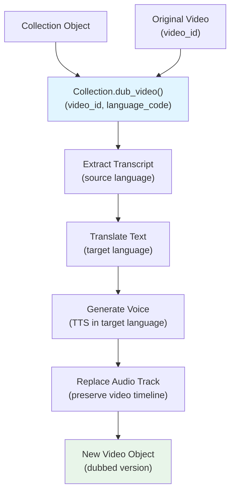
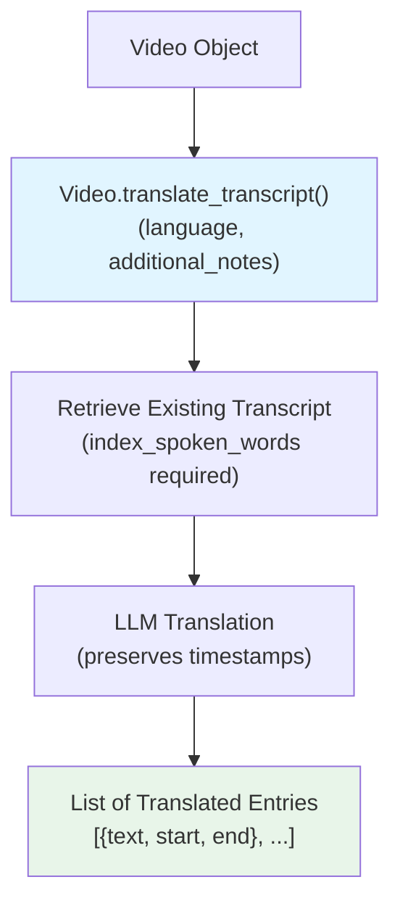
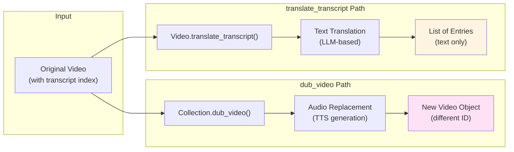
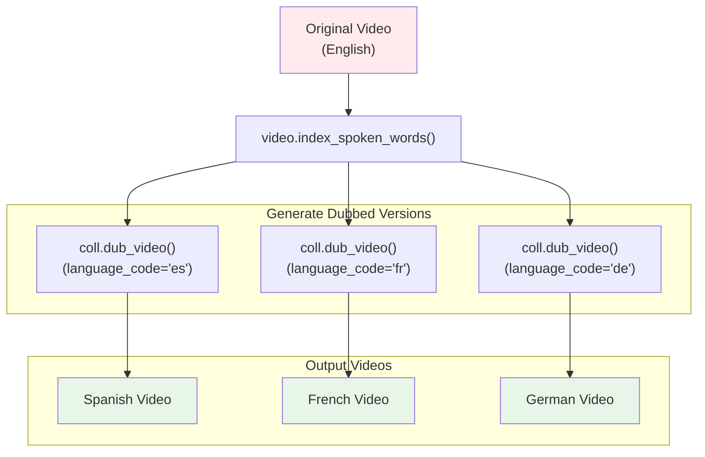
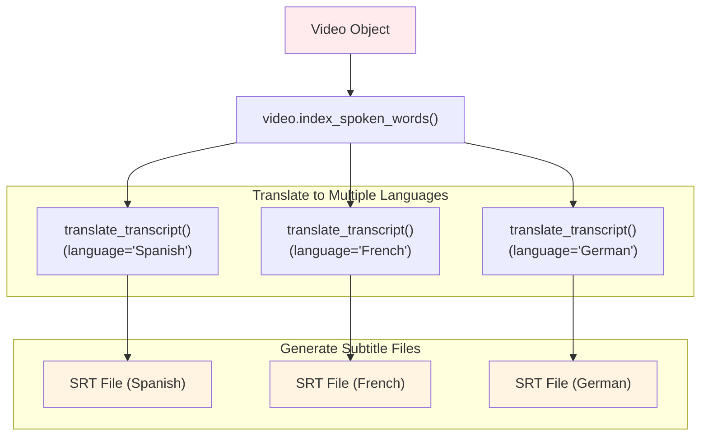
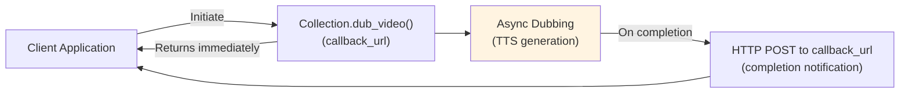

<!-- source: DeepWiki mcp.deepwiki.com · repo video-db/skills · page 11.4 Dubbing and Translation · fetched 2026-10-26 -->

# Dubbing and Translation

<details>
<summary>Relevant source files</summary>

The following files were used as context for generating this wiki page:

- [.gitignore](.gitignore)
- [python/.env.example](python/.env.example)
- [python/reference/generative.md](python/reference/generative.md)

</details>


## Purpose and Scope

This document covers VideoDB's multi-language support capabilities for video content. The system provides two distinct approaches to localization:

1. **Video Dubbing**: Replaces the original audio track with AI-generated speech in the target language
2. **Transcript Translation**: Translates the spoken word transcript to text in the target language without modifying the audio

For general text generation and LLM capabilities, see [Text and LLM](#11.3). For audio generation workflows, see [Audio Generation](#11.2).

---

## Overview

VideoDB provides localization through two methods on different objects:

| Method | Object | Purpose | Output |
|--------|--------|---------|--------|
| `dub_video()` | `Collection` | Full audio replacement | New `Video` object with dubbed audio |
| `translate_transcript()` | `Video` | Text-only translation | List of translated transcript entries |

The choice between these methods depends on whether you need audio replacement or text localization.

**Sources:** [python/reference/generative.md:188-228]()

---

## Video Dubbing

### Method Signature

```python
Collection.dub_video(
    video_id: str,
    language_code: str,
    callback_url: str | None = None
) -> Video
```

The `dub_video()` method is called on a `Collection` object and creates a new `Video` object with the original visual content but replaced audio track in the target language.

**Sources:** [python/reference/generative.md:190-211]()

### Parameters

| Parameter | Type | Required | Description |
|-----------|------|----------|-------------|
| `video_id` | `str` | Yes | ID of the source video to dub |
| `language_code` | `str` | Yes | ISO language code (e.g., `"es"`, `"fr"`, `"de"`) |
| `callback_url` | `str \| None` | No | URL to receive async completion notification |

### Dubbing Workflow



**Dubbing Pipeline Steps:**
1. Extract transcript from original video (requires prior `index_spoken_words()`)
2. Translate transcript text to target language
3. Generate AI voice in target language matching timing
4. Replace audio track while preserving video content
5. Return new `Video` object with dubbed audio

**Sources:** [python/reference/generative.md:190-211]()

### Example Usage

```python
import videodb

conn = videodb.connect()
coll = conn.get_collection()

# Get original video
original_video = coll.get_video("video-123")

# Dub to Spanish
dubbed_video = coll.dub_video(
    video_id=original_video.id,
    language_code="es",
)

# The dubbed video is a new Video object
print(f"Original: {original_video.id}")
print(f"Dubbed: {dubbed_video.id}")

# Play or generate stream
stream_url = dubbed_video.generate_stream()
```

**Important:** The original video must have been indexed with `index_spoken_words()` before dubbing. The system uses the transcript for translation timing.

**Sources:** [python/reference/generative.md:194-201]()

---

## Transcript Translation

### Method Signature

```python
Video.translate_transcript(
    language: str,
    additional_notes: str | None = None
) -> list
```

The `translate_transcript()` method is called on a `Video` object and returns a list of translated transcript entries. Unlike `dub_video()`, this does not create a new video or modify audio—it only translates the text.

**Sources:** [python/reference/generative.md:213-226]()

### Parameters

| Parameter | Type | Required | Description |
|-----------|------|----------|-------------|
| `language` | `str` | Yes | Target language name (e.g., `"Spanish"`, `"French"`) |
| `additional_notes` | `str \| None` | No | Translation instructions (e.g., `"Use formal tone"`) |

**Note:** This method uses language **names** (e.g., `"Spanish"`) while `dub_video()` uses **language codes** (e.g., `"es"`).

### Translation Workflow



**Translation Pipeline Steps:**
1. Retrieve existing transcript from video's index
2. Send transcript entries to LLM translation service
3. Apply `additional_notes` for tone/style guidance
4. Return list of translated entries with preserved timestamps

**Sources:** [python/reference/generative.md:213-226]()

### Example Usage

```python
import videodb

conn = videodb.connect()
coll = conn.get_collection()
video = coll.get_video("video-123")

# Ensure video has been indexed
video.index_spoken_words()

# Translate to Spanish with formal tone
translated = video.translate_transcript(
    language="Spanish",
    additional_notes="Use formal tone for business context",
)

# Print translated entries
for entry in translated:
    print(f"[{entry['start']}-{entry['end']}] {entry['text']}")
```

**Use Case:** Generate subtitle files in multiple languages without creating new video files.

**Sources:** [python/reference/generative.md:217-225]()

---

## Language Support

### Supported Languages

Both `dub_video()` and `translate_transcript()` support the following languages:

| Language | Code (dub_video) | Name (translate_transcript) |
|----------|------------------|------------------------------|
| English | `en` | `English` |
| Spanish | `es` | `Spanish` |
| French | `fr` | `French` |
| German | `de` | `German` |
| Italian | `it` | `Italian` |
| Portuguese | `pt` | `Portuguese` |
| Japanese | `ja` | `Japanese` |
| Korean | `ko` | `Korean` |
| Chinese | `zh` | `Chinese` |
| Hindi | `hi` | `Hindi` |
| Arabic | `ar` | `Arabic` |

**Note:** Additional languages may be supported. Refer to VideoDB documentation for the complete current list.

**Sources:** [python/reference/generative.md:227]()

---

## Method Comparison



### Feature Comparison

| Feature | dub_video() | translate_transcript() |
|---------|-------------|------------------------|
| **Object** | `Collection` | `Video` |
| **Output Type** | New `Video` object | List of transcript entries |
| **Audio Modified** | Yes (replaced) | No |
| **Creates New Asset** | Yes | No |
| **Use Case** | Full localization | Subtitle generation |
| **Language Parameter** | Code (`"es"`) | Name (`"Spanish"`) |
| **Async Support** | Yes (callback_url) | No |
| **Cost** | Higher (TTS + storage) | Lower (text only) |

**Sources:** [python/reference/generative.md:188-228]()

---

## Common Workflows

### Workflow 1: Multi-Language Video Distribution



**Code Example:**

```python
import videodb

conn = videodb.connect()
coll = conn.get_collection()

# Upload and index original video
original = coll.upload(url="https://example.com/video.mp4")
original.index_spoken_words()

# Create dubbed versions for multiple languages
languages = {
    "es": "Spanish",
    "fr": "French", 
    "de": "German",
    "ja": "Japanese",
}

dubbed_versions = {}
for code, name in languages.items():
    dubbed = coll.dub_video(
        video_id=original.id,
        language_code=code,
    )
    dubbed_versions[name] = dubbed
    print(f"{name}: {dubbed.generate_stream()}")
```

**Sources:** [python/reference/generative.md:194-201]()

### Workflow 2: Multi-Language Subtitles



**Code Example:**

```python
def generate_srt(entries, output_file):
    """Convert transcript entries to SRT subtitle format."""
    with open(output_file, 'w', encoding='utf-8') as f:
        for i, entry in enumerate(entries, 1):
            start = entry['start']
            end = entry['end']
            text = entry['text']
            
            # Format timestamps as SRT requires
            f.write(f"{i}\n")
            f.write(f"{format_srt_time(start)} --> {format_srt_time(end)}\n")
            f.write(f"{text}\n\n")

# Generate subtitles in multiple languages
languages = ["Spanish", "French", "German", "Japanese"]

for lang in languages:
    translated = video.translate_transcript(
        language=lang,
        additional_notes="Use neutral, professional tone",
    )
    
    output_file = f"subtitles_{lang.lower()}.srt"
    generate_srt(translated, output_file)
    print(f"Generated {output_file}")
```

**Sources:** [python/reference/generative.md:217-225]()

### Workflow 3: Dubbing with Custom Subtitles

Combine `dub_video()` with subtitle overlay for videos where viewers may want both dubbed audio and on-screen text:

```python
import videodb
from videodb.timeline import Timeline
from videodb.asset import VideoAsset

conn = videodb.connect()
coll = conn.get_collection()
video = coll.get_video("video-123")

# Index original
video.index_spoken_words()

# Create dubbed version
dubbed = coll.dub_video(
    video_id=video.id,
    language_code="es",
)

# Add subtitles in same language
dubbed.add_subtitle(language_code="es")

# Generate final stream
stream_url = dubbed.generate_stream()
```

**Sources:** [python/reference/generative.md:194-201]()

---

## Asynchronous Processing

### Using Callbacks with dub_video()

Video dubbing is a long-running operation. Use `callback_url` for async notification:



**Code Example:**

```python
# Initiate dubbing with callback
dubbed = coll.dub_video(
    video_id="video-123",
    language_code="es",
    callback_url="https://your-app.com/webhooks/dubbing",
)

# dubbed is returned immediately but may not be ready
print(f"Dubbing initiated: {dubbed.id}")

# Your webhook handler receives POST when complete:
# {
#   "status": "completed",
#   "video_id": "dubbed-video-id",
#   "language_code": "es"
# }
```

**Note:** `translate_transcript()` does **not** support async callbacks as it completes faster and returns results synchronously.

**Sources:** [python/reference/generative.md:209]()

---

## Prerequisites and Requirements

### Transcript Index Required

Both methods require the source video to have a transcript index:

```python
# Index before dubbing or translating
video.index_spoken_words()

# Wait for indexing to complete (or use callback)
# Then proceed with dubbing/translation
```

Without a transcript index, both methods will fail.

### Language Detection

The system automatically detects the source language from the indexed transcript. You only specify the **target** language:

```python
# System detects original language automatically
dubbed = coll.dub_video(
    video_id=video.id,
    language_code="es",  # Target only
)
```

**Sources:** [python/reference/generative.md:190-228]()

---

## Limitations and Best Practices

### Limitations

| Limitation | Impact | Workaround |
|------------|--------|------------|
| **Transcript required** | Cannot dub videos without speech | Use `index_spoken_words()` first |
| **Voice matching** | Dubbed voice may not match original speaker | No current workaround |
| **Timing alignment** | Long translations may not fit timing slots | Consider transcript translation only |
| **Background audio** | Music/SFX are replaced during dubbing | Use timeline editor to remix audio |
| **Multiple speakers** | Single voice used for all speakers | No current workaround |

### Best Practices

1. **Index first**: Always call `index_spoken_words()` before dubbing or translating
2. **Use callbacks**: For dubbing, implement `callback_url` to avoid polling
3. **Choose method wisely**: 
   - Use `dub_video()` for full localization needs
   - Use `translate_transcript()` for subtitle generation
4. **Test language codes**: Verify language code format before batch operations
5. **Preserve originals**: `dub_video()` creates new videos—original is unchanged
6. **Additional notes**: Use `additional_notes` in `translate_transcript()` for tone/context

### Performance Considerations

- **Dubbing duration**: Proportional to video length (expect 1-2x realtime)
- **Translation speed**: Text-only translation is significantly faster
- **Storage impact**: Each dubbed version creates a new video asset
- **Cost implications**: Dubbing incurs TTS + storage costs per language

**Sources:** [python/reference/generative.md:188-228]()

---

## Integration with Other Systems

### Timeline Editing

Dubbed videos are standard `Video` objects and can be used in timelines:

```python
from videodb.timeline import Timeline
from videodb.asset import VideoAsset

# Create dubbed version
dubbed_es = coll.dub_video(video_id=video.id, language_code="es")

# Use in timeline
timeline = Timeline(conn)
timeline.add_inline(VideoAsset(asset_id=dubbed_es.id))
stream_url = timeline.generate_stream()
```

See [Timeline Basics](#7.1) for timeline composition details.

### Search and Indexing

Dubbed videos can be indexed and searched independently:

```python
# Index dubbed version
dubbed_es.index_spoken_words(language_code="es")

# Search in Spanish
results = dubbed_es.search(query="producto nuevo", search_type="keyword")
```

See [Searching Videos](#6) for search capabilities.

**Sources:** [python/reference/generative.md:188-228]()

---

## Sources Summary

All content in this document is derived from:
- [python/reference/generative.md:188-228]()

---

