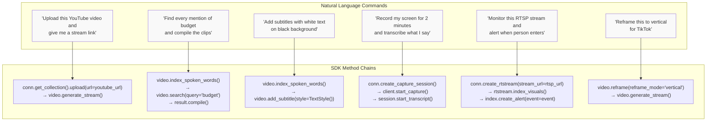
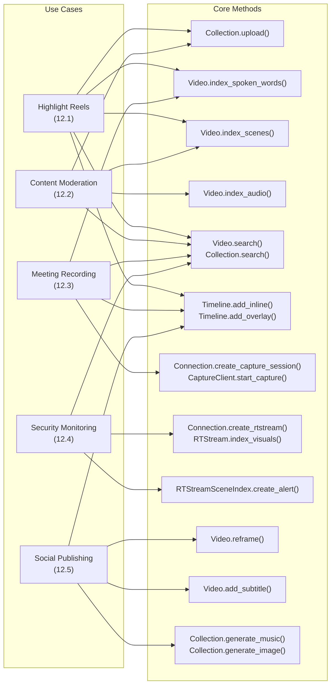

<!-- source: DeepWiki mcp.deepwiki.com · repo video-db/skills · page 12 Common Use Cases · fetched 2026-10-26 -->

# Common Use Cases

<details>
<summary>Relevant source files</summary>

The following files were used as context for generating this wiki page:

- [README.md](README.md)
- [python/reference/use-cases.md](python/reference/use-cases.md)

</details>


This page provides an overview of common VideoDB workflows and how different capabilities combine to solve real-world problems. Each use case demonstrates the See → Understand → Act paradigm applied to specific applications.

For detailed implementation guides, see:
- [Highlight Reels and Clips](#12.1)
- [Content Moderation](#12.2)
- [Meeting Recording and Analysis](#12.3)
- [Security and Monitoring](#12.4)
- [Social Media Publishing](#12.5)

For API details on individual capabilities, refer to:
- Media management: [Uploading Media](#4.1), [Collections](#4.2)
- Understanding content: [Video Understanding and Indexing](#5)
- Finding moments: [Searching Videos](#6)
- Composing output: [Timeline Editing](#7)
- Real-time processing: [Desktop Capture](#8), [Live Stream Processing](#9)

**Sources:** [README.md:1-144](), [python/reference/use-cases.md:1-119]()

---

## Workflow Patterns

VideoDB use cases share common patterns built on the platform's server-side processing architecture. All workflows follow a three-stage pipeline:

| Stage | Operations | SDK Objects |
|-------|-----------|-------------|
| **See** | Upload files, YouTube URLs, local media<br/>Desktop capture with `CaptureClient`<br/>RTSP/RTMP stream ingestion | `Collection.upload()`<br/>`Connection.create_capture_session()`<br/>`Connection.create_rtstream()` |
| **Understand** | Transcribe audio to text<br/>Index visual scenes<br/>Analyze audio content<br/>Extract metadata | `Video.index_spoken_words()`<br/>`Video.index_scenes()`<br/>`Video.index_audio()`<br/>`RTStream.index_visuals()` |
| **Act** | Search and extract clips<br/>Compose timelines<br/>Generate AI media<br/>Reframe for platforms<br/>Stream results | `Video.search()`<br/>`Timeline.add_inline()`<br/>`Collection.generate_*()`<br/>`Video.reframe()`<br/>`Video.generate_stream()` |

The power of these patterns lies in their composability. A single video can be indexed once, then searched multiple times with different queries, with each search result compiled into a different highlight reel.

**Sources:** [README.md:20-44](), [python/reference/use-cases.md:108-119]()

---

## Natural Language Commands to SDK Operations

The following diagram maps common natural language instructions to their underlying SDK method chains. This illustrates how AI agents translate conversational requests into concrete API calls.

**Natural Language to Code Entity Mapping**



Each natural language instruction maps to a specific sequence of method calls on SDK objects. The AI agent's role is to:
1. Parse the user's intent
2. Identify the appropriate SDK objects (`Connection`, `Collection`, `Video`, `CaptureSession`, `RTStream`)
3. Chain method calls in the correct order
4. Pass appropriate parameters based on context

**Sources:** [README.md:87-98](), [python/reference/use-cases.md:1-119]()

---

## Use Case to Core API Mapping

Different use cases leverage different combinations of SDK capabilities. The diagram below shows which primary API methods each use case category relies on.

**Use Case Implementation Pathways**



This mapping reveals several patterns:

- **Content analysis workflows** (UC1, UC2) heavily use indexing and search methods
- **Real-time workflows** (UC3, UC4) use capture/stream objects with live processing
- **Publishing workflows** (UC5) focus on transformation methods (reframe, subtitle, timeline)
- **Timeline composition** appears in multiple use cases as the final assembly step

**Sources:** [python/reference/use-cases.md:1-119]()

---

## Quick Reference: Use Cases and Their Methods

| Use Case | Primary Objects | Key Methods | Output |
|----------|----------------|-------------|--------|
| **Highlight Reels** | `Video`, `SearchResult`, `Timeline` | `index_spoken_words()`, `search()`, `compile()` | Stream URL with compiled clips |
| **Content Moderation** | `Video`, `SearchResult` | `index_scenes()`, `index_audio()`, `search()` | Flagged timestamps, search scores |
| **Meeting Recording** | `CaptureSession`, `CaptureClient`, `Video` | `create_capture_session()`, `start_transcript()`, `export_session()` | Recorded video + transcript |
| **Security Monitoring** | `RTStream`, `RTStreamSceneIndex`, `Alert` | `create_rtstream()`, `index_visuals()`, `create_alert()` | Real-time events via WebSocket |
| **Social Publishing** | `Video`, `Timeline`, `TextAsset` | `reframe()`, `add_subtitle()`, `generate_stream()` | Platform-optimized streams |

Each use case follows a consistent pattern:
1. Ingest media via `upload()`, capture session, or RTStream
2. Apply AI indexing to understand content
3. Execute operations (search, edit, generate) based on understanding
4. Return stream URLs for immediate playback

**Sources:** [python/reference/use-cases.md:108-119]()

---

## Cross-Cutting Capabilities

Several capabilities appear across multiple use cases:

### Stream URL Generation
Every VideoDB operation produces a playable HLS stream URL via `generate_stream()` or `compile()`. This enables:
- Instant playback without local rendering or downloads
- Embedding in web players
- Sharing via CDN-backed URLs
- On-demand compilation (streams are generated when requested)

### Server-Side Processing
All operations run on VideoDB infrastructure:
- No ffmpeg installation required on client
- Consistent results regardless of client platform
- Scalable processing for large media files
- Real-time operations without client resource constraints

### Indexing-Search-Extract Pattern
Most use cases follow this sequence:
1. **Index** content with `index_spoken_words()`, `index_scenes()`, or `index_audio()`
2. **Search** indexed content with `search(query=...)`
3. **Extract** results as clips via `compile()` or timeline composition

This pattern applies to both batch videos and real-time streams.

### Real-Time Event Delivery
Capture sessions and RTStream processing use WebSocket-based event delivery:
- Events logged to JSONL files via `ws_listener.py`
- Live transcripts, visual descriptions, audio analysis
- Custom alerts for detected events
- Asynchronous processing with event-driven updates

For detailed event handling, see [Capture Events](#8.3) and [Events and Alerts](#9.3).

**Sources:** [README.md:102-129](), [python/reference/use-cases.md:1-119]()

---

## Combining Capabilities

Complex workflows often combine multiple capabilities in sequence:

### Example: Enhanced Highlight Reel
```
1. Upload video → Collection.upload()
2. Index content → video.index_spoken_words(), video.index_scenes()
3. Search for moments → video.search(query="key points")
4. Generate background music → coll.generate_music(duration=result_duration)
5. Compose timeline → Timeline.add_inline(VideoAsset), Timeline.add_overlay(AudioAsset)
6. Add subtitles → timeline.add_subtitle()
7. Generate final stream → timeline.generate_stream()
```

### Example: Monitored Live Stream
```
1. Connect stream → Connection.create_rtstream(stream_url=rtsp_url)
2. Start visual indexing → rtstream.index_visuals(prompt="person detection")
3. Create event → event = Event(prompt="person entering frame")
4. Set up alert → scene_index.create_alert(event=event, callback_url=webhook)
5. Monitor events → ws_listener.py captures real-time alerts
6. Search history → rtstream.search(namespace=scene_index_id, query="person")
7. Export clips → Compile search results for incident review
```

These examples demonstrate how individual SDK methods compose into complete workflows. The modularity allows flexible combinations based on specific requirements.

**Sources:** [python/reference/use-cases.md:20-61]()

---

## When to Use Which Approach

The choice between different VideoDB capabilities depends on the use case requirements:

| Requirement | Recommended Approach | Relevant Section |
|-------------|---------------------|------------------|
| Process existing video files | `Collection.upload()` → index → search | [Uploading Media](#4.1) |
| Record screen activity with AI | `create_capture_session()` → `CaptureClient` | [Desktop Capture](#8) |
| Monitor live camera feeds | `create_rtstream()` → `index_visuals()` | [Live Stream Processing](#9) |
| Find specific moments | `index_spoken_words()` or `index_scenes()` → `search()` | [Searching Videos](#6) |
| Combine multiple clips | `Timeline` with multiple `VideoAsset` objects | [Timeline Editing](#7) |
| Create platform-specific formats | `reframe()` with target aspect ratio | [Reframing](#10.2) |
| Add AI-generated elements | `generate_music()`, `generate_image()`, etc. | [AI Media Generation](#11) |
| Real-time alerts on events | `RTStream` → `create_alert()` → WebSocket | [Events and Alerts](#9.3) |

The platform's server-side architecture means all these approaches work consistently regardless of client environment, with results always delivered as stream URLs.

**Sources:** [README.md:107-125](), [python/reference/use-cases.md:1-119]()

---

For complete implementation details and code examples for each use case, refer to the subsections:
- [Highlight Reels and Clips](#12.1)
- [Content Moderation](#12.2)
- [Meeting Recording and Analysis](#12.3)
- [Security and Monitoring](#12.4)
- [Social Media Publishing](#12.5)

---

